# Compose performance

Latest: `4dd19ad6b0dbb5e3c314a6e20325edf35fb935da` on 2026-10-26T102844Z, measured on the CI Ubuntu runner by the paired performance shards.
Each value is the median of the candidate arm's samples; p95 is shown beside it. Change compares the previous main commit.

| Benchmark | Median | p95 | Change |
| --- | --- | --- | --- |
| animate-many/bare | 972.2 µs | 998.0 µs | -42.2% |
| animate-many/compose | 4.13 ms | 4.30 ms | -55.6% |
| animate-many/memory/mounted | 2399 KiB | 2399 KiB | +0.0% |
| animate-many/memory/teardown | 0 KiB | 0 KiB | — |
| animated-navigation.extreme/bare/burst | 761.1 µs | 773.2 µs | -46.2% |
| animated-navigation.extreme/bare/cold | 3.24 ms | 6.33 ms | -43.4% |
| animated-navigation.extreme/bare/settle | 0.4 µs | 0.6 µs | -41.6% |
| animated-navigation.extreme/bare/steady | 9.66 ms | 10.25 ms | -48.9% |
| animated-navigation.extreme/bare/teardown | 2.42 ms | 2.98 ms | -29.2% |
| animated-navigation.extreme/compose/burst | 5.76 ms | 6.38 ms | -47.2% |
| animated-navigation.extreme/compose/cold | 7.47 ms | 13.63 ms | -45.5% |
| animated-navigation.extreme/compose/counts | 58.69 ms | 58.69 ms | -43.0% |
| animated-navigation.extreme/compose/settle | 0.7 µs | 1.0 µs | -33.4% |
| animated-navigation.extreme/compose/steady | 21.15 ms | 22.46 ms | -49.6% |
| animated-navigation.extreme/compose/teardown | 3.69 ms | 4.88 ms | -40.6% |
| animated-navigation.extreme/memory/mounted | 7527 KiB | 7527 KiB | -0.2% |
| animated-navigation.extreme/memory/teardown | 0 KiB | 0 KiB | -100.0% |
| animated-navigation.large/bare/burst | 347.1 µs | 384.4 µs | -49.7% |
| animated-navigation.large/bare/cold | 1.46 ms | 3.29 ms | -17.5% |
| animated-navigation.large/bare/settle | 0.3 µs | 0.4 µs | -45.7% |
| animated-navigation.large/bare/steady | 4.71 ms | 4.82 ms | -46.8% |
| animated-navigation.large/bare/teardown | 713.4 µs | 886.8 µs | -35.8% |
| animated-navigation.large/compose/burst | 2.87 ms | 3.02 ms | -43.8% |
| animated-navigation.large/compose/cold | 4.27 ms | 6.97 ms | -31.0% |
| animated-navigation.large/compose/counts | 46.89 ms | 46.89 ms | -38.3% |
| animated-navigation.large/compose/settle | 1.0 µs | 2.2 µs | +30.7% |
| animated-navigation.large/compose/steady | 17.23 ms | 18.23 ms | -47.7% |
| animated-navigation.large/compose/teardown | 1.67 ms | 2.03 ms | -19.4% |
| animated-navigation.large/memory/mounted | 3793 KiB | 3793 KiB | +0.0% |
| animated-navigation.large/memory/teardown | 8 KiB | 8 KiB | +700.0% |
| animated-navigation.medium/bare/burst | 224.1 µs | 239.7 µs | -7.7% |
| animated-navigation.medium/bare/cold | 514.2 µs | 1.12 ms | +8.2% |
| animated-navigation.medium/bare/settle | 0.5 µs | 0.5 µs | +15.3% |
| animated-navigation.medium/bare/steady | 2.63 ms | 2.77 ms | +1.1% |
| animated-navigation.medium/bare/teardown | 186.8 µs | 262.0 µs | -0.6% |
| animated-navigation.medium/compose/burst | 1.72 ms | 1.81 ms | +0.5% |
| animated-navigation.medium/compose/cold | 1.51 ms | 2.69 ms | +3.9% |
| animated-navigation.medium/compose/counts | 28.22 ms | 28.22 ms | +2.5% |
| animated-navigation.medium/compose/settle | 0.6 µs | 0.6 µs | +1.8% |
| animated-navigation.medium/compose/steady | 13.41 ms | 13.92 ms | -0.4% |
| animated-navigation.medium/compose/teardown | 418.6 µs | 548.9 µs | -0.6% |
| animated-navigation.medium/memory/mounted | 1282 KiB | 1282 KiB | +0.0% |
| animated-navigation.medium/memory/teardown | 0 KiB | 0 KiB | — |
| branch-swap/bare | 2.81 ms | 4.21 ms | +20.7% |
| branch-swap/compose | 2.52 ms | 6.36 ms | -3.4% |
| branch-swap/memory/mounted | 35 KiB | 35 KiB | +0.0% |
| branch-swap/memory/teardown | 0 KiB | 0 KiB | -100.0% |
| cold-mount-100/bare | 467.1 µs | 905.3 µs | -28.6% |
| cold-mount-100/compose | 322.8 µs | 768.5 µs | -45.2% |
| cold-mount-100/memory/mounted | 2240 KiB | 2240 KiB | +0.4% |
| cold-mount-100/memory/teardown | 1 KiB | 1 KiB | — |
| cold-mount-1000/bare | 5.75 ms | 9.61 ms | -5.3% |
| cold-mount-1000/compose | 5.96 ms | 9.08 ms | -1.3% |
| cold-mount-1000/memory/mounted | 21906 KiB | 21906 KiB | +0.0% |
| cold-mount-1000/memory/teardown | 0 KiB | 0 KiB | — |
| cold-mount-10000/bare | 39.81 ms | 74.77 ms | -46.0% |
| cold-mount-10000/compose | 86.94 ms | 87.55 ms | -13.9% |
| cold-mount-10000/memory/mounted | 220006 KiB | 220006 KiB | +0.0% |
| cold-mount-10000/memory/teardown | 1 KiB | 1 KiB | — |
| data-grid.extreme/bare/burst | 813.94 ms | 867.74 ms | +8.8% |
| data-grid.extreme/bare/cold | 534.76 ms | 553.69 ms | +12.4% |
| data-grid.extreme/bare/settle | 2.8 µs | 3.1 µs | +4.9% |
| data-grid.extreme/bare/steady | 19.10 ms | 26.40 ms | +6.9% |
| data-grid.extreme/bare/teardown | 552.1 µs | 2.78 ms | +10.8% |
| data-grid.extreme/compose/burst | 921.51 ms | 973.54 ms | +7.8% |
| data-grid.extreme/compose/cold | 560.37 ms | 621.70 ms | +11.1% |
| data-grid.extreme/compose/counts | 1520.20 ms | 1520.20 ms | +5.2% |
| data-grid.extreme/compose/settle | 2.0 µs | 2.9 µs | -5.3% |
| data-grid.extreme/compose/steady | 25.59 ms | 29.16 ms | +5.7% |
| data-grid.extreme/compose/teardown | 1.39 ms | 2.35 ms | -6.7% |
| data-grid.extreme/memory/mounted | 33055 KiB | 33055 KiB | +0.0% |
| data-grid.extreme/memory/teardown | 1 KiB | 1 KiB | +0.0% |
| data-grid.large/bare/burst | 115.03 ms | 116.22 ms | +0.7% |
| data-grid.large/bare/cold | 72.51 ms | 74.23 ms | +2.0% |
| data-grid.large/bare/settle | 1.1 µs | 1.4 µs | -7.5% |
| data-grid.large/bare/steady | 10.82 ms | 12.96 ms | +10.9% |
| data-grid.large/bare/teardown | 173.9 µs | 203.7 µs | -8.4% |
| data-grid.large/compose/burst | 131.39 ms | 151.52 ms | -1.0% |
| data-grid.large/compose/cold | 77.50 ms | 81.37 ms | -0.3% |
| data-grid.large/compose/counts | 244.14 ms | 244.14 ms | -0.3% |
| data-grid.large/compose/settle | 1.4 µs | 1.8 µs | -0.7% |
| data-grid.large/compose/steady | 16.63 ms | 23.83 ms | +4.1% |
| data-grid.large/compose/teardown | 516.9 µs | 941.0 µs | -6.6% |
| data-grid.large/memory/mounted | 7474 KiB | 7474 KiB | +0.0% |
| data-grid.large/memory/teardown | 1 KiB | 1 KiB | +0.0% |
| data-grid.medium/bare/burst | 40.95 ms | 45.28 ms | -0.3% |
| data-grid.medium/bare/cold | 25.69 ms | 27.01 ms | +1.9% |
| data-grid.medium/bare/settle | 2.2 µs | 3.6 µs | -19.5% |
| data-grid.medium/bare/steady | 6.28 ms | 8.19 ms | -13.7% |
| data-grid.medium/bare/teardown | 82.7 µs | 210.8 µs | -1.3% |
| data-grid.medium/compose/burst | 50.98 ms | 54.49 ms | +5.3% |
| data-grid.medium/compose/cold | 27.68 ms | 35.66 ms | -4.0% |
| data-grid.medium/compose/counts | 104.36 ms | 104.36 ms | -3.3% |
| data-grid.medium/compose/settle | 2.0 µs | 2.4 µs | -9.6% |
| data-grid.medium/compose/steady | 10.47 ms | 14.36 ms | -18.5% |
| data-grid.medium/compose/teardown | 258.1 µs | 446.3 µs | -0.8% |
| data-grid.medium/memory/mounted | 3935 KiB | 3935 KiB | +0.2% |
| data-grid.medium/memory/teardown | 1 KiB | 1 KiB | — |
| dense-dashboard.extreme/bare/burst | 5.16 ms | 10.14 ms | -20.9% |
| dense-dashboard.extreme/bare/cold | 283.6 µs | 1.07 ms | +27.7% |
| dense-dashboard.extreme/bare/settle | 0.6 µs | 1.1 µs | -27.6% |
| dense-dashboard.extreme/bare/steady | 109.8 µs | 167.5 µs | +0.3% |
| dense-dashboard.extreme/bare/teardown | 180.6 µs | 408.2 µs | -7.1% |
| dense-dashboard.extreme/compose/burst | 14.24 ms | 16.73 ms | -7.3% |
| dense-dashboard.extreme/compose/cold | 460.9 µs | 2.12 ms | -8.2% |
| dense-dashboard.extreme/compose/counts | 19.60 ms | 19.60 ms | -10.0% |
| dense-dashboard.extreme/compose/settle | 0.9 µs | 1.2 µs | -34.3% |
| dense-dashboard.extreme/compose/steady | 700.6 µs | 710.7 µs | -1.2% |
| dense-dashboard.extreme/compose/teardown | 477.4 µs | 837.2 µs | -15.7% |
| dense-dashboard.extreme/memory/mounted | 1250 KiB | 1250 KiB | +0.0% |
| dense-dashboard.extreme/memory/teardown | 0 KiB | 0 KiB | — |
| dense-dashboard.large/bare/burst | 2.30 ms | 4.28 ms | -24.5% |
| dense-dashboard.large/bare/cold | 104.6 µs | 367.6 µs | -11.4% |
| dense-dashboard.large/bare/settle | 0.6 µs | 0.9 µs | -6.6% |
| dense-dashboard.large/bare/steady | 107.4 µs | 123.0 µs | -1.5% |
| dense-dashboard.large/bare/teardown | 81.4 µs | 140.9 µs | +2.3% |
| dense-dashboard.large/compose/burst | 5.26 ms | 9.63 ms | -32.7% |
| dense-dashboard.large/compose/cold | 241.0 µs | 320.7 µs | -21.2% |
| dense-dashboard.large/compose/counts | 13.21 ms | 13.21 ms | -3.5% |
| dense-dashboard.large/compose/settle | 0.7 µs | 1.0 µs | -31.0% |
| dense-dashboard.large/compose/steady | 687.8 µs | 735.4 µs | -0.4% |
| dense-dashboard.large/compose/teardown | 203.9 µs | 236.6 µs | -12.8% |
| dense-dashboard.large/memory/mounted | 657 KiB | 657 KiB | +0.0% |
| dense-dashboard.large/memory/teardown | 0 KiB | 0 KiB | — |
| dense-dashboard.medium/bare/burst | 1.10 ms | 2.32 ms | +0.4% |
| dense-dashboard.medium/bare/cold | 74.4 µs | 174.0 µs | +1.2% |
| dense-dashboard.medium/bare/settle | 0.5 µs | 1.0 µs | -31.6% |
| dense-dashboard.medium/bare/steady | 77.3 µs | 103.0 µs | -3.6% |
| dense-dashboard.medium/bare/teardown | 34.8 µs | 65.0 µs | -2.6% |
| dense-dashboard.medium/compose/burst | 2.21 ms | 3.77 ms | +28.2% |
| dense-dashboard.medium/compose/cold | 169.7 µs | 253.4 µs | +7.1% |
| dense-dashboard.medium/compose/counts | 4.00 ms | 4.00 ms | +11.4% |
| dense-dashboard.medium/compose/settle | 0.6 µs | 1.0 µs | -37.2% |
| dense-dashboard.medium/compose/steady | 446.8 µs | 462.6 µs | -0.5% |
| dense-dashboard.medium/compose/teardown | 89.7 µs | 130.2 µs | +13.4% |
| dense-dashboard.medium/memory/mounted | 328 KiB | 328 KiB | -0.3% |
| dense-dashboard.medium/memory/teardown | 0 KiB | 0 KiB | -100.0% |
| entities-identity-churn-10.extreme/bare/burst | 14.39 ms | 18.41 ms | +0.4% |
| entities-identity-churn-10.extreme/bare/cold | 6.40 ms | 15.81 ms | -5.6% |
| entities-identity-churn-10.extreme/bare/settle | 2.7 µs | 3.3 µs | +25.7% |
| entities-identity-churn-10.extreme/bare/steady | 21.05 ms | 28.97 ms | -27.8% |
| entities-identity-churn-10.extreme/bare/teardown | 340.5 µs | 441.6 µs | -4.1% |
| entities-identity-churn-10.extreme/compose/burst | 39.98 ms | 44.45 ms | -1.7% |
| entities-identity-churn-10.extreme/compose/cold | 29.28 ms | 38.10 ms | +30.9% |
| entities-identity-churn-10.extreme/compose/counts | 184.02 ms | 184.02 ms | +0.9% |
| entities-identity-churn-10.extreme/compose/settle | 2.5 µs | 3.8 µs | +5.5% |
| entities-identity-churn-10.extreme/compose/steady | 46.76 ms | 54.01 ms | -8.8% |
| entities-identity-churn-10.extreme/compose/teardown | 1.15 ms | 1.48 ms | +28.1% |
| entities-identity-churn-10.extreme/memory/mounted | 4382 KiB | 4382 KiB | -0.4% |
| entities-identity-churn-10.extreme/memory/teardown | 0 KiB | 0 KiB | -100.0% |
| entities-identity-churn-10.large/bare/burst | 5.45 ms | 8.08 ms | +28.4% |
| entities-identity-churn-10.large/bare/cold | 2.36 ms | 4.15 ms | -36.5% |
| entities-identity-churn-10.large/bare/settle | 0.9 µs | 1.5 µs | -18.8% |
| entities-identity-churn-10.large/bare/steady | 8.50 ms | 10.53 ms | +0.4% |
| entities-identity-churn-10.large/bare/teardown | 96.6 µs | 251.3 µs | -9.7% |
| entities-identity-churn-10.large/compose/burst | 13.81 ms | 20.20 ms | -6.1% |
| entities-identity-churn-10.large/compose/cold | 10.60 ms | 16.95 ms | +19.0% |
| entities-identity-churn-10.large/compose/counts | 58.30 ms | 58.30 ms | -10.4% |
| entities-identity-churn-10.large/compose/settle | 1.6 µs | 2.2 µs | -11.8% |
| entities-identity-churn-10.large/compose/steady | 16.99 ms | 21.90 ms | +0.1% |
| entities-identity-churn-10.large/compose/teardown | 351.5 µs | 545.3 µs | -4.5% |
| entities-identity-churn-10.large/memory/mounted | 1757 KiB | 1757 KiB | +3.2% |
| entities-identity-churn-10.large/memory/teardown | 1 KiB | 1 KiB | — |
| entities-identity-churn-10.medium/bare/burst | 1.31 ms | 3.18 ms | -37.1% |
| entities-identity-churn-10.medium/bare/cold | 1.07 ms | 1.91 ms | -17.8% |
| entities-identity-churn-10.medium/bare/settle | 0.5 µs | 1.3 µs | -26.7% |
| entities-identity-churn-10.medium/bare/steady | 2.74 ms | 3.45 ms | -49.0% |
| entities-identity-churn-10.medium/bare/teardown | 46.8 µs | 70.2 µs | -11.0% |
| entities-identity-churn-10.medium/compose/burst | 3.90 ms | 6.18 ms | -39.5% |
| entities-identity-churn-10.medium/compose/cold | 2.91 ms | 4.85 ms | -49.3% |
| entities-identity-churn-10.medium/compose/counts | 18.38 ms | 18.38 ms | -42.0% |
| entities-identity-churn-10.medium/compose/settle | 0.6 µs | 0.7 µs | -29.0% |
| entities-identity-churn-10.medium/compose/steady | 4.76 ms | 6.16 ms | -46.8% |
| entities-identity-churn-10.medium/compose/teardown | 110.8 µs | 191.7 µs | -38.9% |
| entities-identity-churn-10.medium/memory/mounted | 911 KiB | 911 KiB | -1.1% |
| entities-identity-churn-10.medium/memory/teardown | 0 KiB | 0 KiB | -100.0% |
| entities-identity-churn-50.extreme/bare/burst | 16.60 ms | 19.58 ms | +13.1% |
| entities-identity-churn-50.extreme/bare/cold | 6.90 ms | 13.97 ms | -5.5% |
| entities-identity-churn-50.extreme/bare/settle | 1.6 µs | 2.3 µs | +5.3% |
| entities-identity-churn-50.extreme/bare/steady | 58.86 ms | 78.18 ms | -8.3% |
| entities-identity-churn-50.extreme/bare/teardown | 357.3 µs | 541.7 µs | -5.0% |
| entities-identity-churn-50.extreme/compose/burst | 38.82 ms | 61.02 ms | -12.8% |
| entities-identity-churn-50.extreme/compose/cold | 25.96 ms | 43.64 ms | -19.8% |
| entities-identity-churn-50.extreme/compose/counts | 329.14 ms | 329.14 ms | +2.6% |
| entities-identity-churn-50.extreme/compose/settle | 1.8 µs | 2.2 µs | -2.1% |
| entities-identity-churn-50.extreme/compose/steady | 182.75 ms | 198.30 ms | +11.7% |
| entities-identity-churn-50.extreme/compose/teardown | 1.06 ms | 1.85 ms | +0.4% |
| entities-identity-churn-50.extreme/memory/mounted | 4356 KiB | 4356 KiB | -0.2% |
| entities-identity-churn-50.extreme/memory/teardown | 1 KiB | 1 KiB | -88.9% |
| entities-identity-churn-50.large/bare/burst | 5.23 ms | 10.01 ms | +34.6% |
| entities-identity-churn-50.large/bare/cold | 2.38 ms | 4.97 ms | -23.6% |
| entities-identity-churn-50.large/bare/settle | 2.2 µs | 2.8 µs | +97.7% |
| entities-identity-churn-50.large/bare/steady | 16.78 ms | 21.39 ms | -9.4% |
| entities-identity-churn-50.large/bare/teardown | 115.9 µs | 253.6 µs | +21.9% |
| entities-identity-churn-50.large/compose/burst | 14.06 ms | 21.16 ms | +18.0% |
| entities-identity-churn-50.large/compose/cold | 11.71 ms | 20.61 ms | +32.6% |
| entities-identity-churn-50.large/compose/counts | 95.28 ms | 95.28 ms | +5.8% |
| entities-identity-churn-50.large/compose/settle | 2.2 µs | 3.1 µs | +48.2% |
| entities-identity-churn-50.large/compose/steady | 47.53 ms | 64.72 ms | -7.6% |
| entities-identity-churn-50.large/compose/teardown | 369.3 µs | 530.4 µs | +16.2% |
| entities-identity-churn-50.large/memory/mounted | 1808 KiB | 1808 KiB | -0.7% |
| entities-identity-churn-50.large/memory/teardown | 1 KiB | 1 KiB | -92.3% |
| entities-identity-churn-50.medium/bare/burst | 2.69 ms | 4.18 ms | -16.0% |
| entities-identity-churn-50.medium/bare/cold | 1.47 ms | 4.68 ms | +17.5% |
| entities-identity-churn-50.medium/bare/settle | 0.8 µs | 0.9 µs | +4.2% |
| entities-identity-churn-50.medium/bare/steady | 10.36 ms | 13.03 ms | -0.6% |
| entities-identity-churn-50.medium/bare/teardown | 67.5 µs | 87.0 µs | +1.5% |
| entities-identity-churn-50.medium/compose/burst | 8.35 ms | 14.46 ms | -10.8% |
| entities-identity-churn-50.medium/compose/cold | 5.90 ms | 9.51 ms | +26.4% |
| entities-identity-churn-50.medium/compose/counts | 63.39 ms | 63.39 ms | +5.8% |
| entities-identity-churn-50.medium/compose/settle | 0.9 µs | 1.8 µs | -3.2% |
| entities-identity-churn-50.medium/compose/steady | 25.89 ms | 32.79 ms | +4.7% |
| entities-identity-churn-50.medium/compose/teardown | 241.3 µs | 292.7 µs | +7.6% |
| entities-identity-churn-50.medium/memory/mounted | 998 KiB | 998 KiB | +0.0% |
| entities-identity-churn-50.medium/memory/teardown | 0 KiB | 0 KiB | -100.0% |
| entities-identity-churn.extreme/bare/burst | 19.70 ms | 25.54 ms | +12.5% |
| entities-identity-churn.extreme/bare/cold | 7.68 ms | 15.32 ms | -41.8% |
| entities-identity-churn.extreme/bare/settle | 2.0 µs | 3.0 µs | -9.9% |
| entities-identity-churn.extreme/bare/steady | 43.16 ms | 50.76 ms | +17.2% |
| entities-identity-churn.extreme/bare/teardown | 401.4 µs | 637.9 µs | -12.3% |
| entities-identity-churn.extreme/compose/burst | 49.40 ms | 67.60 ms | -16.2% |
| entities-identity-churn.extreme/compose/cold | 30.84 ms | 45.17 ms | +30.3% |
| entities-identity-churn.extreme/compose/counts | 231.87 ms | 231.87 ms | -17.5% |
| entities-identity-churn.extreme/compose/settle | 2.1 µs | 2.6 µs | +1.9% |
| entities-identity-churn.extreme/compose/steady | 90.44 ms | 121.74 ms | -17.0% |
| entities-identity-churn.extreme/compose/teardown | 1.13 ms | 1.88 ms | -19.7% |
| entities-identity-churn.extreme/memory/mounted | 4553 KiB | 4553 KiB | -4.3% |
| entities-identity-churn.extreme/memory/teardown | 0 KiB | 0 KiB | -100.0% |
| entities-identity-churn.large/bare/burst | 4.48 ms | 5.89 ms | +0.6% |
| entities-identity-churn.large/bare/cold | 2.10 ms | 5.56 ms | -32.5% |
| entities-identity-churn.large/bare/settle | 1.5 µs | 1.9 µs | +58.3% |
| entities-identity-churn.large/bare/steady | 9.97 ms | 14.93 ms | -33.4% |
| entities-identity-churn.large/bare/teardown | 97.0 µs | 132.0 µs | -10.9% |
| entities-identity-churn.large/compose/burst | 10.80 ms | 17.71 ms | -26.4% |
| entities-identity-churn.large/compose/cold | 7.78 ms | 13.91 ms | -22.2% |
| entities-identity-churn.large/compose/counts | 78.78 ms | 78.78 ms | -26.3% |
| entities-identity-churn.large/compose/settle | 1.8 µs | 2.1 µs | +19.9% |
| entities-identity-churn.large/compose/steady | 23.04 ms | 27.85 ms | -32.9% |
| entities-identity-churn.large/compose/teardown | 294.7 µs | 452.0 µs | -25.2% |
| entities-identity-churn.large/memory/mounted | 1833 KiB | 1833 KiB | +7.0% |
| entities-identity-churn.large/memory/teardown | 128 KiB | 128 KiB | — |
| entities-identity-churn.medium/bare/burst | 2.15 ms | 5.27 ms | -15.3% |
| entities-identity-churn.medium/bare/cold | 1.14 ms | 2.39 ms | -6.9% |
| entities-identity-churn.medium/bare/settle | 0.9 µs | 1.5 µs | +20.2% |
| entities-identity-churn.medium/bare/steady | 6.51 ms | 8.60 ms | +15.7% |
| entities-identity-churn.medium/bare/teardown | 53.1 µs | 71.0 µs | +2.9% |
| entities-identity-churn.medium/compose/burst | 6.57 ms | 12.20 ms | -6.7% |
| entities-identity-churn.medium/compose/cold | 4.46 ms | 6.06 ms | +1.0% |
| entities-identity-churn.medium/compose/counts | 39.58 ms | 39.58 ms | +13.0% |
| entities-identity-churn.medium/compose/settle | 1.1 µs | 1.7 µs | -24.0% |
| entities-identity-churn.medium/compose/steady | 13.33 ms | 15.61 ms | +4.0% |
| entities-identity-churn.medium/compose/teardown | 188.5 µs | 391.7 µs | -3.3% |
| entities-identity-churn.medium/memory/mounted | 949 KiB | 949 KiB | +0.0% |
| entities-identity-churn.medium/memory/teardown | 0 KiB | 0 KiB | — |
| entities-integrated.extreme/bare/burst | 3.54 ms | 6.59 ms | -37.3% |
| entities-integrated.extreme/bare/cold | 20.69 ms | 39.60 ms | -32.0% |
| entities-integrated.extreme/bare/settle | 1.4 µs | 1.9 µs | -13.8% |
| entities-integrated.extreme/bare/steady | 16.75 ms | 37.98 ms | -27.4% |
| entities-integrated.extreme/bare/teardown | 19.54 ms | 26.00 ms | -18.0% |
| entities-integrated.extreme/compose/burst | 10.92 ms | 17.12 ms | -46.1% |
| entities-integrated.extreme/compose/cold | 73.47 ms | 106.51 ms | -34.8% |
| entities-integrated.extreme/compose/counts | 217.87 ms | 217.87 ms | -36.6% |
| entities-integrated.extreme/compose/settle | 1.8 µs | 2.4 µs | -7.5% |
| entities-integrated.extreme/compose/steady | 59.06 ms | 109.71 ms | -40.0% |
| entities-integrated.extreme/compose/teardown | 31.52 ms | 36.07 ms | -15.2% |
| entities-integrated.extreme/memory/mounted | 40384 KiB | 40384 KiB | +0.0% |
| entities-integrated.extreme/memory/teardown | 9 KiB | 9 KiB | — |
| entities-integrated.large/bare/burst | 3.05 ms | 7.54 ms | +1.6% |
| entities-integrated.large/bare/cold | 10.71 ms | 23.79 ms | +19.9% |
| entities-integrated.large/bare/settle | 1.3 µs | 2.3 µs | +30.2% |
| entities-integrated.large/bare/steady | 12.27 ms | 18.00 ms | -15.7% |
| entities-integrated.large/bare/teardown | 5.09 ms | 6.80 ms | -4.8% |
| entities-integrated.large/compose/burst | 9.82 ms | 14.65 ms | -3.1% |
| entities-integrated.large/compose/cold | 39.92 ms | 54.22 ms | +0.1% |
| entities-integrated.large/compose/counts | 159.41 ms | 159.41 ms | -0.3% |
| entities-integrated.large/compose/settle | 1.3 µs | 1.7 µs | +19.0% |
| entities-integrated.large/compose/steady | 48.39 ms | 63.86 ms | -1.0% |
| entities-integrated.large/compose/teardown | 9.47 ms | 10.57 ms | -2.1% |
| entities-integrated.large/memory/mounted | 16705 KiB | 16705 KiB | +0.0% |
| entities-integrated.large/memory/teardown | 8 KiB | 8 KiB | — |
| entities-integrated.medium/bare/burst | 1.23 ms | 1.75 ms | -57.4% |
| entities-integrated.medium/bare/cold | 4.12 ms | 6.79 ms | -13.1% |
| entities-integrated.medium/bare/settle | 0.6 µs | 0.8 µs | -50.0% |
| entities-integrated.medium/bare/steady | 5.51 ms | 11.45 ms | -52.9% |
| entities-integrated.medium/bare/teardown | 1.40 ms | 1.80 ms | -40.1% |
| entities-integrated.medium/compose/burst | 4.37 ms | 5.84 ms | -43.4% |
| entities-integrated.medium/compose/cold | 15.39 ms | 19.10 ms | -36.2% |
| entities-integrated.medium/compose/counts | 55.19 ms | 55.19 ms | -51.2% |
| entities-integrated.medium/compose/settle | 1.0 µs | 1.3 µs | -36.0% |
| entities-integrated.medium/compose/steady | 20.92 ms | 26.05 ms | -43.7% |
| entities-integrated.medium/compose/teardown | 3.60 ms | 4.82 ms | -33.7% |
| entities-integrated.medium/memory/mounted | 9013 KiB | 9013 KiB | -0.2% |
| entities-integrated.medium/memory/teardown | 0 KiB | 0 KiB | — |
| entities-relevance-saturated.extreme/bare/burst | 12.55 ms | 22.14 ms | -25.1% |
| entities-relevance-saturated.extreme/bare/cold | 9.65 ms | 26.70 ms | -25.6% |
| entities-relevance-saturated.extreme/bare/settle | 2.1 µs | 3.0 µs | +0.9% |
| entities-relevance-saturated.extreme/bare/steady | 59.44 ms | 86.03 ms | -36.8% |
| entities-relevance-saturated.extreme/bare/teardown | 3.68 ms | 7.67 ms | +9.7% |
| entities-relevance-saturated.extreme/compose/burst | 56.20 ms | 82.20 ms | -35.4% |
| entities-relevance-saturated.extreme/compose/cold | 21.36 ms | 44.50 ms | -40.8% |
| entities-relevance-saturated.extreme/compose/counts | 164.48 ms | 164.48 ms | -31.6% |
| entities-relevance-saturated.extreme/compose/settle | 2.1 µs | 2.4 µs | +2.9% |
| entities-relevance-saturated.extreme/compose/steady | 36.01 ms | 63.91 ms | -32.9% |
| entities-relevance-saturated.extreme/compose/teardown | 10.66 ms | 11.75 ms | -21.9% |
| entities-relevance-saturated.extreme/memory/mounted | 12680 KiB | 12680 KiB | +0.1% |
| entities-relevance-saturated.extreme/memory/teardown | 0 KiB | 0 KiB | -100.0% |
| entities-relevance-saturated.large/bare/burst | 4.49 ms | 8.55 ms | -10.9% |
| entities-relevance-saturated.large/bare/cold | 2.57 ms | 9.27 ms | -4.2% |
| entities-relevance-saturated.large/bare/settle | 1.8 µs | 2.7 µs | +25.5% |
| entities-relevance-saturated.large/bare/steady | 21.01 ms | 29.45 ms | -8.2% |
| entities-relevance-saturated.large/bare/teardown | 1.33 ms | 1.74 ms | +71.7% |
| entities-relevance-saturated.large/compose/burst | 21.69 ms | 33.55 ms | -12.1% |
| entities-relevance-saturated.large/compose/cold | 8.70 ms | 12.74 ms | +4.7% |
| entities-relevance-saturated.large/compose/counts | 71.77 ms | 71.77 ms | -5.6% |
| entities-relevance-saturated.large/compose/settle | 2.1 µs | 3.1 µs | +43.3% |
| entities-relevance-saturated.large/compose/steady | 11.45 ms | 21.95 ms | -14.3% |
| entities-relevance-saturated.large/compose/teardown | 3.03 ms | 3.93 ms | +15.3% |
| entities-relevance-saturated.large/memory/mounted | 5096 KiB | 5096 KiB | +0.0% |
| entities-relevance-saturated.large/memory/teardown | 1 KiB | 1 KiB | +0.0% |
| entities-relevance-saturated.medium/bare/burst | 1.80 ms | 3.25 ms | -49.6% |
| entities-relevance-saturated.medium/bare/cold | 1.24 ms | 3.25 ms | -30.2% |
| entities-relevance-saturated.medium/bare/settle | 0.7 µs | 1.6 µs | -22.6% |
| entities-relevance-saturated.medium/bare/steady | 9.90 ms | 11.81 ms | -40.9% |
| entities-relevance-saturated.medium/bare/teardown | 304.4 µs | 755.3 µs | -28.3% |
| entities-relevance-saturated.medium/compose/burst | 6.75 ms | 13.81 ms | -40.3% |
| entities-relevance-saturated.medium/compose/cold | 3.50 ms | 7.06 ms | -46.9% |
| entities-relevance-saturated.medium/compose/counts | 26.23 ms | 26.23 ms | -33.2% |
| entities-relevance-saturated.medium/compose/settle | 0.6 µs | 1.0 µs | -42.2% |
| entities-relevance-saturated.medium/compose/steady | 4.69 ms | 9.84 ms | -40.9% |
| entities-relevance-saturated.medium/compose/teardown | 743.8 µs | 964.2 µs | -35.1% |
| entities-relevance-saturated.medium/memory/mounted | 2557 KiB | 2557 KiB | +0.0% |
| entities-relevance-saturated.medium/memory/teardown | 1 KiB | 1 KiB | +0.0% |
| entities-relevance-sweep.extreme/bare/burst | 24.36 ms | 58.38 ms | -7.6% |
| entities-relevance-sweep.extreme/bare/cold | 7.44 ms | 31.31 ms | -21.6% |
| entities-relevance-sweep.extreme/bare/settle | 2.4 µs | 2.7 µs | +27.2% |
| entities-relevance-sweep.extreme/bare/steady | 22.65 ms | 37.46 ms | -17.0% |
| entities-relevance-sweep.extreme/bare/teardown | 4.18 ms | 5.62 ms | +12.9% |
| entities-relevance-sweep.extreme/compose/burst | 93.04 ms | 121.33 ms | -27.4% |
| entities-relevance-sweep.extreme/compose/cold | 32.35 ms | 49.67 ms | -3.3% |
| entities-relevance-sweep.extreme/compose/counts | 256.64 ms | 256.64 ms | -44.1% |
| entities-relevance-sweep.extreme/compose/settle | 2.4 µs | 2.7 µs | +18.3% |
| entities-relevance-sweep.extreme/compose/steady | 78.54 ms | 98.49 ms | -39.5% |
| entities-relevance-sweep.extreme/compose/teardown | 12.14 ms | 15.29 ms | -10.4% |
| entities-relevance-sweep.extreme/memory/mounted | 12656 KiB | 12656 KiB | +0.0% |
| entities-relevance-sweep.extreme/memory/teardown | 0 KiB | 0 KiB | — |
| entities-relevance-sweep.large/bare/burst | 8.39 ms | 17.11 ms | -2.7% |
| entities-relevance-sweep.large/bare/cold | 3.43 ms | 15.89 ms | -9.3% |
| entities-relevance-sweep.large/bare/settle | 1.5 µs | 2.4 µs | +3.5% |
| entities-relevance-sweep.large/bare/steady | 10.68 ms | 15.12 ms | +0.3% |
| entities-relevance-sweep.large/bare/teardown | 1.36 ms | 1.66 ms | +10.5% |
| entities-relevance-sweep.large/compose/burst | 37.88 ms | 50.16 ms | +5.9% |
| entities-relevance-sweep.large/compose/cold | 10.68 ms | 17.56 ms | +5.8% |
| entities-relevance-sweep.large/compose/counts | 116.47 ms | 116.47 ms | -2.4% |
| entities-relevance-sweep.large/compose/settle | 2.0 µs | 2.6 µs | -8.5% |
| entities-relevance-sweep.large/compose/steady | 36.52 ms | 46.77 ms | -8.9% |
| entities-relevance-sweep.large/compose/teardown | 3.31 ms | 4.87 ms | -11.5% |
| entities-relevance-sweep.large/memory/mounted | 5104 KiB | 5104 KiB | +0.2% |
| entities-relevance-sweep.large/memory/teardown | 0 KiB | 0 KiB | -100.0% |
| entities-relevance-sweep.medium/bare/burst | 4.13 ms | 7.22 ms | +14.1% |
| entities-relevance-sweep.medium/bare/cold | 1.58 ms | 6.49 ms | +29.6% |
| entities-relevance-sweep.medium/bare/settle | 1.7 µs | 2.2 µs | +41.9% |
| entities-relevance-sweep.medium/bare/steady | 3.93 ms | 8.75 ms | +8.8% |
| entities-relevance-sweep.medium/bare/teardown | 737.3 µs | 997.1 µs | +129.4% |
| entities-relevance-sweep.medium/compose/burst | 16.18 ms | 28.95 ms | -4.9% |
| entities-relevance-sweep.medium/compose/cold | 4.57 ms | 14.24 ms | +7.7% |
| entities-relevance-sweep.medium/compose/counts | 64.31 ms | 64.31 ms | +0.1% |
| entities-relevance-sweep.medium/compose/settle | 2.7 µs | 3.4 µs | +80.6% |
| entities-relevance-sweep.medium/compose/steady | 17.36 ms | 22.56 ms | +7.9% |
| entities-relevance-sweep.medium/compose/teardown | 1.63 ms | 3.38 ms | +42.7% |
| entities-relevance-sweep.medium/memory/mounted | 2564 KiB | 2564 KiB | +0.3% |
| entities-relevance-sweep.medium/memory/teardown | 0 KiB | 0 KiB | — |
| entity-labels-sparse.extreme/bare/burst | 9.75 ms | 15.86 ms | +22.0% |
| entity-labels-sparse.extreme/bare/cold | 9.24 ms | 19.87 ms | -8.7% |
| entity-labels-sparse.extreme/bare/settle | 1.5 µs | 1.8 µs | +0.8% |
| entity-labels-sparse.extreme/bare/steady | 768.6 µs | 1.34 ms | -9.0% |
| entity-labels-sparse.extreme/bare/teardown | 5.74 ms | 7.14 ms | -1.0% |
| entity-labels-sparse.extreme/compose/burst | 31.85 ms | 45.15 ms | -2.7% |
| entity-labels-sparse.extreme/compose/cold | 22.56 ms | 35.89 ms | -2.9% |
| entity-labels-sparse.extreme/compose/counts | 98.25 ms | 98.25 ms | -3.5% |
| entity-labels-sparse.extreme/compose/settle | 2.0 µs | 3.7 µs | +13.3% |
| entity-labels-sparse.extreme/compose/steady | 3.95 ms | 6.21 ms | -6.1% |
| entity-labels-sparse.extreme/compose/teardown | 10.97 ms | 13.97 ms | -6.9% |
| entity-labels-sparse.extreme/memory/mounted | 11915 KiB | 11915 KiB | +0.0% |
| entity-labels-sparse.extreme/memory/teardown | 0 KiB | 0 KiB | — |
| entity-labels-sparse.large/bare/burst | 4.10 ms | 5.55 ms | +1.4% |
| entity-labels-sparse.large/bare/cold | 4.12 ms | 8.12 ms | -12.1% |
| entity-labels-sparse.large/bare/settle | 0.9 µs | 1.2 µs | -15.6% |
| entity-labels-sparse.large/bare/steady | 367.9 µs | 426.2 µs | +0.0% |
| entity-labels-sparse.large/bare/teardown | 1.66 ms | 2.08 ms | -18.9% |
| entity-labels-sparse.large/compose/burst | 11.90 ms | 18.23 ms | -9.5% |
| entity-labels-sparse.large/compose/cold | 9.14 ms | 13.69 ms | -12.3% |
| entity-labels-sparse.large/compose/counts | 42.37 ms | 42.37 ms | +7.2% |
| entity-labels-sparse.large/compose/settle | 1.4 µs | 1.8 µs | -4.2% |
| entity-labels-sparse.large/compose/steady | 1.82 ms | 1.86 ms | -4.3% |
| entity-labels-sparse.large/compose/teardown | 3.75 ms | 4.21 ms | -0.5% |
| entity-labels-sparse.large/memory/mounted | 6204 KiB | 6204 KiB | -0.1% |
| entity-labels-sparse.large/memory/teardown | 1 KiB | 1 KiB | — |
| entity-labels-sparse.medium/bare/burst | 1.36 ms | 2.67 ms | +26.7% |
| entity-labels-sparse.medium/bare/cold | 1.48 ms | 3.65 ms | +55.1% |
| entity-labels-sparse.medium/bare/settle | 0.6 µs | 1.2 µs | -38.5% |
| entity-labels-sparse.medium/bare/steady | 133.1 µs | 184.8 µs | -1.8% |
| entity-labels-sparse.medium/bare/teardown | 502.8 µs | 672.6 µs | +21.3% |
| entity-labels-sparse.medium/compose/burst | 3.73 ms | 4.99 ms | +2.2% |
| entity-labels-sparse.medium/compose/cold | 4.44 ms | 5.86 ms | +24.9% |
| entity-labels-sparse.medium/compose/counts | 16.52 ms | 16.52 ms | -10.2% |
| entity-labels-sparse.medium/compose/settle | 1.6 µs | 2.2 µs | +56.3% |
| entity-labels-sparse.medium/compose/steady | 683.5 µs | 751.1 µs | +2.8% |
| entity-labels-sparse.medium/compose/teardown | 1.17 ms | 1.88 ms | +26.8% |
| entity-labels-sparse.medium/memory/mounted | 2795 KiB | 2795 KiB | +0.3% |
| entity-labels-sparse.medium/memory/teardown | 1 KiB | 1 KiB | +0.0% |
| entity-labels.extreme/bare/burst | 8.17 ms | 13.31 ms | -14.0% |
| entity-labels.extreme/bare/cold | 8.95 ms | 14.91 ms | +28.3% |
| entity-labels.extreme/bare/settle | 1.2 µs | 1.5 µs | -25.4% |
| entity-labels.extreme/bare/steady | 649.5 µs | 926.8 µs | -25.3% |
| entity-labels.extreme/bare/teardown | 5.95 ms | 7.73 ms | -8.6% |
| entity-labels.extreme/compose/burst | 32.52 ms | 44.14 ms | -5.0% |
| entity-labels.extreme/compose/cold | 21.81 ms | 31.38 ms | -4.1% |
| entity-labels.extreme/compose/counts | 168.43 ms | 168.43 ms | -5.5% |
| entity-labels.extreme/compose/settle | 2.0 µs | 3.9 µs | -10.8% |
| entity-labels.extreme/compose/steady | 38.67 ms | 48.86 ms | -0.9% |
| entity-labels.extreme/compose/teardown | 11.28 ms | 14.25 ms | -6.0% |
| entity-labels.extreme/memory/mounted | 12133 KiB | 12133 KiB | +0.0% |
| entity-labels.extreme/memory/teardown | 1 KiB | 1 KiB | — |
| entity-labels.large/bare/burst | 2.98 ms | 5.59 ms | -17.9% |
| entity-labels.large/bare/cold | 3.55 ms | 5.31 ms | +32.1% |
| entity-labels.large/bare/settle | 0.8 µs | 1.3 µs | -23.7% |
| entity-labels.large/bare/steady | 306.4 µs | 423.3 µs | -7.1% |
| entity-labels.large/bare/teardown | 1.56 ms | 2.26 ms | -4.3% |
| entity-labels.large/compose/burst | 11.94 ms | 17.21 ms | +9.7% |
| entity-labels.large/compose/cold | 10.28 ms | 15.16 ms | +13.8% |
| entity-labels.large/compose/counts | 66.00 ms | 66.00 ms | +5.5% |
| entity-labels.large/compose/settle | 2.1 µs | 3.0 µs | +71.8% |
| entity-labels.large/compose/steady | 12.67 ms | 14.56 ms | +14.2% |
| entity-labels.large/compose/teardown | 3.82 ms | 4.65 ms | +13.9% |
| entity-labels.large/memory/mounted | 6320 KiB | 6320 KiB | +0.0% |
| entity-labels.large/memory/teardown | 0 KiB | 0 KiB | — |
| entity-labels.medium/bare/burst | 1.07 ms | 2.84 ms | +0.0% |
| entity-labels.medium/bare/cold | 1.28 ms | 3.54 ms | -20.7% |
| entity-labels.medium/bare/settle | 0.7 µs | 1.1 µs | -29.4% |
| entity-labels.medium/bare/steady | 126.8 µs | 186.0 µs | -13.0% |
| entity-labels.medium/bare/teardown | 468.1 µs | 635.5 µs | +11.7% |
| entity-labels.medium/compose/burst | 3.68 ms | 4.85 ms | -14.5% |
| entity-labels.medium/compose/cold | 3.60 ms | 6.34 ms | -11.6% |
| entity-labels.medium/compose/counts | 27.40 ms | 27.40 ms | +8.7% |
| entity-labels.medium/compose/settle | 1.7 µs | 2.3 µs | +36.8% |
| entity-labels.medium/compose/steady | 4.90 ms | 6.33 ms | -12.8% |
| entity-labels.medium/compose/teardown | 1.19 ms | 1.39 ms | +7.9% |
| entity-labels.medium/memory/mounted | 2849 KiB | 2849 KiB | -0.0% |
| entity-labels.medium/memory/teardown | 1 KiB | 1 KiB | +0.0% |
| events/bare | 9.02 ms | 9.69 ms | +20.1% |
| events/compose | 11.36 ms | 13.87 ms | +24.8% |
| events/memory/mounted | 260 KiB | 260 KiB | +1200.0% |
| events/memory/teardown | 256 KiB | 256 KiB | — |
| inspector.extreme/bare/burst | 1.30 ms | 1.74 ms | +12.0% |
| inspector.extreme/bare/cold | 6.37 ms | 13.16 ms | -7.3% |
| inspector.extreme/bare/settle | 1.6 µs | 2.4 µs | +76.4% |
| inspector.extreme/bare/steady | 74.8 µs | 113.1 µs | +21.4% |
| inspector.extreme/bare/teardown | 5.02 ms | 5.82 ms | +3.2% |
| inspector.extreme/compose/burst | 5.78 ms | 8.14 ms | -17.1% |
| inspector.extreme/compose/cold | 21.67 ms | 40.14 ms | +12.9% |
| inspector.extreme/compose/counts | 40.94 ms | 40.94 ms | +20.2% |
| inspector.extreme/compose/settle | 1.9 µs | 10.0 µs | +29.1% |
| inspector.extreme/compose/steady | 257.6 µs | 321.9 µs | +15.9% |
| inspector.extreme/compose/teardown | 2.79 ms | 6.88 ms | +27.6% |
| inspector.extreme/memory/mounted | 21871 KiB | 21871 KiB | -0.1% |
| inspector.extreme/memory/teardown | 0 KiB | 0 KiB | -100.0% |
| inspector.large/bare/burst | 444.4 µs | 646.9 µs | -2.3% |
| inspector.large/bare/cold | 3.53 ms | 5.29 ms | +67.9% |
| inspector.large/bare/settle | 0.7 µs | 1.0 µs | +45.9% |
| inspector.large/bare/steady | 54.6 µs | 72.6 µs | +12.4% |
| inspector.large/bare/teardown | 1.38 ms | 1.89 ms | +5.2% |
| inspector.large/compose/burst | 2.72 ms | 3.42 ms | +6.9% |
| inspector.large/compose/cold | 7.60 ms | 8.37 ms | +20.7% |
| inspector.large/compose/counts | 18.40 ms | 18.40 ms | +4.2% |
| inspector.large/compose/settle | 1.8 µs | 2.0 µs | +57.2% |
| inspector.large/compose/steady | 218.3 µs | 252.6 µs | +35.8% |
| inspector.large/compose/teardown | 1.18 ms | 2.03 ms | +44.6% |
| inspector.large/memory/mounted | 7208 KiB | 7208 KiB | -0.1% |
| inspector.large/memory/teardown | 0 KiB | 0 KiB | -100.0% |
| inspector.medium/bare/burst | 193.4 µs | 223.3 µs | +1.8% |
| inspector.medium/bare/cold | 784.4 µs | 2.32 ms | -29.6% |
| inspector.medium/bare/settle | 0.3 µs | 0.5 µs | -2.6% |
| inspector.medium/bare/steady | 44.7 µs | 52.2 µs | -1.9% |
| inspector.medium/bare/teardown | 287.0 µs | 383.4 µs | +0.9% |
| inspector.medium/compose/burst | 1.21 ms | 1.37 ms | +0.8% |
| inspector.medium/compose/cold | 2.15 ms | 4.45 ms | +4.7% |
| inspector.medium/compose/counts | 4.67 ms | 4.67 ms | -7.5% |
| inspector.medium/compose/settle | 0.5 µs | 0.6 µs | +0.2% |
| inspector.medium/compose/steady | 189.0 µs | 234.9 µs | -1.5% |
| inspector.medium/compose/teardown | 324.2 µs | 574.3 µs | +6.2% |
| inspector.medium/memory/mounted | 1901 KiB | 1901 KiB | +0.0% |
| inspector.medium/memory/teardown | 0 KiB | 0 KiB | — |
| keyed-append/bare | 786.9 µs | 1.00 ms | -44.7% |
| keyed-append/compose | 1.05 ms | 1.36 ms | -44.4% |
| keyed-append/memory/mounted | 2209 KiB | 2209 KiB | +0.0% |
| keyed-append/memory/teardown | 0 KiB | 0 KiB | -100.0% |
| keyed-insert/bare | 829.0 µs | 1.26 ms | -50.3% |
| keyed-insert/compose | 1.96 ms | 3.03 ms | -49.5% |
| keyed-insert/memory/mounted | 2234 KiB | 2234 KiB | -0.4% |
| keyed-insert/memory/teardown | 0 KiB | 0 KiB | -100.0% |
| keyed-prepend/bare | 1.69 ms | 2.30 ms | -1.7% |
| keyed-prepend/compose | 5.30 ms | 5.81 ms | +0.4% |
| keyed-prepend/memory/mounted | 2284 KiB | 2284 KiB | +0.4% |
| keyed-prepend/memory/teardown | 0 KiB | 0 KiB | — |
| keyed-remove/bare | 835.4 µs | 943.4 µs | -44.2% |
| keyed-remove/compose | 1.83 ms | 2.28 ms | -48.5% |
| keyed-remove/memory/mounted | 2236 KiB | 2236 KiB | -0.4% |
| keyed-remove/memory/teardown | 0 KiB | 0 KiB | -100.0% |
| keyed-replace/bare | 25.33 ms | 38.13 ms | -10.9% |
| keyed-replace/compose | 60.20 ms | 65.13 ms | +5.8% |
| keyed-replace/memory/mounted | 2989 KiB | 2989 KiB | +34.6% |
| keyed-replace/memory/teardown | 761 KiB | 761 KiB | — |
| keyed-reverse/bare | 1.23 ms | 1.30 ms | +0.5% |
| keyed-reverse/compose | 3.89 ms | 4.04 ms | +0.6% |
| keyed-reverse/memory/mounted | 2287 KiB | 2287 KiB | -0.0% |
| keyed-reverse/memory/teardown | 8 KiB | 8 KiB | +700.0% |
| keyed-rotate/bare | 1.27 ms | 1.36 ms | +3.8% |
| keyed-rotate/compose | 3.89 ms | 4.13 ms | -1.3% |
| keyed-rotate/memory/mounted | 2287 KiB | 2287 KiB | -0.0% |
| keyed-rotate/memory/teardown | 8 KiB | 8 KiB | +700.0% |
| keyed-shuffle/bare | 1.30 ms | 1.41 ms | -2.6% |
| keyed-shuffle/compose | 4.03 ms | 4.09 ms | -0.6% |
| keyed-shuffle/memory/mounted | 2271 KiB | 2271 KiB | -0.4% |
| keyed-shuffle/memory/teardown | 0 KiB | 0 KiB | -100.0% |
| mount-cycles/bare | 17.86 ms | 19.14 ms | +12.2% |
| mount-cycles/compose | 23.12 ms | 28.90 ms | -7.1% |
| mount-cycles/memory/mounted | 12 KiB | 12 KiB | +200.0% |
| mount-cycles/memory/teardown | 0 KiB | 0 KiB | — |
| mount-dispose/bare | 6.67 ms | 11.92 ms | +21.5% |
| mount-dispose/compose | 6.06 ms | 9.45 ms | -5.0% |
| mount-dispose/memory/mounted | 4 KiB | 4 KiB | -80.0% |
| mount-dispose/memory/teardown | 0 KiB | 0 KiB | — |
| ordered-window-scroll/compose | 553.8 µs | 567.1 µs | -1.9% |
| ordered-window-scroll/memory/mounted | 1131 KiB | 1131 KiB | +0.0% |
| ordered-window-scroll/memory/teardown | 0 KiB | 0 KiB | — |
| scene-2d.extreme/bare/burst | 5.77 ms | 14.00 ms | -33.3% |
| scene-2d.extreme/bare/cold | 1.17 ms | 2.02 ms | -25.8% |
| scene-2d.extreme/bare/settle | 0.8 µs | 1.9 µs | -51.6% |
| scene-2d.extreme/bare/steady | 28.71 ms | 33.35 ms | -40.9% |
| scene-2d.extreme/bare/teardown | 400.4 µs | 497.0 µs | -31.2% |
| scene-2d.extreme/compose/burst | 19.66 ms | 22.48 ms | -35.9% |
| scene-2d.extreme/compose/cold | 11.22 ms | 21.52 ms | -46.7% |
| scene-2d.extreme/compose/counts | 138.18 ms | 138.18 ms | -41.5% |
| scene-2d.extreme/compose/settle | 1.8 µs | 2.3 µs | -5.4% |
| scene-2d.extreme/compose/steady | 52.23 ms | 60.62 ms | -44.4% |
| scene-2d.extreme/compose/teardown | 883.0 µs | 996.9 µs | -36.4% |
| scene-2d.extreme/memory/mounted | 13277 KiB | 13277 KiB | +0.0% |
| scene-2d.extreme/memory/teardown | 9 KiB | 9 KiB | +12.5% |
| scene-2d.large/bare/burst | 6.86 ms | 11.51 ms | +12.0% |
| scene-2d.large/bare/cold | 1.16 ms | 5.04 ms | +8.6% |
| scene-2d.large/bare/settle | 1.8 µs | 2.6 µs | +18.4% |
| scene-2d.large/bare/steady | 29.05 ms | 33.89 ms | -5.3% |
| scene-2d.large/bare/teardown | 554.5 µs | 691.8 µs | +51.3% |
| scene-2d.large/compose/burst | 17.01 ms | 23.39 ms | -29.1% |
| scene-2d.large/compose/cold | 6.15 ms | 10.91 ms | +3.7% |
| scene-2d.large/compose/counts | 129.54 ms | 129.54 ms | -19.3% |
| scene-2d.large/compose/settle | 2.3 µs | 2.6 µs | +11.0% |
| scene-2d.large/compose/steady | 56.62 ms | 59.52 ms | -17.8% |
| scene-2d.large/compose/teardown | 867.7 µs | 1.15 ms | -7.9% |
| scene-2d.large/memory/mounted | 4823 KiB | 4823 KiB | -0.2% |
| scene-2d.large/memory/teardown | 0 KiB | 0 KiB | -100.0% |
| scene-2d.medium/bare/burst | 7.19 ms | 8.26 ms | +18.2% |
| scene-2d.medium/bare/cold | 1.31 ms | 2.20 ms | +4.5% |
| scene-2d.medium/bare/settle | 0.9 µs | 1.2 µs | +13.9% |
| scene-2d.medium/bare/steady | 36.79 ms | 40.02 ms | +1.6% |
| scene-2d.medium/bare/teardown | 386.4 µs | 565.8 µs | +7.4% |
| scene-2d.medium/compose/burst | 21.91 ms | 27.01 ms | +0.4% |
| scene-2d.medium/compose/cold | 3.56 ms | 6.83 ms | -8.8% |
| scene-2d.medium/compose/counts | 157.16 ms | 157.16 ms | +0.8% |
| scene-2d.medium/compose/settle | 0.9 µs | 1.2 µs | -10.9% |
| scene-2d.medium/compose/steady | 67.60 ms | 84.66 ms | -1.3% |
| scene-2d.medium/compose/teardown | 814.6 µs | 889.5 µs | -1.6% |
| scene-2d.medium/memory/mounted | 2337 KiB | 2337 KiB | +0.3% |
| scene-2d.medium/memory/teardown | 0 KiB | 0 KiB | — |
| scene-3d/bare | 2.96 ms | 3.66 ms | +1.0% |
| scene-3d/compose | 6.38 ms | 7.33 ms | -3.6% |
| scene-3d/memory/mounted | 1245 KiB | 1245 KiB | +0.1% |
| scene-3d/memory/teardown | 1 KiB | 1 KiB | — |
| session-cycle.extreme/bare/burst | 99.95 ms | 156.90 ms | -27.6% |
| session-cycle.extreme/bare/cold | 4.5 µs | 7.5 µs | +4.1% |
| session-cycle.extreme/bare/settle | 2.8 µs | 3.2 µs | -0.2% |
| session-cycle.extreme/bare/steady | 165.63 ms | 218.06 ms | -1.7% |
| session-cycle.extreme/bare/teardown | 2.5 µs | 3.7 µs | -10.6% |
| session-cycle.extreme/compose/burst | 120.77 ms | 191.57 ms | +6.0% |
| session-cycle.extreme/compose/cold | 4.6 µs | 13.6 µs | +11.1% |
| session-cycle.extreme/compose/counts | 297.27 ms | 297.27 ms | -10.6% |
| session-cycle.extreme/compose/settle | 2.6 µs | 3.2 µs | +14.9% |
| session-cycle.extreme/compose/steady | 140.49 ms | 238.69 ms | -27.5% |
| session-cycle.extreme/compose/teardown | 2.7 µs | 3.3 µs | +28.4% |
| session-cycle.extreme/memory/mounted | 12 KiB | 12 KiB | -42.9% |
| session-cycle.extreme/memory/teardown | 0 KiB | 0 KiB | -100.0% |
| session-cycle.large/bare/burst | 52.96 ms | 56.16 ms | +0.9% |
| session-cycle.large/bare/cold | 4.4 µs | 14.2 µs | +1.9% |
| session-cycle.large/bare/settle | 2.3 µs | 2.8 µs | -3.1% |
| session-cycle.large/bare/steady | 57.12 ms | 85.41 ms | -1.5% |
| session-cycle.large/bare/teardown | 2.1 µs | 2.6 µs | -1.9% |
| session-cycle.large/compose/burst | 42.01 ms | 58.70 ms | +6.0% |
| session-cycle.large/compose/cold | 4.3 µs | 6.7 µs | +2.9% |
| session-cycle.large/compose/counts | 132.16 ms | 132.16 ms | +12.9% |
| session-cycle.large/compose/settle | 1.9 µs | 2.3 µs | -7.8% |
| session-cycle.large/compose/steady | 74.77 ms | 86.15 ms | +0.3% |
| session-cycle.large/compose/teardown | 2.3 µs | 3.0 µs | -7.2% |
| session-cycle.large/memory/mounted | 13 KiB | 13 KiB | +8.3% |
| session-cycle.large/memory/teardown | 1 KiB | 1 KiB | — |
| session-cycle.medium/bare/burst | 12.90 ms | 17.86 ms | +20.5% |
| session-cycle.medium/bare/cold | 2.7 µs | 4.0 µs | +4.7% |
| session-cycle.medium/bare/settle | 0.9 µs | 1.1 µs | -11.1% |
| session-cycle.medium/bare/steady | 15.47 ms | 22.19 ms | -6.8% |
| session-cycle.medium/bare/teardown | 1.1 µs | 1.3 µs | -1.9% |
| session-cycle.medium/compose/burst | 15.56 ms | 24.20 ms | +17.6% |
| session-cycle.medium/compose/cold | 4.3 µs | 8.6 µs | +44.3% |
| session-cycle.medium/compose/counts | 41.85 ms | 41.85 ms | +7.3% |
| session-cycle.medium/compose/settle | 1.2 µs | 1.5 µs | +14.4% |
| session-cycle.medium/compose/steady | 27.94 ms | 32.18 ms | +18.4% |
| session-cycle.medium/compose/teardown | 1.6 µs | 2.2 µs | +43.3% |
| session-cycle.medium/memory/mounted | 12 KiB | 12 KiB | +0.0% |
| session-cycle.medium/memory/teardown | 0 KiB | 0 KiB | — |
| spatial-scene.extreme/bare/burst | 48.92 ms | 66.08 ms | -1.9% |
| spatial-scene.extreme/bare/cold | 3.15 ms | 6.45 ms | -1.8% |
| spatial-scene.extreme/bare/settle | 1.8 µs | 2.3 µs | +10.0% |
| spatial-scene.extreme/bare/steady | 74.41 ms | 78.13 ms | +1.0% |
| spatial-scene.extreme/bare/teardown | 1.22 ms | 1.56 ms | +0.2% |
| spatial-scene.extreme/compose/burst | 144.47 ms | 157.25 ms | +4.3% |
| spatial-scene.extreme/compose/cold | 11.56 ms | 19.27 ms | -1.9% |
| spatial-scene.extreme/compose/counts | 294.78 ms | 294.78 ms | +2.4% |
| spatial-scene.extreme/compose/settle | 1.6 µs | 1.8 µs | +8.4% |
| spatial-scene.extreme/compose/steady | 64.41 ms | 72.10 ms | +0.9% |
| spatial-scene.extreme/compose/teardown | 4.07 ms | 4.68 ms | +17.3% |
| spatial-scene.extreme/memory/mounted | 5492 KiB | 5492 KiB | +0.0% |
| spatial-scene.extreme/memory/teardown | 0 KiB | 0 KiB | — |
| spatial-scene.large/bare/burst | 11.92 ms | 19.65 ms | -3.5% |
| spatial-scene.large/bare/cold | 1.17 ms | 2.01 ms | +18.6% |
| spatial-scene.large/bare/settle | 0.8 µs | 1.1 µs | -0.0% |
| spatial-scene.large/bare/steady | 22.62 ms | 23.26 ms | +4.7% |
| spatial-scene.large/bare/teardown | 319.6 µs | 712.1 µs | +8.3% |
| spatial-scene.large/compose/burst | 34.87 ms | 39.35 ms | -3.4% |
| spatial-scene.large/compose/cold | 3.51 ms | 5.09 ms | -3.1% |
| spatial-scene.large/compose/counts | 82.80 ms | 82.80 ms | +1.7% |
| spatial-scene.large/compose/settle | 1.0 µs | 1.3 µs | +8.2% |
| spatial-scene.large/compose/steady | 22.46 ms | 26.35 ms | +4.6% |
| spatial-scene.large/compose/teardown | 785.7 µs | 969.5 µs | -2.2% |
| spatial-scene.large/memory/mounted | 1836 KiB | 1836 KiB | +1.0% |
| spatial-scene.large/memory/teardown | 0 KiB | 0 KiB | — |
| spatial-scene.medium/bare/burst | 3.38 ms | 6.61 ms | -11.9% |
| spatial-scene.medium/bare/cold | 400.9 µs | 985.0 µs | -27.1% |
| spatial-scene.medium/bare/settle | 0.7 µs | 1.1 µs | -10.2% |
| spatial-scene.medium/bare/steady | 8.36 ms | 8.80 ms | +1.1% |
| spatial-scene.medium/bare/teardown | 96.1 µs | 151.6 µs | -7.4% |
| spatial-scene.medium/compose/burst | 12.54 ms | 14.16 ms | -0.8% |
| spatial-scene.medium/compose/cold | 1.18 ms | 1.81 ms | -3.2% |
| spatial-scene.medium/compose/counts | 37.28 ms | 37.28 ms | +3.8% |
| spatial-scene.medium/compose/settle | 0.8 µs | 1.2 µs | +2.5% |
| spatial-scene.medium/compose/steady | 10.45 ms | 11.39 ms | -3.1% |
| spatial-scene.medium/compose/teardown | 268.8 µs | 295.8 µs | -7.1% |
| spatial-scene.medium/memory/mounted | 727 KiB | 727 KiB | +1.0% |
| spatial-scene.medium/memory/teardown | 0 KiB | 0 KiB | — |
| status-panel/bare | 106.5 µs | 151.6 µs | +12.5% |
| status-panel/compose | 604.8 µs | 656.9 µs | -3.4% |
| status-panel/memory/mounted | 56 KiB | 56 KiB | +0.0% |
| status-panel/memory/teardown | 0 KiB | 0 KiB | -100.0% |
| unwind/bare | 2.90 ms | 5.24 ms | +14.1% |
| unwind/compose | 3.10 ms | 6.61 ms | +2.0% |
| unwind/memory/mounted | 11 KiB | 11 KiB | -42.1% |
| unwind/memory/teardown | 0 KiB | 0 KiB | -100.0% |
| update-batched/bare | 511.2 µs | 539.7 µs | -50.6% |
| update-batched/compose | 1.49 ms | 1.58 ms | -51.2% |
| update-batched/memory/mounted | 1879 KiB | 1879 KiB | +0.0% |
| update-batched/memory/teardown | 8 KiB | 8 KiB | +0.0% |
| update-fanout/bare | 506.0 µs | 523.9 µs | -51.1% |
| update-fanout/compose | 822.8 µs | 861.7 µs | -55.2% |
| update-fanout/memory/mounted | 1814 KiB | 1814 KiB | -0.1% |
| update-fanout/memory/teardown | 0 KiB | 0 KiB | — |
| update-leaf/bare | 15.6 µs | 17.4 µs | -5.3% |
| update-leaf/compose | 40.7 µs | 48.6 µs | +0.0% |
| update-leaf/memory/mounted | 2766 KiB | 2766 KiB | -0.3% |
| update-leaf/memory/teardown | 0 KiB | 0 KiB | -100.0% |
| update-repeated/bare | 31.6 µs | 36.3 µs | +2.4% |
| update-repeated/compose | 357.0 µs | 369.3 µs | +0.3% |
| update-repeated/memory/mounted | 20 KiB | 20 KiB | -44.4% |
| update-repeated/memory/teardown | 0 KiB | 0 KiB | — |
| virtual-filtered-list.extreme/bare/burst | 612.38 ms | 650.37 ms | -1.0% |
| virtual-filtered-list.extreme/bare/cold | 392.97 ms | 421.00 ms | -0.5% |
| virtual-filtered-list.extreme/bare/settle | 3.0 µs | 3.3 µs | +12.3% |
| virtual-filtered-list.extreme/bare/steady | 7.98 ms | 9.73 ms | -0.6% |
| virtual-filtered-list.extreme/bare/teardown | 156.9 µs | 193.2 µs | -3.3% |
| virtual-filtered-list.extreme/compose/burst | 654.18 ms | 672.50 ms | -7.8% |
| virtual-filtered-list.extreme/compose/cold | 403.53 ms | 439.95 ms | -7.1% |
| virtual-filtered-list.extreme/compose/counts | 1109.87 ms | 1109.87 ms | +4.2% |
| virtual-filtered-list.extreme/compose/settle | 2.4 µs | 2.8 µs | +0.8% |
| virtual-filtered-list.extreme/compose/steady | 13.46 ms | 16.90 ms | +4.8% |
| virtual-filtered-list.extreme/compose/teardown | 441.5 µs | 541.3 µs | -5.5% |
| virtual-filtered-list.extreme/memory/mounted | 31844 KiB | 31844 KiB | +0.0% |
| virtual-filtered-list.extreme/memory/teardown | 1 KiB | 1 KiB | +0.0% |
| virtual-filtered-list.large/bare/burst | 69.69 ms | 89.14 ms | -3.6% |
| virtual-filtered-list.large/bare/cold | 45.57 ms | 62.54 ms | -2.2% |
| virtual-filtered-list.large/bare/settle | 2.3 µs | 3.0 µs | -2.3% |
| virtual-filtered-list.large/bare/steady | 5.69 ms | 9.61 ms | +4.5% |
| virtual-filtered-list.large/bare/teardown | 86.5 µs | 150.5 µs | -13.2% |
| virtual-filtered-list.large/compose/burst | 81.56 ms | 90.05 ms | -13.5% |
| virtual-filtered-list.large/compose/cold | 50.09 ms | 57.25 ms | -10.3% |
| virtual-filtered-list.large/compose/counts | 141.58 ms | 141.58 ms | -11.4% |
| virtual-filtered-list.large/compose/settle | 2.4 µs | 2.8 µs | +15.2% |
| virtual-filtered-list.large/compose/steady | 9.14 ms | 13.73 ms | -17.4% |
| virtual-filtered-list.large/compose/teardown | 230.5 µs | 411.5 µs | -3.5% |
| virtual-filtered-list.large/memory/mounted | 6982 KiB | 6982 KiB | +0.0% |
| virtual-filtered-list.large/memory/teardown | 1 KiB | 1 KiB | — |
| virtual-filtered-list.medium/bare/burst | 12.18 ms | 14.00 ms | -9.5% |
| virtual-filtered-list.medium/bare/cold | 6.99 ms | 7.89 ms | -12.7% |
| virtual-filtered-list.medium/bare/settle | 2.4 µs | 9.8 µs | +88.7% |
| virtual-filtered-list.medium/bare/steady | 4.21 ms | 6.37 ms | -4.2% |
| virtual-filtered-list.medium/bare/teardown | 42.9 µs | 61.5 µs | -5.0% |
| virtual-filtered-list.medium/compose/burst | 16.78 ms | 19.86 ms | +9.2% |
| virtual-filtered-list.medium/compose/cold | 8.55 ms | 12.07 ms | +7.2% |
| virtual-filtered-list.medium/compose/counts | 36.54 ms | 36.54 ms | -18.6% |
| virtual-filtered-list.medium/compose/settle | 2.3 µs | 3.0 µs | +113.7% |
| virtual-filtered-list.medium/compose/steady | 7.98 ms | 11.17 ms | -10.6% |
| virtual-filtered-list.medium/compose/teardown | 141.5 µs | 744.3 µs | +8.8% |
| virtual-filtered-list.medium/memory/mounted | 1688 KiB | 1688 KiB | -0.1% |
| virtual-filtered-list.medium/memory/teardown | 1 KiB | 1 KiB | +0.0% |

## Trends over the last 6 main commits

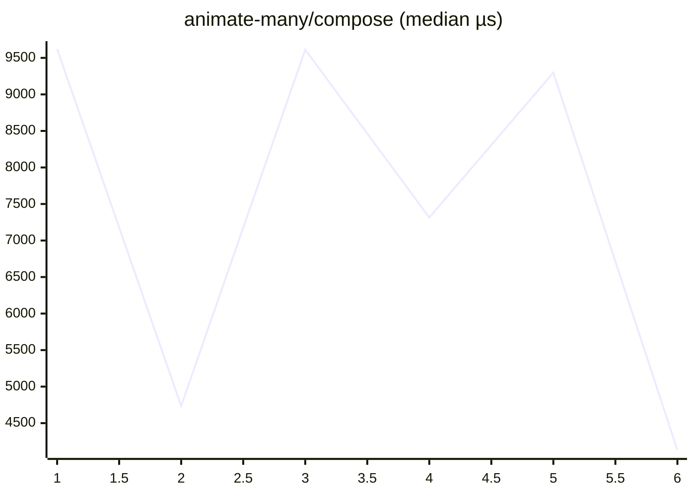

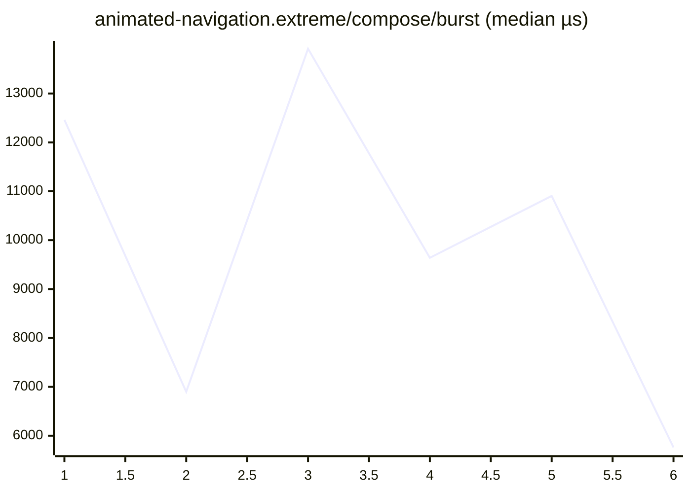


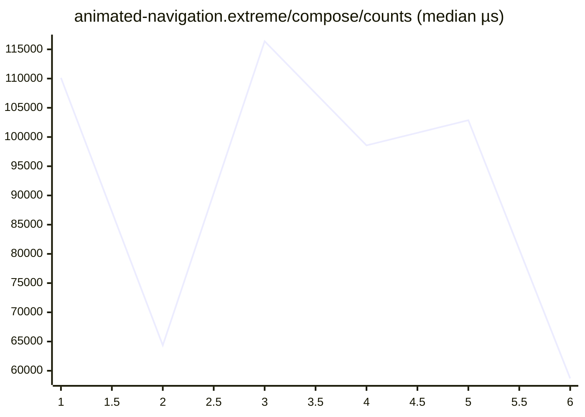


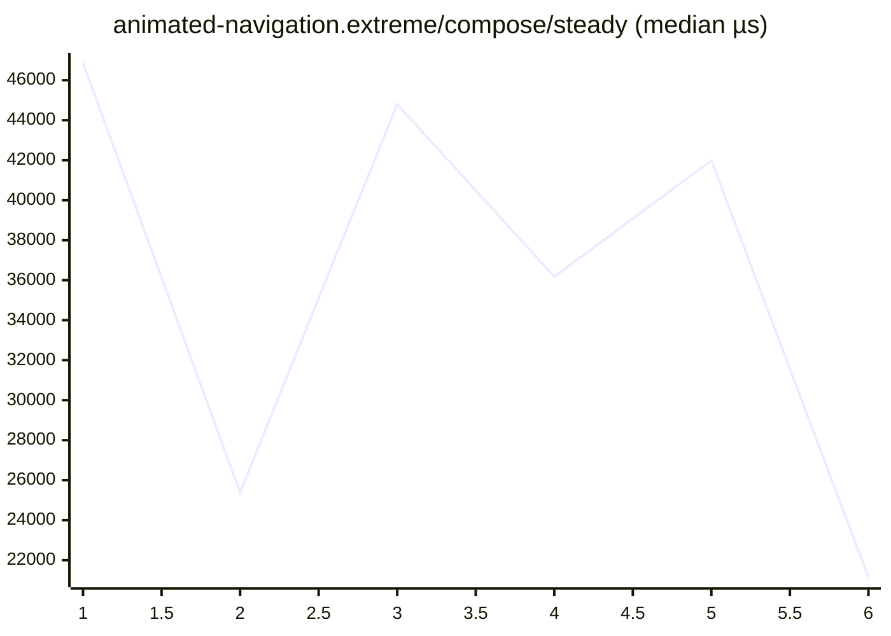


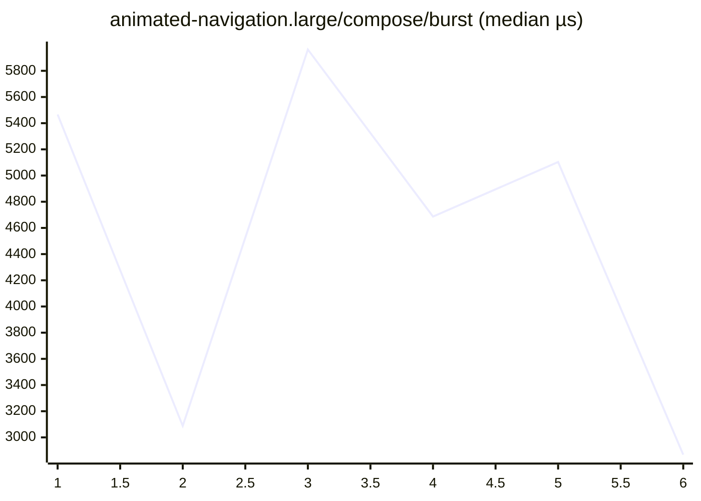

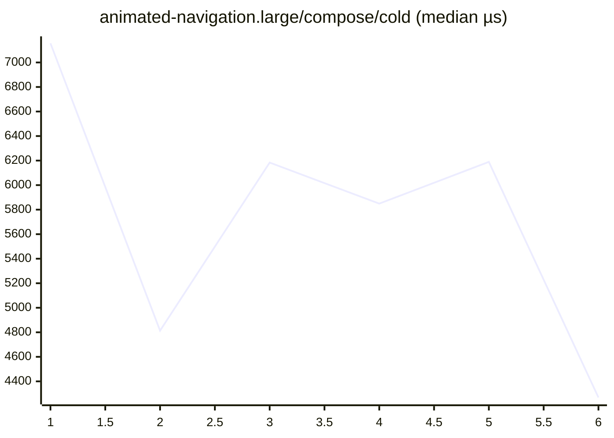


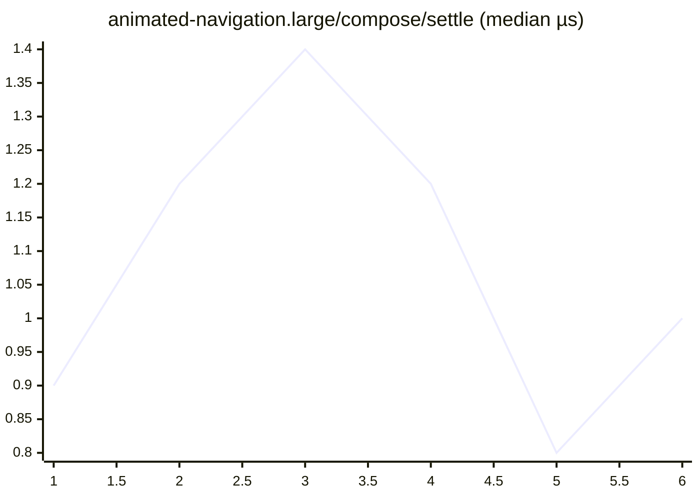

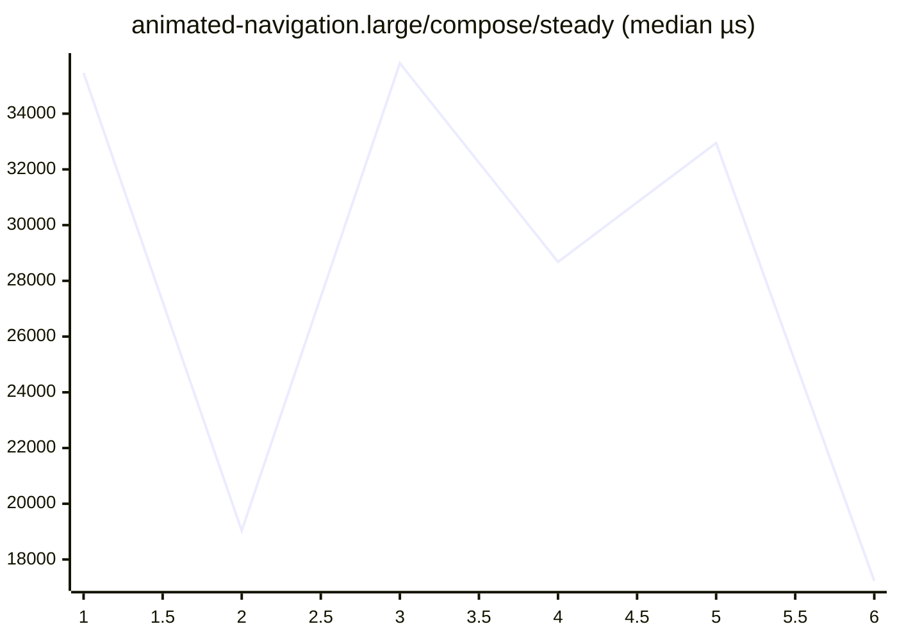

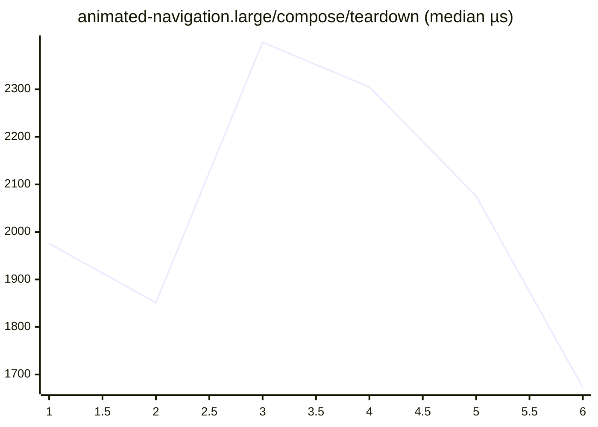


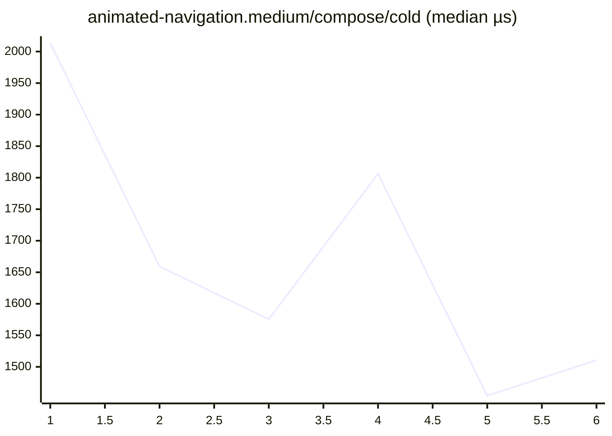

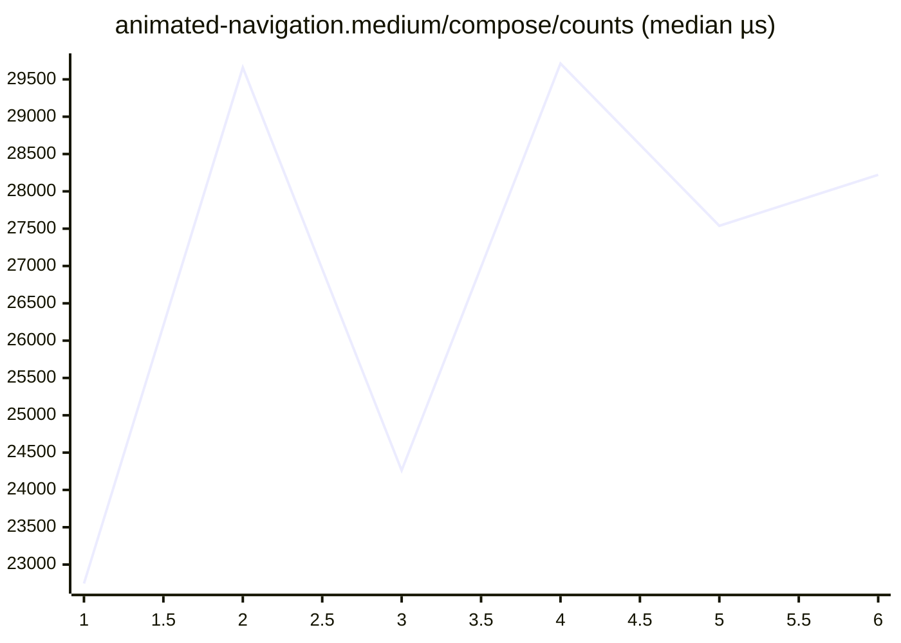

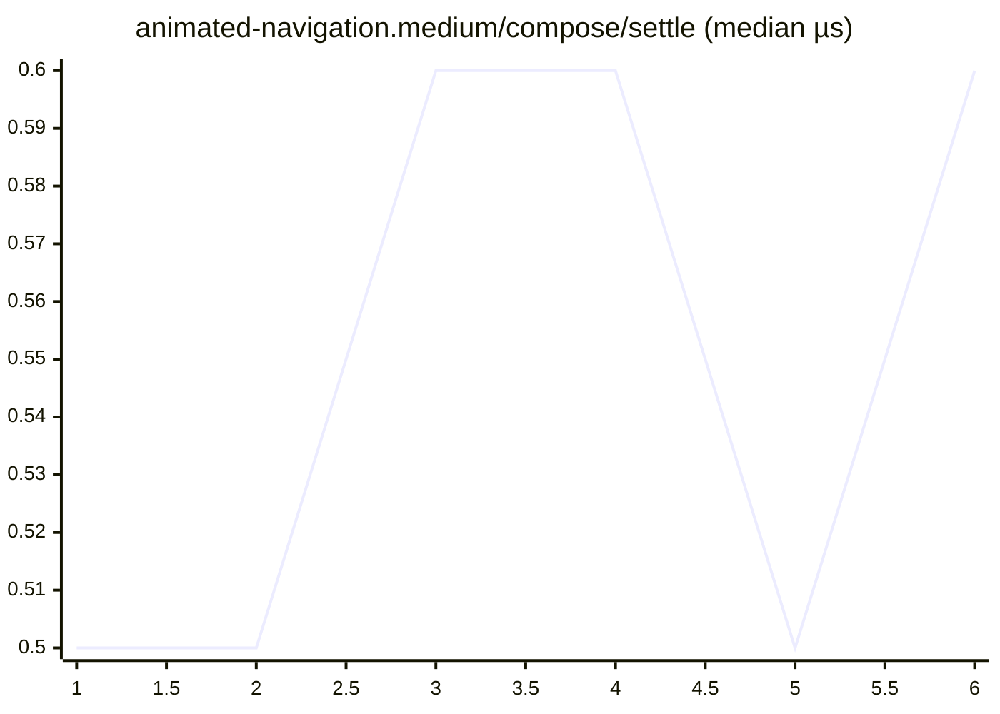

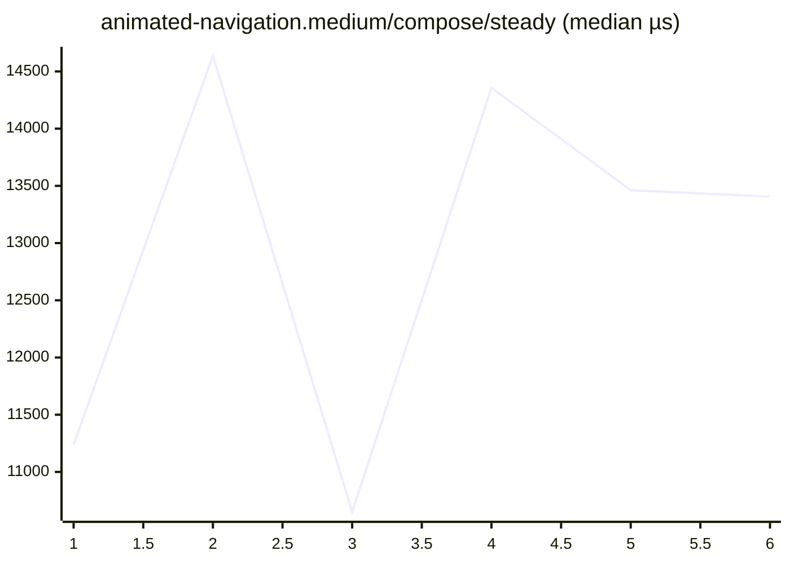

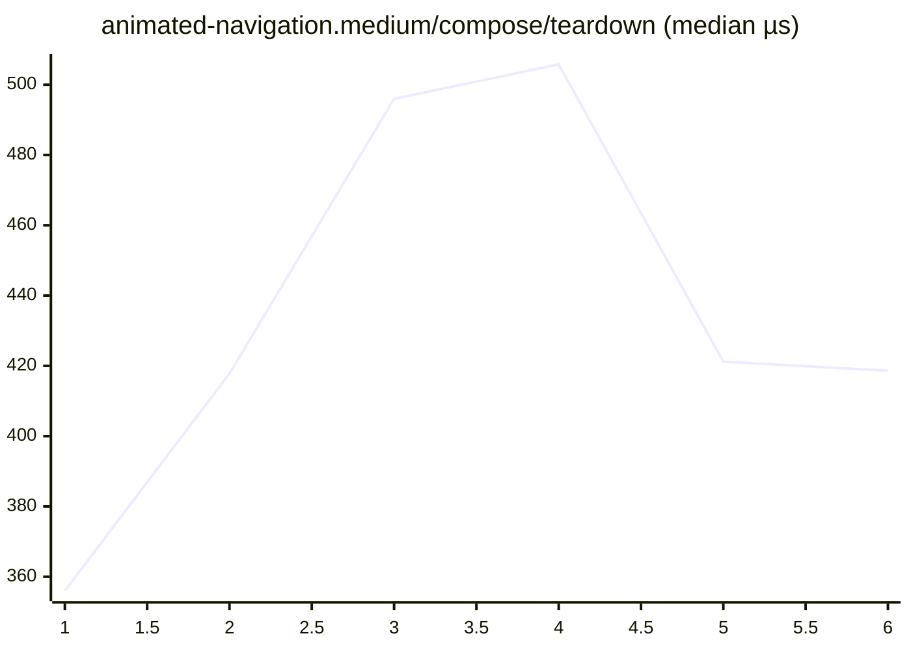


```mermaid
xychart-beta
    title "cold-mount-100/compose (median µs)"
    x-axis 1 --> 6
    line [686.8, 560.2, 838.1, 567.4, 589.5, 322.8]
```

```mermaid
xychart-beta
    title "cold-mount-1000/compose (median µs)"
    x-axis 1 --> 6
    line [8399.3, 4719.3, 3773.5, 7121.6, 6041.0, 5964.6]
```

```mermaid
xychart-beta
    title "cold-mount-10000/compose (median µs)"
    x-axis 1 --> 6
    line [74882.4, 77308.0, 75289.0, 90310.2, 100985.1, 86939.8]
```

```mermaid
xychart-beta
    title "data-grid.extreme/compose/burst (median µs)"
    x-axis 1 --> 6
    line [917195.8, 848359.9, 869706.9, 657651.2, 855176.6, 921506.7]
```

```mermaid
xychart-beta
    title "data-grid.extreme/compose/cold (median µs)"
    x-axis 1 --> 6
    line [564671.1, 532198.1, 527821.7, 398200.7, 504535.6, 560369.8]
```

```mermaid
xychart-beta
    title "data-grid.extreme/compose/counts (median µs)"
    x-axis 1 --> 6
    line [1731762.7, 1413521.5, 1498282.4, 1110786.6, 1445044.7, 1520204.8]
```

```mermaid
xychart-beta
    title "data-grid.extreme/compose/settle (median µs)"
    x-axis 1 --> 6
    line [2.1, 2.1, 1.9, 2.3, 2.1, 2.0]
```

```mermaid
xychart-beta
    title "data-grid.extreme/compose/steady (median µs)"
    x-axis 1 --> 6
    line [27880.3, 26608.5, 24816.6, 19150.7, 24207.3, 25586.7]
```

```mermaid
xychart-beta
    title "data-grid.extreme/compose/teardown (median µs)"
    x-axis 1 --> 6
    line [1360.6, 1265.7, 1291.4, 1110.8, 1495.5, 1394.8]
```

```mermaid
xychart-beta
    title "data-grid.large/compose/burst (median µs)"
    x-axis 1 --> 6
    line [108370.1, 137573.0, 114009.5, 133242.0, 132707.0, 131389.9]
```

```mermaid
xychart-beta
    title "data-grid.large/compose/cold (median µs)"
    x-axis 1 --> 6
    line [60694.5, 76941.3, 63120.6, 77459.9, 77741.8, 77504.9]
```

```mermaid
xychart-beta
    title "data-grid.large/compose/counts (median µs)"
    x-axis 1 --> 6
    line [187980.4, 244856.9, 207644.2, 241741.6, 244790.8, 244140.2]
```

```mermaid
xychart-beta
    title "data-grid.large/compose/settle (median µs)"
    x-axis 1 --> 6
    line [1.5, 1.6, 2.4, 1.8, 1.5, 1.4]
```

```mermaid
xychart-beta
    title "data-grid.large/compose/steady (median µs)"
    x-axis 1 --> 6
    line [14957.3, 18099.0, 16104.9, 16959.8, 15977.4, 16630.3]
```

```mermaid
xychart-beta
    title "data-grid.large/compose/teardown (median µs)"
    x-axis 1 --> 6
    line [469.9, 567.8, 474.6, 573.2, 553.4, 516.9]
```

```mermaid
xychart-beta
    title "data-grid.medium/compose/burst (median µs)"
    x-axis 1 --> 6
    line [69739.0, 35886.9, 46673.5, 57857.6, 48420.1, 50977.2]
```

```mermaid
xychart-beta
    title "data-grid.medium/compose/cold (median µs)"
    x-axis 1 --> 6
    line [39856.7, 21102.5, 25793.1, 34471.6, 28818.4, 27678.6]
```

```mermaid
xychart-beta
    title "data-grid.medium/compose/counts (median µs)"
    x-axis 1 --> 6
    line [141793.3, 71603.8, 99581.8, 122381.7, 107874.3, 104361.4]
```

```mermaid
xychart-beta
    title "data-grid.medium/compose/settle (median µs)"
    x-axis 1 --> 6
    line [2.3, 1.0, 1.8, 1.5, 2.2, 2.0]
```

```mermaid
xychart-beta
    title "data-grid.medium/compose/steady (median µs)"
    x-axis 1 --> 6
    line [20754.9, 8162.0, 12334.8, 12381.3, 12840.2, 10470.5]
```

```mermaid
xychart-beta
    title "data-grid.medium/compose/teardown (median µs)"
    x-axis 1 --> 6
    line [356.8, 187.9, 248.2, 292.5, 260.1, 258.1]
```

```mermaid
xychart-beta
    title "dense-dashboard.extreme/compose/burst (median µs)"
    x-axis 1 --> 6
    line [20153.1, 12231.0, 11532.2, 14838.7, 15355.1, 14237.6]
```

```mermaid
xychart-beta
    title "dense-dashboard.extreme/compose/cold (median µs)"
    x-axis 1 --> 6
    line [606.7, 398.8, 383.4, 479.8, 502.1, 460.9]
```

```mermaid
xychart-beta
    title "dense-dashboard.extreme/compose/counts (median µs)"
    x-axis 1 --> 6
    line [23438.8, 13693.1, 17691.5, 22404.5, 21786.2, 19601.6]
```

```mermaid
xychart-beta
    title "dense-dashboard.extreme/compose/settle (median µs)"
    x-axis 1 --> 6
    line [1.3, 0.9, 1.2, 1.1, 1.4, 0.9]
```

```mermaid
xychart-beta
    title "dense-dashboard.extreme/compose/steady (median µs)"
    x-axis 1 --> 6
    line [863.1, 432.7, 533.0, 686.6, 708.9, 700.6]
```

```mermaid
xychart-beta
    title "dense-dashboard.extreme/compose/teardown (median µs)"
    x-axis 1 --> 6
    line [599.1, 388.0, 393.2, 539.8, 566.2, 477.4]
```

```mermaid
xychart-beta
    title "dense-dashboard.large/compose/burst (median µs)"
    x-axis 1 --> 6
    line [9706.7, 4188.0, 5056.8, 5928.3, 7819.4, 5262.6]
```

```mermaid
xychart-beta
    title "dense-dashboard.large/compose/cold (median µs)"
    x-axis 1 --> 6
    line [371.6, 211.1, 249.9, 272.8, 305.9, 241.0]
```

```mermaid
xychart-beta
    title "dense-dashboard.large/compose/counts (median µs)"
    x-axis 1 --> 6
    line [16409.6, 9670.9, 14102.2, 13629.3, 13693.5, 13209.6]
```

```mermaid
xychart-beta
    title "dense-dashboard.large/compose/settle (median µs)"
    x-axis 1 --> 6
    line [1.0, 0.6, 1.2, 0.9, 1.0, 0.7]
```

```mermaid
xychart-beta
    title "dense-dashboard.large/compose/steady (median µs)"
    x-axis 1 --> 6
    line [865.5, 435.0, 514.3, 679.4, 690.4, 687.8]
```

```mermaid
xychart-beta
    title "dense-dashboard.large/compose/teardown (median µs)"
    x-axis 1 --> 6
    line [297.0, 159.4, 204.5, 229.9, 234.0, 203.9]
```

```mermaid
xychart-beta
    title "dense-dashboard.medium/compose/burst (median µs)"
    x-axis 1 --> 6
    line [3256.9, 3747.3, 2886.3, 1441.8, 1725.1, 2212.3]
```

```mermaid
xychart-beta
    title "dense-dashboard.medium/compose/cold (median µs)"
    x-axis 1 --> 6
    line [214.4, 274.0, 218.8, 100.9, 158.5, 169.7]
```

```mermaid
xychart-beta
    title "dense-dashboard.medium/compose/counts (median µs)"
    x-axis 1 --> 6
    line [6736.4, 8374.2, 5949.6, 3187.1, 3588.3, 3998.0]
```

```mermaid
xychart-beta
    title "dense-dashboard.medium/compose/settle (median µs)"
    x-axis 1 --> 6
    line [0.8, 1.3, 0.7, 0.4, 0.9, 0.6]
```

```mermaid
xychart-beta
    title "dense-dashboard.medium/compose/steady (median µs)"
    x-axis 1 --> 6
    line [823.5, 817.9, 816.4, 407.5, 448.9, 446.8]
```

```mermaid
xychart-beta
    title "dense-dashboard.medium/compose/teardown (median µs)"
    x-axis 1 --> 6
    line [120.9, 153.9, 121.5, 62.5, 79.1, 89.7]
```

```mermaid
xychart-beta
    title "entities-identity-churn-10.extreme/compose/burst (median µs)"
    x-axis 1 --> 6
    line [57275.1, 58550.6, 48500.0, 29373.5, 40666.3, 39982.2]
```

```mermaid
xychart-beta
    title "entities-identity-churn-10.extreme/compose/cold (median µs)"
    x-axis 1 --> 6
    line [35128.8, 48787.2, 29239.1, 17390.4, 22368.5, 29280.2]
```

```mermaid
xychart-beta
    title "entities-identity-churn-10.extreme/compose/counts (median µs)"
    x-axis 1 --> 6
    line [203645.1, 278041.5, 232881.6, 153922.4, 182354.5, 184019.0]
```

```mermaid
xychart-beta
    title "entities-identity-churn-10.extreme/compose/settle (median µs)"
    x-axis 1 --> 6
    line [1.7, 2.7, 2.1, 1.3, 2.4, 2.5]
```

```mermaid
xychart-beta
    title "entities-identity-churn-10.extreme/compose/steady (median µs)"
    x-axis 1 --> 6
    line [67605.4, 110490.0, 62006.6, 30428.1, 51252.0, 46762.5]
```

```mermaid
xychart-beta
    title "entities-identity-churn-10.extreme/compose/teardown (median µs)"
    x-axis 1 --> 6
    line [1382.9, 1964.2, 1144.8, 694.6, 900.0, 1153.0]
```

```mermaid
xychart-beta
    title "entities-identity-churn-10.large/compose/burst (median µs)"
    x-axis 1 --> 6
    line [22661.4, 12171.9, 13759.9, 13609.3, 14702.9, 13810.3]
```

```mermaid
xychart-beta
    title "entities-identity-churn-10.large/compose/cold (median µs)"
    x-axis 1 --> 6
    line [16026.8, 10773.1, 8930.7, 10020.5, 8909.7, 10600.2]
```

```mermaid
xychart-beta
    title "entities-identity-churn-10.large/compose/counts (median µs)"
    x-axis 1 --> 6
    line [80942.4, 39356.0, 64825.7, 63038.7, 65034.2, 58295.1]
```

```mermaid
xychart-beta
    title "entities-identity-churn-10.large/compose/settle (median µs)"
    x-axis 1 --> 6
    line [1.9, 1.8, 1.6, 1.3, 1.8, 1.6]
```

```mermaid
xychart-beta
    title "entities-identity-churn-10.large/compose/steady (median µs)"
    x-axis 1 --> 6
    line [29699.1, 13169.4, 18127.8, 19237.6, 16977.4, 16994.0]
```

```mermaid
xychart-beta
    title "entities-identity-churn-10.large/compose/teardown (median µs)"
    x-axis 1 --> 6
    line [555.6, 288.1, 337.4, 360.3, 368.0, 351.5]
```

```mermaid
xychart-beta
    title "entities-identity-churn-10.medium/compose/burst (median µs)"
    x-axis 1 --> 6
    line [8775.5, 6489.2, 8202.0, 6319.3, 6445.7, 3900.8]
```

```mermaid
xychart-beta
    title "entities-identity-churn-10.medium/compose/cold (median µs)"
    x-axis 1 --> 6
    line [6847.6, 4064.4, 5318.6, 5299.9, 5743.4, 2913.7]
```

```mermaid
xychart-beta
    title "entities-identity-churn-10.medium/compose/counts (median µs)"
    x-axis 1 --> 6
    line [33013.6, 23547.5, 40497.8, 27670.3, 31664.9, 18380.9]
```

```mermaid
xychart-beta
    title "entities-identity-churn-10.medium/compose/settle (median µs)"
    x-axis 1 --> 6
    line [1.1, 1.6, 2.1, 1.6, 0.8, 0.6]
```

```mermaid
xychart-beta
    title "entities-identity-churn-10.medium/compose/steady (median µs)"
    x-axis 1 --> 6
    line [10632.2, 6021.8, 10678.6, 8206.7, 8958.3, 4763.9]
```

```mermaid
xychart-beta
    title "entities-identity-churn-10.medium/compose/teardown (median µs)"
    x-axis 1 --> 6
    line [231.8, 181.7, 264.1, 212.7, 181.2, 110.8]
```

```mermaid
xychart-beta
    title "entities-identity-churn-50.extreme/compose/burst (median µs)"
    x-axis 1 --> 6
    line [38163.8, 45513.9, 41164.8, 46703.8, 44520.9, 38822.5]
```

```mermaid
xychart-beta
    title "entities-identity-churn-50.extreme/compose/cold (median µs)"
    x-axis 1 --> 6
    line [30010.2, 36978.8, 29991.4, 41393.0, 32387.4, 25962.5]
```

```mermaid
xychart-beta
    title "entities-identity-churn-50.extreme/compose/counts (median µs)"
    x-axis 1 --> 6
    line [308853.3, 356183.6, 347691.5, 358267.1, 320929.1, 329140.8]
```

```mermaid
xychart-beta
    title "entities-identity-churn-50.extreme/compose/settle (median µs)"
    x-axis 1 --> 6
    line [1.9, 1.8, 2.1, 2.0, 1.8, 1.8]
```

```mermaid
xychart-beta
    title "entities-identity-churn-50.extreme/compose/steady (median µs)"
    x-axis 1 --> 6
    line [170674.3, 195161.2, 168550.7, 182630.3, 163543.1, 182753.2]
```

```mermaid
xychart-beta
    title "entities-identity-churn-50.extreme/compose/teardown (median µs)"
    x-axis 1 --> 6
    line [1011.2, 1123.7, 1080.1, 1376.9, 1058.4, 1062.6]
```

```mermaid
xychart-beta
    title "entities-identity-churn-50.large/compose/burst (median µs)"
    x-axis 1 --> 6
    line [20445.0, 22651.5, 14964.2, 12211.5, 11912.3, 14060.4]
```

```mermaid
xychart-beta
    title "entities-identity-churn-50.large/compose/cold (median µs)"
    x-axis 1 --> 6
    line [12195.2, 16233.7, 12335.9, 7185.3, 8832.7, 11712.1]
```

```mermaid
xychart-beta
    title "entities-identity-churn-50.large/compose/counts (median µs)"
    x-axis 1 --> 6
    line [116758.9, 159716.3, 121699.6, 72346.5, 90059.4, 95283.3]
```

```mermaid
xychart-beta
    title "entities-identity-churn-50.large/compose/settle (median µs)"
    x-axis 1 --> 6
    line [1.7, 2.6, 1.9, 1.3, 1.5, 2.2]
```

```mermaid
xychart-beta
    title "entities-identity-churn-50.large/compose/steady (median µs)"
    x-axis 1 --> 6
    line [65487.9, 100478.1, 59706.0, 34308.7, 51437.5, 47528.6]
```

```mermaid
xychart-beta
    title "entities-identity-churn-50.large/compose/teardown (median µs)"
    x-axis 1 --> 6
    line [465.8, 729.5, 440.9, 295.7, 317.9, 369.3]
```

```mermaid
xychart-beta
    title "entities-identity-churn-50.medium/compose/burst (median µs)"
    x-axis 1 --> 6
    line [7359.9, 9363.4, 7988.6, 9747.3, 9365.5, 8349.5]
```

```mermaid
xychart-beta
    title "entities-identity-churn-50.medium/compose/cold (median µs)"
    x-axis 1 --> 6
    line [5217.5, 8076.9, 4571.3, 5260.1, 4670.0, 5901.2]
```

```mermaid
xychart-beta
    title "entities-identity-churn-50.medium/compose/counts (median µs)"
    x-axis 1 --> 6
    line [53771.4, 72919.2, 57149.8, 65876.4, 59908.3, 63387.5]
```

```mermaid
xychart-beta
    title "entities-identity-churn-50.medium/compose/settle (median µs)"
    x-axis 1 --> 6
    line [1.0, 1.3, 1.6, 1.3, 1.0, 0.9]
```

```mermaid
xychart-beta
    title "entities-identity-churn-50.medium/compose/steady (median µs)"
    x-axis 1 --> 6
    line [24173.9, 29083.3, 23959.0, 26680.3, 24724.4, 25894.3]
```

```mermaid
xychart-beta
    title "entities-identity-churn-50.medium/compose/teardown (median µs)"
    x-axis 1 --> 6
    line [206.6, 265.4, 235.4, 253.6, 224.3, 241.3]
```

```mermaid
xychart-beta
    title "entities-identity-churn.extreme/compose/burst (median µs)"
    x-axis 1 --> 6
    line [67899.9, 40475.8, 49011.8, 47993.9, 58958.8, 49403.5]
```

```mermaid
xychart-beta
    title "entities-identity-churn.extreme/compose/cold (median µs)"
    x-axis 1 --> 6
    line [43440.3, 23189.6, 21354.5, 24947.4, 23666.7, 30840.0]
```

```mermaid
xychart-beta
    title "entities-identity-churn.extreme/compose/counts (median µs)"
    x-axis 1 --> 6
    line [322090.0, 155075.8, 263232.8, 241537.1, 281124.0, 231871.8]
```

```mermaid
xychart-beta
    title "entities-identity-churn.extreme/compose/settle (median µs)"
    x-axis 1 --> 6
    line [2.2, 2.0, 2.2, 1.5, 2.1, 2.1]
```

```mermaid
xychart-beta
    title "entities-identity-churn.extreme/compose/steady (median µs)"
    x-axis 1 --> 6
    line [168290.2, 78037.0, 94632.2, 97962.6, 108987.6, 90436.8]
```

```mermaid
xychart-beta
    title "entities-identity-churn.extreme/compose/teardown (median µs)"
    x-axis 1 --> 6
    line [1918.2, 1082.7, 1099.8, 1219.6, 1413.1, 1134.2]
```

```mermaid
xychart-beta
    title "entities-identity-churn.large/compose/burst (median µs)"
    x-axis 1 --> 6
    line [15198.1, 12817.1, 17384.4, 12828.2, 14670.0, 10802.1]
```

```mermaid
xychart-beta
    title "entities-identity-churn.large/compose/cold (median µs)"
    x-axis 1 --> 6
    line [14413.0, 10025.1, 12412.5, 10919.1, 9991.0, 7777.1]
```

```mermaid
xychart-beta
    title "entities-identity-churn.large/compose/counts (median µs)"
    x-axis 1 --> 6
    line [94808.6, 66047.0, 131198.0, 102800.1, 106962.5, 78783.2]
```

```mermaid
xychart-beta
    title "entities-identity-churn.large/compose/settle (median µs)"
    x-axis 1 --> 6
    line [1.7, 2.1, 2.3, 1.7, 1.5, 1.8]
```

```mermaid
xychart-beta
    title "entities-identity-churn.large/compose/steady (median µs)"
    x-axis 1 --> 6
    line [42870.9, 30465.6, 44952.7, 30109.8, 34357.1, 23042.6]
```

```mermaid
xychart-beta
    title "entities-identity-churn.large/compose/teardown (median µs)"
    x-axis 1 --> 6
    line [421.7, 347.3, 504.6, 355.7, 394.0, 294.7]
```

```mermaid
xychart-beta
    title "entities-identity-churn.medium/compose/burst (median µs)"
    x-axis 1 --> 6
    line [9268.9, 6214.3, 6318.0, 7594.1, 7048.3, 6573.8]
```

```mermaid
xychart-beta
    title "entities-identity-churn.medium/compose/cold (median µs)"
    x-axis 1 --> 6
    line [6175.2, 5202.2, 4209.2, 4766.1, 4414.4, 4459.7]
```

```mermaid
xychart-beta
    title "entities-identity-churn.medium/compose/counts (median µs)"
    x-axis 1 --> 6
    line [48430.6, 24546.5, 34883.2, 42248.6, 35027.4, 39583.1]
```

```mermaid
xychart-beta
    title "entities-identity-churn.medium/compose/settle (median µs)"
    x-axis 1 --> 6
    line [1.8, 1.7, 1.3, 1.0, 1.4, 1.1]
```

```mermaid
xychart-beta
    title "entities-identity-churn.medium/compose/steady (median µs)"
    x-axis 1 --> 6
    line [18970.0, 11144.9, 13984.1, 14562.6, 12821.2, 13331.6]
```

```mermaid
xychart-beta
    title "entities-identity-churn.medium/compose/teardown (median µs)"
    x-axis 1 --> 6
    line [266.7, 172.8, 182.1, 197.6, 194.9, 188.5]
```

```mermaid
xychart-beta
    title "entities-integrated.extreme/compose/burst (median µs)"
    x-axis 1 --> 6
    line [21280.1, 17085.4, 25262.9, 28283.5, 20257.0, 10917.0]
```

```mermaid
xychart-beta
    title "entities-integrated.extreme/compose/cold (median µs)"
    x-axis 1 --> 6
    line [107928.0, 93149.3, 109143.0, 107346.8, 112756.0, 73472.7]
```

```mermaid
xychart-beta
    title "entities-integrated.extreme/compose/counts (median µs)"
    x-axis 1 --> 6
    line [345877.0, 271171.1, 372031.9, 371349.9, 343525.6, 217868.2]
```

```mermaid
xychart-beta
    title "entities-integrated.extreme/compose/settle (median µs)"
    x-axis 1 --> 6
    line [1.8, 2.2, 2.2, 2.2, 1.9, 1.8]
```

```mermaid
xychart-beta
    title "entities-integrated.extreme/compose/steady (median µs)"
    x-axis 1 --> 6
    line [112062.9, 90774.1, 117256.3, 106657.1, 98348.3, 59055.9]
```

```mermaid
xychart-beta
    title "entities-integrated.extreme/compose/teardown (median µs)"
    x-axis 1 --> 6
    line [33241.4, 38551.9, 37604.0, 45565.4, 37162.6, 31516.4]
```

```mermaid
xychart-beta
    title "entities-integrated.large/compose/burst (median µs)"
    x-axis 1 --> 6
    line [8720.8, 10514.8, 8702.4, 10287.4, 10136.5, 9822.3]
```

```mermaid
xychart-beta
    title "entities-integrated.large/compose/cold (median µs)"
    x-axis 1 --> 6
    line [35331.9, 46561.1, 36425.1, 45716.0, 39872.5, 39917.1]
```

```mermaid
xychart-beta
    title "entities-integrated.large/compose/counts (median µs)"
    x-axis 1 --> 6
    line [127887.2, 165417.5, 156094.5, 170891.3, 159918.6, 159409.8]
```

```mermaid
xychart-beta
    title "entities-integrated.large/compose/settle (median µs)"
    x-axis 1 --> 6
    line [1.4, 1.6, 2.0, 1.5, 1.1, 1.3]
```

```mermaid
xychart-beta
    title "entities-integrated.large/compose/steady (median µs)"
    x-axis 1 --> 6
    line [42270.1, 58987.0, 46845.8, 49441.4, 48906.3, 48394.1]
```

```mermaid
xychart-beta
    title "entities-integrated.large/compose/teardown (median µs)"
    x-axis 1 --> 6
    line [9384.4, 11676.7, 12636.7, 11453.4, 9676.2, 9468.6]
```

```mermaid
xychart-beta
    title "entities-integrated.medium/compose/burst (median µs)"
    x-axis 1 --> 6
    line [8064.7, 5412.3, 8325.1, 7310.8, 7725.2, 4373.6]
```

```mermaid
xychart-beta
    title "entities-integrated.medium/compose/cold (median µs)"
    x-axis 1 --> 6
    line [23640.0, 18354.3, 20523.4, 16963.3, 24114.6, 15390.3]
```

```mermaid
xychart-beta
    title "entities-integrated.medium/compose/counts (median µs)"
    x-axis 1 --> 6
    line [92316.8, 67519.0, 107959.8, 94567.5, 113174.7, 55185.3]
```

```mermaid
xychart-beta
    title "entities-integrated.medium/compose/settle (median µs)"
    x-axis 1 --> 6
    line [1.6, 2.1, 2.2, 1.7, 1.5, 1.0]
```

```mermaid
xychart-beta
    title "entities-integrated.medium/compose/steady (median µs)"
    x-axis 1 --> 6
    line [39845.5, 29943.1, 47449.4, 35007.7, 37155.4, 20922.3]
```

```mermaid
xychart-beta
    title "entities-integrated.medium/compose/teardown (median µs)"
    x-axis 1 --> 6
    line [6105.6, 6486.4, 6913.2, 7758.7, 5425.1, 3598.7]
```

```mermaid
xychart-beta
    title "entities-relevance-saturated.extreme/compose/burst (median µs)"
    x-axis 1 --> 6
    line [95057.1, 94073.3, 97254.7, 96247.4, 87014.9, 56203.8]
```

```mermaid
xychart-beta
    title "entities-relevance-saturated.extreme/compose/cold (median µs)"
    x-axis 1 --> 6
    line [30591.9, 22227.2, 28424.7, 29174.1, 36070.7, 21358.8]
```

```mermaid
xychart-beta
    title "entities-relevance-saturated.extreme/compose/counts (median µs)"
    x-axis 1 --> 6
    line [228810.1, 211002.3, 277035.4, 262243.7, 240299.8, 164476.9]
```

```mermaid
xychart-beta
    title "entities-relevance-saturated.extreme/compose/settle (median µs)"
    x-axis 1 --> 6
    line [2.0, 2.8, 2.9, 2.6, 2.0, 2.1]
```

```mermaid
xychart-beta
    title "entities-relevance-saturated.extreme/compose/steady (median µs)"
    x-axis 1 --> 6
    line [56507.4, 52162.7, 59312.8, 52039.1, 53658.6, 36010.3]
```

```mermaid
xychart-beta
    title "entities-relevance-saturated.extreme/compose/teardown (median µs)"
    x-axis 1 --> 6
    line [13113.8, 13417.0, 14500.7, 15465.3, 13655.0, 10660.5]
```

```mermaid
xychart-beta
    title "entities-relevance-saturated.large/compose/burst (median µs)"
    x-axis 1 --> 6
    line [27403.3, 40547.2, 27643.0, 16736.6, 24669.8, 21688.5]
```

```mermaid
xychart-beta
    title "entities-relevance-saturated.large/compose/cold (median µs)"
    x-axis 1 --> 6
    line [11952.4, 12445.2, 13843.1, 7413.0, 8312.1, 8704.4]
```

```mermaid
xychart-beta
    title "entities-relevance-saturated.large/compose/counts (median µs)"
    x-axis 1 --> 6
    line [100423.7, 101703.7, 92984.2, 61791.0, 76047.1, 71772.8]
```

```mermaid
xychart-beta
    title "entities-relevance-saturated.large/compose/settle (median µs)"
    x-axis 1 --> 6
    line [1.5, 2.3, 2.0, 1.3, 1.4, 2.1]
```

```mermaid
xychart-beta
    title "entities-relevance-saturated.large/compose/steady (median µs)"
    x-axis 1 --> 6
    line [19345.5, 23966.2, 20176.3, 10165.4, 13367.2, 11453.9]
```

```mermaid
xychart-beta
    title "entities-relevance-saturated.large/compose/teardown (median µs)"
    x-axis 1 --> 6
    line [2906.6, 4134.8, 3277.4, 2382.9, 2631.1, 3034.7]
```

```mermaid
xychart-beta
    title "entities-relevance-saturated.medium/compose/burst (median µs)"
    x-axis 1 --> 6
    line [13879.1, 10176.6, 13944.0, 11937.1, 11307.3, 6750.6]
```

```mermaid
xychart-beta
    title "entities-relevance-saturated.medium/compose/cold (median µs)"
    x-axis 1 --> 6
    line [6104.0, 4520.5, 5933.8, 6295.2, 6588.9, 3499.8]
```

```mermaid
xychart-beta
    title "entities-relevance-saturated.medium/compose/counts (median µs)"
    x-axis 1 --> 6
    line [39918.2, 26024.7, 45495.9, 38988.2, 39254.8, 26227.8]
```

```mermaid
xychart-beta
    title "entities-relevance-saturated.medium/compose/settle (median µs)"
    x-axis 1 --> 6
    line [1.3, 1.8, 2.2, 1.9, 1.0, 0.6]
```

```mermaid
xychart-beta
    title "entities-relevance-saturated.medium/compose/steady (median µs)"
    x-axis 1 --> 6
    line [8588.8, 6714.5, 10581.6, 7636.9, 7928.6, 4687.4]
```

```mermaid
xychart-beta
    title "entities-relevance-saturated.medium/compose/teardown (median µs)"
    x-axis 1 --> 6
    line [1136.6, 1234.8, 1482.3, 1376.9, 1147.0, 743.8]
```

```mermaid
xychart-beta
    title "entities-relevance-sweep.extreme/compose/burst (median µs)"
    x-axis 1 --> 6
    line [139551.2, 143863.6, 147758.9, 149769.7, 128240.4, 93044.8]
```

```mermaid
xychart-beta
    title "entities-relevance-sweep.extreme/compose/cold (median µs)"
    x-axis 1 --> 6
    line [37476.4, 26814.0, 37931.2, 27280.6, 33457.4, 32352.6]
```

```mermaid
xychart-beta
    title "entities-relevance-sweep.extreme/compose/counts (median µs)"
    x-axis 1 --> 6
    line [453942.0, 363604.4, 495520.1, 408039.1, 458887.5, 256641.6]
```

```mermaid
xychart-beta
    title "entities-relevance-sweep.extreme/compose/settle (median µs)"
    x-axis 1 --> 6
    line [2.0, 2.9, 2.8, 2.4, 2.0, 2.4]
```

```mermaid
xychart-beta
    title "entities-relevance-sweep.extreme/compose/steady (median µs)"
    x-axis 1 --> 6
    line [149428.6, 140862.0, 167028.5, 121048.4, 129724.9, 78538.3]
```

```mermaid
xychart-beta
    title "entities-relevance-sweep.extreme/compose/teardown (median µs)"
    x-axis 1 --> 6
    line [13492.1, 13806.8, 15285.8, 15385.2, 13545.9, 12137.9]
```

```mermaid
xychart-beta
    title "entities-relevance-sweep.large/compose/burst (median µs)"
    x-axis 1 --> 6
    line [64372.4, 33315.0, 43296.5, 43553.3, 35754.9, 37879.2]
```

```mermaid
xychart-beta
    title "entities-relevance-sweep.large/compose/cold (median µs)"
    x-axis 1 --> 6
    line [12505.9, 8058.4, 8874.3, 10385.9, 10093.6, 10681.3]
```

```mermaid
xychart-beta
    title "entities-relevance-sweep.large/compose/counts (median µs)"
    x-axis 1 --> 6
    line [187160.4, 84451.7, 121670.1, 137514.1, 119307.2, 116472.5]
```

```mermaid
xychart-beta
    title "entities-relevance-sweep.large/compose/settle (median µs)"
    x-axis 1 --> 6
    line [2.3, 1.9, 2.4, 1.6, 2.2, 2.0]
```

```mermaid
xychart-beta
    title "entities-relevance-sweep.large/compose/steady (median µs)"
    x-axis 1 --> 6
    line [56628.5, 29545.4, 39104.4, 46006.1, 40089.7, 36520.1]
```

```mermaid
xychart-beta
    title "entities-relevance-sweep.large/compose/teardown (median µs)"
    x-axis 1 --> 6
    line [3915.7, 2636.1, 3097.4, 3094.1, 3740.5, 3308.5]
```

```mermaid
xychart-beta
    title "entities-relevance-sweep.medium/compose/burst (median µs)"
    x-axis 1 --> 6
    line [20435.0, 27247.9, 20502.7, 11766.6, 17019.7, 16181.3]
```

```mermaid
xychart-beta
    title "entities-relevance-sweep.medium/compose/cold (median µs)"
    x-axis 1 --> 6
    line [6221.8, 7648.4, 5806.6, 3251.3, 4242.8, 4567.5]
```

```mermaid
xychart-beta
    title "entities-relevance-sweep.medium/compose/counts (median µs)"
    x-axis 1 --> 6
    line [79311.3, 99350.5, 73925.1, 39521.4, 64266.7, 64313.0]
```

```mermaid
xychart-beta
    title "entities-relevance-sweep.medium/compose/settle (median µs)"
    x-axis 1 --> 6
    line [1.2, 2.3, 1.9, 0.9, 1.5, 2.7]
```

```mermaid
xychart-beta
    title "entities-relevance-sweep.medium/compose/steady (median µs)"
    x-axis 1 --> 6
    line [21056.0, 29692.1, 21901.2, 11598.6, 16084.1, 17362.8]
```

```mermaid
xychart-beta
    title "entities-relevance-sweep.medium/compose/teardown (median µs)"
    x-axis 1 --> 6
    line [1121.8, 1664.5, 1361.2, 805.1, 1141.2, 1629.0]
```

```mermaid
xychart-beta
    title "entity-labels-sparse.extreme/compose/burst (median µs)"
    x-axis 1 --> 6
    line [55182.4, 21144.1, 30740.0, 30157.3, 32728.7, 31850.2]
```

```mermaid
xychart-beta
    title "entity-labels-sparse.extreme/compose/cold (median µs)"
    x-axis 1 --> 6
    line [32818.0, 17437.9, 19443.1, 21501.3, 23241.9, 22558.6]
```

```mermaid
xychart-beta
    title "entity-labels-sparse.extreme/compose/counts (median µs)"
    x-axis 1 --> 6
    line [135325.6, 59311.0, 95734.4, 87969.1, 101861.3, 98252.5]
```

```mermaid
xychart-beta
    title "entity-labels-sparse.extreme/compose/settle (median µs)"
    x-axis 1 --> 6
    line [2.6, 1.7, 2.1, 1.5, 1.8, 2.0]
```

```mermaid
xychart-beta
    title "entity-labels-sparse.extreme/compose/steady (median µs)"
    x-axis 1 --> 6
    line [5921.1, 2635.6, 4056.5, 3954.9, 4210.9, 3954.1]
```

```mermaid
xychart-beta
    title "entity-labels-sparse.extreme/compose/teardown (median µs)"
    x-axis 1 --> 6
    line [15688.5, 7760.4, 10927.2, 10437.8, 11785.0, 10969.4]
```

```mermaid
xychart-beta
    title "entity-labels-sparse.large/compose/burst (median µs)"
    x-axis 1 --> 6
    line [17004.7, 10266.2, 12968.2, 14944.3, 13156.1, 11903.4]
```

```mermaid
xychart-beta
    title "entity-labels-sparse.large/compose/cold (median µs)"
    x-axis 1 --> 6
    line [14612.0, 9463.4, 9673.3, 10162.5, 10425.1, 9138.0]
```

```mermaid
xychart-beta
    title "entity-labels-sparse.large/compose/counts (median µs)"
    x-axis 1 --> 6
    line [56031.2, 30721.5, 40692.9, 42414.6, 39516.8, 42369.1]
```

```mermaid
xychart-beta
    title "entity-labels-sparse.large/compose/settle (median µs)"
    x-axis 1 --> 6
    line [2.0, 1.2, 1.6, 1.4, 1.4, 1.4]
```

```mermaid
xychart-beta
    title "entity-labels-sparse.large/compose/steady (median µs)"
    x-axis 1 --> 6
    line [2403.1, 1405.3, 2440.9, 2190.5, 1904.3, 1822.0]
```

```mermaid
xychart-beta
    title "entity-labels-sparse.large/compose/teardown (median µs)"
    x-axis 1 --> 6
    line [4514.6, 2934.8, 3895.1, 3908.4, 3767.0, 3746.9]
```

```mermaid
xychart-beta
    title "entity-labels-sparse.medium/compose/burst (median µs)"
    x-axis 1 --> 6
    line [6844.5, 9109.6, 5969.2, 3082.2, 3646.2, 3725.6]
```

```mermaid
xychart-beta
    title "entity-labels-sparse.medium/compose/cold (median µs)"
    x-axis 1 --> 6
    line [6071.8, 5752.8, 4648.3, 2237.8, 3552.1, 4437.4]
```

```mermaid
xychart-beta
    title "entity-labels-sparse.medium/compose/counts (median µs)"
    x-axis 1 --> 6
    line [24575.3, 28494.2, 23587.6, 12562.2, 18385.8, 16519.4]
```

```mermaid
xychart-beta
    title "entity-labels-sparse.medium/compose/settle (median µs)"
    x-axis 1 --> 6
    line [0.9, 2.3, 0.9, 0.5, 1.0, 1.6]
```

```mermaid
xychart-beta
    title "entity-labels-sparse.medium/compose/steady (median µs)"
    x-axis 1 --> 6
    line [968.2, 1678.2, 1013.9, 512.7, 665.1, 683.5]
```

```mermaid
xychart-beta
    title "entity-labels-sparse.medium/compose/teardown (median µs)"
    x-axis 1 --> 6
    line [1286.2, 1937.9, 1228.0, 691.1, 924.8, 1172.3]
```

```mermaid
xychart-beta
    title "entity-labels.extreme/compose/burst (median µs)"
    x-axis 1 --> 6
    line [53690.8, 21373.5, 33150.6, 31009.3, 34242.4, 32524.1]
```

```mermaid
xychart-beta
    title "entity-labels.extreme/compose/cold (median µs)"
    x-axis 1 --> 6
    line [42536.2, 18791.7, 19043.0, 26424.6, 22746.0, 21814.9]
```

```mermaid
xychart-beta
    title "entity-labels.extreme/compose/counts (median µs)"
    x-axis 1 --> 6
    line [210738.5, 102006.1, 145730.7, 183814.2, 178258.1, 168433.6]
```

```mermaid
xychart-beta
    title "entity-labels.extreme/compose/settle (median µs)"
    x-axis 1 --> 6
    line [2.5, 1.5, 1.8, 1.5, 2.2, 2.0]
```

```mermaid
xychart-beta
    title "entity-labels.extreme/compose/steady (median µs)"
    x-axis 1 --> 6
    line [52614.8, 24846.6, 30404.9, 43592.1, 39017.9, 38674.6]
```

```mermaid
xychart-beta
    title "entity-labels.extreme/compose/teardown (median µs)"
    x-axis 1 --> 6
    line [16453.7, 7976.6, 10670.0, 11402.2, 12000.1, 11279.1]
```

```mermaid
xychart-beta
    title "entity-labels.large/compose/burst (median µs)"
    x-axis 1 --> 6
    line [19159.2, 27915.4, 15705.5, 8668.6, 10885.5, 11937.1]
```

```mermaid
xychart-beta
    title "entity-labels.large/compose/cold (median µs)"
    x-axis 1 --> 6
    line [18682.7, 20066.2, 13238.4, 7382.9, 9032.9, 10279.1]
```

```mermaid
xychart-beta
    title "entity-labels.large/compose/counts (median µs)"
    x-axis 1 --> 6
    line [91912.5, 114130.0, 97208.5, 44084.1, 62545.8, 66003.8]
```

```mermaid
xychart-beta
    title "entity-labels.large/compose/settle (median µs)"
    x-axis 1 --> 6
    line [1.2, 2.6, 1.6, 0.7, 1.2, 2.1]
```

```mermaid
xychart-beta
    title "entity-labels.large/compose/steady (median µs)"
    x-axis 1 --> 6
    line [22658.3, 28149.5, 23067.9, 10007.7, 11093.8, 12671.3]
```

```mermaid
xychart-beta
    title "entity-labels.large/compose/teardown (median µs)"
    x-axis 1 --> 6
    line [4112.4, 6443.5, 4511.9, 2413.7, 3359.3, 3824.7]
```

```mermaid
xychart-beta
    title "entity-labels.medium/compose/burst (median µs)"
    x-axis 1 --> 6
    line [6413.9, 7923.0, 6655.7, 2987.1, 4307.0, 3682.8]
```

```mermaid
xychart-beta
    title "entity-labels.medium/compose/cold (median µs)"
    x-axis 1 --> 6
    line [7035.0, 7218.0, 4634.0, 2388.0, 4074.6, 3602.4]
```

```mermaid
xychart-beta
    title "entity-labels.medium/compose/counts (median µs)"
    x-axis 1 --> 6
    line [34527.2, 41760.6, 39554.7, 17018.3, 25208.3, 27401.5]
```

```mermaid
xychart-beta
    title "entity-labels.medium/compose/settle (median µs)"
    x-axis 1 --> 6
    line [0.9, 2.2, 1.4, 0.5, 1.2, 1.7]
```

```mermaid
xychart-beta
    title "entity-labels.medium/compose/steady (median µs)"
    x-axis 1 --> 6
    line [9633.0, 11476.3, 10002.5, 4084.2, 5621.1, 4900.5]
```

```mermaid
xychart-beta
    title "entity-labels.medium/compose/teardown (median µs)"
    x-axis 1 --> 6
    line [1339.3, 2013.9, 1522.0, 723.0, 1106.6, 1193.6]
```

```mermaid
xychart-beta
    title "events/compose (median µs)"
    x-axis 1 --> 6
    line [12824.2, 16203.6, 12880.5, 7949.6, 9101.6, 11355.0]
```

```mermaid
xychart-beta
    title "inspector.extreme/compose/burst (median µs)"
    x-axis 1 --> 6
    line [10283.2, 16184.3, 10218.7, 5604.9, 6973.3, 5782.0]
```

```mermaid
xychart-beta
    title "inspector.extreme/compose/cold (median µs)"
    x-axis 1 --> 6
    line [26249.5, 32777.8, 23939.4, 18653.8, 19197.1, 21671.9]
```

```mermaid
xychart-beta
    title "inspector.extreme/compose/counts (median µs)"
    x-axis 1 --> 6
    line [42785.5, 50581.3, 44294.9, 28478.2, 34069.7, 40942.9]
```

```mermaid
xychart-beta
    title "inspector.extreme/compose/settle (median µs)"
    x-axis 1 --> 6
    line [1.2, 2.7, 1.8, 1.4, 1.5, 1.9]
```

```mermaid
xychart-beta
    title "inspector.extreme/compose/steady (median µs)"
    x-axis 1 --> 6
    line [264.2, 375.4, 304.4, 195.7, 222.4, 257.6]
```

```mermaid
xychart-beta
    title "inspector.extreme/compose/teardown (median µs)"
    x-axis 1 --> 6
    line [2274.0, 4160.9, 2610.4, 1830.1, 2189.4, 2793.2]
```

```mermaid
xychart-beta
    title "inspector.large/compose/burst (median µs)"
    x-axis 1 --> 6
    line [5172.9, 5523.4, 4834.6, 2399.5, 2543.4, 2718.1]
```

```mermaid
xychart-beta
    title "inspector.large/compose/cold (median µs)"
    x-axis 1 --> 6
    line [10732.1, 10546.3, 9019.8, 4807.1, 6297.0, 7597.7]
```

```mermaid
xychart-beta
    title "inspector.large/compose/counts (median µs)"
    x-axis 1 --> 6
    line [22551.8, 25059.8, 22413.4, 13855.0, 17657.9, 18402.8]
```

```mermaid
xychart-beta
    title "inspector.large/compose/settle (median µs)"
    x-axis 1 --> 6
    line [0.8, 2.1, 1.0, 0.4, 1.1, 1.8]
```

```mermaid
xychart-beta
    title "inspector.large/compose/steady (median µs)"
    x-axis 1 --> 6
    line [256.4, 347.2, 245.5, 127.5, 160.8, 218.3]
```

```mermaid
xychart-beta
    title "inspector.large/compose/teardown (median µs)"
    x-axis 1 --> 6
    line [1173.0, 1562.2, 1034.1, 633.8, 819.3, 1184.7]
```

```mermaid
xychart-beta
    title "inspector.medium/compose/burst (median µs)"
    x-axis 1 --> 6
    line [1730.1, 812.1, 949.5, 1228.1, 1202.6, 1212.4]
```

```mermaid
xychart-beta
    title "inspector.medium/compose/cold (median µs)"
    x-axis 1 --> 6
    line [2916.5, 2007.5, 1674.3, 1787.9, 2053.5, 2149.1]
```

```mermaid
xychart-beta
    title "inspector.medium/compose/counts (median µs)"
    x-axis 1 --> 6
    line [6271.7, 3825.7, 3465.4, 5629.4, 5044.4, 4665.5]
```

```mermaid
xychart-beta
    title "inspector.medium/compose/settle (median µs)"
    x-axis 1 --> 6
    line [0.6, 0.4, 0.6, 0.6, 0.5, 0.5]
```

```mermaid
xychart-beta
    title "inspector.medium/compose/steady (median µs)"
    x-axis 1 --> 6
    line [220.2, 113.5, 160.3, 190.7, 191.8, 189.0]
```

```mermaid
xychart-beta
    title "inspector.medium/compose/teardown (median µs)"
    x-axis 1 --> 6
    line [363.0, 214.0, 235.1, 343.4, 305.4, 324.2]
```

```mermaid
xychart-beta
    title "keyed-append/compose (median µs)"
    x-axis 1 --> 6
    line [2241.5, 1230.1, 2017.3, 1849.1, 1890.5, 1051.8]
```

```mermaid
xychart-beta
    title "keyed-insert/compose (median µs)"
    x-axis 1 --> 6
    line [3904.0, 2135.2, 3946.0, 3101.5, 3884.0, 1959.5]
```

```mermaid
xychart-beta
    title "keyed-prepend/compose (median µs)"
    x-axis 1 --> 6
    line [4631.9, 5670.2, 4810.1, 5713.6, 5284.0, 5303.8]
```

```mermaid
xychart-beta
    title "keyed-remove/compose (median µs)"
    x-axis 1 --> 6
    line [3754.0, 2340.4, 3841.8, 2875.3, 3547.1, 1827.6]
```

```mermaid
xychart-beta
    title "keyed-replace/compose (median µs)"
    x-axis 1 --> 6
    line [52486.3, 65204.8, 53183.6, 71503.5, 56891.2, 60200.2]
```

```mermaid
xychart-beta
    title "keyed-reverse/compose (median µs)"
    x-axis 1 --> 6
    line [3454.2, 4152.3, 3170.7, 4076.7, 3867.3, 3889.8]
```

```mermaid
xychart-beta
    title "keyed-rotate/compose (median µs)"
    x-axis 1 --> 6
    line [3675.5, 4205.0, 3245.0, 4008.5, 3943.0, 3893.6]
```

```mermaid
xychart-beta
    title "keyed-shuffle/compose (median µs)"
    x-axis 1 --> 6
    line [3509.2, 4344.0, 3309.9, 4133.7, 4059.5, 4033.7]
```

```mermaid
xychart-beta
    title "mount-cycles/compose (median µs)"
    x-axis 1 --> 6
    line [22487.2, 16290.9, 25389.8, 24470.6, 24881.5, 23116.2]
```

```mermaid
xychart-beta
    title "mount-dispose/compose (median µs)"
    x-axis 1 --> 6
    line [8156.2, 11089.1, 7309.6, 5895.6, 6379.9, 6063.8]
```

```mermaid
xychart-beta
    title "ordered-window-scroll/compose (median µs)"
    x-axis 1 --> 6
    line [476.6, 541.8, 471.3, 556.9, 564.7, 553.8]
```

```mermaid
xychart-beta
    title "scene-2d.extreme/compose/burst (median µs)"
    x-axis 1 --> 6
    line [30003.3, 30104.3, 33381.7, 27820.2, 30682.4, 19661.0]
```

```mermaid
xychart-beta
    title "scene-2d.extreme/compose/cold (median µs)"
    x-axis 1 --> 6
    line [21590.6, 18636.7, 17711.5, 14764.4, 21038.9, 11215.7]
```

```mermaid
xychart-beta
    title "scene-2d.extreme/compose/counts (median µs)"
    x-axis 1 --> 6
    line [222074.4, 182929.5, 238390.1, 207079.0, 236140.7, 138184.2]
```

```mermaid
xychart-beta
    title "scene-2d.extreme/compose/settle (median µs)"
    x-axis 1 --> 6
    line [2.0, 3.0, 2.5, 2.4, 1.9, 1.8]
```

```mermaid
xychart-beta
    title "scene-2d.extreme/compose/steady (median µs)"
    x-axis 1 --> 6
    line [101466.1, 63734.7, 97238.3, 78657.6, 93914.1, 52229.2]
```

```mermaid
xychart-beta
    title "scene-2d.extreme/compose/teardown (median µs)"
    x-axis 1 --> 6
    line [1168.5, 1282.5, 1345.4, 1276.1, 1387.9, 883.0]
```

```mermaid
xychart-beta
    title "scene-2d.large/compose/burst (median µs)"
    x-axis 1 --> 6
    line [30042.0, 37026.2, 26826.4, 14648.1, 23991.6, 17009.8]
```

```mermaid
xychart-beta
    title "scene-2d.large/compose/cold (median µs)"
    x-axis 1 --> 6
    line [9782.2, 11285.3, 8011.4, 5744.9, 5928.1, 6149.2]
```

```mermaid
xychart-beta
    title "scene-2d.large/compose/counts (median µs)"
    x-axis 1 --> 6
    line [203516.4, 232335.1, 211377.1, 117511.9, 160501.4, 129535.4]
```

```mermaid
xychart-beta
    title "scene-2d.large/compose/settle (median µs)"
    x-axis 1 --> 6
    line [1.6, 2.4, 1.7, 1.3, 2.1, 2.3]
```

```mermaid
xychart-beta
    title "scene-2d.large/compose/steady (median µs)"
    x-axis 1 --> 6
    line [102067.8, 113887.3, 93404.2, 50940.6, 68914.9, 56622.4]
```

```mermaid
xychart-beta
    title "scene-2d.large/compose/teardown (median µs)"
    x-axis 1 --> 6
    line [1105.1, 1578.5, 1068.9, 745.5, 942.1, 867.7]
```

```mermaid
xychart-beta
    title "scene-2d.medium/compose/burst (median µs)"
    x-axis 1 --> 6
    line [18821.8, 22931.8, 19566.8, 24613.0, 21830.9, 21914.7]
```

```mermaid
xychart-beta
    title "scene-2d.medium/compose/cold (median µs)"
    x-axis 1 --> 6
    line [5108.5, 6142.9, 3823.9, 5466.1, 3897.6, 3555.4]
```

```mermaid
xychart-beta
    title "scene-2d.medium/compose/counts (median µs)"
    x-axis 1 --> 6
    line [126713.0, 160716.4, 148021.9, 170011.4, 155845.4, 157157.6]
```

```mermaid
xychart-beta
    title "scene-2d.medium/compose/settle (median µs)"
    x-axis 1 --> 6
    line [1.2, 1.5, 2.2, 1.3, 1.0, 0.9]
```

```mermaid
xychart-beta
    title "scene-2d.medium/compose/steady (median µs)"
    x-axis 1 --> 6
    line [59494.9, 76366.9, 54077.8, 70846.0, 68475.1, 67595.5]
```

```mermaid
xychart-beta
    title "scene-2d.medium/compose/teardown (median µs)"
    x-axis 1 --> 6
    line [772.6, 884.1, 896.1, 1066.5, 827.8, 814.6]
```

```mermaid
xychart-beta
    title "scene-3d/compose (median µs)"
    x-axis 1 --> 6
    line [10372.3, 5793.5, 5440.4, 7389.5, 6615.1, 6376.6]
```

```mermaid
xychart-beta
    title "session-cycle.extreme/compose/burst (median µs)"
    x-axis 1 --> 6
    line [127130.6, 167018.1, 115393.0, 103046.5, 113930.3, 120767.1]
```

```mermaid
xychart-beta
    title "session-cycle.extreme/compose/cold (median µs)"
    x-axis 1 --> 6
    line [4.2, 4.6, 4.2, 4.3, 4.2, 4.6]
```

```mermaid
xychart-beta
    title "session-cycle.extreme/compose/counts (median µs)"
    x-axis 1 --> 6
    line [296908.1, 344119.5, 308098.2, 247736.6, 332555.4, 297268.8]
```

```mermaid
xychart-beta
    title "session-cycle.extreme/compose/settle (median µs)"
    x-axis 1 --> 6
    line [2.2, 2.3, 1.9, 2.0, 2.2, 2.6]
```

```mermaid
xychart-beta
    title "session-cycle.extreme/compose/steady (median µs)"
    x-axis 1 --> 6
    line [160845.4, 196666.1, 197076.8, 157127.6, 193707.5, 140489.0]
```

```mermaid
xychart-beta
    title "session-cycle.extreme/compose/teardown (median µs)"
    x-axis 1 --> 6
    line [2.2, 2.6, 2.2, 2.4, 2.1, 2.7]
```

```mermaid
xychart-beta
    title "session-cycle.large/compose/burst (median µs)"
    x-axis 1 --> 6
    line [57003.0, 42123.0, 46878.9, 50522.5, 39632.6, 42006.2]
```

```mermaid
xychart-beta
    title "session-cycle.large/compose/cold (median µs)"
    x-axis 1 --> 6
    line [4.4, 3.1, 3.5, 3.2, 4.2, 4.3]
```

```mermaid
xychart-beta
    title "session-cycle.large/compose/counts (median µs)"
    x-axis 1 --> 6
    line [128750.1, 75810.9, 99563.4, 125498.0, 117015.6, 132164.7]
```

```mermaid
xychart-beta
    title "session-cycle.large/compose/settle (median µs)"
    x-axis 1 --> 6
    line [2.2, 1.6, 1.6, 1.4, 2.1, 1.9]
```

```mermaid
xychart-beta
    title "session-cycle.large/compose/steady (median µs)"
    x-axis 1 --> 6
    line [69667.1, 42712.5, 61818.0, 57307.8, 74551.5, 74773.3]
```

```mermaid
xychart-beta
    title "session-cycle.large/compose/teardown (median µs)"
    x-axis 1 --> 6
    line [2.2, 1.7, 2.0, 1.8, 2.5, 2.3]
```

```mermaid
xychart-beta
    title "session-cycle.medium/compose/burst (median µs)"
    x-axis 1 --> 6
    line [14058.5, 13643.4, 14167.1, 12992.3, 13234.1, 15559.1]
```

```mermaid
xychart-beta
    title "session-cycle.medium/compose/cold (median µs)"
    x-axis 1 --> 6
    line [3.3, 3.2, 3.5, 3.8, 3.0, 4.3]
```

```mermaid
xychart-beta
    title "session-cycle.medium/compose/counts (median µs)"
    x-axis 1 --> 6
    line [28155.4, 34778.7, 33666.4, 44220.3, 39011.1, 41846.8]
```

```mermaid
xychart-beta
    title "session-cycle.medium/compose/settle (median µs)"
    x-axis 1 --> 6
    line [1.1, 1.2, 1.8, 1.4, 1.0, 1.2]
```

```mermaid
xychart-beta
    title "session-cycle.medium/compose/steady (median µs)"
    x-axis 1 --> 6
    line [16033.0, 21649.1, 18367.5, 26384.9, 23587.7, 27936.0]
```

```mermaid
xychart-beta
    title "session-cycle.medium/compose/teardown (median µs)"
    x-axis 1 --> 6
    line [1.4, 1.7, 1.8, 1.5, 1.1, 1.6]
```

```mermaid
xychart-beta
    title "spatial-scene.extreme/compose/burst (median µs)"
    x-axis 1 --> 6
    line [122493.7, 149820.6, 129214.0, 136849.7, 138470.2, 144472.7]
```

```mermaid
xychart-beta
    title "spatial-scene.extreme/compose/cold (median µs)"
    x-axis 1 --> 6
    line [9688.2, 11822.6, 13879.1, 19936.9, 11791.9, 11562.9]
```

```mermaid
xychart-beta
    title "spatial-scene.extreme/compose/counts (median µs)"
    x-axis 1 --> 6
    line [218379.0, 269117.3, 254745.5, 304720.4, 287843.2, 294778.7]
```

```mermaid
xychart-beta
    title "spatial-scene.extreme/compose/settle (median µs)"
    x-axis 1 --> 6
    line [1.8, 2.0, 2.4, 2.0, 1.4, 1.6]
```

```mermaid
xychart-beta
    title "spatial-scene.extreme/compose/steady (median µs)"
    x-axis 1 --> 6
    line [53873.0, 66474.9, 52024.6, 70068.5, 63812.5, 64409.4]
```

```mermaid
xychart-beta
    title "spatial-scene.extreme/compose/teardown (median µs)"
    x-axis 1 --> 6
    line [3328.9, 4158.0, 4512.2, 4315.9, 3466.7, 4067.4]
```

```mermaid
xychart-beta
    title "spatial-scene.large/compose/burst (median µs)"
    x-axis 1 --> 6
    line [30042.5, 39771.4, 33445.5, 38984.4, 36092.3, 34872.0]
```

```mermaid
xychart-beta
    title "spatial-scene.large/compose/cold (median µs)"
    x-axis 1 --> 6
    line [2800.4, 3543.0, 3829.8, 3724.9, 3617.4, 3505.9]
```

```mermaid
xychart-beta
    title "spatial-scene.large/compose/counts (median µs)"
    x-axis 1 --> 6
    line [58121.2, 76076.5, 68807.2, 84007.9, 81376.6, 82795.6]
```

```mermaid
xychart-beta
    title "spatial-scene.large/compose/settle (median µs)"
    x-axis 1 --> 6
    line [1.0, 1.2, 2.3, 1.3, 1.0, 1.0]
```

```mermaid
xychart-beta
    title "spatial-scene.large/compose/steady (median µs)"
    x-axis 1 --> 6
    line [15596.8, 21949.3, 16415.8, 21967.6, 21470.8, 22464.9]
```

```mermaid
xychart-beta
    title "spatial-scene.large/compose/teardown (median µs)"
    x-axis 1 --> 6
    line [739.4, 972.7, 805.0, 855.2, 803.6, 785.7]
```

```mermaid
xychart-beta
    title "spatial-scene.medium/compose/burst (median µs)"
    x-axis 1 --> 6
    line [10440.0, 15557.2, 11457.1, 13518.7, 12640.5, 12542.6]
```

```mermaid
xychart-beta
    title "spatial-scene.medium/compose/cold (median µs)"
    x-axis 1 --> 6
    line [925.2, 1427.4, 1127.5, 1311.3, 1223.2, 1184.2]
```

```mermaid
xychart-beta
    title "spatial-scene.medium/compose/counts (median µs)"
    x-axis 1 --> 6
    line [27492.1, 38434.8, 28600.2, 38760.3, 35914.7, 37283.3]
```

```mermaid
xychart-beta
    title "spatial-scene.medium/compose/settle (median µs)"
    x-axis 1 --> 6
    line [0.8, 1.2, 1.4, 0.9, 0.8, 0.8]
```

```mermaid
xychart-beta
    title "spatial-scene.medium/compose/steady (median µs)"
    x-axis 1 --> 6
    line [7535.1, 11593.9, 7440.0, 10757.9, 10783.6, 10447.9]
```

```mermaid
xychart-beta
    title "spatial-scene.medium/compose/teardown (median µs)"
    x-axis 1 --> 6
    line [209.5, 316.8, 257.4, 307.7, 289.4, 268.8]
```

```mermaid
xychart-beta
    title "status-panel/compose (median µs)"
    x-axis 1 --> 6
    line [468.9, 653.2, 449.9, 652.9, 625.9, 604.8]
```

```mermaid
xychart-beta
    title "unwind/compose (median µs)"
    x-axis 1 --> 6
    line [4377.9, 5909.9, 4681.9, 2220.6, 3034.6, 3095.2]
```

```mermaid
xychart-beta
    title "update-batched/compose (median µs)"
    x-axis 1 --> 6
    line [3498.0, 1720.7, 3034.6, 2232.9, 3059.4, 1492.9]
```

```mermaid
xychart-beta
    title "update-fanout/compose (median µs)"
    x-axis 1 --> 6
    line [2181.8, 955.8, 1823.1, 1315.3, 1835.1, 822.8]
```

```mermaid
xychart-beta
    title "update-leaf/compose (median µs)"
    x-axis 1 --> 6
    line [36.3, 43.0, 35.9, 40.1, 40.7, 40.7]
```

```mermaid
xychart-beta
    title "update-repeated/compose (median µs)"
    x-axis 1 --> 6
    line [393.2, 210.7, 261.5, 364.0, 356.1, 357.0]
```

```mermaid
xychart-beta
    title "virtual-filtered-list.extreme/compose/burst (median µs)"
    x-axis 1 --> 6
    line [874021.2, 673319.5, 659995.0, 698672.7, 709767.1, 654183.8]
```

```mermaid
xychart-beta
    title "virtual-filtered-list.extreme/compose/cold (median µs)"
    x-axis 1 --> 6
    line [548551.6, 399701.0, 402562.3, 443175.1, 434568.7, 403527.0]
```

```mermaid
xychart-beta
    title "virtual-filtered-list.extreme/compose/counts (median µs)"
    x-axis 1 --> 6
    line [1518062.6, 1045366.1, 1078431.5, 1190165.4, 1065313.0, 1109872.8]
```

```mermaid
xychart-beta
    title "virtual-filtered-list.extreme/compose/settle (median µs)"
    x-axis 1 --> 6
    line [2.2, 2.7, 2.7, 1.8, 2.4, 2.4]
```

```mermaid
xychart-beta
    title "virtual-filtered-list.extreme/compose/steady (median µs)"
    x-axis 1 --> 6
    line [21817.1, 12911.6, 13726.7, 13668.5, 12849.3, 13460.1]
```

```mermaid
xychart-beta
    title "virtual-filtered-list.extreme/compose/teardown (median µs)"
    x-axis 1 --> 6
    line [597.3, 596.2, 570.2, 533.8, 467.2, 441.5]
```

```mermaid
xychart-beta
    title "virtual-filtered-list.large/compose/burst (median µs)"
    x-axis 1 --> 6
    line [129597.0, 152881.9, 130628.4, 71007.0, 94251.3, 81557.8]
```

```mermaid
xychart-beta
    title "virtual-filtered-list.large/compose/cold (median µs)"
    x-axis 1 --> 6
    line [77495.7, 86845.4, 78386.1, 43806.1, 55829.2, 50093.8]
```

```mermaid
xychart-beta
    title "virtual-filtered-list.large/compose/counts (median µs)"
    x-axis 1 --> 6
    line [233844.8, 292742.7, 237449.0, 132886.2, 159710.6, 141581.0]
```

```mermaid
xychart-beta
    title "virtual-filtered-list.large/compose/settle (median µs)"
    x-axis 1 --> 6
    line [1.8, 2.5, 2.0, 1.0, 2.1, 2.4]
```

```mermaid
xychart-beta
    title "virtual-filtered-list.large/compose/steady (median µs)"
    x-axis 1 --> 6
    line [16797.9, 18068.3, 13820.3, 7769.8, 11069.5, 9141.8]
```

```mermaid
xychart-beta
    title "virtual-filtered-list.large/compose/teardown (median µs)"
    x-axis 1 --> 6
    line [394.3, 415.6, 316.6, 177.0, 238.9, 230.5]
```

```mermaid
xychart-beta
    title "virtual-filtered-list.medium/compose/burst (median µs)"
    x-axis 1 --> 6
    line [26466.6, 30431.0, 24749.7, 14336.6, 15360.9, 16779.4]
```

```mermaid
xychart-beta
    title "virtual-filtered-list.medium/compose/cold (median µs)"
    x-axis 1 --> 6
    line [13006.1, 14270.7, 12615.2, 6978.4, 7976.4, 8554.5]
```

```mermaid
xychart-beta
    title "virtual-filtered-list.medium/compose/counts (median µs)"
    x-axis 1 --> 6
    line [59589.6, 61649.5, 60488.9, 31514.3, 44861.3, 36535.2]
```

```mermaid
xychart-beta
    title "virtual-filtered-list.medium/compose/settle (median µs)"
    x-axis 1 --> 6
    line [1.3, 2.0, 1.7, 0.7, 1.1, 2.3]
```

```mermaid
xychart-beta
    title "virtual-filtered-list.medium/compose/steady (median µs)"
    x-axis 1 --> 6
    line [13755.1, 15839.6, 11775.6, 6339.4, 8929.5, 7982.2]
```

```mermaid
xychart-beta
    title "virtual-filtered-list.medium/compose/teardown (median µs)"
    x-axis 1 --> 6
    line [209.7, 348.6, 197.9, 112.1, 130.1, 141.5]
```
