# Compose performance

Latest: `2b21c05ef5f1b7bfe1fef9bc72a3265ff785f7d9` on 2026-10-26T154039Z, measured on the CI Ubuntu runner by the paired performance shards.
Each value is the median of the candidate arm's samples; p95 is shown beside it. Change compares the previous main commit.

| Benchmark | Median | p95 | Change |
| --- | --- | --- | --- |
| animate-many/bare | 1.67 ms | 1.74 ms | +39.0% |
| animate-many/compose | 9.16 ms | 9.28 ms | +90.9% |
| animate-many/memory/mounted | 2399 KiB | 2399 KiB | +0.0% |
| animate-many/memory/teardown | 0 KiB | 0 KiB | — |
| animated-navigation.extreme/bare/burst | 1.38 ms | 1.41 ms | +62.3% |
| animated-navigation.extreme/bare/cold | 6.35 ms | 8.89 ms | +47.0% |
| animated-navigation.extreme/bare/settle | 0.9 µs | 1.1 µs | +83.6% |
| animated-navigation.extreme/bare/steady | 17.75 ms | 18.11 ms | +55.1% |
| animated-navigation.extreme/bare/teardown | 3.94 ms | 4.64 ms | +29.5% |
| animated-navigation.extreme/compose/burst | 11.61 ms | 12.45 ms | +38.0% |
| animated-navigation.extreme/compose/cold | 13.52 ms | 20.76 ms | +59.4% |
| animated-navigation.extreme/compose/counts | 111.37 ms | 111.37 ms | +61.0% |
| animated-navigation.extreme/compose/settle | 1.1 µs | 1.3 µs | +13.2% |
| animated-navigation.extreme/compose/steady | 43.47 ms | 46.39 ms | +75.5% |
| animated-navigation.extreme/compose/teardown | 6.79 ms | 7.06 ms | +59.7% |
| animated-navigation.extreme/memory/mounted | 7527 KiB | 7527 KiB | -0.1% |
| animated-navigation.extreme/memory/teardown | 0 KiB | 0 KiB | — |
| animated-navigation.large/bare/burst | 609.7 µs | 679.1 µs | +37.7% |
| animated-navigation.large/bare/cold | 2.32 ms | 4.63 ms | +4.7% |
| animated-navigation.large/bare/settle | 0.6 µs | 0.9 µs | +38.0% |
| animated-navigation.large/bare/steady | 8.00 ms | 8.15 ms | +34.9% |
| animated-navigation.large/bare/teardown | 1.23 ms | 1.87 ms | +39.3% |
| animated-navigation.large/compose/burst | 5.57 ms | 5.95 ms | +59.8% |
| animated-navigation.large/compose/cold | 7.39 ms | 12.37 ms | +49.9% |
| animated-navigation.large/compose/counts | 87.12 ms | 87.12 ms | +66.8% |
| animated-navigation.large/compose/settle | 1.1 µs | 1.5 µs | +45.9% |
| animated-navigation.large/compose/steady | 35.16 ms | 35.69 ms | +86.3% |
| animated-navigation.large/compose/teardown | 2.45 ms | 3.77 ms | +49.7% |
| animated-navigation.large/memory/mounted | 3793 KiB | 3793 KiB | +0.2% |
| animated-navigation.large/memory/teardown | 0 KiB | 0 KiB | — |
| animated-navigation.medium/bare/burst | 219.2 µs | 254.9 µs | +3.5% |
| animated-navigation.medium/bare/cold | 571.1 µs | 1.42 ms | +2.1% |
| animated-navigation.medium/bare/settle | 0.4 µs | 0.6 µs | +2.3% |
| animated-navigation.medium/bare/steady | 2.68 ms | 2.71 ms | +2.3% |
| animated-navigation.medium/bare/teardown | 209.2 µs | 284.3 µs | +8.2% |
| animated-navigation.medium/compose/burst | 1.81 ms | 1.89 ms | +5.3% |
| animated-navigation.medium/compose/cold | 1.92 ms | 4.22 ms | +5.5% |
| animated-navigation.medium/compose/counts | 30.52 ms | 30.52 ms | +7.6% |
| animated-navigation.medium/compose/settle | 0.9 µs | 1.2 µs | +46.0% |
| animated-navigation.medium/compose/steady | 13.90 ms | 14.54 ms | +3.4% |
| animated-navigation.medium/compose/teardown | 597.3 µs | 868.6 µs | +26.4% |
| animated-navigation.medium/memory/mounted | 1282 KiB | 1282 KiB | +0.0% |
| animated-navigation.medium/memory/teardown | 0 KiB | 0 KiB | — |
| branch-swap/bare | 3.81 ms | 5.94 ms | +20.6% |
| branch-swap/compose | 5.19 ms | 7.34 ms | +10.0% |
| branch-swap/memory/mounted | 35 KiB | 35 KiB | +29.6% |
| branch-swap/memory/teardown | 0 KiB | 0 KiB | — |
| cold-mount-100/bare | 425.4 µs | 1.08 ms | -14.2% |
| cold-mount-100/compose | 1.08 ms | 1.22 ms | +47.3% |
| cold-mount-100/memory/mounted | 2240 KiB | 2240 KiB | +0.0% |
| cold-mount-100/memory/teardown | 1 KiB | 1 KiB | +0.0% |
| cold-mount-1000/bare | 3.72 ms | 5.57 ms | -36.2% |
| cold-mount-1000/compose | 4.68 ms | 8.17 ms | -24.0% |
| cold-mount-1000/memory/mounted | 21906 KiB | 21906 KiB | -0.0% |
| cold-mount-1000/memory/teardown | 0 KiB | 0 KiB | — |
| cold-mount-10000/bare | 78.99 ms | 106.28 ms | +64.3% |
| cold-mount-10000/compose | 87.19 ms | 180.64 ms | +17.8% |
| cold-mount-10000/memory/mounted | 219982 KiB | 219982 KiB | -0.0% |
| cold-mount-10000/memory/teardown | 1 KiB | 1 KiB | +0.0% |
| data-grid.extreme/bare/burst | 562.79 ms | 584.25 ms | -26.2% |
| data-grid.extreme/bare/cold | 357.45 ms | 368.83 ms | -27.4% |
| data-grid.extreme/bare/settle | 2.6 µs | 3.0 µs | +0.3% |
| data-grid.extreme/bare/steady | 13.98 ms | 17.50 ms | -28.5% |
| data-grid.extreme/bare/teardown | 436.4 µs | 670.7 µs | -13.4% |
| data-grid.extreme/compose/burst | 618.03 ms | 642.75 ms | -23.1% |
| data-grid.extreme/compose/cold | 374.54 ms | 403.91 ms | -24.0% |
| data-grid.extreme/compose/counts | 1103.69 ms | 1103.69 ms | -20.1% |
| data-grid.extreme/compose/settle | 2.1 µs | 2.3 µs | +8.6% |
| data-grid.extreme/compose/steady | 19.93 ms | 26.30 ms | -19.4% |
| data-grid.extreme/compose/teardown | 980.9 µs | 1.17 ms | -16.4% |
| data-grid.extreme/memory/mounted | 33055 KiB | 33055 KiB | +0.0% |
| data-grid.extreme/memory/teardown | 1 KiB | 1 KiB | +0.0% |
| data-grid.large/bare/burst | 129.14 ms | 137.62 ms | +12.1% |
| data-grid.large/bare/cold | 84.00 ms | 97.18 ms | +13.0% |
| data-grid.large/bare/settle | 2.8 µs | 3.5 µs | +59.8% |
| data-grid.large/bare/steady | 11.19 ms | 14.27 ms | +5.2% |
| data-grid.large/bare/teardown | 221.7 µs | 344.3 µs | +5.5% |
| data-grid.large/compose/burst | 152.05 ms | 164.63 ms | +6.6% |
| data-grid.large/compose/cold | 91.49 ms | 98.86 ms | +10.2% |
| data-grid.large/compose/counts | 280.35 ms | 280.35 ms | +13.2% |
| data-grid.large/compose/settle | 2.2 µs | 2.6 µs | +38.5% |
| data-grid.large/compose/steady | 17.74 ms | 23.25 ms | +1.8% |
| data-grid.large/compose/teardown | 622.3 µs | 1.55 ms | -7.6% |
| data-grid.large/memory/mounted | 7474 KiB | 7474 KiB | +0.0% |
| data-grid.large/memory/teardown | 0 KiB | 0 KiB | -100.0% |
| data-grid.medium/bare/burst | 36.29 ms | 42.23 ms | -31.6% |
| data-grid.medium/bare/cold | 23.22 ms | 25.54 ms | -32.8% |
| data-grid.medium/bare/settle | 1.5 µs | 2.1 µs | -30.1% |
| data-grid.medium/bare/steady | 4.94 ms | 9.83 ms | -38.2% |
| data-grid.medium/bare/teardown | 82.5 µs | 111.4 µs | -21.8% |
| data-grid.medium/compose/burst | 43.95 ms | 73.14 ms | -28.3% |
| data-grid.medium/compose/cold | 25.54 ms | 31.96 ms | -29.8% |
| data-grid.medium/compose/counts | 101.44 ms | 101.44 ms | -27.7% |
| data-grid.medium/compose/settle | 2.0 µs | 2.7 µs | +11.9% |
| data-grid.medium/compose/steady | 10.57 ms | 15.93 ms | -33.9% |
| data-grid.medium/compose/teardown | 260.1 µs | 413.1 µs | -12.8% |
| data-grid.medium/memory/mounted | 3935 KiB | 3935 KiB | +0.0% |
| data-grid.medium/memory/teardown | 1 KiB | 1 KiB | +0.0% |
| dense-dashboard.extreme/bare/burst | 4.87 ms | 7.38 ms | -22.0% |
| dense-dashboard.extreme/bare/cold | 207.7 µs | 407.4 µs | -17.8% |
| dense-dashboard.extreme/bare/settle | 1.1 µs | 5.8 µs | +28.1% |
| dense-dashboard.extreme/bare/steady | 85.4 µs | 103.7 µs | -36.2% |
| dense-dashboard.extreme/bare/teardown | 158.9 µs | 295.1 µs | -29.5% |
| dense-dashboard.extreme/compose/burst | 12.43 ms | 13.86 ms | -34.3% |
| dense-dashboard.extreme/compose/cold | 433.7 µs | 1.23 ms | -25.6% |
| dense-dashboard.extreme/compose/counts | 16.91 ms | 16.91 ms | -42.4% |
| dense-dashboard.extreme/compose/settle | 1.3 µs | 1.4 µs | +13.7% |
| dense-dashboard.extreme/compose/steady | 522.7 µs | 582.0 µs | -38.3% |
| dense-dashboard.extreme/compose/teardown | 409.3 µs | 650.1 µs | -32.3% |
| dense-dashboard.extreme/memory/mounted | 1258 KiB | 1258 KiB | +0.6% |
| dense-dashboard.extreme/memory/teardown | 8 KiB | 8 KiB | — |
| dense-dashboard.large/bare/burst | 2.16 ms | 3.00 ms | -19.4% |
| dense-dashboard.large/bare/cold | 110.9 µs | 256.7 µs | -20.1% |
| dense-dashboard.large/bare/settle | 0.9 µs | 1.2 µs | +35.8% |
| dense-dashboard.large/bare/steady | 83.1 µs | 119.9 µs | -37.6% |
| dense-dashboard.large/bare/teardown | 80.3 µs | 111.9 µs | -25.1% |
| dense-dashboard.large/compose/burst | 5.26 ms | 8.52 ms | -39.2% |
| dense-dashboard.large/compose/cold | 254.6 µs | 651.0 µs | -20.2% |
| dense-dashboard.large/compose/counts | 11.01 ms | 11.01 ms | -35.4% |
| dense-dashboard.large/compose/settle | 1.1 µs | 1.2 µs | +34.1% |
| dense-dashboard.large/compose/steady | 543.4 µs | 581.8 µs | -34.8% |
| dense-dashboard.large/compose/teardown | 184.9 µs | 293.7 µs | -27.9% |
| dense-dashboard.large/memory/mounted | 657 KiB | 657 KiB | +0.0% |
| dense-dashboard.large/memory/teardown | 0 KiB | 0 KiB | — |
| dense-dashboard.medium/bare/burst | 1.49 ms | 3.18 ms | +57.2% |
| dense-dashboard.medium/bare/cold | 92.9 µs | 289.4 µs | -16.0% |
| dense-dashboard.medium/bare/settle | 0.7 µs | 1.4 µs | +16.7% |
| dense-dashboard.medium/bare/steady | 135.6 µs | 153.0 µs | +4.6% |
| dense-dashboard.medium/bare/teardown | 47.7 µs | 66.5 µs | -5.3% |
| dense-dashboard.medium/compose/burst | 3.48 ms | 4.84 ms | +23.5% |
| dense-dashboard.medium/compose/cold | 210.2 µs | 366.7 µs | +7.4% |
| dense-dashboard.medium/compose/counts | 6.50 ms | 6.50 ms | +9.6% |
| dense-dashboard.medium/compose/settle | 0.7 µs | 0.9 µs | +5.7% |
| dense-dashboard.medium/compose/steady | 886.2 µs | 916.0 µs | +9.9% |
| dense-dashboard.medium/compose/teardown | 129.6 µs | 140.3 µs | +13.6% |
| dense-dashboard.medium/memory/mounted | 328 KiB | 328 KiB | -0.3% |
| dense-dashboard.medium/memory/teardown | 0 KiB | 0 KiB | -100.0% |
| entities-identity-churn-10.extreme/bare/burst | 17.32 ms | 21.65 ms | +16.3% |
| entities-identity-churn-10.extreme/bare/cold | 8.06 ms | 20.09 ms | -12.0% |
| entities-identity-churn-10.extreme/bare/settle | 2.2 µs | 2.9 µs | +24.7% |
| entities-identity-churn-10.extreme/bare/steady | 31.17 ms | 48.21 ms | +0.5% |
| entities-identity-churn-10.extreme/bare/teardown | 465.5 µs | 530.2 µs | +16.0% |
| entities-identity-churn-10.extreme/compose/burst | 57.35 ms | 70.69 ms | +29.8% |
| entities-identity-churn-10.extreme/compose/cold | 35.82 ms | 50.71 ms | +37.9% |
| entities-identity-churn-10.extreme/compose/counts | 229.91 ms | 229.91 ms | +3.2% |
| entities-identity-churn-10.extreme/compose/settle | 2.3 µs | 2.8 µs | +37.9% |
| entities-identity-churn-10.extreme/compose/steady | 65.23 ms | 68.30 ms | +17.3% |
| entities-identity-churn-10.extreme/compose/teardown | 1.44 ms | 2.78 ms | +29.8% |
| entities-identity-churn-10.extreme/memory/mounted | 4382 KiB | 4382 KiB | -0.4% |
| entities-identity-churn-10.extreme/memory/teardown | 0 KiB | 0 KiB | — |
| entities-identity-churn-10.large/bare/burst | 4.26 ms | 4.76 ms | -7.6% |
| entities-identity-churn-10.large/bare/cold | 1.72 ms | 3.93 ms | -59.7% |
| entities-identity-churn-10.large/bare/settle | 1.1 µs | 1.3 µs | +3.5% |
| entities-identity-churn-10.large/bare/steady | 7.33 ms | 9.60 ms | -34.4% |
| entities-identity-churn-10.large/bare/teardown | 80.6 µs | 107.7 µs | -33.2% |
| entities-identity-churn-10.large/compose/burst | 10.35 ms | 16.17 ms | -32.8% |
| entities-identity-churn-10.large/compose/cold | 8.27 ms | 12.78 ms | -25.9% |
| entities-identity-churn-10.large/compose/counts | 45.34 ms | 45.34 ms | -35.9% |
| entities-identity-churn-10.large/compose/settle | 1.2 µs | 1.5 µs | -32.5% |
| entities-identity-churn-10.large/compose/steady | 15.88 ms | 20.08 ms | -19.2% |
| entities-identity-churn-10.large/compose/teardown | 292.6 µs | 533.5 µs | -28.3% |
| entities-identity-churn-10.large/memory/mounted | 1777 KiB | 1777 KiB | +1.8% |
| entities-identity-churn-10.large/memory/teardown | 29 KiB | 29 KiB | — |
| entities-identity-churn-10.medium/bare/burst | 2.33 ms | 5.68 ms | +35.3% |
| entities-identity-churn-10.medium/bare/cold | 1.44 ms | 3.98 ms | +59.0% |
| entities-identity-churn-10.medium/bare/settle | 0.8 µs | 1.6 µs | -10.3% |
| entities-identity-churn-10.medium/bare/steady | 4.96 ms | 7.97 ms | +42.9% |
| entities-identity-churn-10.medium/bare/teardown | 60.3 µs | 137.9 µs | +28.6% |
| entities-identity-churn-10.medium/compose/burst | 7.38 ms | 11.36 ms | +62.2% |
| entities-identity-churn-10.medium/compose/cold | 5.33 ms | 6.82 ms | +41.5% |
| entities-identity-churn-10.medium/compose/counts | 32.30 ms | 32.30 ms | +33.2% |
| entities-identity-churn-10.medium/compose/settle | 0.9 µs | 1.3 µs | -1.6% |
| entities-identity-churn-10.medium/compose/steady | 8.77 ms | 10.01 ms | +42.1% |
| entities-identity-churn-10.medium/compose/teardown | 196.3 µs | 263.5 µs | +32.9% |
| entities-identity-churn-10.medium/memory/mounted | 913 KiB | 913 KiB | -0.4% |
| entities-identity-churn-10.medium/memory/teardown | 3 KiB | 3 KiB | — |
| entities-identity-churn-50.extreme/bare/burst | 17.60 ms | 30.30 ms | +3.9% |
| entities-identity-churn-50.extreme/bare/cold | 7.90 ms | 18.53 ms | -10.7% |
| entities-identity-churn-50.extreme/bare/settle | 2.3 µs | 2.9 µs | -2.1% |
| entities-identity-churn-50.extreme/bare/steady | 73.48 ms | 84.15 ms | +0.4% |
| entities-identity-churn-50.extreme/bare/teardown | 403.2 µs | 897.7 µs | +9.5% |
| entities-identity-churn-50.extreme/compose/burst | 56.25 ms | 78.89 ms | +18.9% |
| entities-identity-churn-50.extreme/compose/cold | 38.85 ms | 63.98 ms | +28.0% |
| entities-identity-churn-50.extreme/compose/counts | 394.86 ms | 394.86 ms | +2.7% |
| entities-identity-churn-50.extreme/compose/settle | 2.4 µs | 2.9 µs | +13.4% |
| entities-identity-churn-50.extreme/compose/steady | 212.30 ms | 237.87 ms | +4.4% |
| entities-identity-churn-50.extreme/compose/teardown | 1.48 ms | 2.52 ms | +13.4% |
| entities-identity-churn-50.extreme/memory/mounted | 4356 KiB | 4356 KiB | +0.2% |
| entities-identity-churn-50.extreme/memory/teardown | 9 KiB | 9 KiB | +800.0% |
| entities-identity-churn-50.large/bare/burst | 6.30 ms | 13.26 ms | +29.7% |
| entities-identity-churn-50.large/bare/cold | 4.33 ms | 10.19 ms | +50.9% |
| entities-identity-churn-50.large/bare/settle | 2.1 µs | 2.9 µs | +96.2% |
| entities-identity-churn-50.large/bare/steady | 24.10 ms | 33.50 ms | +12.1% |
| entities-identity-churn-50.large/bare/teardown | 141.3 µs | 391.7 µs | +12.1% |
| entities-identity-churn-50.large/compose/burst | 18.18 ms | 32.03 ms | +8.6% |
| entities-identity-churn-50.large/compose/cold | 11.52 ms | 22.02 ms | +14.3% |
| entities-identity-churn-50.large/compose/counts | 141.32 ms | 141.32 ms | +22.2% |
| entities-identity-churn-50.large/compose/settle | 2.2 µs | 3.1 µs | +27.6% |
| entities-identity-churn-50.large/compose/steady | 63.97 ms | 76.93 ms | +13.5% |
| entities-identity-churn-50.large/compose/teardown | 503.6 µs | 867.1 µs | +19.1% |
| entities-identity-churn-50.large/memory/mounted | 1816 KiB | 1816 KiB | +1.3% |
| entities-identity-churn-50.large/memory/teardown | 9 KiB | 9 KiB | — |
| entities-identity-churn-50.medium/bare/burst | 3.54 ms | 9.18 ms | -3.5% |
| entities-identity-churn-50.medium/bare/cold | 1.41 ms | 4.41 ms | -25.4% |
| entities-identity-churn-50.medium/bare/settle | 1.4 µs | 2.1 µs | +37.9% |
| entities-identity-churn-50.medium/bare/steady | 10.80 ms | 14.20 ms | +3.6% |
| entities-identity-churn-50.medium/bare/teardown | 79.9 µs | 114.4 µs | +12.1% |
| entities-identity-churn-50.medium/compose/burst | 9.69 ms | 12.71 ms | +4.1% |
| entities-identity-churn-50.medium/compose/cold | 5.23 ms | 7.69 ms | -13.9% |
| entities-identity-churn-50.medium/compose/counts | 65.60 ms | 65.60 ms | -0.5% |
| entities-identity-churn-50.medium/compose/settle | 1.9 µs | 2.1 µs | +43.4% |
| entities-identity-churn-50.medium/compose/steady | 26.33 ms | 37.65 ms | +5.6% |
| entities-identity-churn-50.medium/compose/teardown | 268.2 µs | 328.2 µs | +8.2% |
| entities-identity-churn-50.medium/memory/mounted | 990 KiB | 990 KiB | -0.8% |
| entities-identity-churn-50.medium/memory/teardown | 0 KiB | 0 KiB | — |
| entities-identity-churn.extreme/bare/burst | 16.04 ms | 22.65 ms | -17.0% |
| entities-identity-churn.extreme/bare/cold | 6.20 ms | 16.53 ms | -26.5% |
| entities-identity-churn.extreme/bare/settle | 1.8 µs | 2.7 µs | -4.2% |
| entities-identity-churn.extreme/bare/steady | 45.33 ms | 51.38 ms | -10.3% |
| entities-identity-churn.extreme/bare/teardown | 408.7 µs | 621.0 µs | -7.5% |
| entities-identity-churn.extreme/compose/burst | 44.56 ms | 56.85 ms | -30.8% |
| entities-identity-churn.extreme/compose/cold | 18.88 ms | 49.57 ms | -33.9% |
| entities-identity-churn.extreme/compose/counts | 232.62 ms | 232.62 ms | -15.7% |
| entities-identity-churn.extreme/compose/settle | 2.3 µs | 3.1 µs | +20.4% |
| entities-identity-churn.extreme/compose/steady | 93.47 ms | 105.65 ms | -14.8% |
| entities-identity-churn.extreme/compose/teardown | 1.05 ms | 1.15 ms | -29.2% |
| entities-identity-churn.extreme/memory/mounted | 4761 KiB | 4761 KiB | +0.2% |
| entities-identity-churn.extreme/memory/teardown | 97 KiB | 97 KiB | +0.0% |
| entities-identity-churn.large/bare/burst | 4.98 ms | 8.84 ms | +35.6% |
| entities-identity-churn.large/bare/cold | 3.72 ms | 10.44 ms | +88.5% |
| entities-identity-churn.large/bare/settle | 1.2 µs | 1.6 µs | +25.7% |
| entities-identity-churn.large/bare/steady | 14.34 ms | 16.39 ms | +31.2% |
| entities-identity-churn.large/bare/teardown | 114.8 µs | 145.5 µs | +34.4% |
| entities-identity-churn.large/compose/burst | 16.57 ms | 23.38 ms | +33.9% |
| entities-identity-churn.large/compose/cold | 10.20 ms | 21.60 ms | +5.0% |
| entities-identity-churn.large/compose/counts | 108.04 ms | 108.04 ms | +32.3% |
| entities-identity-churn.large/compose/settle | 1.6 µs | 2.2 µs | +44.4% |
| entities-identity-churn.large/compose/steady | 34.21 ms | 43.65 ms | +28.0% |
| entities-identity-churn.large/compose/teardown | 400.7 µs | 721.1 µs | +41.7% |
| entities-identity-churn.large/memory/mounted | 1713 KiB | 1713 KiB | +0.5% |
| entities-identity-churn.large/memory/teardown | 8 KiB | 8 KiB | — |
| entities-identity-churn.medium/bare/burst | 1.93 ms | 3.25 ms | -30.6% |
| entities-identity-churn.medium/bare/cold | 1.46 ms | 3.10 ms | -0.4% |
| entities-identity-churn.medium/bare/settle | 1.1 µs | 1.7 µs | +45.1% |
| entities-identity-churn.medium/bare/steady | 4.86 ms | 7.44 ms | -37.4% |
| entities-identity-churn.medium/bare/teardown | 50.6 µs | 97.8 µs | -17.3% |
| entities-identity-churn.medium/compose/burst | 5.80 ms | 8.66 ms | -30.4% |
| entities-identity-churn.medium/compose/cold | 3.01 ms | 4.57 ms | -42.6% |
| entities-identity-churn.medium/compose/counts | 30.29 ms | 30.29 ms | -34.2% |
| entities-identity-churn.medium/compose/settle | 1.0 µs | 1.3 µs | -10.3% |
| entities-identity-churn.medium/compose/steady | 9.97 ms | 14.71 ms | -35.1% |
| entities-identity-churn.medium/compose/teardown | 146.6 µs | 158.0 µs | -35.2% |
| entities-identity-churn.medium/memory/mounted | 950 KiB | 950 KiB | +0.4% |
| entities-identity-churn.medium/memory/teardown | 1 KiB | 1 KiB | — |
| entities-integrated.extreme/bare/burst | 6.24 ms | 7.31 ms | +16.6% |
| entities-integrated.extreme/bare/cold | 27.49 ms | 58.98 ms | +62.1% |
| entities-integrated.extreme/bare/settle | 2.0 µs | 2.8 µs | +52.2% |
| entities-integrated.extreme/bare/steady | 23.97 ms | 30.98 ms | +8.4% |
| entities-integrated.extreme/bare/teardown | 27.08 ms | 29.57 ms | +26.7% |
| entities-integrated.extreme/compose/burst | 20.03 ms | 27.35 ms | +14.9% |
| entities-integrated.extreme/compose/cold | 108.33 ms | 142.62 ms | +20.4% |
| entities-integrated.extreme/compose/counts | 357.41 ms | 357.41 ms | +26.5% |
| entities-integrated.extreme/compose/settle | 2.1 µs | 3.3 µs | +29.0% |
| entities-integrated.extreme/compose/steady | 97.19 ms | 127.99 ms | +30.3% |
| entities-integrated.extreme/compose/teardown | 41.53 ms | 62.96 ms | +52.5% |
| entities-integrated.extreme/memory/mounted | 40376 KiB | 40376 KiB | -0.0% |
| entities-integrated.extreme/memory/teardown | 0 KiB | 0 KiB | -100.0% |
| entities-integrated.large/bare/burst | 3.47 ms | 4.71 ms | +13.3% |
| entities-integrated.large/bare/cold | 13.59 ms | 26.39 ms | +24.1% |
| entities-integrated.large/bare/settle | 2.3 µs | 2.9 µs | +73.8% |
| entities-integrated.large/bare/steady | 16.81 ms | 21.13 ms | +32.6% |
| entities-integrated.large/bare/teardown | 8.09 ms | 8.37 ms | +47.4% |
| entities-integrated.large/compose/burst | 14.92 ms | 29.60 ms | +46.2% |
| entities-integrated.large/compose/cold | 49.73 ms | 64.49 ms | +17.5% |
| entities-integrated.large/compose/counts | 206.77 ms | 206.77 ms | +21.4% |
| entities-integrated.large/compose/settle | 2.1 µs | 2.7 µs | +32.5% |
| entities-integrated.large/compose/steady | 67.41 ms | 79.73 ms | +23.3% |
| entities-integrated.large/compose/teardown | 18.03 ms | 21.54 ms | +47.9% |
| entities-integrated.large/memory/mounted | 16697 KiB | 16697 KiB | +0.0% |
| entities-integrated.large/memory/teardown | 0 KiB | 0 KiB | — |
| entities-integrated.medium/bare/burst | 2.67 ms | 4.26 ms | +75.9% |
| entities-integrated.medium/bare/cold | 4.94 ms | 10.86 ms | +28.4% |
| entities-integrated.medium/bare/settle | 1.1 µs | 1.6 µs | +6.2% |
| entities-integrated.medium/bare/steady | 11.36 ms | 17.48 ms | +45.3% |
| entities-integrated.medium/bare/teardown | 2.55 ms | 2.99 ms | +43.5% |
| entities-integrated.medium/compose/burst | 7.83 ms | 15.50 ms | +23.9% |
| entities-integrated.medium/compose/cold | 21.29 ms | 33.63 ms | +35.9% |
| entities-integrated.medium/compose/counts | 105.89 ms | 105.89 ms | +41.4% |
| entities-integrated.medium/compose/settle | 1.6 µs | 2.4 µs | +30.4% |
| entities-integrated.medium/compose/steady | 34.90 ms | 40.82 ms | +13.1% |
| entities-integrated.medium/compose/teardown | 6.45 ms | 7.13 ms | +45.5% |
| entities-integrated.medium/memory/mounted | 9029 KiB | 9029 KiB | +0.0% |
| entities-integrated.medium/memory/teardown | 1 KiB | 1 KiB | -88.9% |
| entities-relevance-saturated.extreme/bare/burst | 21.29 ms | 32.57 ms | +44.0% |
| entities-relevance-saturated.extreme/bare/cold | 15.05 ms | 28.36 ms | +110.0% |
| entities-relevance-saturated.extreme/bare/settle | 2.6 µs | 3.7 µs | +49.8% |
| entities-relevance-saturated.extreme/bare/steady | 98.20 ms | 130.54 ms | +11.9% |
| entities-relevance-saturated.extreme/bare/teardown | 4.42 ms | 5.94 ms | +68.2% |
| entities-relevance-saturated.extreme/compose/burst | 101.90 ms | 112.19 ms | +70.3% |
| entities-relevance-saturated.extreme/compose/cold | 37.49 ms | 48.87 ms | +74.1% |
| entities-relevance-saturated.extreme/compose/counts | 274.77 ms | 274.77 ms | +54.4% |
| entities-relevance-saturated.extreme/compose/settle | 2.8 µs | 4.0 µs | +55.7% |
| entities-relevance-saturated.extreme/compose/steady | 57.13 ms | 93.21 ms | +37.5% |
| entities-relevance-saturated.extreme/compose/teardown | 16.09 ms | 18.10 ms | +45.0% |
| entities-relevance-saturated.extreme/memory/mounted | 12648 KiB | 12648 KiB | -0.2% |
| entities-relevance-saturated.extreme/memory/teardown | 0 KiB | 0 KiB | — |
| entities-relevance-saturated.large/bare/burst | 7.22 ms | 15.78 ms | +10.1% |
| entities-relevance-saturated.large/bare/cold | 3.91 ms | 9.73 ms | -23.0% |
| entities-relevance-saturated.large/bare/settle | 1.9 µs | 3.5 µs | +50.2% |
| entities-relevance-saturated.large/bare/steady | 34.34 ms | 48.41 ms | -2.7% |
| entities-relevance-saturated.large/bare/teardown | 1.45 ms | 1.82 ms | +44.7% |
| entities-relevance-saturated.large/compose/burst | 28.98 ms | 37.46 ms | +6.0% |
| entities-relevance-saturated.large/compose/cold | 11.70 ms | 25.56 ms | +3.0% |
| entities-relevance-saturated.large/compose/counts | 103.78 ms | 103.78 ms | +5.7% |
| entities-relevance-saturated.large/compose/settle | 2.2 µs | 2.8 µs | +41.7% |
| entities-relevance-saturated.large/compose/steady | 18.54 ms | 28.80 ms | +12.7% |
| entities-relevance-saturated.large/compose/teardown | 4.16 ms | 4.32 ms | +28.2% |
| entities-relevance-saturated.large/memory/mounted | 5096 KiB | 5096 KiB | +0.0% |
| entities-relevance-saturated.large/memory/teardown | 1 KiB | 1 KiB | +0.0% |
| entities-relevance-saturated.medium/bare/burst | 3.41 ms | 6.69 ms | +34.3% |
| entities-relevance-saturated.medium/bare/cold | 1.97 ms | 4.33 ms | +42.9% |
| entities-relevance-saturated.medium/bare/settle | 1.3 µs | 1.7 µs | +17.9% |
| entities-relevance-saturated.medium/bare/steady | 15.69 ms | 23.05 ms | +29.8% |
| entities-relevance-saturated.medium/bare/teardown | 526.5 µs | 769.5 µs | +71.2% |
| entities-relevance-saturated.medium/compose/burst | 12.69 ms | 19.71 ms | +39.8% |
| entities-relevance-saturated.medium/compose/cold | 7.15 ms | 9.45 ms | +87.7% |
| entities-relevance-saturated.medium/compose/counts | 42.54 ms | 42.54 ms | +22.0% |
| entities-relevance-saturated.medium/compose/settle | 1.3 µs | 2.6 µs | +17.3% |
| entities-relevance-saturated.medium/compose/steady | 9.00 ms | 16.53 ms | +42.6% |
| entities-relevance-saturated.medium/compose/teardown | 1.35 ms | 2.31 ms | +60.7% |
| entities-relevance-saturated.medium/memory/mounted | 2565 KiB | 2565 KiB | +0.3% |
| entities-relevance-saturated.medium/memory/teardown | 9 KiB | 9 KiB | — |
| entities-relevance-sweep.extreme/bare/burst | 38.18 ms | 57.68 ms | +64.2% |
| entities-relevance-sweep.extreme/bare/cold | 11.50 ms | 25.37 ms | -1.3% |
| entities-relevance-sweep.extreme/bare/settle | 2.3 µs | 2.9 µs | +47.9% |
| entities-relevance-sweep.extreme/bare/steady | 32.99 ms | 41.45 ms | +29.0% |
| entities-relevance-sweep.extreme/bare/teardown | 4.20 ms | 5.27 ms | +60.5% |
| entities-relevance-sweep.extreme/compose/burst | 119.06 ms | 181.71 ms | +17.8% |
| entities-relevance-sweep.extreme/compose/cold | 34.82 ms | 53.99 ms | +19.4% |
| entities-relevance-sweep.extreme/compose/counts | 426.40 ms | 426.40 ms | +29.3% |
| entities-relevance-sweep.extreme/compose/settle | 2.6 µs | 2.9 µs | +20.9% |
| entities-relevance-sweep.extreme/compose/steady | 133.11 ms | 160.43 ms | +28.5% |
| entities-relevance-sweep.extreme/compose/teardown | 15.63 ms | 17.29 ms | +21.6% |
| entities-relevance-sweep.extreme/memory/mounted | 12656 KiB | 12656 KiB | +0.0% |
| entities-relevance-sweep.extreme/memory/teardown | 0 KiB | 0 KiB | -100.0% |
| entities-relevance-sweep.large/bare/burst | 8.26 ms | 15.30 ms | -14.8% |
| entities-relevance-sweep.large/bare/cold | 4.47 ms | 7.27 ms | -0.6% |
| entities-relevance-sweep.large/bare/settle | 1.5 µs | 1.7 µs | -15.2% |
| entities-relevance-sweep.large/bare/steady | 7.88 ms | 13.58 ms | -36.5% |
| entities-relevance-sweep.large/bare/teardown | 736.9 µs | 1.07 ms | -51.2% |
| entities-relevance-sweep.large/compose/burst | 35.49 ms | 47.06 ms | -19.6% |
| entities-relevance-sweep.large/compose/cold | 8.67 ms | 20.01 ms | -42.5% |
| entities-relevance-sweep.large/compose/counts | 115.77 ms | 115.77 ms | -20.4% |
| entities-relevance-sweep.large/compose/settle | 1.5 µs | 2.1 µs | -25.7% |
| entities-relevance-sweep.large/compose/steady | 35.05 ms | 52.28 ms | -35.0% |
| entities-relevance-sweep.large/compose/teardown | 2.89 ms | 4.04 ms | -26.3% |
| entities-relevance-sweep.large/memory/mounted | 5088 KiB | 5088 KiB | -0.2% |
| entities-relevance-sweep.large/memory/teardown | 0 KiB | 0 KiB | -100.0% |
| entities-relevance-sweep.medium/bare/burst | 6.22 ms | 10.48 ms | +31.9% |
| entities-relevance-sweep.medium/bare/cold | 2.06 ms | 4.98 ms | +13.6% |
| entities-relevance-sweep.medium/bare/settle | 1.8 µs | 2.5 µs | +92.7% |
| entities-relevance-sweep.medium/bare/steady | 5.02 ms | 10.56 ms | -7.3% |
| entities-relevance-sweep.medium/bare/teardown | 764.6 µs | 953.0 µs | +118.4% |
| entities-relevance-sweep.medium/compose/burst | 21.54 ms | 28.77 ms | +6.1% |
| entities-relevance-sweep.medium/compose/cold | 6.65 ms | 12.28 ms | +0.2% |
| entities-relevance-sweep.medium/compose/counts | 76.06 ms | 76.06 ms | +7.7% |
| entities-relevance-sweep.medium/compose/settle | 2.1 µs | 2.5 µs | +50.2% |
| entities-relevance-sweep.medium/compose/steady | 20.86 ms | 28.19 ms | +3.9% |
| entities-relevance-sweep.medium/compose/teardown | 1.67 ms | 2.47 ms | +24.5% |
| entities-relevance-sweep.medium/memory/mounted | 2564 KiB | 2564 KiB | +0.3% |
| entities-relevance-sweep.medium/memory/teardown | 0 KiB | 0 KiB | — |
| entity-labels-sparse.extreme/bare/burst | 7.76 ms | 9.47 ms | -25.1% |
| entity-labels-sparse.extreme/bare/cold | 8.30 ms | 15.22 ms | +13.7% |
| entity-labels-sparse.extreme/bare/settle | 1.2 µs | 1.8 µs | -18.3% |
| entity-labels-sparse.extreme/bare/steady | 763.4 µs | 879.8 µs | -17.3% |
| entity-labels-sparse.extreme/bare/teardown | 5.28 ms | 6.08 ms | -14.6% |
| entity-labels-sparse.extreme/compose/burst | 26.91 ms | 31.45 ms | -17.0% |
| entity-labels-sparse.extreme/compose/cold | 22.23 ms | 27.14 ms | -21.1% |
| entity-labels-sparse.extreme/compose/counts | 81.20 ms | 81.20 ms | -21.6% |
| entity-labels-sparse.extreme/compose/settle | 1.7 µs | 2.5 µs | -11.7% |
| entity-labels-sparse.extreme/compose/steady | 3.38 ms | 4.39 ms | -21.9% |
| entity-labels-sparse.extreme/compose/teardown | 9.53 ms | 10.39 ms | -21.0% |
| entity-labels-sparse.extreme/memory/mounted | 11915 KiB | 11915 KiB | +0.0% |
| entity-labels-sparse.extreme/memory/teardown | 0 KiB | 0 KiB | — |
| entity-labels-sparse.large/bare/burst | 2.57 ms | 6.17 ms | -36.3% |
| entity-labels-sparse.large/bare/cold | 2.45 ms | 5.48 ms | -50.9% |
| entity-labels-sparse.large/bare/settle | 1.1 µs | 3.4 µs | +48.0% |
| entity-labels-sparse.large/bare/steady | 319.4 µs | 354.8 µs | -29.2% |
| entity-labels-sparse.large/bare/teardown | 1.57 ms | 2.19 ms | -10.4% |
| entity-labels-sparse.large/compose/burst | 11.02 ms | 12.81 ms | -25.7% |
| entity-labels-sparse.large/compose/cold | 7.42 ms | 10.70 ms | -50.6% |
| entity-labels-sparse.large/compose/counts | 29.35 ms | 29.35 ms | -39.1% |
| entity-labels-sparse.large/compose/settle | 1.3 µs | 1.7 µs | -4.3% |
| entity-labels-sparse.large/compose/steady | 1.55 ms | 1.69 ms | -28.8% |
| entity-labels-sparse.large/compose/teardown | 2.93 ms | 3.85 ms | -24.8% |
| entity-labels-sparse.large/memory/mounted | 6204 KiB | 6204 KiB | +0.0% |
| entity-labels-sparse.large/memory/teardown | 1 KiB | 1 KiB | +0.0% |
| entity-labels-sparse.medium/bare/burst | 1.52 ms | 2.45 ms | +10.1% |
| entity-labels-sparse.medium/bare/cold | 1.62 ms | 4.53 ms | +23.1% |
| entity-labels-sparse.medium/bare/settle | 0.7 µs | 1.7 µs | +19.6% |
| entity-labels-sparse.medium/bare/steady | 199.8 µs | 238.3 µs | -3.3% |
| entity-labels-sparse.medium/bare/teardown | 571.3 µs | 894.4 µs | +6.3% |
| entity-labels-sparse.medium/compose/burst | 5.85 ms | 8.01 ms | +6.7% |
| entity-labels-sparse.medium/compose/cold | 6.48 ms | 8.79 ms | +41.7% |
| entity-labels-sparse.medium/compose/counts | 26.33 ms | 26.33 ms | +19.0% |
| entity-labels-sparse.medium/compose/settle | 1.2 µs | 1.8 µs | +54.7% |
| entity-labels-sparse.medium/compose/steady | 1.05 ms | 1.21 ms | +9.2% |
| entity-labels-sparse.medium/compose/teardown | 1.51 ms | 2.40 ms | +28.0% |
| entity-labels-sparse.medium/memory/mounted | 2787 KiB | 2787 KiB | +0.0% |
| entity-labels-sparse.medium/memory/teardown | 1 KiB | 1 KiB | +0.0% |
| entity-labels.extreme/bare/burst | 6.86 ms | 9.74 ms | -37.9% |
| entity-labels.extreme/bare/cold | 7.11 ms | 13.32 ms | -3.6% |
| entity-labels.extreme/bare/settle | 1.1 µs | 1.3 µs | -6.2% |
| entity-labels.extreme/bare/steady | 729.6 µs | 803.3 µs | -15.3% |
| entity-labels.extreme/bare/teardown | 5.20 ms | 6.37 ms | -18.3% |
| entity-labels.extreme/compose/burst | 28.29 ms | 36.07 ms | -23.6% |
| entity-labels.extreme/compose/cold | 19.56 ms | 28.13 ms | -35.9% |
| entity-labels.extreme/compose/counts | 138.63 ms | 138.63 ms | -29.5% |
| entity-labels.extreme/compose/settle | 1.7 µs | 1.9 µs | -12.2% |
| entity-labels.extreme/compose/steady | 26.67 ms | 34.97 ms | -43.0% |
| entity-labels.extreme/compose/teardown | 9.69 ms | 10.93 ms | -25.2% |
| entity-labels.extreme/memory/mounted | 12141 KiB | 12141 KiB | +0.1% |
| entity-labels.extreme/memory/teardown | 1 KiB | 1 KiB | — |
| entity-labels.large/bare/burst | 4.50 ms | 7.43 ms | -5.7% |
| entity-labels.large/bare/cold | 5.60 ms | 13.06 ms | +26.5% |
| entity-labels.large/bare/settle | 1.2 µs | 1.9 µs | +59.6% |
| entity-labels.large/bare/steady | 507.2 µs | 665.0 µs | +12.1% |
| entity-labels.large/bare/teardown | 2.35 ms | 2.84 ms | +28.7% |
| entity-labels.large/compose/burst | 18.23 ms | 23.26 ms | +22.4% |
| entity-labels.large/compose/cold | 16.23 ms | 22.06 ms | +12.0% |
| entity-labels.large/compose/counts | 102.54 ms | 102.54 ms | +17.6% |
| entity-labels.large/compose/settle | 2.6 µs | 2.9 µs | +117.9% |
| entity-labels.large/compose/steady | 23.39 ms | 24.67 ms | +8.7% |
| entity-labels.large/compose/teardown | 5.46 ms | 6.96 ms | +40.8% |
| entity-labels.large/memory/mounted | 6320 KiB | 6320 KiB | +0.1% |
| entity-labels.large/memory/teardown | 1 KiB | 1 KiB | +0.0% |
| entity-labels.medium/bare/burst | 1.67 ms | 3.14 ms | +16.9% |
| entity-labels.medium/bare/cold | 2.20 ms | 5.60 ms | +50.3% |
| entity-labels.medium/bare/settle | 0.7 µs | 1.6 µs | +8.1% |
| entity-labels.medium/bare/steady | 207.2 µs | 264.5 µs | -2.8% |
| entity-labels.medium/bare/teardown | 546.7 µs | 957.9 µs | +11.1% |
| entity-labels.medium/compose/burst | 6.63 ms | 10.66 ms | +20.4% |
| entity-labels.medium/compose/cold | 6.06 ms | 8.73 ms | +43.9% |
| entity-labels.medium/compose/counts | 39.14 ms | 39.14 ms | +7.7% |
| entity-labels.medium/compose/settle | 1.4 µs | 2.0 µs | +74.5% |
| entity-labels.medium/compose/steady | 8.78 ms | 10.60 ms | -3.4% |
| entity-labels.medium/compose/teardown | 1.59 ms | 1.69 ms | +31.2% |
| entity-labels.medium/memory/mounted | 2842 KiB | 2842 KiB | -0.2% |
| entity-labels.medium/memory/teardown | 9 KiB | 9 KiB | +800.0% |
| events/bare | 13.19 ms | 18.32 ms | +4.8% |
| events/compose | 13.78 ms | 19.43 ms | +10.7% |
| events/memory/mounted | 4 KiB | 4 KiB | -66.7% |
| events/memory/teardown | 0 KiB | 0 KiB | — |
| inspector.extreme/bare/burst | 1.75 ms | 1.92 ms | -0.3% |
| inspector.extreme/bare/cold | 9.28 ms | 14.43 ms | +0.8% |
| inspector.extreme/bare/settle | 0.9 µs | 1.5 µs | +40.8% |
| inspector.extreme/bare/steady | 86.8 µs | 103.3 µs | +19.4% |
| inspector.extreme/bare/teardown | 6.24 ms | 7.84 ms | +19.3% |
| inspector.extreme/compose/burst | 10.68 ms | 13.31 ms | +15.5% |
| inspector.extreme/compose/cold | 31.48 ms | 33.26 ms | +18.3% |
| inspector.extreme/compose/counts | 46.81 ms | 46.81 ms | +0.6% |
| inspector.extreme/compose/settle | 2.0 µs | 3.3 µs | +79.0% |
| inspector.extreme/compose/steady | 371.6 µs | 473.9 µs | +38.3% |
| inspector.extreme/compose/teardown | 3.76 ms | 4.30 ms | +54.2% |
| inspector.extreme/memory/mounted | 21879 KiB | 21879 KiB | -0.0% |
| inspector.extreme/memory/teardown | 0 KiB | 0 KiB | — |
| inspector.large/bare/burst | 721.4 µs | 810.1 µs | -16.7% |
| inspector.large/bare/cold | 3.85 ms | 5.34 ms | +14.9% |
| inspector.large/bare/settle | 0.6 µs | 0.8 µs | +8.8% |
| inspector.large/bare/steady | 63.4 µs | 73.5 µs | -12.0% |
| inspector.large/bare/teardown | 1.82 ms | 2.12 ms | +11.8% |
| inspector.large/compose/burst | 4.76 ms | 4.97 ms | +4.9% |
| inspector.large/compose/cold | 8.84 ms | 17.85 ms | +4.8% |
| inspector.large/compose/counts | 26.41 ms | 26.41 ms | +10.2% |
| inspector.large/compose/settle | 1.3 µs | 2.1 µs | +52.8% |
| inspector.large/compose/steady | 297.6 µs | 351.1 µs | +20.0% |
| inspector.large/compose/teardown | 1.38 ms | 2.00 ms | +22.5% |
| inspector.large/memory/mounted | 7208 KiB | 7208 KiB | +0.0% |
| inspector.large/memory/teardown | 0 KiB | 0 KiB | — |
| inspector.medium/bare/burst | 170.3 µs | 225.4 µs | -33.8% |
| inspector.medium/bare/cold | 755.0 µs | 2.29 ms | -35.5% |
| inspector.medium/bare/settle | 0.4 µs | 0.6 µs | -18.0% |
| inspector.medium/bare/steady | 43.3 µs | 74.8 µs | -26.5% |
| inspector.medium/bare/teardown | 261.4 µs | 408.6 µs | -20.9% |
| inspector.medium/compose/burst | 1.11 ms | 1.47 ms | -29.6% |
| inspector.medium/compose/cold | 1.68 ms | 3.23 ms | -30.8% |
| inspector.medium/compose/counts | 4.16 ms | 4.16 ms | -32.5% |
| inspector.medium/compose/settle | 0.6 µs | 0.9 µs | -2.9% |
| inspector.medium/compose/steady | 175.2 µs | 268.4 µs | -22.4% |
| inspector.medium/compose/teardown | 285.4 µs | 376.4 µs | -22.5% |
| inspector.medium/memory/mounted | 1901 KiB | 1901 KiB | +0.8% |
| inspector.medium/memory/teardown | 0 KiB | 0 KiB | — |
| keyed-append/bare | 1.26 ms | 1.79 ms | +23.5% |
| keyed-append/compose | 1.87 ms | 2.50 ms | +39.4% |
| keyed-append/memory/mounted | 2201 KiB | 2201 KiB | -0.4% |
| keyed-append/memory/teardown | 0 KiB | 0 KiB | — |
| keyed-insert/bare | 1.62 ms | 2.16 ms | +30.5% |
| keyed-insert/compose | 3.79 ms | 4.66 ms | +66.6% |
| keyed-insert/memory/mounted | 2250 KiB | 2250 KiB | +0.4% |
| keyed-insert/memory/teardown | 8 KiB | 8 KiB | — |
| keyed-prepend/bare | 2.07 ms | 2.98 ms | +7.8% |
| keyed-prepend/compose | 5.75 ms | 6.16 ms | +6.2% |
| keyed-prepend/memory/mounted | 2284 KiB | 2284 KiB | -0.3% |
| keyed-prepend/memory/teardown | 8 KiB | 8 KiB | +0.0% |
| keyed-remove/bare | 1.42 ms | 1.65 ms | +36.1% |
| keyed-remove/compose | 3.57 ms | 4.95 ms | +56.1% |
| keyed-remove/memory/mounted | 2244 KiB | 2244 KiB | +0.0% |
| keyed-remove/memory/teardown | 0 KiB | 0 KiB | — |
| keyed-replace/bare | 30.46 ms | 39.64 ms | +1.6% |
| keyed-replace/compose | 73.48 ms | 81.07 ms | +17.0% |
| keyed-replace/memory/mounted | 2229 KiB | 2229 KiB | +0.4% |
| keyed-replace/memory/teardown | 1 KiB | 1 KiB | — |
| keyed-reverse/bare | 1.30 ms | 1.46 ms | +6.3% |
| keyed-reverse/compose | 4.09 ms | 4.74 ms | +4.4% |
| keyed-reverse/memory/mounted | 2279 KiB | 2279 KiB | -0.0% |
| keyed-reverse/memory/teardown | 0 KiB | 0 KiB | -100.0% |
| keyed-rotate/bare | 1.37 ms | 1.65 ms | +13.3% |
| keyed-rotate/compose | 4.10 ms | 4.37 ms | +2.9% |
| keyed-rotate/memory/mounted | 2279 KiB | 2279 KiB | -0.0% |
| keyed-rotate/memory/teardown | 0 KiB | 0 KiB | — |
| keyed-shuffle/bare | 1.32 ms | 1.45 ms | +4.0% |
| keyed-shuffle/compose | 4.48 ms | 5.18 ms | +10.0% |
| keyed-shuffle/memory/mounted | 2287 KiB | 2287 KiB | +0.4% |
| keyed-shuffle/memory/teardown | 0 KiB | 0 KiB | -100.0% |
| mount-cycles/bare | 11.23 ms | 12.56 ms | -48.9% |
| mount-cycles/compose | 17.03 ms | 21.06 ms | -43.0% |
| mount-cycles/memory/mounted | 4 KiB | 4 KiB | -66.7% |
| mount-cycles/memory/teardown | 0 KiB | 0 KiB | — |
| mount-dispose/bare | 9.80 ms | 13.21 ms | +29.8% |
| mount-dispose/compose | 10.38 ms | 14.48 ms | +12.7% |
| mount-dispose/memory/mounted | 4 KiB | 4 KiB | +0.0% |
| mount-dispose/memory/teardown | 0 KiB | 0 KiB | — |
| ordered-window-scroll/compose | 555.7 µs | 594.9 µs | +1.9% |
| ordered-window-scroll/memory/mounted | 1131 KiB | 1131 KiB | +0.0% |
| ordered-window-scroll/memory/teardown | 0 KiB | 0 KiB | — |
| scene-2d.extreme/bare/burst | 10.66 ms | 17.70 ms | +44.0% |
| scene-2d.extreme/bare/cold | 1.82 ms | 4.80 ms | +47.0% |
| scene-2d.extreme/bare/settle | 2.1 µs | 3.0 µs | +50.7% |
| scene-2d.extreme/bare/steady | 49.45 ms | 59.13 ms | +39.5% |
| scene-2d.extreme/bare/teardown | 716.9 µs | 1.04 ms | +62.3% |
| scene-2d.extreme/compose/burst | 31.41 ms | 44.49 ms | +60.7% |
| scene-2d.extreme/compose/cold | 19.57 ms | 30.10 ms | +57.6% |
| scene-2d.extreme/compose/counts | 241.45 ms | 241.45 ms | +38.2% |
| scene-2d.extreme/compose/settle | 1.8 µs | 2.3 µs | +15.5% |
| scene-2d.extreme/compose/steady | 97.84 ms | 116.61 ms | +45.9% |
| scene-2d.extreme/compose/teardown | 1.31 ms | 1.75 ms | +50.5% |
| scene-2d.extreme/memory/mounted | 13269 KiB | 13269 KiB | +0.0% |
| scene-2d.extreme/memory/teardown | 9 KiB | 9 KiB | +800.0% |
| scene-2d.large/bare/burst | 9.37 ms | 17.60 ms | +18.7% |
| scene-2d.large/bare/cold | 2.63 ms | 3.95 ms | +14.1% |
| scene-2d.large/bare/settle | 2.5 µs | 3.0 µs | +103.2% |
| scene-2d.large/bare/steady | 50.85 ms | 55.63 ms | +6.9% |
| scene-2d.large/bare/teardown | 754.4 µs | 901.8 µs | +48.3% |
| scene-2d.large/compose/burst | 32.38 ms | 44.15 ms | +3.8% |
| scene-2d.large/compose/cold | 7.12 ms | 12.87 ms | +4.6% |
| scene-2d.large/compose/counts | 234.15 ms | 234.15 ms | +12.4% |
| scene-2d.large/compose/settle | 2.1 µs | 3.0 µs | +51.0% |
| scene-2d.large/compose/steady | 96.43 ms | 100.85 ms | +3.5% |
| scene-2d.large/compose/teardown | 1.38 ms | 1.81 ms | +15.4% |
| scene-2d.large/memory/mounted | 4831 KiB | 4831 KiB | -0.0% |
| scene-2d.large/memory/teardown | 0 KiB | 0 KiB | -100.0% |
| scene-2d.medium/bare/burst | 6.42 ms | 11.90 ms | -12.7% |
| scene-2d.medium/bare/cold | 1.41 ms | 2.57 ms | -6.5% |
| scene-2d.medium/bare/settle | 1.4 µs | 2.5 µs | +3.7% |
| scene-2d.medium/bare/steady | 37.75 ms | 40.42 ms | +0.8% |
| scene-2d.medium/bare/teardown | 505.2 µs | 577.8 µs | +4.8% |
| scene-2d.medium/compose/burst | 31.00 ms | 32.92 ms | +43.2% |
| scene-2d.medium/compose/cold | 4.78 ms | 8.04 ms | +18.6% |
| scene-2d.medium/compose/counts | 174.78 ms | 174.78 ms | +6.5% |
| scene-2d.medium/compose/settle | 2.5 µs | 2.9 µs | +79.2% |
| scene-2d.medium/compose/steady | 74.65 ms | 76.86 ms | +8.0% |
| scene-2d.medium/compose/teardown | 1.53 ms | 2.34 ms | +53.5% |
| scene-2d.medium/memory/mounted | 2329 KiB | 2329 KiB | -0.3% |
| scene-2d.medium/memory/teardown | 0 KiB | 0 KiB | — |
| scene-3d/bare | 2.47 ms | 3.53 ms | -31.6% |
| scene-3d/compose | 4.61 ms | 5.51 ms | -44.8% |
| scene-3d/memory/mounted | 1244 KiB | 1244 KiB | +0.0% |
| scene-3d/memory/teardown | 1 KiB | 1 KiB | +0.0% |
| session-cycle.extreme/bare/burst | 148.08 ms | 235.31 ms | +8.0% |
| session-cycle.extreme/bare/cold | 5.3 µs | 7.7 µs | +24.5% |
| session-cycle.extreme/bare/settle | 3.2 µs | 3.5 µs | +50.7% |
| session-cycle.extreme/bare/steady | 220.11 ms | 331.10 ms | +10.8% |
| session-cycle.extreme/bare/teardown | 3.1 µs | 3.6 µs | +29.6% |
| session-cycle.extreme/compose/burst | 170.77 ms | 205.01 ms | +22.7% |
| session-cycle.extreme/compose/cold | 5.0 µs | 8.7 µs | +17.8% |
| session-cycle.extreme/compose/counts | 441.45 ms | 441.45 ms | +25.4% |
| session-cycle.extreme/compose/settle | 2.5 µs | 2.8 µs | +27.6% |
| session-cycle.extreme/compose/steady | 220.55 ms | 336.00 ms | +13.1% |
| session-cycle.extreme/compose/teardown | 3.0 µs | 3.8 µs | +51.5% |
| session-cycle.extreme/memory/mounted | 21 KiB | 21 KiB | +75.0% |
| session-cycle.extreme/memory/teardown | 1 KiB | 1 KiB | — |
| session-cycle.large/bare/burst | 45.20 ms | 67.84 ms | +20.6% |
| session-cycle.large/bare/cold | 3.7 µs | 6.2 µs | -13.8% |
| session-cycle.large/bare/settle | 2.0 µs | 2.5 µs | -22.7% |
| session-cycle.large/bare/steady | 56.29 ms | 89.80 ms | -24.5% |
| session-cycle.large/bare/teardown | 1.5 µs | 1.9 µs | -30.1% |
| session-cycle.large/compose/burst | 47.27 ms | 58.53 ms | -19.0% |
| session-cycle.large/compose/cold | 2.7 µs | 10.7 µs | -35.2% |
| session-cycle.large/compose/counts | 122.91 ms | 122.91 ms | -15.8% |
| session-cycle.large/compose/settle | 1.4 µs | 2.2 µs | -25.1% |
| session-cycle.large/compose/steady | 53.92 ms | 81.78 ms | -20.8% |
| session-cycle.large/compose/teardown | 1.4 µs | 2.4 µs | -38.0% |
| session-cycle.large/memory/mounted | 5 KiB | 5 KiB | -61.5% |
| session-cycle.large/memory/teardown | 1 KiB | 1 KiB | — |
| session-cycle.medium/bare/burst | 13.33 ms | 19.60 ms | +11.1% |
| session-cycle.medium/bare/cold | 3.6 µs | 16.6 µs | +24.0% |
| session-cycle.medium/bare/settle | 1.3 µs | 2.3 µs | +30.0% |
| session-cycle.medium/bare/steady | 17.11 ms | 24.32 ms | +4.7% |
| session-cycle.medium/bare/teardown | 1.7 µs | 2.2 µs | +47.8% |
| session-cycle.medium/compose/burst | 12.30 ms | 19.23 ms | -12.0% |
| session-cycle.medium/compose/cold | 4.3 µs | 6.9 µs | +25.8% |
| session-cycle.medium/compose/counts | 44.42 ms | 44.42 ms | +4.9% |
| session-cycle.medium/compose/settle | 1.7 µs | 2.2 µs | +34.6% |
| session-cycle.medium/compose/steady | 27.49 ms | 29.50 ms | +1.1% |
| session-cycle.medium/compose/teardown | 1.9 µs | 2.2 µs | +30.0% |
| session-cycle.medium/memory/mounted | 12 KiB | 12 KiB | +0.0% |
| session-cycle.medium/memory/teardown | 0 KiB | 0 KiB | — |
| spatial-scene.extreme/bare/burst | 56.37 ms | 71.64 ms | +5.6% |
| spatial-scene.extreme/bare/cold | 3.52 ms | 8.13 ms | +2.5% |
| spatial-scene.extreme/bare/settle | 2.6 µs | 3.1 µs | +28.1% |
| spatial-scene.extreme/bare/steady | 75.58 ms | 82.60 ms | +2.1% |
| spatial-scene.extreme/bare/teardown | 1.78 ms | 2.47 ms | +25.9% |
| spatial-scene.extreme/compose/burst | 166.05 ms | 178.58 ms | +15.1% |
| spatial-scene.extreme/compose/cold | 13.97 ms | 38.75 ms | +26.0% |
| spatial-scene.extreme/compose/counts | 330.43 ms | 330.43 ms | +15.4% |
| spatial-scene.extreme/compose/settle | 2.6 µs | 3.1 µs | +52.5% |
| spatial-scene.extreme/compose/steady | 68.98 ms | 78.65 ms | +8.5% |
| spatial-scene.extreme/compose/teardown | 5.35 ms | 7.02 ms | +47.0% |
| spatial-scene.extreme/memory/mounted | 5488 KiB | 5488 KiB | +0.0% |
| spatial-scene.extreme/memory/teardown | 0 KiB | 0 KiB | -100.0% |
| spatial-scene.large/bare/burst | 15.18 ms | 18.73 ms | +2.2% |
| spatial-scene.large/bare/cold | 1.10 ms | 2.02 ms | +2.3% |
| spatial-scene.large/bare/settle | 1.8 µs | 5.7 µs | +68.5% |
| spatial-scene.large/bare/steady | 23.03 ms | 30.61 ms | +4.9% |
| spatial-scene.large/bare/teardown | 312.3 µs | 731.1 µs | -9.5% |
| spatial-scene.large/compose/burst | 45.19 ms | 49.11 ms | +14.1% |
| spatial-scene.large/compose/cold | 4.19 ms | 6.73 ms | +7.8% |
| spatial-scene.large/compose/counts | 93.06 ms | 93.06 ms | +6.2% |
| spatial-scene.large/compose/settle | 2.1 µs | 2.3 µs | +31.7% |
| spatial-scene.large/compose/steady | 24.76 ms | 27.76 ms | +6.7% |
| spatial-scene.large/compose/teardown | 1.29 ms | 1.57 ms | +22.2% |
| spatial-scene.large/memory/mounted | 1834 KiB | 1834 KiB | +1.1% |
| spatial-scene.large/memory/teardown | 4 KiB | 4 KiB | — |
| spatial-scene.medium/bare/burst | 5.34 ms | 7.14 ms | +4.8% |
| spatial-scene.medium/bare/cold | 463.6 µs | 909.7 µs | +8.7% |
| spatial-scene.medium/bare/settle | 1.6 µs | 2.1 µs | +79.8% |
| spatial-scene.medium/bare/steady | 8.34 ms | 9.11 ms | +1.1% |
| spatial-scene.medium/bare/teardown | 116.7 µs | 179.0 µs | +11.0% |
| spatial-scene.medium/compose/burst | 15.54 ms | 17.85 ms | +12.7% |
| spatial-scene.medium/compose/cold | 2.13 ms | 4.88 ms | +58.3% |
| spatial-scene.medium/compose/counts | 41.63 ms | 41.63 ms | +5.9% |
| spatial-scene.medium/compose/settle | 2.5 µs | 3.0 µs | +169.2% |
| spatial-scene.medium/compose/steady | 11.51 ms | 12.99 ms | +5.2% |
| spatial-scene.medium/compose/teardown | 373.8 µs | 632.7 µs | +28.2% |
| spatial-scene.medium/memory/mounted | 728 KiB | 728 KiB | +0.1% |
| spatial-scene.medium/memory/teardown | 1 KiB | 1 KiB | +0.0% |
| status-panel/bare | 101.6 µs | 141.7 µs | +2.4% |
| status-panel/compose | 695.7 µs | 768.8 µs | +11.8% |
| status-panel/memory/mounted | 56 KiB | 56 KiB | +0.0% |
| status-panel/memory/teardown | 0 KiB | 0 KiB | — |
| unwind/bare | 4.81 ms | 5.38 ms | +38.6% |
| unwind/compose | 5.12 ms | 8.43 ms | +29.0% |
| unwind/memory/mounted | 11 KiB | 11 KiB | +266.7% |
| unwind/memory/teardown | 0 KiB | 0 KiB | — |
| update-batched/bare | 856.7 µs | 897.0 µs | +35.1% |
| update-batched/compose | 2.83 ms | 2.88 ms | +67.2% |
| update-batched/memory/mounted | 1879 KiB | 1879 KiB | +0.0% |
| update-batched/memory/teardown | 0 KiB | 0 KiB | — |
| update-fanout/bare | 848.9 µs | 897.1 µs | +32.1% |
| update-fanout/compose | 1.57 ms | 1.64 ms | +51.4% |
| update-fanout/memory/mounted | 1815 KiB | 1815 KiB | +0.1% |
| update-fanout/memory/teardown | 0 KiB | 0 KiB | — |
| update-leaf/bare | 17.5 µs | 31.2 µs | +8.2% |
| update-leaf/compose | 43.5 µs | 49.8 µs | +5.1% |
| update-leaf/memory/mounted | 2766 KiB | 2766 KiB | +0.0% |
| update-leaf/memory/teardown | 0 KiB | 0 KiB | — |
| update-repeated/bare | 28.5 µs | 29.0 µs | -25.8% |
| update-repeated/compose | 244.4 µs | 254.5 µs | -36.9% |
| update-repeated/memory/mounted | 28 KiB | 28 KiB | +0.0% |
| update-repeated/memory/teardown | 0 KiB | 0 KiB | — |
| virtual-filtered-list.extreme/bare/burst | 507.75 ms | 573.96 ms | -33.0% |
| virtual-filtered-list.extreme/bare/cold | 332.35 ms | 367.10 ms | -33.0% |
| virtual-filtered-list.extreme/bare/settle | 2.6 µs | 3.4 µs | -6.6% |
| virtual-filtered-list.extreme/bare/steady | 6.86 ms | 13.19 ms | -34.0% |
| virtual-filtered-list.extreme/bare/teardown | 210.5 µs | 337.0 µs | +10.3% |
| virtual-filtered-list.extreme/compose/burst | 550.60 ms | 648.27 ms | -39.5% |
| virtual-filtered-list.extreme/compose/cold | 347.95 ms | 372.57 ms | -35.8% |
| virtual-filtered-list.extreme/compose/counts | 915.35 ms | 915.35 ms | -35.0% |
| virtual-filtered-list.extreme/compose/settle | 2.9 µs | 3.1 µs | +13.3% |
| virtual-filtered-list.extreme/compose/steady | 11.58 ms | 20.03 ms | -33.9% |
| virtual-filtered-list.extreme/compose/teardown | 478.9 µs | 666.7 µs | -18.1% |
| virtual-filtered-list.extreme/memory/mounted | 31836 KiB | 31836 KiB | -0.0% |
| virtual-filtered-list.extreme/memory/teardown | 1 KiB | 1 KiB | +0.0% |
| virtual-filtered-list.large/bare/burst | 116.06 ms | 122.85 ms | +4.8% |
| virtual-filtered-list.large/bare/cold | 72.90 ms | 77.62 ms | +2.3% |
| virtual-filtered-list.large/bare/settle | 2.8 µs | 3.7 µs | +186.4% |
| virtual-filtered-list.large/bare/steady | 7.96 ms | 12.52 ms | +8.0% |
| virtual-filtered-list.large/bare/teardown | 121.4 µs | 173.0 µs | +7.3% |
| virtual-filtered-list.large/compose/burst | 136.16 ms | 140.18 ms | +10.0% |
| virtual-filtered-list.large/compose/cold | 79.44 ms | 95.98 ms | +4.6% |
| virtual-filtered-list.large/compose/counts | 245.98 ms | 245.98 ms | +6.4% |
| virtual-filtered-list.large/compose/settle | 2.4 µs | 2.8 µs | +109.5% |
| virtual-filtered-list.large/compose/steady | 14.41 ms | 20.11 ms | -6.3% |
| virtual-filtered-list.large/compose/teardown | 369.9 µs | 649.5 µs | +20.2% |
| virtual-filtered-list.large/memory/mounted | 6982 KiB | 6982 KiB | +0.0% |
| virtual-filtered-list.large/memory/teardown | 1 KiB | 1 KiB | +0.0% |
| virtual-filtered-list.medium/bare/burst | 18.97 ms | 20.56 ms | +0.9% |
| virtual-filtered-list.medium/bare/cold | 11.67 ms | 13.38 ms | +1.4% |
| virtual-filtered-list.medium/bare/settle | 1.8 µs | 3.0 µs | +140.6% |
| virtual-filtered-list.medium/bare/steady | 6.78 ms | 8.82 ms | +26.6% |
| virtual-filtered-list.medium/bare/teardown | 71.5 µs | 155.5 µs | +8.6% |
| virtual-filtered-list.medium/compose/burst | 25.98 ms | 29.31 ms | +4.9% |
| virtual-filtered-list.medium/compose/cold | 12.61 ms | 16.03 ms | -0.5% |
| virtual-filtered-list.medium/compose/counts | 60.08 ms | 60.08 ms | +5.9% |
| virtual-filtered-list.medium/compose/settle | 1.9 µs | 2.6 µs | +119.8% |
| virtual-filtered-list.medium/compose/steady | 11.11 ms | 17.63 ms | -10.2% |
| virtual-filtered-list.medium/compose/teardown | 206.7 µs | 229.3 µs | +8.4% |
| virtual-filtered-list.medium/memory/mounted | 1688 KiB | 1688 KiB | +0.0% |
| virtual-filtered-list.medium/memory/teardown | 1 KiB | 1 KiB | +0.0% |

## Trends over the last 14 main commits

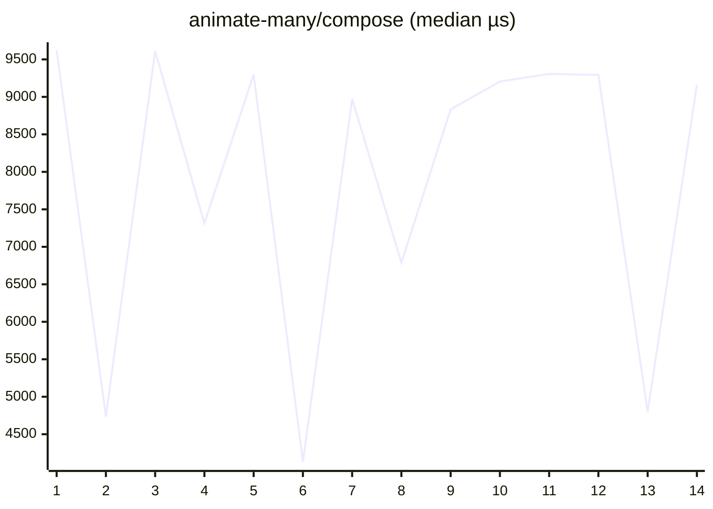

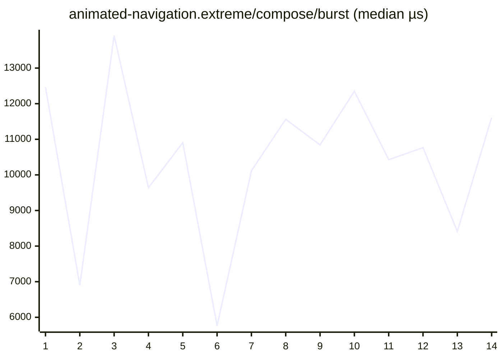


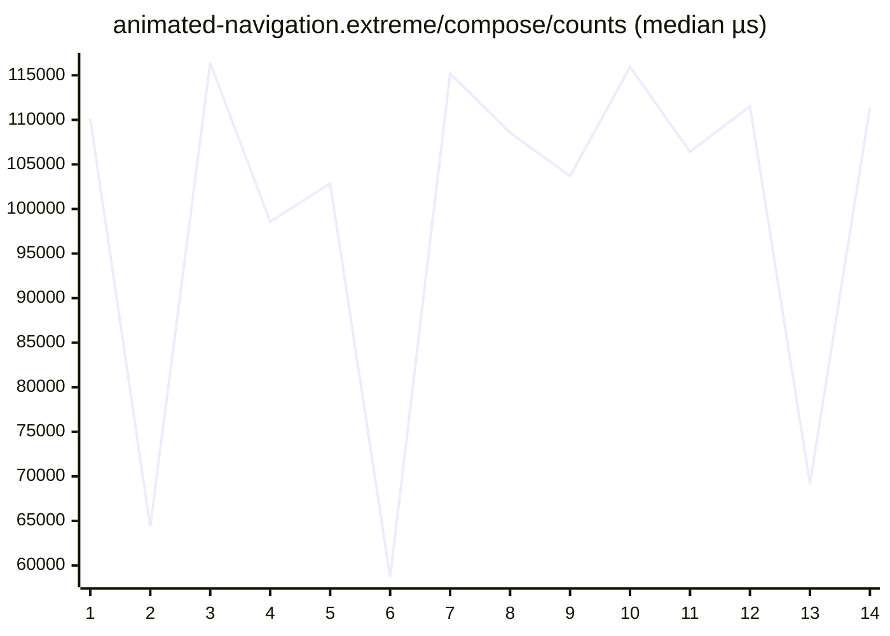


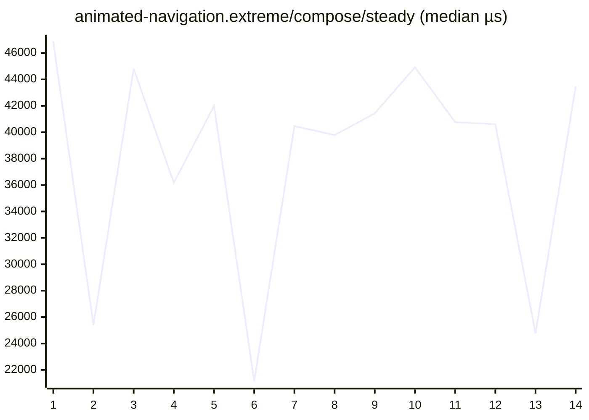

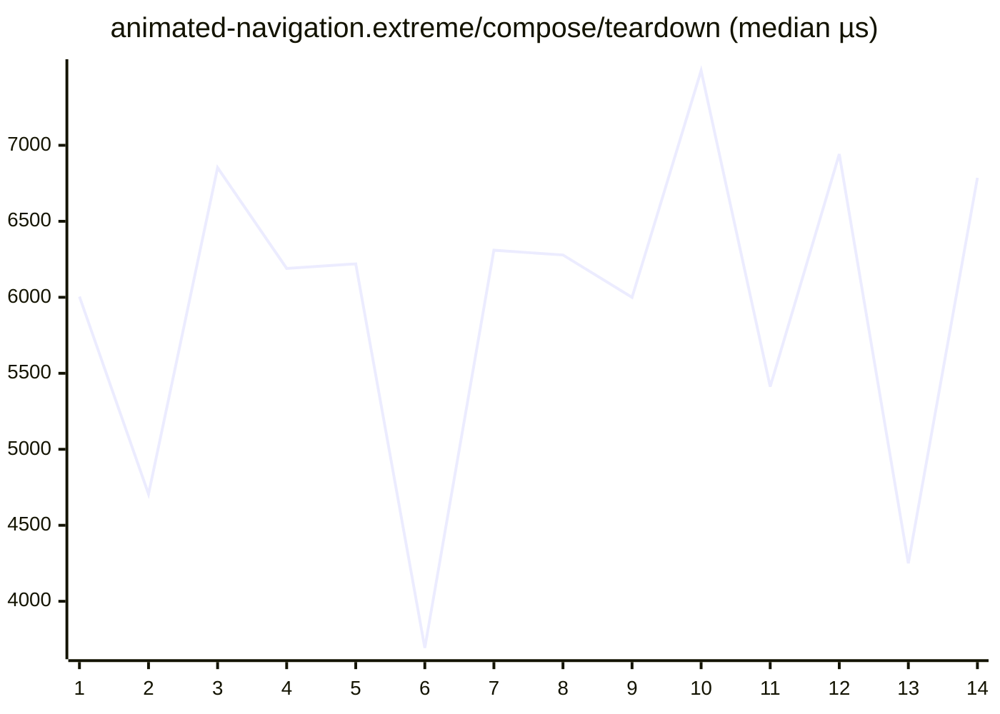


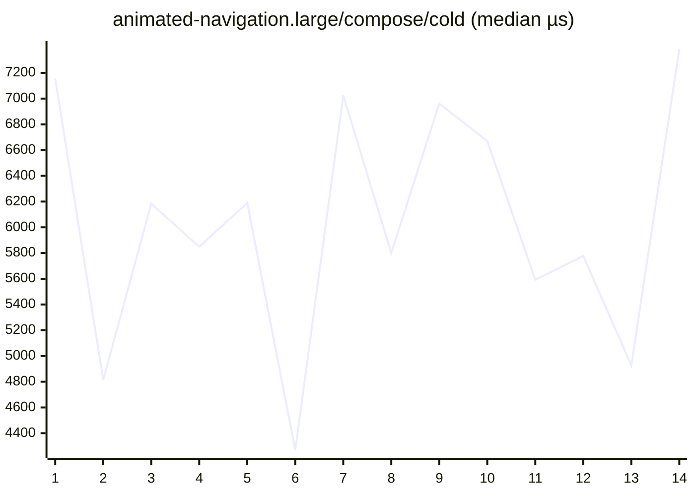

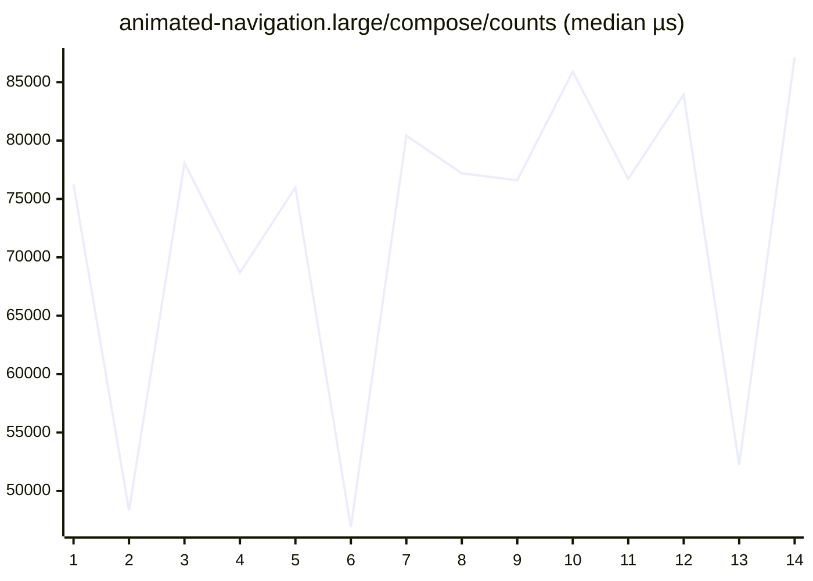

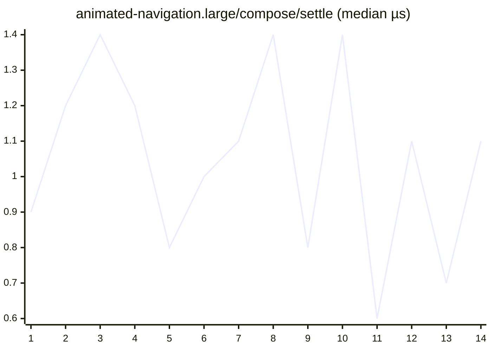

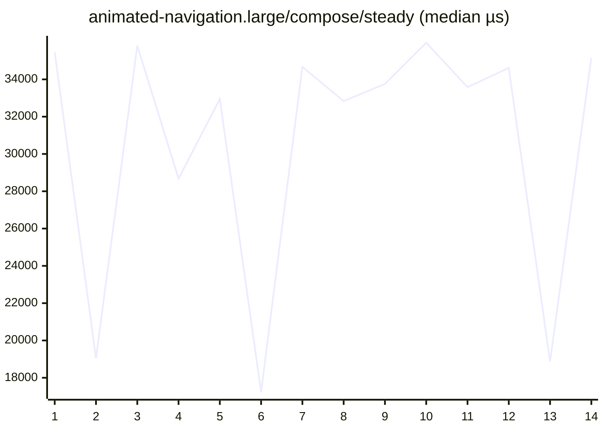


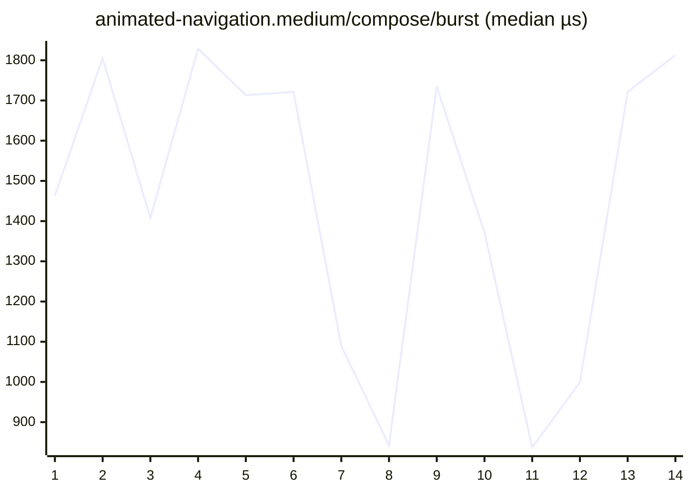

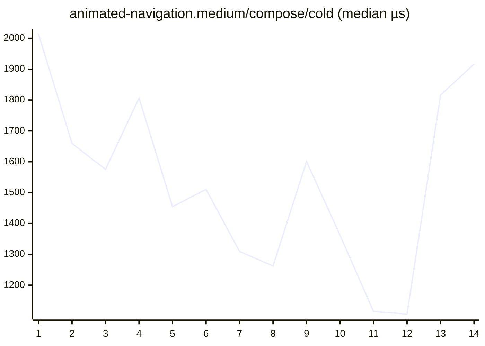


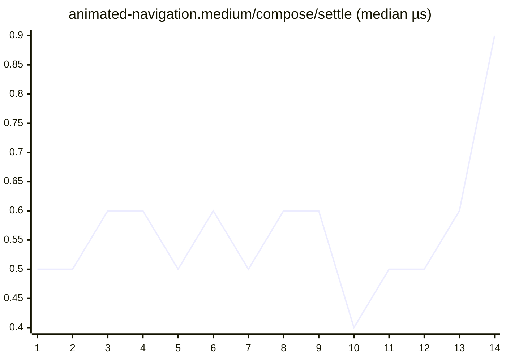

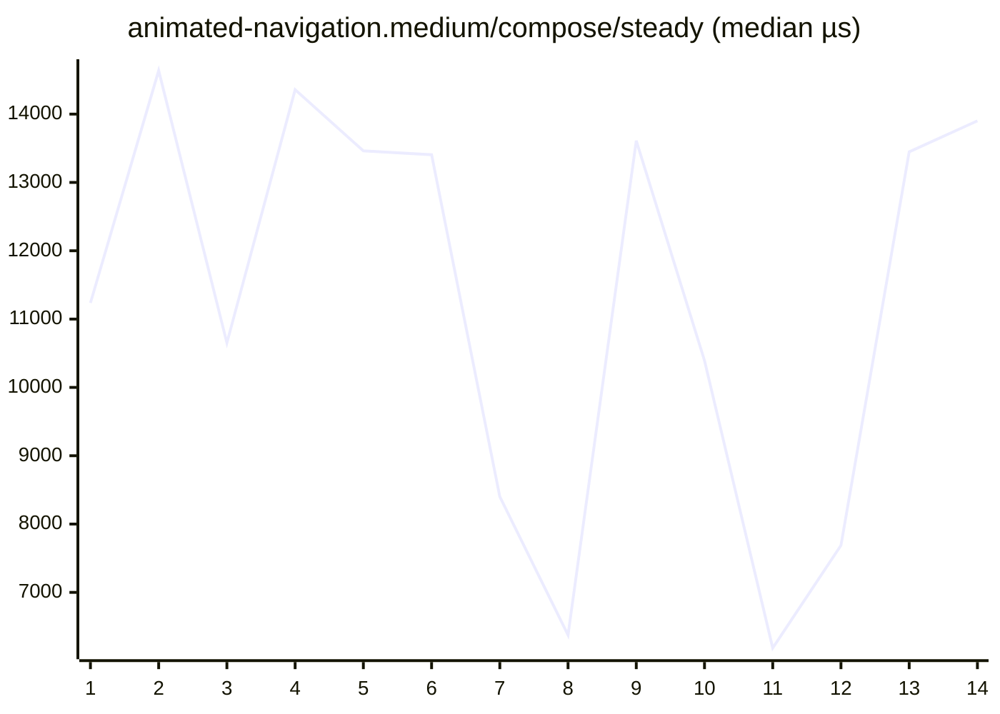


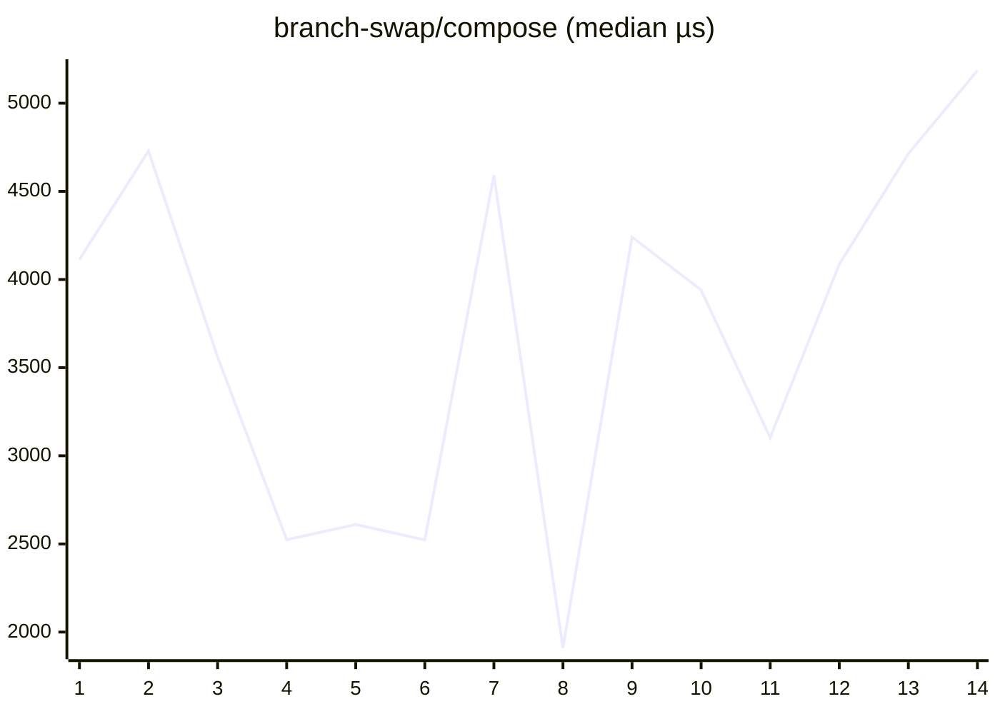

```mermaid
xychart-beta
    title "cold-mount-100/compose (median µs)"
    x-axis 1 --> 14
    line [686.8, 560.2, 838.1, 567.4, 589.5, 322.8, 586.1, 833.3, 574.8, 590.4, 542.0, 551.8, 731.2, 1077.2]
```

```mermaid
xychart-beta
    title "cold-mount-1000/compose (median µs)"
    x-axis 1 --> 14
    line [8399.3, 4719.3, 3773.5, 7121.6, 6041.0, 5964.6, 7856.3, 5534.2, 7586.1, 7564.1, 6423.2, 5716.5, 6155.1, 4680.5]
```

```mermaid
xychart-beta
    title "cold-mount-10000/compose (median µs)"
    x-axis 1 --> 14
    line [74882.4, 77308.0, 75289.0, 90310.2, 100985.1, 86939.8, 92707.3, 108106.4, 117169.6, 87680.3, 84895.8, 118560.2, 74046.2, 87189.7]
```

```mermaid
xychart-beta
    title "data-grid.extreme/compose/burst (median µs)"
    x-axis 1 --> 14
    line [917195.8, 848359.9, 869706.9, 657651.2, 855176.6, 921506.7, 908083.0, 573450.9, 461483.4, 761043.5, 816508.3, 689906.6, 803454.6, 618026.1]
```

```mermaid
xychart-beta
    title "data-grid.extreme/compose/cold (median µs)"
    x-axis 1 --> 14
    line [564671.1, 532198.1, 527821.7, 398200.7, 504535.6, 560369.8, 559329.2, 357117.7, 275265.8, 469042.6, 502280.7, 419753.1, 493032.1, 374544.2]
```

```mermaid
xychart-beta
    title "data-grid.extreme/compose/counts (median µs)"
    x-axis 1 --> 14
    line [1731762.7, 1413521.5, 1498282.4, 1110786.6, 1445044.7, 1520204.8, 1598444.8, 1013220.0, 820746.8, 1359771.1, 1345694.4, 1198215.0, 1381937.6, 1103694.0]
```

```mermaid
xychart-beta
    title "data-grid.extreme/compose/settle (median µs)"
    x-axis 1 --> 14
    line [2.1, 2.1, 1.9, 2.3, 2.1, 2.0, 2.5, 1.9, 2.3, 1.6, 2.0, 2.4, 2.0, 2.1]
```

```mermaid
xychart-beta
    title "data-grid.extreme/compose/steady (median µs)"
    x-axis 1 --> 14
    line [27880.3, 26608.5, 24816.6, 19150.7, 24207.3, 25586.7, 23913.6, 16161.1, 13884.4, 22676.4, 23497.7, 19627.2, 24715.0, 19926.1]
```

```mermaid
xychart-beta
    title "data-grid.extreme/compose/teardown (median µs)"
    x-axis 1 --> 14
    line [1360.6, 1265.7, 1291.4, 1110.8, 1495.5, 1394.8, 1342.7, 1198.4, 894.8, 1159.8, 1218.1, 1067.8, 1172.8, 980.9]
```

```mermaid
xychart-beta
    title "data-grid.large/compose/burst (median µs)"
    x-axis 1 --> 14
    line [108370.1, 137573.0, 114009.5, 133242.0, 132707.0, 131389.9, 95336.0, 90479.1, 132048.5, 117034.0, 90517.6, 99924.5, 142674.2, 152054.8]
```

```mermaid
xychart-beta
    title "data-grid.large/compose/cold (median µs)"
    x-axis 1 --> 14
    line [60694.5, 76941.3, 63120.6, 77459.9, 77741.8, 77504.9, 55851.8, 49552.1, 78186.9, 63835.1, 50574.9, 58902.3, 83015.1, 91492.9]
```

```mermaid
xychart-beta
    title "data-grid.large/compose/counts (median µs)"
    x-axis 1 --> 14
    line [187980.4, 244856.9, 207644.2, 241741.6, 244790.8, 244140.2, 179442.8, 167872.8, 245479.5, 209517.2, 173625.5, 183503.3, 247575.1, 280353.1]
```

```mermaid
xychart-beta
    title "data-grid.large/compose/settle (median µs)"
    x-axis 1 --> 14
    line [1.5, 1.6, 2.4, 1.8, 1.5, 1.4, 1.2, 2.6, 1.6, 1.7, 2.0, 1.4, 1.6, 2.2]
```

```mermaid
xychart-beta
    title "data-grid.large/compose/steady (median µs)"
    x-axis 1 --> 14
    line [14957.3, 18099.0, 16104.9, 16959.8, 15977.4, 16630.3, 11479.9, 11754.6, 16353.8, 12991.3, 10569.2, 12334.9, 17439.5, 17744.9]
```

```mermaid
xychart-beta
    title "data-grid.large/compose/teardown (median µs)"
    x-axis 1 --> 14
    line [469.9, 567.8, 474.6, 573.2, 553.4, 516.9, 391.3, 447.8, 530.9, 497.7, 413.5, 417.8, 673.8, 622.3]
```

```mermaid
xychart-beta
    title "data-grid.medium/compose/burst (median µs)"
    x-axis 1 --> 14
    line [69739.0, 35886.9, 46673.5, 57857.6, 48420.1, 50977.2, 67910.8, 47817.6, 71027.7, 60248.1, 63971.8, 40554.9, 61266.2, 43948.0]
```

```mermaid
xychart-beta
    title "data-grid.medium/compose/cold (median µs)"
    x-axis 1 --> 14
    line [39856.7, 21102.5, 25793.1, 34471.6, 28818.4, 27678.6, 37266.3, 27413.1, 42489.8, 36315.9, 37015.0, 23026.9, 36389.3, 25537.0]
```

```mermaid
xychart-beta
    title "data-grid.medium/compose/counts (median µs)"
    x-axis 1 --> 14
    line [141793.3, 71603.8, 99581.8, 122381.7, 107874.3, 104361.4, 148720.8, 103336.5, 148623.9, 130794.7, 134981.7, 87414.3, 140256.9, 101443.1]
```

```mermaid
xychart-beta
    title "data-grid.medium/compose/settle (median µs)"
    x-axis 1 --> 14
    line [2.3, 1.0, 1.8, 1.5, 2.2, 2.0, 2.7, 2.0, 2.4, 1.4, 1.9, 1.2, 1.8, 2.0]
```

```mermaid
xychart-beta
    title "data-grid.medium/compose/steady (median µs)"
    x-axis 1 --> 14
    line [20754.9, 8162.0, 12334.8, 12381.3, 12840.2, 10470.5, 13619.2, 11418.3, 14976.0, 13623.4, 16125.3, 9286.1, 15988.6, 10571.0]
```

```mermaid
xychart-beta
    title "data-grid.medium/compose/teardown (median µs)"
    x-axis 1 --> 14
    line [356.8, 187.9, 248.2, 292.5, 260.1, 258.1, 350.6, 241.2, 365.1, 291.9, 312.0, 182.4, 298.5, 260.1]
```

```mermaid
xychart-beta
    title "dense-dashboard.extreme/compose/burst (median µs)"
    x-axis 1 --> 14
    line [20153.1, 12231.0, 11532.2, 14838.7, 15355.1, 14237.6, 19804.9, 12160.9, 22267.2, 17938.8, 17343.2, 11744.1, 18935.9, 12431.7]
```

```mermaid
xychart-beta
    title "dense-dashboard.extreme/compose/cold (median µs)"
    x-axis 1 --> 14
    line [606.7, 398.8, 383.4, 479.8, 502.1, 460.9, 622.2, 391.5, 598.7, 533.1, 544.2, 396.2, 582.7, 433.7]
```

```mermaid
xychart-beta
    title "dense-dashboard.extreme/compose/counts (median µs)"
    x-axis 1 --> 14
    line [23438.8, 13693.1, 17691.5, 22404.5, 21786.2, 19601.6, 29177.0, 18354.6, 29196.1, 24726.4, 24497.4, 17843.8, 29355.9, 16907.7]
```

```mermaid
xychart-beta
    title "dense-dashboard.extreme/compose/settle (median µs)"
    x-axis 1 --> 14
    line [1.3, 0.9, 1.2, 1.1, 1.4, 0.9, 2.0, 1.1, 1.9, 1.0, 1.0, 1.1, 1.1, 1.3]
```

```mermaid
xychart-beta
    title "dense-dashboard.extreme/compose/steady (median µs)"
    x-axis 1 --> 14
    line [863.1, 432.7, 533.0, 686.6, 708.9, 700.6, 897.3, 551.6, 891.7, 837.9, 851.9, 466.5, 847.8, 522.7]
```

```mermaid
xychart-beta
    title "dense-dashboard.extreme/compose/teardown (median µs)"
    x-axis 1 --> 14
    line [599.1, 388.0, 393.2, 539.8, 566.2, 477.4, 750.9, 387.6, 852.7, 578.6, 584.8, 403.3, 604.5, 409.3]
```

```mermaid
xychart-beta
    title "dense-dashboard.large/compose/burst (median µs)"
    x-axis 1 --> 14
    line [9706.7, 4188.0, 5056.8, 5928.3, 7819.4, 5262.6, 10115.0, 6456.2, 9438.2, 6248.7, 8699.0, 5344.5, 8641.8, 5255.7]
```

```mermaid
xychart-beta
    title "dense-dashboard.large/compose/cold (median µs)"
    x-axis 1 --> 14
    line [371.6, 211.1, 249.9, 272.8, 305.9, 241.0, 388.7, 281.7, 353.2, 277.0, 315.2, 224.8, 318.8, 254.6]
```

```mermaid
xychart-beta
    title "dense-dashboard.large/compose/counts (median µs)"
    x-axis 1 --> 14
    line [16409.6, 9670.9, 14102.2, 13629.3, 13693.5, 13209.6, 18184.6, 13156.2, 19699.1, 16149.3, 17614.6, 12484.4, 17033.2, 11006.9]
```

```mermaid
xychart-beta
    title "dense-dashboard.large/compose/settle (median µs)"
    x-axis 1 --> 14
    line [1.0, 0.6, 1.2, 0.9, 1.0, 0.7, 1.6, 1.1, 1.3, 0.8, 0.8, 1.0, 0.8, 1.1]
```

```mermaid
xychart-beta
    title "dense-dashboard.large/compose/steady (median µs)"
    x-axis 1 --> 14
    line [865.5, 435.0, 514.3, 679.4, 690.4, 687.8, 906.9, 544.2, 843.3, 826.2, 842.4, 453.4, 832.9, 543.4]
```

```mermaid
xychart-beta
    title "dense-dashboard.large/compose/teardown (median µs)"
    x-axis 1 --> 14
    line [297.0, 159.4, 204.5, 229.9, 234.0, 203.9, 330.2, 203.6, 300.1, 241.5, 297.5, 179.0, 256.5, 184.9]
```

```mermaid
xychart-beta
    title "dense-dashboard.medium/compose/burst (median µs)"
    x-axis 1 --> 14
    line [3256.9, 3747.3, 2886.3, 1441.8, 1725.1, 2212.3, 2923.7, 1545.5, 3048.9, 2276.1, 2787.0, 3601.1, 2820.4, 3481.9]
```

```mermaid
xychart-beta
    title "dense-dashboard.medium/compose/cold (median µs)"
    x-axis 1 --> 14
    line [214.4, 274.0, 218.8, 100.9, 158.5, 169.7, 216.8, 94.9, 220.6, 178.7, 193.6, 231.5, 195.7, 210.2]
```

```mermaid
xychart-beta
    title "dense-dashboard.medium/compose/counts (median µs)"
    x-axis 1 --> 14
    line [6736.4, 8374.2, 5949.6, 3187.1, 3588.3, 3998.0, 5805.3, 3074.5, 6058.2, 4688.6, 4602.1, 6344.4, 5931.1, 6502.2]
```

```mermaid
xychart-beta
    title "dense-dashboard.medium/compose/settle (median µs)"
    x-axis 1 --> 14
    line [0.8, 1.3, 0.7, 0.4, 0.9, 0.6, 1.0, 0.4, 0.7, 0.5, 0.7, 0.7, 0.7, 0.7]
```

```mermaid
xychart-beta
    title "dense-dashboard.medium/compose/steady (median µs)"
    x-axis 1 --> 14
    line [823.5, 817.9, 816.4, 407.5, 448.9, 446.8, 626.3, 405.8, 836.7, 691.9, 679.1, 829.3, 806.3, 886.2]
```

```mermaid
xychart-beta
    title "dense-dashboard.medium/compose/teardown (median µs)"
    x-axis 1 --> 14
    line [120.9, 153.9, 121.5, 62.5, 79.1, 89.7, 105.7, 57.1, 114.0, 91.1, 113.4, 114.9, 114.1, 129.6]
```

```mermaid
xychart-beta
    title "entities-identity-churn-10.extreme/compose/burst (median µs)"
    x-axis 1 --> 14
    line [57275.1, 58550.6, 48500.0, 29373.5, 40666.3, 39982.2, 49684.3, 29001.5, 55300.8, 46626.0, 54331.2, 47385.4, 44184.1, 57350.2]
```

```mermaid
xychart-beta
    title "entities-identity-churn-10.extreme/compose/cold (median µs)"
    x-axis 1 --> 14
    line [35128.8, 48787.2, 29239.1, 17390.4, 22368.5, 29280.2, 24311.0, 16950.3, 33925.4, 35068.3, 35395.1, 30904.1, 25973.8, 35820.1]
```

```mermaid
xychart-beta
    title "entities-identity-churn-10.extreme/compose/counts (median µs)"
    x-axis 1 --> 14
    line [203645.1, 278041.5, 232881.6, 153922.4, 182354.5, 184019.0, 216326.1, 144957.2, 253653.9, 222367.1, 244247.3, 227252.0, 222707.6, 229905.6]
```

```mermaid
xychart-beta
    title "entities-identity-churn-10.extreme/compose/settle (median µs)"
    x-axis 1 --> 14
    line [1.7, 2.7, 2.1, 1.3, 2.4, 2.5, 2.5, 1.7, 2.1, 2.4, 2.7, 1.8, 1.7, 2.3]
```

```mermaid
xychart-beta
    title "entities-identity-churn-10.extreme/compose/steady (median µs)"
    x-axis 1 --> 14
    line [67605.4, 110490.0, 62006.6, 30428.1, 51252.0, 46762.5, 64252.2, 28767.6, 66612.9, 59787.7, 63653.0, 55688.2, 55625.3, 65233.1]
```

```mermaid
xychart-beta
    title "entities-identity-churn-10.extreme/compose/teardown (median µs)"
    x-axis 1 --> 14
    line [1382.9, 1964.2, 1144.8, 694.6, 900.0, 1153.0, 1185.0, 704.6, 1317.6, 1288.5, 1374.1, 1154.8, 1108.5, 1439.2]
```

```mermaid
xychart-beta
    title "entities-identity-churn-10.large/compose/burst (median µs)"
    x-axis 1 --> 14
    line [22661.4, 12171.9, 13759.9, 13609.3, 14702.9, 13810.3, 16589.5, 13156.5, 16938.4, 14336.2, 14496.7, 12469.3, 15407.9, 10352.2]
```

```mermaid
xychart-beta
    title "entities-identity-churn-10.large/compose/cold (median µs)"
    x-axis 1 --> 14
    line [16026.8, 10773.1, 8930.7, 10020.5, 8909.7, 10600.2, 13336.4, 10600.4, 12699.6, 11446.0, 12019.2, 7298.6, 11158.7, 8272.5]
```

```mermaid
xychart-beta
    title "entities-identity-churn-10.large/compose/counts (median µs)"
    x-axis 1 --> 14
    line [80942.4, 39356.0, 64825.7, 63038.7, 65034.2, 58295.1, 80549.5, 59637.8, 87345.1, 67044.6, 67442.3, 52391.8, 70744.8, 45340.9]
```

```mermaid
xychart-beta
    title "entities-identity-churn-10.large/compose/settle (median µs)"
    x-axis 1 --> 14
    line [1.9, 1.8, 1.6, 1.3, 1.8, 1.6, 2.4, 1.4, 2.1, 1.2, 1.3, 1.3, 1.7, 1.2]
```

```mermaid
xychart-beta
    title "entities-identity-churn-10.large/compose/steady (median µs)"
    x-axis 1 --> 14
    line [29699.1, 13169.4, 18127.8, 19237.6, 16977.4, 16994.0, 22978.3, 17373.8, 24022.9, 20372.9, 19422.1, 16158.3, 19649.2, 15884.6]
```

```mermaid
xychart-beta
    title "entities-identity-churn-10.large/compose/teardown (median µs)"
    x-axis 1 --> 14
    line [555.6, 288.1, 337.4, 360.3, 368.0, 351.5, 470.6, 319.2, 503.9, 407.0, 387.4, 294.0, 408.2, 292.6]
```

```mermaid
xychart-beta
    title "entities-identity-churn-10.medium/compose/burst (median µs)"
    x-axis 1 --> 14
    line [8775.5, 6489.2, 8202.0, 6319.3, 6445.7, 3900.8, 7292.3, 7175.4, 6417.0, 7572.0, 6505.7, 7539.0, 4551.2, 7381.0]
```

```mermaid
xychart-beta
    title "entities-identity-churn-10.medium/compose/cold (median µs)"
    x-axis 1 --> 14
    line [6847.6, 4064.4, 5318.6, 5299.9, 5743.4, 2913.7, 5973.1, 4930.1, 5396.7, 6172.9, 5428.8, 6106.4, 3768.4, 5332.9]
```

```mermaid
xychart-beta
    title "entities-identity-churn-10.medium/compose/counts (median µs)"
    x-axis 1 --> 14
    line [33013.6, 23547.5, 40497.8, 27670.3, 31664.9, 18380.9, 32467.4, 30743.4, 32153.6, 32792.7, 29426.3, 33269.3, 24241.3, 32295.2]
```

```mermaid
xychart-beta
    title "entities-identity-churn-10.medium/compose/settle (median µs)"
    x-axis 1 --> 14
    line [1.1, 1.6, 2.1, 1.6, 0.8, 0.6, 1.3, 1.4, 0.8, 1.5, 0.7, 1.7, 0.9, 0.9]
```

```mermaid
xychart-beta
    title "entities-identity-churn-10.medium/compose/steady (median µs)"
    x-axis 1 --> 14
    line [10632.2, 6021.8, 10678.6, 8206.7, 8958.3, 4763.9, 9523.9, 9074.0, 9048.8, 9567.1, 9299.6, 9981.8, 6169.6, 8767.4]
```

```mermaid
xychart-beta
    title "entities-identity-churn-10.medium/compose/teardown (median µs)"
    x-axis 1 --> 14
    line [231.8, 181.7, 264.1, 212.7, 181.2, 110.8, 211.8, 210.3, 188.4, 238.5, 207.6, 239.0, 147.6, 196.3]
```

```mermaid
xychart-beta
    title "entities-identity-churn-50.extreme/compose/burst (median µs)"
    x-axis 1 --> 14
    line [38163.8, 45513.9, 41164.8, 46703.8, 44520.9, 38822.5, 40775.0, 36485.4, 43653.6, 35867.4, 34266.2, 32167.3, 47315.9, 56247.1]
```

```mermaid
xychart-beta
    title "entities-identity-churn-50.extreme/compose/cold (median µs)"
    x-axis 1 --> 14
    line [30010.2, 36978.8, 29991.4, 41393.0, 32387.4, 25962.5, 25504.0, 25319.0, 37083.9, 25771.7, 25931.6, 22738.4, 30340.0, 38850.1]
```

```mermaid
xychart-beta
    title "entities-identity-churn-50.extreme/compose/counts (median µs)"
    x-axis 1 --> 14
    line [308853.3, 356183.6, 347691.5, 358267.1, 320929.1, 329140.8, 275854.8, 259581.0, 334907.8, 295014.5, 246701.5, 267573.0, 384574.9, 394862.2]
```

```mermaid
xychart-beta
    title "entities-identity-churn-50.extreme/compose/settle (median µs)"
    x-axis 1 --> 14
    line [1.9, 1.8, 2.1, 2.0, 1.8, 1.8, 1.4, 2.3, 2.2, 1.9, 2.2, 1.6, 2.1, 2.4]
```

```mermaid
xychart-beta
    title "entities-identity-churn-50.extreme/compose/steady (median µs)"
    x-axis 1 --> 14
    line [170674.3, 195161.2, 168550.7, 182630.3, 163543.1, 182753.2, 138682.5, 133780.4, 165275.8, 149408.4, 111451.2, 136217.5, 203349.1, 212304.8]
```

```mermaid
xychart-beta
    title "entities-identity-churn-50.extreme/compose/teardown (median µs)"
    x-axis 1 --> 14
    line [1011.2, 1123.7, 1080.1, 1376.9, 1058.4, 1062.6, 926.8, 1133.5, 1104.3, 970.0, 848.3, 985.0, 1305.6, 1480.7]
```

```mermaid
xychart-beta
    title "entities-identity-churn-50.large/compose/burst (median µs)"
    x-axis 1 --> 14
    line [20445.0, 22651.5, 14964.2, 12211.5, 11912.3, 14060.4, 15071.6, 9027.6, 18620.6, 19561.0, 14256.0, 15757.8, 16733.7, 18175.8]
```

```mermaid
xychart-beta
    title "entities-identity-churn-50.large/compose/cold (median µs)"
    x-axis 1 --> 14
    line [12195.2, 16233.7, 12335.9, 7185.3, 8832.7, 11712.1, 10066.8, 8342.5, 10620.5, 8742.6, 11307.8, 13813.6, 10078.2, 11520.7]
```

```mermaid
xychart-beta
    title "entities-identity-churn-50.large/compose/counts (median µs)"
    x-axis 1 --> 14
    line [116758.9, 159716.3, 121699.6, 72346.5, 90059.4, 95283.3, 117176.1, 61067.3, 135298.4, 127316.3, 114177.9, 123935.4, 115659.7, 141317.2]
```

```mermaid
xychart-beta
    title "entities-identity-churn-50.large/compose/settle (median µs)"
    x-axis 1 --> 14
    line [1.7, 2.6, 1.9, 1.3, 1.5, 2.2, 2.2, 1.2, 1.7, 1.7, 1.8, 1.7, 1.7, 2.2]
```

```mermaid
xychart-beta
    title "entities-identity-churn-50.large/compose/steady (median µs)"
    x-axis 1 --> 14
    line [65487.9, 100478.1, 59706.0, 34308.7, 51437.5, 47528.6, 59568.6, 31848.4, 60575.3, 53501.9, 51348.9, 56812.4, 56379.8, 63971.2]
```

```mermaid
xychart-beta
    title "entities-identity-churn-50.large/compose/teardown (median µs)"
    x-axis 1 --> 14
    line [465.8, 729.5, 440.9, 295.7, 317.9, 369.3, 410.5, 228.9, 431.5, 405.0, 388.3, 429.0, 422.8, 503.6]
```

```mermaid
xychart-beta
    title "entities-identity-churn-50.medium/compose/burst (median µs)"
    x-axis 1 --> 14
    line [7359.9, 9363.4, 7988.6, 9747.3, 9365.5, 8349.5, 6021.4, 7530.2, 8564.1, 7945.3, 5942.5, 6061.8, 9300.0, 9685.8]
```

```mermaid
xychart-beta
    title "entities-identity-churn-50.medium/compose/cold (median µs)"
    x-axis 1 --> 14
    line [5217.5, 8076.9, 4571.3, 5260.1, 4670.0, 5901.2, 3485.4, 3508.0, 6353.3, 5982.3, 4253.9, 3093.3, 6073.5, 5226.8]
```

```mermaid
xychart-beta
    title "entities-identity-churn-50.medium/compose/counts (median µs)"
    x-axis 1 --> 14
    line [53771.4, 72919.2, 57149.8, 65876.4, 59908.3, 63387.5, 49532.5, 47417.3, 63149.1, 51987.3, 47650.9, 50996.6, 65923.4, 65597.9]
```

```mermaid
xychart-beta
    title "entities-identity-churn-50.medium/compose/settle (median µs)"
    x-axis 1 --> 14
    line [1.0, 1.3, 1.6, 1.3, 1.0, 0.9, 1.1, 2.1, 1.1, 1.2, 1.3, 1.1, 1.3, 1.9]
```

```mermaid
xychart-beta
    title "entities-identity-churn-50.medium/compose/steady (median µs)"
    x-axis 1 --> 14
    line [24173.9, 29083.3, 23959.0, 26680.3, 24724.4, 25894.3, 17904.5, 18238.3, 25204.8, 20874.4, 18761.8, 18671.9, 24933.1, 26327.0]
```

```mermaid
xychart-beta
    title "entities-identity-churn-50.medium/compose/teardown (median µs)"
    x-axis 1 --> 14
    line [206.6, 265.4, 235.4, 253.6, 224.3, 241.3, 176.2, 215.7, 232.0, 204.8, 166.6, 163.6, 247.9, 268.2]
```

```mermaid
xychart-beta
    title "entities-identity-churn.extreme/compose/burst (median µs)"
    x-axis 1 --> 14
    line [67899.9, 40475.8, 49011.8, 47993.9, 58958.8, 49403.5, 73334.0, 54549.5, 66548.0, 54692.4, 50808.2, 45346.6, 64404.4, 44556.8]
```

```mermaid
xychart-beta
    title "entities-identity-churn.extreme/compose/cold (median µs)"
    x-axis 1 --> 14
    line [43440.3, 23189.6, 21354.5, 24947.4, 23666.7, 30840.0, 48721.1, 23251.0, 32258.1, 34556.2, 37320.9, 26896.5, 28562.5, 18882.8]
```

```mermaid
xychart-beta
    title "entities-identity-churn.extreme/compose/counts (median µs)"
    x-axis 1 --> 14
    line [322090.0, 155075.8, 263232.8, 241537.1, 281124.0, 231871.8, 353585.2, 248508.0, 354600.3, 272145.1, 280403.1, 215439.7, 275925.5, 232621.2]
```

```mermaid
xychart-beta
    title "entities-identity-churn.extreme/compose/settle (median µs)"
    x-axis 1 --> 14
    line [2.2, 2.0, 2.2, 1.5, 2.1, 2.1, 3.1, 2.2, 2.6, 1.9, 2.0, 2.2, 1.9, 2.3]
```

```mermaid
xychart-beta
    title "entities-identity-churn.extreme/compose/steady (median µs)"
    x-axis 1 --> 14
    line [168290.2, 78037.0, 94632.2, 97962.6, 108987.6, 90436.8, 176374.5, 99424.5, 155470.2, 102340.9, 104819.1, 92642.8, 109719.2, 93469.6]
```

```mermaid
xychart-beta
    title "entities-identity-churn.extreme/compose/teardown (median µs)"
    x-axis 1 --> 14
    line [1918.2, 1082.7, 1099.8, 1219.6, 1413.1, 1134.2, 2628.7, 1181.1, 1619.0, 1290.8, 1234.4, 1140.3, 1481.3, 1048.1]
```

```mermaid
xychart-beta
    title "entities-identity-churn.large/compose/burst (median µs)"
    x-axis 1 --> 14
    line [15198.1, 12817.1, 17384.4, 12828.2, 14670.0, 10802.1, 16642.4, 15644.2, 13803.3, 15894.8, 14230.7, 17457.7, 12369.8, 16567.9]
```

```mermaid
xychart-beta
    title "entities-identity-churn.large/compose/cold (median µs)"
    x-axis 1 --> 14
    line [14413.0, 10025.1, 12412.5, 10919.1, 9991.0, 7777.1, 12912.0, 9409.6, 12787.2, 12599.2, 13130.1, 11285.8, 9709.2, 10198.8]
```

```mermaid
xychart-beta
    title "entities-identity-churn.large/compose/counts (median µs)"
    x-axis 1 --> 14
    line [94808.6, 66047.0, 131198.0, 102800.1, 106962.5, 78783.2, 123433.1, 103192.9, 104430.0, 107261.8, 97542.2, 114780.9, 81637.6, 108041.6]
```

```mermaid
xychart-beta
    title "entities-identity-churn.large/compose/settle (median µs)"
    x-axis 1 --> 14
    line [1.7, 2.1, 2.3, 1.7, 1.5, 1.8, 2.1, 1.8, 1.5, 2.1, 1.2, 1.9, 1.1, 1.6]
```

```mermaid
xychart-beta
    title "entities-identity-churn.large/compose/steady (median µs)"
    x-axis 1 --> 14
    line [42870.9, 30465.6, 44952.7, 30109.8, 34357.1, 23042.6, 39531.9, 34800.9, 32076.5, 35789.2, 30831.0, 35006.3, 26722.2, 34206.4]
```

```mermaid
xychart-beta
    title "entities-identity-churn.large/compose/teardown (median µs)"
    x-axis 1 --> 14
    line [421.7, 347.3, 504.6, 355.7, 394.0, 294.7, 437.3, 369.5, 374.1, 431.8, 360.0, 430.7, 282.8, 400.7]
```

```mermaid
xychart-beta
    title "entities-identity-churn.medium/compose/burst (median µs)"
    x-axis 1 --> 14
    line [9268.9, 6214.3, 6318.0, 7594.1, 7048.3, 6573.8, 9681.2, 6917.6, 10671.7, 7352.6, 7444.0, 5553.5, 8327.7, 5800.0]
```

```mermaid
xychart-beta
    title "entities-identity-churn.medium/compose/cold (median µs)"
    x-axis 1 --> 14
    line [6175.2, 5202.2, 4209.2, 4766.1, 4414.4, 4459.7, 5534.7, 4639.2, 6259.4, 4559.3, 5122.8, 3357.2, 5238.4, 3007.7]
```

```mermaid
xychart-beta
    title "entities-identity-churn.medium/compose/counts (median µs)"
    x-axis 1 --> 14
    line [48430.6, 24546.5, 34883.2, 42248.6, 35027.4, 39583.1, 54112.8, 35568.3, 53135.7, 45790.5, 44009.5, 32544.3, 46007.6, 30291.5]
```

```mermaid
xychart-beta
    title "entities-identity-churn.medium/compose/settle (median µs)"
    x-axis 1 --> 14
    line [1.8, 1.7, 1.3, 1.0, 1.4, 1.1, 2.0, 1.2, 2.2, 0.9, 1.0, 1.2, 1.1, 1.0]
```

```mermaid
xychart-beta
    title "entities-identity-churn.medium/compose/steady (median µs)"
    x-axis 1 --> 14
    line [18970.0, 11144.9, 13984.1, 14562.6, 12821.2, 13331.6, 17419.2, 12697.6, 19931.5, 14936.2, 14865.4, 12633.7, 15363.1, 9969.8]
```

```mermaid
xychart-beta
    title "entities-identity-churn.medium/compose/teardown (median µs)"
    x-axis 1 --> 14
    line [266.7, 172.8, 182.1, 197.6, 194.9, 188.5, 272.0, 172.4, 326.5, 214.9, 209.0, 161.2, 226.1, 146.6]
```

```mermaid
xychart-beta
    title "entities-integrated.extreme/compose/burst (median µs)"
    x-axis 1 --> 14
    line [21280.1, 17085.4, 25262.9, 28283.5, 20257.0, 10917.0, 19502.9, 24080.5, 19960.3, 23727.6, 18390.4, 21100.0, 17439.3, 20030.5]
```

```mermaid
xychart-beta
    title "entities-integrated.extreme/compose/cold (median µs)"
    x-axis 1 --> 14
    line [107928.0, 93149.3, 109143.0, 107346.8, 112756.0, 73472.7, 113745.4, 103329.2, 116577.4, 113946.5, 114118.9, 112593.3, 90008.5, 108330.3]
```

```mermaid
xychart-beta
    title "entities-integrated.extreme/compose/counts (median µs)"
    x-axis 1 --> 14
    line [345877.0, 271171.1, 372031.9, 371349.9, 343525.6, 217868.2, 360516.2, 336407.1, 365059.0, 423319.5, 361829.1, 349288.6, 282524.2, 357406.1]
```

```mermaid
xychart-beta
    title "entities-integrated.extreme/compose/settle (median µs)"
    x-axis 1 --> 14
    line [1.8, 2.2, 2.2, 2.2, 1.9, 1.8, 1.9, 2.1, 1.9, 2.3, 1.6, 2.2, 1.6, 2.1]
```

```mermaid
xychart-beta
    title "entities-integrated.extreme/compose/steady (median µs)"
    x-axis 1 --> 14
    line [112062.9, 90774.1, 117256.3, 106657.1, 98348.3, 59055.9, 101799.9, 103158.3, 100873.5, 115044.8, 87598.0, 108020.6, 74589.8, 97192.1]
```

```mermaid
xychart-beta
    title "entities-integrated.extreme/compose/teardown (median µs)"
    x-axis 1 --> 14
    line [33241.4, 38551.9, 37604.0, 45565.4, 37162.6, 31516.4, 39172.8, 37057.2, 37139.6, 45558.4, 33108.3, 47613.6, 27231.7, 41531.6]
```

```mermaid
xychart-beta
    title "entities-integrated.large/compose/burst (median µs)"
    x-axis 1 --> 14
    line [8720.8, 10514.8, 8702.4, 10287.4, 10136.5, 9822.3, 8483.4, 7252.4, 9927.0, 8424.9, 6957.0, 8468.7, 10206.6, 14920.9]
```

```mermaid
xychart-beta
    title "entities-integrated.large/compose/cold (median µs)"
    x-axis 1 --> 14
    line [35331.9, 46561.1, 36425.1, 45716.0, 39872.5, 39917.1, 29158.2, 30742.1, 43972.9, 34958.4, 32787.8, 29287.8, 42325.9, 49728.2]
```

```mermaid
xychart-beta
    title "entities-integrated.large/compose/counts (median µs)"
    x-axis 1 --> 14
    line [127887.2, 165417.5, 156094.5, 170891.3, 159918.6, 159409.8, 123085.1, 129687.2, 160052.6, 139696.9, 134004.0, 122945.8, 170282.3, 206774.8]
```

```mermaid
xychart-beta
    title "entities-integrated.large/compose/settle (median µs)"
    x-axis 1 --> 14
    line [1.4, 1.6, 2.0, 1.5, 1.1, 1.3, 1.2, 1.9, 1.5, 1.3, 2.1, 1.3, 1.6, 2.1]
```

```mermaid
xychart-beta
    title "entities-integrated.large/compose/steady (median µs)"
    x-axis 1 --> 14
    line [42270.1, 58987.0, 46845.8, 49441.4, 48906.3, 48394.1, 38336.6, 38926.6, 50075.4, 42207.0, 38612.3, 37360.6, 54678.6, 67411.4]
```

```mermaid
xychart-beta
    title "entities-integrated.large/compose/teardown (median µs)"
    x-axis 1 --> 14
    line [9384.4, 11676.7, 12636.7, 11453.4, 9676.2, 9468.6, 7501.9, 12956.1, 10009.3, 9471.1, 13938.6, 7721.6, 12193.9, 18029.9]
```

```mermaid
xychart-beta
    title "entities-integrated.medium/compose/burst (median µs)"
    x-axis 1 --> 14
    line [8064.7, 5412.3, 8325.1, 7310.8, 7725.2, 4373.6, 8143.5, 7842.8, 7736.3, 7767.2, 7690.7, 7697.9, 6319.0, 7829.1]
```

```mermaid
xychart-beta
    title "entities-integrated.medium/compose/cold (median µs)"
    x-axis 1 --> 14
    line [23640.0, 18354.3, 20523.4, 16963.3, 24114.6, 15390.3, 22026.8, 20615.5, 21547.9, 19992.3, 18799.4, 22885.9, 15659.8, 21287.6]
```

```mermaid
xychart-beta
    title "entities-integrated.medium/compose/counts (median µs)"
    x-axis 1 --> 14
    line [92316.8, 67519.0, 107959.8, 94567.5, 113174.7, 55185.3, 104655.9, 96762.4, 98185.9, 114888.1, 97832.6, 104372.1, 74869.5, 105893.4]
```

```mermaid
xychart-beta
    title "entities-integrated.medium/compose/settle (median µs)"
    x-axis 1 --> 14
    line [1.6, 2.1, 2.2, 1.7, 1.5, 1.0, 1.9, 2.1, 1.6, 1.7, 1.6, 1.7, 1.2, 1.6]
```

```mermaid
xychart-beta
    title "entities-integrated.medium/compose/steady (median µs)"
    x-axis 1 --> 14
    line [39845.5, 29943.1, 47449.4, 35007.7, 37155.4, 20922.3, 41221.1, 36357.3, 41695.6, 35887.0, 39232.7, 35605.8, 30858.8, 34901.2]
```

```mermaid
xychart-beta
    title "entities-integrated.medium/compose/teardown (median µs)"
    x-axis 1 --> 14
    line [6105.6, 6486.4, 6913.2, 7758.7, 5425.1, 3598.7, 7513.6, 6383.3, 5777.9, 6224.8, 6071.4, 6893.6, 4435.3, 6452.0]
```

```mermaid
xychart-beta
    title "entities-relevance-saturated.extreme/compose/burst (median µs)"
    x-axis 1 --> 14
    line [95057.1, 94073.3, 97254.7, 96247.4, 87014.9, 56203.8, 97444.4, 80154.4, 77927.4, 103746.7, 82803.5, 93375.6, 59829.5, 101895.7]
```

```mermaid
xychart-beta
    title "entities-relevance-saturated.extreme/compose/cold (median µs)"
    x-axis 1 --> 14
    line [30591.9, 22227.2, 28424.7, 29174.1, 36070.7, 21358.8, 36288.9, 26574.9, 35611.0, 36983.5, 34520.6, 36564.2, 21527.8, 37487.9]
```

```mermaid
xychart-beta
    title "entities-relevance-saturated.extreme/compose/counts (median µs)"
    x-axis 1 --> 14
    line [228810.1, 211002.3, 277035.4, 262243.7, 240299.8, 164476.9, 257313.3, 264214.0, 233920.7, 276780.2, 221301.1, 270359.0, 177921.8, 274771.1]
```

```mermaid
xychart-beta
    title "entities-relevance-saturated.extreme/compose/settle (median µs)"
    x-axis 1 --> 14
    line [2.0, 2.8, 2.9, 2.6, 2.0, 2.1, 2.8, 2.4, 2.1, 2.9, 2.0, 3.0, 1.8, 2.8]
```

```mermaid
xychart-beta
    title "entities-relevance-saturated.extreme/compose/steady (median µs)"
    x-axis 1 --> 14
    line [56507.4, 52162.7, 59312.8, 52039.1, 53658.6, 36010.3, 61177.2, 57566.9, 48010.2, 68485.7, 53094.5, 57009.3, 41539.1, 57133.3]
```

```mermaid
xychart-beta
    title "entities-relevance-saturated.extreme/compose/teardown (median µs)"
    x-axis 1 --> 14
    line [13113.8, 13417.0, 14500.7, 15465.3, 13655.0, 10660.5, 15751.4, 13314.0, 13344.5, 17644.9, 12661.0, 16440.7, 11094.6, 16090.4]
```

```mermaid
xychart-beta
    title "entities-relevance-saturated.large/compose/burst (median µs)"
    x-axis 1 --> 14
    line [27403.3, 40547.2, 27643.0, 16736.6, 24669.8, 21688.5, 29979.9, 16166.2, 30300.2, 30155.5, 28582.6, 28651.2, 27329.9, 28979.2]
```

```mermaid
xychart-beta
    title "entities-relevance-saturated.large/compose/cold (median µs)"
    x-axis 1 --> 14
    line [11952.4, 12445.2, 13843.1, 7413.0, 8312.1, 8704.4, 10161.2, 6701.9, 12357.0, 10756.6, 10370.8, 11728.1, 11365.2, 11702.2]
```

```mermaid
xychart-beta
    title "entities-relevance-saturated.large/compose/counts (median µs)"
    x-axis 1 --> 14
    line [100423.7, 101703.7, 92984.2, 61791.0, 76047.1, 71772.8, 86609.3, 65186.0, 106708.1, 101829.6, 109206.6, 92523.3, 98196.1, 103780.3]
```

```mermaid
xychart-beta
    title "entities-relevance-saturated.large/compose/settle (median µs)"
    x-axis 1 --> 14
    line [1.5, 2.3, 2.0, 1.3, 1.4, 2.1, 2.5, 1.5, 2.1, 2.3, 2.4, 1.8, 1.6, 2.2]
```

```mermaid
xychart-beta
    title "entities-relevance-saturated.large/compose/steady (median µs)"
    x-axis 1 --> 14
    line [19345.5, 23966.2, 20176.3, 10165.4, 13367.2, 11453.9, 16848.3, 9876.0, 19588.2, 17985.1, 19800.6, 18112.7, 16450.4, 18537.0]
```

```mermaid
xychart-beta
    title "entities-relevance-saturated.large/compose/teardown (median µs)"
    x-axis 1 --> 14
    line [2906.6, 4134.8, 3277.4, 2382.9, 2631.1, 3034.7, 3549.8, 2278.8, 3502.9, 3805.4, 3819.2, 3267.9, 3244.7, 4160.1]
```

```mermaid
xychart-beta
    title "entities-relevance-saturated.medium/compose/burst (median µs)"
    x-axis 1 --> 14
    line [13879.1, 10176.6, 13944.0, 11937.1, 11307.3, 6750.6, 12996.3, 12989.8, 13667.0, 12683.5, 13714.4, 12186.7, 9072.5, 12685.5]
```

```mermaid
xychart-beta
    title "entities-relevance-saturated.medium/compose/cold (median µs)"
    x-axis 1 --> 14
    line [6104.0, 4520.5, 5933.8, 6295.2, 6588.9, 3499.8, 6545.6, 5372.2, 7062.3, 6753.8, 6482.3, 6567.6, 3807.3, 7146.6]
```

```mermaid
xychart-beta
    title "entities-relevance-saturated.medium/compose/counts (median µs)"
    x-axis 1 --> 14
    line [39918.2, 26024.7, 45495.9, 38988.2, 39254.8, 26227.8, 42747.2, 41118.5, 39198.0, 43906.8, 41520.5, 40325.3, 34865.1, 42542.8]
```

```mermaid
xychart-beta
    title "entities-relevance-saturated.medium/compose/settle (median µs)"
    x-axis 1 --> 14
    line [1.3, 1.8, 2.2, 1.9, 1.0, 0.6, 1.3, 2.0, 1.3, 1.8, 1.1, 1.3, 1.1, 1.3]
```

```mermaid
xychart-beta
    title "entities-relevance-saturated.medium/compose/steady (median µs)"
    x-axis 1 --> 14
    line [8588.8, 6714.5, 10581.6, 7636.9, 7928.6, 4687.4, 9124.6, 9217.5, 9170.4, 8764.4, 9846.1, 8458.0, 6308.1, 8997.5]
```

```mermaid
xychart-beta
    title "entities-relevance-saturated.medium/compose/teardown (median µs)"
    x-axis 1 --> 14
    line [1136.6, 1234.8, 1482.3, 1376.9, 1147.0, 743.8, 1440.3, 1227.4, 1235.2, 1620.3, 1200.1, 1482.3, 839.0, 1348.2]
```

```mermaid
xychart-beta
    title "entities-relevance-sweep.extreme/compose/burst (median µs)"
    x-axis 1 --> 14
    line [139551.2, 143863.6, 147758.9, 149769.7, 128240.4, 93044.8, 149168.0, 144251.0, 131585.7, 147043.5, 138853.1, 148610.3, 101068.7, 119055.2]
```

```mermaid
xychart-beta
    title "entities-relevance-sweep.extreme/compose/cold (median µs)"
    x-axis 1 --> 14
    line [37476.4, 26814.0, 37931.2, 27280.6, 33457.4, 32352.6, 32106.3, 26594.2, 30779.4, 41249.8, 30978.2, 42100.3, 29164.0, 34824.5]
```

```mermaid
xychart-beta
    title "entities-relevance-sweep.extreme/compose/counts (median µs)"
    x-axis 1 --> 14
    line [453942.0, 363604.4, 495520.1, 408039.1, 458887.5, 256641.6, 523119.6, 464648.7, 389212.7, 471089.2, 417051.1, 469661.4, 329683.4, 426404.6]
```

```mermaid
xychart-beta
    title "entities-relevance-sweep.extreme/compose/settle (median µs)"
    x-axis 1 --> 14
    line [2.0, 2.9, 2.8, 2.4, 2.0, 2.4, 2.3, 2.3, 2.1, 2.8, 1.9, 2.5, 2.2, 2.6]
```

```mermaid
xychart-beta
    title "entities-relevance-sweep.extreme/compose/steady (median µs)"
    x-axis 1 --> 14
    line [149428.6, 140862.0, 167028.5, 121048.4, 129724.9, 78538.3, 131756.2, 137165.3, 123652.4, 139636.4, 120641.4, 122040.3, 103545.5, 133106.6]
```

```mermaid
xychart-beta
    title "entities-relevance-sweep.extreme/compose/teardown (median µs)"
    x-axis 1 --> 14
    line [13492.1, 13806.8, 15285.8, 15385.2, 13545.9, 12137.9, 14643.9, 14547.8, 13579.1, 18199.6, 14372.0, 16570.3, 12849.3, 15626.4]
```

```mermaid
xychart-beta
    title "entities-relevance-sweep.large/compose/burst (median µs)"
    x-axis 1 --> 14
    line [64372.4, 33315.0, 43296.5, 43553.3, 35754.9, 37879.2, 59168.1, 41786.5, 62893.0, 41234.0, 41592.0, 40247.3, 44117.8, 35485.3]
```

```mermaid
xychart-beta
    title "entities-relevance-sweep.large/compose/cold (median µs)"
    x-axis 1 --> 14
    line [12505.9, 8058.4, 8874.3, 10385.9, 10093.6, 10681.3, 14504.4, 8713.5, 14374.0, 11292.8, 11386.0, 10523.4, 15085.7, 8671.2]
```

```mermaid
xychart-beta
    title "entities-relevance-sweep.large/compose/counts (median µs)"
    x-axis 1 --> 14
    line [187160.4, 84451.7, 121670.1, 137514.1, 119307.2, 116472.5, 200142.9, 111452.0, 166578.4, 138418.4, 149671.4, 110726.1, 145437.5, 115771.8]
```

```mermaid
xychart-beta
    title "entities-relevance-sweep.large/compose/settle (median µs)"
    x-axis 1 --> 14
    line [2.3, 1.9, 2.4, 1.6, 2.2, 2.0, 3.0, 1.6, 2.1, 1.7, 1.6, 2.1, 2.0, 1.5]
```

```mermaid
xychart-beta
    title "entities-relevance-sweep.large/compose/steady (median µs)"
    x-axis 1 --> 14
    line [56628.5, 29545.4, 39104.4, 46006.1, 40089.7, 36520.1, 60341.0, 39911.6, 62544.5, 41919.1, 43771.8, 35749.3, 53958.3, 35052.3]
```

```mermaid
xychart-beta
    title "entities-relevance-sweep.large/compose/teardown (median µs)"
    x-axis 1 --> 14
    line [3915.7, 2636.1, 3097.4, 3094.1, 3740.5, 3308.5, 5401.4, 2983.5, 5239.3, 3464.3, 3300.5, 3248.5, 3921.0, 2890.1]
```

```mermaid
xychart-beta
    title "entities-relevance-sweep.medium/compose/burst (median µs)"
    x-axis 1 --> 14
    line [20435.0, 27247.9, 20502.7, 11766.6, 17019.7, 16181.3, 18018.6, 11196.0, 22081.2, 18378.1, 19867.1, 19531.9, 20313.0, 21543.1]
```

```mermaid
xychart-beta
    title "entities-relevance-sweep.medium/compose/cold (median µs)"
    x-axis 1 --> 14
    line [6221.8, 7648.4, 5806.6, 3251.3, 4242.8, 4567.5, 5171.4, 4429.6, 6358.0, 5384.5, 5603.0, 5878.6, 6642.2, 6654.2]
```

```mermaid
xychart-beta
    title "entities-relevance-sweep.medium/compose/counts (median µs)"
    x-axis 1 --> 14
    line [79311.3, 99350.5, 73925.1, 39521.4, 64266.7, 64313.0, 69307.7, 44008.5, 83227.7, 71954.3, 74650.6, 75859.9, 70648.0, 76061.8]
```

```mermaid
xychart-beta
    title "entities-relevance-sweep.medium/compose/settle (median µs)"
    x-axis 1 --> 14
    line [1.2, 2.3, 1.9, 0.9, 1.5, 2.7, 1.8, 1.2, 1.9, 1.9, 2.3, 1.3, 1.4, 2.1]
```

```mermaid
xychart-beta
    title "entities-relevance-sweep.medium/compose/steady (median µs)"
    x-axis 1 --> 14
    line [21056.0, 29692.1, 21901.2, 11598.6, 16084.1, 17362.8, 19878.1, 12256.6, 20947.0, 16964.2, 20623.5, 20341.0, 20073.2, 20855.7]
```

```mermaid
xychart-beta
    title "entities-relevance-sweep.medium/compose/teardown (median µs)"
    x-axis 1 --> 14
    line [1121.8, 1664.5, 1361.2, 805.1, 1141.2, 1629.0, 1316.3, 1084.8, 1512.6, 1537.9, 1520.4, 1364.3, 1343.3, 1672.1]
```

```mermaid
xychart-beta
    title "entity-labels-sparse.extreme/compose/burst (median µs)"
    x-axis 1 --> 14
    line [55182.4, 21144.1, 30740.0, 30157.3, 32728.7, 31850.2, 49922.1, 31055.3, 53579.0, 32139.1, 31815.6, 26603.4, 32438.6, 26913.9]
```

```mermaid
xychart-beta
    title "entity-labels-sparse.extreme/compose/cold (median µs)"
    x-axis 1 --> 14
    line [32818.0, 17437.9, 19443.1, 21501.3, 23241.9, 22558.6, 28906.9, 21218.7, 23868.0, 26137.7, 23298.4, 17062.7, 28183.8, 22229.8]
```

```mermaid
xychart-beta
    title "entity-labels-sparse.extreme/compose/counts (median µs)"
    x-axis 1 --> 14
    line [135325.6, 59311.0, 95734.4, 87969.1, 101861.3, 98252.5, 128543.0, 90083.9, 144277.1, 97523.8, 113922.8, 81348.2, 103566.0, 81203.7]
```

```mermaid
xychart-beta
    title "entity-labels-sparse.extreme/compose/settle (median µs)"
    x-axis 1 --> 14
    line [2.6, 1.7, 2.1, 1.5, 1.8, 2.0, 3.5, 1.8, 2.8, 1.8, 1.8, 1.6, 1.9, 1.7]
```

```mermaid
xychart-beta
    title "entity-labels-sparse.extreme/compose/steady (median µs)"
    x-axis 1 --> 14
    line [5921.1, 2635.6, 4056.5, 3954.9, 4210.9, 3954.1, 5955.2, 3846.6, 5495.2, 4193.8, 4440.5, 3402.7, 4330.0, 3380.7]
```

```mermaid
xychart-beta
    title "entity-labels-sparse.extreme/compose/teardown (median µs)"
    x-axis 1 --> 14
    line [15688.5, 7760.4, 10927.2, 10437.8, 11785.0, 10969.4, 16640.3, 11061.9, 15506.0, 11121.9, 12063.1, 9629.1, 12055.4, 9526.0]
```

```mermaid
xychart-beta
    title "entity-labels-sparse.large/compose/burst (median µs)"
    x-axis 1 --> 14
    line [17004.7, 10266.2, 12968.2, 14944.3, 13156.1, 11903.4, 18937.3, 12006.6, 26302.5, 13367.3, 15223.0, 11928.1, 14830.4, 11024.1]
```

```mermaid
xychart-beta
    title "entity-labels-sparse.large/compose/cold (median µs)"
    x-axis 1 --> 14
    line [14612.0, 9463.4, 9673.3, 10162.5, 10425.1, 9138.0, 16568.5, 10069.1, 12282.3, 12910.0, 10508.1, 9876.4, 15034.8, 7424.0]
```

```mermaid
xychart-beta
    title "entity-labels-sparse.large/compose/counts (median µs)"
    x-axis 1 --> 14
    line [56031.2, 30721.5, 40692.9, 42414.6, 39516.8, 42369.1, 68730.7, 35875.0, 64835.6, 48936.9, 50665.5, 35785.3, 48156.1, 29346.0]
```

```mermaid
xychart-beta
    title "entity-labels-sparse.large/compose/settle (median µs)"
    x-axis 1 --> 14
    line [2.0, 1.2, 1.6, 1.4, 1.4, 1.4, 2.6, 1.3, 2.3, 0.9, 1.3, 1.5, 1.3, 1.3]
```

```mermaid
xychart-beta
    title "entity-labels-sparse.large/compose/steady (median µs)"
    x-axis 1 --> 14
    line [2403.1, 1405.3, 2440.9, 2190.5, 1904.3, 1822.0, 3192.2, 1907.8, 2995.3, 2045.1, 2228.1, 1810.5, 2172.3, 1546.6]
```

```mermaid
xychart-beta
    title "entity-labels-sparse.large/compose/teardown (median µs)"
    x-axis 1 --> 14
    line [4514.6, 2934.8, 3895.1, 3908.4, 3767.0, 3746.9, 5621.8, 3533.9, 5888.2, 3726.7, 3834.5, 3708.0, 3891.7, 2928.4]
```

```mermaid
xychart-beta
    title "entity-labels-sparse.medium/compose/burst (median µs)"
    x-axis 1 --> 14
    line [6844.5, 9109.6, 5969.2, 3082.2, 3646.2, 3725.6, 4815.2, 2559.6, 6620.1, 4670.7, 4261.9, 5522.6, 5484.7, 5854.1]
```

```mermaid
xychart-beta
    title "entity-labels-sparse.medium/compose/cold (median µs)"
    x-axis 1 --> 14
    line [6071.8, 5752.8, 4648.3, 2237.8, 3552.1, 4437.4, 5690.1, 2615.3, 5009.7, 5158.5, 5485.3, 4995.1, 4570.6, 6477.7]
```

```mermaid
xychart-beta
    title "entity-labels-sparse.medium/compose/counts (median µs)"
    x-axis 1 --> 14
    line [24575.3, 28494.2, 23587.6, 12562.2, 18385.8, 16519.4, 22390.3, 11729.1, 24857.0, 20708.8, 20090.8, 24745.1, 22118.7, 26331.3]
```

```mermaid
xychart-beta
    title "entity-labels-sparse.medium/compose/settle (median µs)"
    x-axis 1 --> 14
    line [0.9, 2.3, 0.9, 0.5, 1.0, 1.6, 1.3, 0.5, 1.2, 0.7, 0.8, 0.9, 0.8, 1.2]
```

```mermaid
xychart-beta
    title "entity-labels-sparse.medium/compose/steady (median µs)"
    x-axis 1 --> 14
    line [968.2, 1678.2, 1013.9, 512.7, 665.1, 683.5, 862.0, 487.6, 1022.5, 794.7, 785.9, 995.4, 960.6, 1049.3]
```

```mermaid
xychart-beta
    title "entity-labels-sparse.medium/compose/teardown (median µs)"
    x-axis 1 --> 14
    line [1286.2, 1937.9, 1228.0, 691.1, 924.8, 1172.3, 1228.5, 658.3, 1406.4, 1132.9, 1103.5, 1217.7, 1180.7, 1511.6]
```

```mermaid
xychart-beta
    title "entity-labels.extreme/compose/burst (median µs)"
    x-axis 1 --> 14
    line [53690.8, 21373.5, 33150.6, 31009.3, 34242.4, 32524.1, 61317.8, 32078.2, 60915.5, 31620.4, 33228.4, 29712.7, 37046.3, 28289.2]
```

```mermaid
xychart-beta
    title "entity-labels.extreme/compose/cold (median µs)"
    x-axis 1 --> 14
    line [42536.2, 18791.7, 19043.0, 26424.6, 22746.0, 21814.9, 36125.5, 21193.5, 28086.8, 30303.7, 23060.2, 22384.6, 30485.9, 19556.5]
```

```mermaid
xychart-beta
    title "entity-labels.extreme/compose/counts (median µs)"
    x-axis 1 --> 14
    line [210738.5, 102006.1, 145730.7, 183814.2, 178258.1, 168433.6, 242062.2, 161868.6, 232863.0, 186541.9, 188245.5, 142297.8, 196716.0, 138627.7]
```

```mermaid
xychart-beta
    title "entity-labels.extreme/compose/settle (median µs)"
    x-axis 1 --> 14
    line [2.5, 1.5, 1.8, 1.5, 2.2, 2.0, 3.5, 2.1, 3.2, 1.6, 1.5, 2.3, 1.9, 1.7]
```

```mermaid
xychart-beta
    title "entity-labels.extreme/compose/steady (median µs)"
    x-axis 1 --> 14
    line [52614.8, 24846.6, 30404.9, 43592.1, 39017.9, 38674.6, 51533.9, 30775.3, 51325.8, 43053.2, 41488.7, 28628.6, 46779.6, 26668.4]
```

```mermaid
xychart-beta
    title "entity-labels.extreme/compose/teardown (median µs)"
    x-axis 1 --> 14
    line [16453.7, 7976.6, 10670.0, 11402.2, 12000.1, 11279.1, 18240.8, 11619.8, 16517.0, 11460.7, 11769.0, 11030.8, 12955.7, 9692.4]
```

```mermaid
xychart-beta
    title "entity-labels.large/compose/burst (median µs)"
    x-axis 1 --> 14
    line [19159.2, 27915.4, 15705.5, 8668.6, 10885.5, 11937.1, 15087.9, 7846.9, 18172.7, 15409.8, 14938.4, 14849.0, 14897.6, 18231.3]
```

```mermaid
xychart-beta
    title "entity-labels.large/compose/cold (median µs)"
    x-axis 1 --> 14
    line [18682.7, 20066.2, 13238.4, 7382.9, 9032.9, 10279.1, 13823.3, 9031.2, 13599.2, 12232.6, 14035.7, 12004.1, 14485.9, 16230.2]
```

```mermaid
xychart-beta
    title "entity-labels.large/compose/counts (median µs)"
    x-axis 1 --> 14
    line [91912.5, 114130.0, 97208.5, 44084.1, 62545.8, 66003.8, 77824.4, 47317.9, 96845.6, 83787.9, 83701.1, 91701.4, 87220.4, 102535.9]
```

```mermaid
xychart-beta
    title "entity-labels.large/compose/settle (median µs)"
    x-axis 1 --> 14
    line [1.2, 2.6, 1.6, 0.7, 1.2, 2.1, 2.3, 0.8, 2.2, 2.1, 2.2, 1.5, 1.2, 2.6]
```

```mermaid
xychart-beta
    title "entity-labels.large/compose/steady (median µs)"
    x-axis 1 --> 14
    line [22658.3, 28149.5, 23067.9, 10007.7, 11093.8, 12671.3, 15637.9, 10516.7, 24500.8, 18521.9, 20233.5, 22671.4, 21513.2, 23386.2]
```

```mermaid
xychart-beta
    title "entity-labels.large/compose/teardown (median µs)"
    x-axis 1 --> 14
    line [4112.4, 6443.5, 4511.9, 2413.7, 3359.3, 3824.7, 4739.9, 2515.0, 4863.6, 4518.2, 4821.5, 4134.9, 3876.6, 5458.7]
```

```mermaid
xychart-beta
    title "entity-labels.medium/compose/burst (median µs)"
    x-axis 1 --> 14
    line [6413.9, 7923.0, 6655.7, 2987.1, 4307.0, 3682.8, 4907.8, 3324.3, 5747.3, 5064.4, 5297.7, 6713.9, 5504.7, 6627.0]
```

```mermaid
xychart-beta
    title "entity-labels.medium/compose/cold (median µs)"
    x-axis 1 --> 14
    line [7035.0, 7218.0, 4634.0, 2388.0, 4074.6, 3602.4, 4409.0, 2479.5, 5244.2, 4760.9, 4419.5, 5323.1, 4213.6, 6063.2]
```

```mermaid
xychart-beta
    title "entity-labels.medium/compose/counts (median µs)"
    x-axis 1 --> 14
    line [34527.2, 41760.6, 39554.7, 17018.3, 25208.3, 27401.5, 28674.4, 17827.2, 35343.4, 32495.8, 34975.7, 35907.1, 36349.3, 39135.5]
```

```mermaid
xychart-beta
    title "entity-labels.medium/compose/settle (median µs)"
    x-axis 1 --> 14
    line [0.9, 2.2, 1.4, 0.5, 1.2, 1.7, 1.3, 0.5, 0.9, 1.4, 1.2, 1.0, 0.8, 1.4]
```

```mermaid
xychart-beta
    title "entity-labels.medium/compose/steady (median µs)"
    x-axis 1 --> 14
    line [9633.0, 11476.3, 10002.5, 4084.2, 5621.1, 4900.5, 6594.9, 4294.7, 9081.4, 7094.4, 6927.6, 9313.3, 9086.9, 8777.5]
```

```mermaid
xychart-beta
    title "entity-labels.medium/compose/teardown (median µs)"
    x-axis 1 --> 14
    line [1339.3, 2013.9, 1522.0, 723.0, 1106.6, 1193.6, 1316.0, 773.1, 1320.4, 1297.3, 1347.7, 1364.4, 1211.5, 1589.0]
```

```mermaid
xychart-beta
    title "events/compose (median µs)"
    x-axis 1 --> 14
    line [12824.2, 16203.6, 12880.5, 7949.6, 9101.6, 11355.0, 13309.8, 7443.4, 13513.3, 13190.8, 11935.0, 13736.4, 12440.8, 13775.9]
```

```mermaid
xychart-beta
    title "inspector.extreme/compose/burst (median µs)"
    x-axis 1 --> 14
    line [10283.2, 16184.3, 10218.7, 5604.9, 6973.3, 5782.0, 8076.6, 4860.3, 9309.8, 8729.2, 8091.1, 10010.8, 9250.9, 10684.6]
```

```mermaid
xychart-beta
    title "inspector.extreme/compose/cold (median µs)"
    x-axis 1 --> 14
    line [26249.5, 32777.8, 23939.4, 18653.8, 19197.1, 21671.9, 23951.9, 16163.0, 26269.8, 26609.8, 24650.5, 27035.5, 26611.9, 31476.5]
```

```mermaid
xychart-beta
    title "inspector.extreme/compose/counts (median µs)"
    x-axis 1 --> 14
    line [42785.5, 50581.3, 44294.9, 28478.2, 34069.7, 40942.9, 39564.4, 25554.2, 46292.0, 44753.1, 41508.4, 45755.1, 46546.6, 46808.4]
```

```mermaid
xychart-beta
    title "inspector.extreme/compose/settle (median µs)"
    x-axis 1 --> 14
    line [1.2, 2.7, 1.8, 1.4, 1.5, 1.9, 1.8, 0.9, 1.0, 1.8, 1.5, 1.6, 1.1, 2.0]
```

```mermaid
xychart-beta
    title "inspector.extreme/compose/steady (median µs)"
    x-axis 1 --> 14
    line [264.2, 375.4, 304.4, 195.7, 222.4, 257.6, 246.7, 159.7, 268.0, 299.6, 255.5, 296.6, 268.6, 371.6]
```

```mermaid
xychart-beta
    title "inspector.extreme/compose/teardown (median µs)"
    x-axis 1 --> 14
    line [2274.0, 4160.9, 2610.4, 1830.1, 2189.4, 2793.2, 2584.0, 1396.7, 2316.0, 2830.3, 2521.4, 2810.5, 2437.0, 3757.0]
```

```mermaid
xychart-beta
    title "inspector.large/compose/burst (median µs)"
    x-axis 1 --> 14
    line [5172.9, 5523.4, 4834.6, 2399.5, 2543.4, 2718.1, 3191.6, 2265.9, 4720.2, 4039.6, 3748.0, 4533.3, 4540.0, 4760.6]
```

```mermaid
xychart-beta
    title "inspector.large/compose/cold (median µs)"
    x-axis 1 --> 14
    line [10732.1, 10546.3, 9019.8, 4807.1, 6297.0, 7597.7, 6967.6, 5011.2, 8652.6, 7819.4, 6848.8, 8099.9, 8429.0, 8836.5]
```

```mermaid
xychart-beta
    title "inspector.large/compose/counts (median µs)"
    x-axis 1 --> 14
    line [22551.8, 25059.8, 22413.4, 13855.0, 17657.9, 18402.8, 17853.9, 12096.7, 24833.1, 21422.5, 20295.4, 23825.5, 23971.5, 26412.6]
```

```mermaid
xychart-beta
    title "inspector.large/compose/settle (median µs)"
    x-axis 1 --> 14
    line [0.8, 2.1, 1.0, 0.4, 1.1, 1.8, 1.1, 0.5, 1.4, 1.1, 0.9, 0.7, 0.8, 1.3]
```

```mermaid
xychart-beta
    title "inspector.large/compose/steady (median µs)"
    x-axis 1 --> 14
    line [256.4, 347.2, 245.5, 127.5, 160.8, 218.3, 221.2, 140.6, 289.8, 244.4, 219.7, 245.9, 248.1, 297.6]
```

```mermaid
xychart-beta
    title "inspector.large/compose/teardown (median µs)"
    x-axis 1 --> 14
    line [1173.0, 1562.2, 1034.1, 633.8, 819.3, 1184.7, 1068.1, 626.4, 1340.9, 1197.0, 1095.5, 1056.4, 1122.8, 1375.6]
```

```mermaid
xychart-beta
    title "inspector.medium/compose/burst (median µs)"
    x-axis 1 --> 14
    line [1730.1, 812.1, 949.5, 1228.1, 1202.6, 1212.4, 1601.2, 956.2, 1714.3, 1575.6, 1559.5, 874.0, 1580.8, 1112.2]
```

```mermaid
xychart-beta
    title "inspector.medium/compose/cold (median µs)"
    x-axis 1 --> 14
    line [2916.5, 2007.5, 1674.3, 1787.9, 2053.5, 2149.1, 2961.2, 1596.8, 2948.0, 1870.6, 2680.1, 2069.8, 2423.6, 1677.5]
```

```mermaid
xychart-beta
    title "inspector.medium/compose/counts (median µs)"
    x-axis 1 --> 14
    line [6271.7, 3825.7, 3465.4, 5629.4, 5044.4, 4665.5, 6362.0, 3999.4, 8345.3, 6076.5, 6280.1, 4687.9, 6156.4, 4155.2]
```

```mermaid
xychart-beta
    title "inspector.medium/compose/settle (median µs)"
    x-axis 1 --> 14
    line [0.6, 0.4, 0.6, 0.6, 0.5, 0.5, 0.8, 0.6, 1.2, 0.6, 0.6, 0.7, 0.6, 0.6]
```

```mermaid
xychart-beta
    title "inspector.medium/compose/steady (median µs)"
    x-axis 1 --> 14
    line [220.2, 113.5, 160.3, 190.7, 191.8, 189.0, 247.2, 165.5, 280.7, 243.4, 218.6, 151.1, 225.7, 175.2]
```

```mermaid
xychart-beta
    title "inspector.medium/compose/teardown (median µs)"
    x-axis 1 --> 14
    line [363.0, 214.0, 235.1, 343.4, 305.4, 324.2, 440.7, 286.7, 590.6, 378.0, 369.3, 267.4, 368.1, 285.4]
```

```mermaid
xychart-beta
    title "keyed-append/compose (median µs)"
    x-axis 1 --> 14
    line [2241.5, 1230.1, 2017.3, 1849.1, 1890.5, 1051.8, 1973.6, 1709.5, 1889.9, 2007.1, 1855.3, 1932.6, 1345.4, 1874.9]
```

```mermaid
xychart-beta
    title "keyed-insert/compose (median µs)"
    x-axis 1 --> 14
    line [3904.0, 2135.2, 3946.0, 3101.5, 3884.0, 1959.5, 3703.6, 3486.6, 3845.8, 3817.7, 3672.4, 3834.8, 2272.6, 3786.7]
```

```mermaid
xychart-beta
    title "keyed-prepend/compose (median µs)"
    x-axis 1 --> 14
    line [4631.9, 5670.2, 4810.1, 5713.6, 5284.0, 5303.8, 3424.0, 3075.3, 5469.7, 4329.9, 3072.9, 3534.2, 5415.6, 5749.3]
```

```mermaid
xychart-beta
    title "keyed-remove/compose (median µs)"
    x-axis 1 --> 14
    line [3754.0, 2340.4, 3841.8, 2875.3, 3547.1, 1827.6, 3479.3, 3015.0, 3793.2, 3623.3, 3407.1, 3633.7, 2290.5, 3574.5]
```

```mermaid
xychart-beta
    title "keyed-replace/compose (median µs)"
    x-axis 1 --> 14
    line [52486.3, 65204.8, 53183.6, 71503.5, 56891.2, 60200.2, 44740.2, 49482.4, 62602.0, 53547.2, 42754.3, 45079.6, 62821.6, 73484.8]
```

```mermaid
xychart-beta
    title "keyed-reverse/compose (median µs)"
    x-axis 1 --> 14
    line [3454.2, 4152.3, 3170.7, 4076.7, 3867.3, 3889.8, 2315.2, 2136.9, 3943.8, 3223.1, 2172.9, 2596.7, 3912.4, 4086.3]
```

```mermaid
xychart-beta
    title "keyed-rotate/compose (median µs)"
    x-axis 1 --> 14
    line [3675.5, 4205.0, 3245.0, 4008.5, 3943.0, 3893.6, 2361.3, 2144.9, 4059.1, 3293.0, 2245.2, 2677.4, 3984.8, 4099.9]
```

```mermaid
xychart-beta
    title "keyed-shuffle/compose (median µs)"
    x-axis 1 --> 14
    line [3509.2, 4344.0, 3309.9, 4133.7, 4059.5, 4033.7, 2413.3, 2320.3, 4145.0, 3363.4, 2283.9, 2444.8, 4070.7, 4478.8]
```

```mermaid
xychart-beta
    title "mount-cycles/compose (median µs)"
    x-axis 1 --> 14
    line [22487.2, 16290.9, 25389.8, 24470.6, 24881.5, 23116.2, 33298.8, 19578.4, 31633.5, 23882.9, 26129.9, 17334.7, 29876.3, 17030.6]
```

```mermaid
xychart-beta
    title "mount-dispose/compose (median µs)"
    x-axis 1 --> 14
    line [8156.2, 11089.1, 7309.6, 5895.6, 6379.9, 6063.8, 8561.0, 5241.5, 10075.4, 8933.6, 7451.1, 9936.7, 9206.7, 10375.5]
```

```mermaid
xychart-beta
    title "ordered-window-scroll/compose (median µs)"
    x-axis 1 --> 14
    line [476.6, 541.8, 471.3, 556.9, 564.7, 553.8, 385.7, 321.4, 549.1, 480.4, 312.0, 380.8, 545.1, 555.7]
```

```mermaid
xychart-beta
    title "scene-2d.extreme/compose/burst (median µs)"
    x-axis 1 --> 14
    line [30003.3, 30104.3, 33381.7, 27820.2, 30682.4, 19661.0, 28503.1, 27385.1, 30676.5, 28778.6, 30568.6, 30951.2, 19540.1, 31409.7]
```

```mermaid
xychart-beta
    title "scene-2d.extreme/compose/cold (median µs)"
    x-axis 1 --> 14
    line [21590.6, 18636.7, 17711.5, 14764.4, 21038.9, 11215.7, 20462.7, 16769.4, 15059.0, 19783.2, 17011.5, 18762.2, 12419.5, 19569.5]
```

```mermaid
xychart-beta
    title "scene-2d.extreme/compose/counts (median µs)"
    x-axis 1 --> 14
    line [222074.4, 182929.5, 238390.1, 207079.0, 236140.7, 138184.2, 230943.6, 221631.6, 235812.5, 246946.0, 224752.1, 241342.8, 174719.5, 241448.8]
```

```mermaid
xychart-beta
    title "scene-2d.extreme/compose/settle (median µs)"
    x-axis 1 --> 14
    line [2.0, 3.0, 2.5, 2.4, 1.9, 1.8, 2.1, 2.1, 1.9, 2.5, 1.5, 2.2, 1.6, 1.8]
```

```mermaid
xychart-beta
    title "scene-2d.extreme/compose/steady (median µs)"
    x-axis 1 --> 14
    line [101466.1, 63734.7, 97238.3, 78657.6, 93914.1, 52229.2, 93731.7, 90060.2, 95064.3, 92297.5, 93959.2, 96713.1, 67063.4, 97841.6]
```

```mermaid
xychart-beta
    title "scene-2d.extreme/compose/teardown (median µs)"
    x-axis 1 --> 14
    line [1168.5, 1282.5, 1345.4, 1276.1, 1387.9, 883.0, 1294.2, 1087.5, 1445.8, 1448.1, 1234.9, 1334.2, 868.4, 1306.9]
```

```mermaid
xychart-beta
    title "scene-2d.large/compose/burst (median µs)"
    x-axis 1 --> 14
    line [30042.0, 37026.2, 26826.4, 14648.1, 23991.6, 17009.8, 26266.2, 17048.6, 27192.0, 21699.1, 23196.2, 28654.4, 31188.0, 32384.8]
```

```mermaid
xychart-beta
    title "scene-2d.large/compose/cold (median µs)"
    x-axis 1 --> 14
    line [9782.2, 11285.3, 8011.4, 5744.9, 5928.1, 6149.2, 7633.5, 4052.3, 9373.6, 8092.3, 8242.4, 6786.8, 6807.2, 7117.4]
```

```mermaid
xychart-beta
    title "scene-2d.large/compose/counts (median µs)"
    x-axis 1 --> 14
    line [203516.4, 232335.1, 211377.1, 117511.9, 160501.4, 129535.4, 198277.6, 109338.9, 228267.7, 182225.3, 188809.3, 224954.1, 208367.0, 234148.0]
```

```mermaid
xychart-beta
    title "scene-2d.large/compose/settle (median µs)"
    x-axis 1 --> 14
    line [1.6, 2.4, 1.7, 1.3, 2.1, 2.3, 2.4, 0.8, 1.9, 2.1, 2.4, 1.6, 1.4, 2.1]
```

```mermaid
xychart-beta
    title "scene-2d.large/compose/steady (median µs)"
    x-axis 1 --> 14
    line [102067.8, 113887.3, 93404.2, 50940.6, 68914.9, 56622.4, 81485.3, 49588.3, 98041.4, 74863.3, 78728.0, 93504.9, 93128.0, 96432.7]
```

```mermaid
xychart-beta
    title "scene-2d.large/compose/teardown (median µs)"
    x-axis 1 --> 14
    line [1105.1, 1578.5, 1068.9, 745.5, 942.1, 867.7, 1027.5, 605.7, 1218.9, 1178.1, 1161.4, 1195.8, 1197.4, 1382.0]
```

```mermaid
xychart-beta
    title "scene-2d.medium/compose/burst (median µs)"
    x-axis 1 --> 14
    line [18821.8, 22931.8, 19566.8, 24613.0, 21830.9, 21914.7, 15539.6, 16071.1, 20653.1, 16156.2, 13451.4, 17070.9, 21652.9, 31002.5]
```

```mermaid
xychart-beta
    title "scene-2d.medium/compose/cold (median µs)"
    x-axis 1 --> 14
    line [5108.5, 6142.9, 3823.9, 5466.1, 3897.6, 3555.4, 2705.3, 2636.4, 3972.1, 4177.5, 3530.8, 2930.5, 4029.2, 4778.1]
```

```mermaid
xychart-beta
    title "scene-2d.medium/compose/counts (median µs)"
    x-axis 1 --> 14
    line [126713.0, 160716.4, 148021.9, 170011.4, 155845.4, 157157.6, 112924.6, 108237.2, 158063.2, 135151.4, 95137.7, 122218.3, 164109.8, 174780.6]
```

```mermaid
xychart-beta
    title "scene-2d.medium/compose/settle (median µs)"
    x-axis 1 --> 14
    line [1.2, 1.5, 2.2, 1.3, 1.0, 0.9, 1.1, 1.5, 1.2, 1.2, 1.8, 1.1, 1.4, 2.5]
```

```mermaid
xychart-beta
    title "scene-2d.medium/compose/steady (median µs)"
    x-axis 1 --> 14
    line [59494.9, 76366.9, 54077.8, 70846.0, 68475.1, 67595.5, 43826.9, 40181.0, 69670.8, 55909.2, 40456.0, 45717.5, 69116.6, 74648.1]
```

```mermaid
xychart-beta
    title "scene-2d.medium/compose/teardown (median µs)"
    x-axis 1 --> 14
    line [772.6, 884.1, 896.1, 1066.5, 827.8, 814.6, 602.9, 748.2, 845.0, 737.1, 860.2, 616.6, 995.4, 1527.6]
```

```mermaid
xychart-beta
    title "scene-3d/compose (median µs)"
    x-axis 1 --> 14
    line [10372.3, 5793.5, 5440.4, 7389.5, 6615.1, 6376.6, 10244.5, 5127.0, 9321.4, 7547.3, 8374.0, 5006.7, 8357.8, 4614.0]
```

```mermaid
xychart-beta
    title "session-cycle.extreme/compose/burst (median µs)"
    x-axis 1 --> 14
    line [127130.6, 167018.1, 115393.0, 103046.5, 113930.3, 120767.1, 130705.0, 103802.0, 128400.1, 142816.1, 123118.4, 105047.6, 139186.6, 170768.6]
```

```mermaid
xychart-beta
    title "session-cycle.extreme/compose/cold (median µs)"
    x-axis 1 --> 14
    line [4.2, 4.6, 4.2, 4.3, 4.2, 4.6, 5.0, 4.0, 5.4, 4.8, 4.9, 4.2, 4.2, 5.0]
```

```mermaid
xychart-beta
    title "session-cycle.extreme/compose/counts (median µs)"
    x-axis 1 --> 14
    line [296908.1, 344119.5, 308098.2, 247736.6, 332555.4, 297268.8, 364456.1, 271101.1, 346442.2, 365313.0, 389611.0, 372836.0, 351963.4, 441452.6]
```

```mermaid
xychart-beta
    title "session-cycle.extreme/compose/settle (median µs)"
    x-axis 1 --> 14
    line [2.2, 2.3, 1.9, 2.0, 2.2, 2.6, 2.5, 2.1, 2.3, 2.4, 2.5, 2.0, 2.0, 2.5]
```

```mermaid
xychart-beta
    title "session-cycle.extreme/compose/steady (median µs)"
    x-axis 1 --> 14
    line [160845.4, 196666.1, 197076.8, 157127.6, 193707.5, 140489.0, 200387.4, 135009.2, 237679.1, 238449.6, 222780.9, 221526.5, 195005.3, 220550.3]
```

```mermaid
xychart-beta
    title "session-cycle.extreme/compose/teardown (median µs)"
    x-axis 1 --> 14
    line [2.2, 2.6, 2.2, 2.4, 2.1, 2.7, 3.0, 2.5, 2.7, 3.0, 2.9, 2.3, 2.0, 3.0]
```

```mermaid
xychart-beta
    title "session-cycle.large/compose/burst (median µs)"
    x-axis 1 --> 14
    line [57003.0, 42123.0, 46878.9, 50522.5, 39632.6, 42006.2, 57491.1, 47770.6, 43632.6, 37946.8, 48879.6, 45009.6, 58342.1, 47265.2]
```

```mermaid
xychart-beta
    title "session-cycle.large/compose/cold (median µs)"
    x-axis 1 --> 14
    line [4.4, 3.1, 3.5, 3.2, 4.2, 4.3, 6.2, 3.7, 5.4, 4.3, 4.0, 4.1, 4.1, 2.7]
```

```mermaid
xychart-beta
    title "session-cycle.large/compose/counts (median µs)"
    x-axis 1 --> 14
    line [128750.1, 75810.9, 99563.4, 125498.0, 117015.6, 132164.7, 157084.7, 148138.6, 162243.7, 147619.1, 126923.6, 109080.0, 145974.8, 122908.0]
```

```mermaid
xychart-beta
    title "session-cycle.large/compose/settle (median µs)"
    x-axis 1 --> 14
    line [2.2, 1.6, 1.6, 1.4, 2.1, 1.9, 2.5, 1.8, 2.3, 1.8, 1.7, 1.9, 1.9, 1.4]
```

```mermaid
xychart-beta
    title "session-cycle.large/compose/steady (median µs)"
    x-axis 1 --> 14
    line [69667.1, 42712.5, 61818.0, 57307.8, 74551.5, 74773.3, 100237.1, 66389.4, 93951.0, 74531.3, 69768.3, 61192.7, 68105.2, 53923.2]
```

```mermaid
xychart-beta
    title "session-cycle.large/compose/teardown (median µs)"
    x-axis 1 --> 14
    line [2.2, 1.7, 2.0, 1.8, 2.5, 2.3, 2.9, 1.9, 2.4, 1.7, 1.5, 2.1, 2.2, 1.4]
```

```mermaid
xychart-beta
    title "session-cycle.medium/compose/burst (median µs)"
    x-axis 1 --> 14
    line [14058.5, 13643.4, 14167.1, 12992.3, 13234.1, 15559.1, 10465.1, 11655.7, 11959.3, 15591.5, 10920.0, 9897.7, 13971.7, 12299.8]
```

```mermaid
xychart-beta
    title "session-cycle.medium/compose/cold (median µs)"
    x-axis 1 --> 14
    line [3.3, 3.2, 3.5, 3.8, 3.0, 4.3, 2.2, 3.7, 3.0, 4.1, 3.6, 2.7, 3.4, 4.3]
```

```mermaid
xychart-beta
    title "session-cycle.medium/compose/counts (median µs)"
    x-axis 1 --> 14
    line [28155.4, 34778.7, 33666.4, 44220.3, 39011.1, 41846.8, 30498.8, 31874.8, 41643.0, 34746.8, 31038.0, 35524.4, 42354.8, 44418.4]
```

```mermaid
xychart-beta
    title "session-cycle.medium/compose/settle (median µs)"
    x-axis 1 --> 14
    line [1.1, 1.2, 1.8, 1.4, 1.0, 1.2, 1.0, 1.6, 1.3, 1.3, 1.5, 1.0, 1.3, 1.7]
```

```mermaid
xychart-beta
    title "session-cycle.medium/compose/steady (median µs)"
    x-axis 1 --> 14
    line [16033.0, 21649.1, 18367.5, 26384.9, 23587.7, 27936.0, 14539.5, 17820.3, 24159.6, 19799.8, 14886.1, 16868.2, 27178.9, 27489.2]
```

```mermaid
xychart-beta
    title "session-cycle.medium/compose/teardown (median µs)"
    x-axis 1 --> 14
    line [1.4, 1.7, 1.8, 1.5, 1.1, 1.6, 0.9, 1.7, 1.2, 1.2, 1.6, 1.0, 1.4, 1.9]
```

```mermaid
xychart-beta
    title "spatial-scene.extreme/compose/burst (median µs)"
    x-axis 1 --> 14
    line [122493.7, 149820.6, 129214.0, 136849.7, 138470.2, 144472.7, 95523.9, 101470.5, 128743.8, 118774.8, 107945.6, 105041.8, 144308.7, 166047.7]
```

```mermaid
xychart-beta
    title "spatial-scene.extreme/compose/cold (median µs)"
    x-axis 1 --> 14
    line [9688.2, 11822.6, 13879.1, 19936.9, 11791.9, 11562.9, 8114.6, 7744.9, 18853.2, 16933.8, 7747.0, 8661.9, 11087.4, 13966.0]
```

```mermaid
xychart-beta
    title "spatial-scene.extreme/compose/counts (median µs)"
    x-axis 1 --> 14
    line [218379.0, 269117.3, 254745.5, 304720.4, 287843.2, 294778.7, 202222.5, 206267.0, 290406.9, 244142.8, 184190.0, 229340.2, 286223.5, 330432.0]
```

```mermaid
xychart-beta
    title "spatial-scene.extreme/compose/settle (median µs)"
    x-axis 1 --> 14
    line [1.8, 2.0, 2.4, 2.0, 1.4, 1.6, 1.3, 2.1, 1.8, 1.7, 2.0, 1.3, 1.7, 2.6]
```

```mermaid
xychart-beta
    title "spatial-scene.extreme/compose/steady (median µs)"
    x-axis 1 --> 14
    line [53873.0, 66474.9, 52024.6, 70068.5, 63812.5, 64409.4, 43998.7, 39926.7, 68488.9, 57521.6, 39054.6, 44879.7, 63569.9, 68978.0]
```

```mermaid
xychart-beta
    title "spatial-scene.extreme/compose/teardown (median µs)"
    x-axis 1 --> 14
    line [3328.9, 4158.0, 4512.2, 4315.9, 3466.7, 4067.4, 2841.4, 2971.9, 3721.2, 3749.5, 3626.7, 3065.3, 3639.7, 5350.2]
```

```mermaid
xychart-beta
    title "spatial-scene.large/compose/burst (median µs)"
    x-axis 1 --> 14
    line [30042.5, 39771.4, 33445.5, 38984.4, 36092.3, 34872.0, 27515.2, 28800.0, 35259.7, 31377.1, 24590.5, 25859.3, 39608.4, 45187.9]
```

```mermaid
xychart-beta
    title "spatial-scene.large/compose/cold (median µs)"
    x-axis 1 --> 14
    line [2800.4, 3543.0, 3829.8, 3724.9, 3617.4, 3505.9, 3229.3, 2691.6, 4806.4, 2907.8, 2183.6, 2879.2, 3888.6, 4193.1]
```

```mermaid
xychart-beta
    title "spatial-scene.large/compose/counts (median µs)"
    x-axis 1 --> 14
    line [58121.2, 76076.5, 68807.2, 84007.9, 81376.6, 82795.6, 58376.4, 55613.7, 86206.9, 59297.2, 44311.3, 56370.3, 87662.6, 93055.1]
```

```mermaid
xychart-beta
    title "spatial-scene.large/compose/settle (median µs)"
    x-axis 1 --> 14
    line [1.0, 1.2, 2.3, 1.3, 1.0, 1.0, 1.1, 2.0, 1.2, 1.2, 1.0, 1.1, 1.6, 2.1]
```

```mermaid
xychart-beta
    title "spatial-scene.large/compose/steady (median µs)"
    x-axis 1 --> 14
    line [15596.8, 21949.3, 16415.8, 21967.6, 21470.8, 22464.9, 15864.8, 12773.0, 23134.9, 15870.2, 12090.1, 14948.2, 23201.2, 24764.2]
```

```mermaid
xychart-beta
    title "spatial-scene.large/compose/teardown (median µs)"
    x-axis 1 --> 14
    line [739.4, 972.7, 805.0, 855.2, 803.6, 785.7, 627.6, 705.5, 843.2, 695.4, 497.7, 607.9, 1052.8, 1286.5]
```

```mermaid
xychart-beta
    title "spatial-scene.medium/compose/burst (median µs)"
    x-axis 1 --> 14
    line [10440.0, 15557.2, 11457.1, 13518.7, 12640.5, 12542.6, 8682.4, 8878.8, 12787.7, 10457.6, 9024.9, 8827.4, 13781.1, 15537.1]
```

```mermaid
xychart-beta
    title "spatial-scene.medium/compose/cold (median µs)"
    x-axis 1 --> 14
    line [925.2, 1427.4, 1127.5, 1311.3, 1223.2, 1184.2, 879.6, 847.8, 1267.7, 988.1, 846.9, 1025.5, 1343.5, 2126.9]
```

```mermaid
xychart-beta
    title "spatial-scene.medium/compose/counts (median µs)"
    x-axis 1 --> 14
    line [27492.1, 38434.8, 28600.2, 38760.3, 35914.7, 37283.3, 26653.6, 25124.6, 39943.0, 29657.9, 65867.1, 26872.3, 39304.2, 41634.3]
```

```mermaid
xychart-beta
    title "spatial-scene.medium/compose/settle (median µs)"
    x-axis 1 --> 14
    line [0.8, 1.2, 1.4, 0.9, 0.8, 0.8, 1.1, 1.1, 0.9, 0.8, 0.8, 1.0, 0.9, 2.5]
```

```mermaid
xychart-beta
    title "spatial-scene.medium/compose/steady (median µs)"
    x-axis 1 --> 14
    line [7535.1, 11593.9, 7440.0, 10757.9, 10783.6, 10447.9, 7142.7, 5944.2, 11076.0, 7590.2, 5930.9, 7744.9, 10941.1, 11507.2]
```

```mermaid
xychart-beta
    title "spatial-scene.medium/compose/teardown (median µs)"
    x-axis 1 --> 14
    line [209.5, 316.8, 257.4, 307.7, 289.4, 268.8, 213.9, 203.7, 284.5, 230.4, 177.8, 196.6, 291.5, 373.8]
```

```mermaid
xychart-beta
    title "status-panel/compose (median µs)"
    x-axis 1 --> 14
    line [468.9, 653.2, 449.9, 652.9, 625.9, 604.8, 463.3, 373.4, 612.2, 459.2, 352.7, 492.0, 622.0, 695.7]
```

```mermaid
xychart-beta
    title "unwind/compose (median µs)"
    x-axis 1 --> 14
    line [4377.9, 5909.9, 4681.9, 2220.6, 3034.6, 3095.2, 3927.3, 2203.9, 4610.8, 4615.6, 4168.6, 5287.0, 3968.8, 5119.5]
```

```mermaid
xychart-beta
    title "update-batched/compose (median µs)"
    x-axis 1 --> 14
    line [3498.0, 1720.7, 3034.6, 2232.9, 3059.4, 1492.9, 3239.3, 2419.1, 3145.7, 2866.6, 3061.9, 2906.3, 1694.5, 2832.4]
```

```mermaid
xychart-beta
    title "update-fanout/compose (median µs)"
    x-axis 1 --> 14
    line [2181.8, 955.8, 1823.1, 1315.3, 1835.1, 822.8, 1892.2, 1379.4, 1836.8, 1623.3, 1834.5, 1580.5, 1039.3, 1573.0]
```

```mermaid
xychart-beta
    title "update-leaf/compose (median µs)"
    x-axis 1 --> 14
    line [36.3, 43.0, 35.9, 40.1, 40.7, 40.7, 32.8, 24.2, 40.6, 34.0, 24.7, 32.8, 41.4, 43.5]
```

```mermaid
xychart-beta
    title "update-repeated/compose (median µs)"
    x-axis 1 --> 14
    line [393.2, 210.7, 261.5, 364.0, 356.1, 357.0, 469.4, 268.4, 383.0, 395.5, 388.8, 232.4, 387.3, 244.4]
```

```mermaid
xychart-beta
    title "virtual-filtered-list.extreme/compose/burst (median µs)"
    x-axis 1 --> 14
    line [874021.2, 673319.5, 659995.0, 698672.7, 709767.1, 654183.8, 988199.5, 671053.7, 967523.5, 778264.5, 811090.8, 569938.9, 910413.3, 550601.3]
```

```mermaid
xychart-beta
    title "virtual-filtered-list.extreme/compose/cold (median µs)"
    x-axis 1 --> 14
    line [548551.6, 399701.0, 402562.3, 443175.1, 434568.7, 403527.0, 604894.6, 421563.3, 603837.8, 489436.5, 504515.2, 358296.8, 541987.4, 347947.1]
```

```mermaid
xychart-beta
    title "virtual-filtered-list.extreme/compose/counts (median µs)"
    x-axis 1 --> 14
    line [1518062.6, 1045366.1, 1078431.5, 1190165.4, 1065313.0, 1109872.8, 1634229.8, 1128758.7, 1588525.9, 1438190.9, 1324146.1, 979310.2, 1407718.8, 915354.4]
```

```mermaid
xychart-beta
    title "virtual-filtered-list.extreme/compose/settle (median µs)"
    x-axis 1 --> 14
    line [2.2, 2.7, 2.7, 1.8, 2.4, 2.4, 2.9, 2.8, 2.4, 2.2, 2.0, 2.5, 2.6, 2.9]
```

```mermaid
xychart-beta
    title "virtual-filtered-list.extreme/compose/steady (median µs)"
    x-axis 1 --> 14
    line [21817.1, 12911.6, 13726.7, 13668.5, 12849.3, 13460.1, 17921.6, 12450.5, 16974.3, 17271.7, 17237.6, 11368.9, 17521.2, 11575.5]
```

```mermaid
xychart-beta
    title "virtual-filtered-list.extreme/compose/teardown (median µs)"
    x-axis 1 --> 14
    line [597.3, 596.2, 570.2, 533.8, 467.2, 441.5, 606.6, 495.5, 583.4, 518.6, 522.5, 464.9, 584.6, 478.9]
```

```mermaid
xychart-beta
    title "virtual-filtered-list.large/compose/burst (median µs)"
    x-axis 1 --> 14
    line [129597.0, 152881.9, 130628.4, 71007.0, 94251.3, 81557.8, 108804.7, 69145.0, 134404.0, 102881.0, 112407.1, 126039.1, 123775.7, 136155.9]
```

```mermaid
xychart-beta
    title "virtual-filtered-list.large/compose/cold (median µs)"
    x-axis 1 --> 14
    line [77495.7, 86845.4, 78386.1, 43806.1, 55829.2, 50093.8, 66586.9, 43522.0, 82924.9, 63045.2, 66023.5, 76969.5, 75937.8, 79438.3]
```

```mermaid
xychart-beta
    title "virtual-filtered-list.large/compose/counts (median µs)"
    x-axis 1 --> 14
    line [233844.8, 292742.7, 237449.0, 132886.2, 159710.6, 141581.0, 209257.8, 142227.2, 252387.7, 199410.2, 207526.1, 241998.3, 231202.4, 245977.0]
```

```mermaid
xychart-beta
    title "virtual-filtered-list.large/compose/settle (median µs)"
    x-axis 1 --> 14
    line [1.8, 2.5, 2.0, 1.0, 2.1, 2.4, 2.3, 1.2, 2.1, 2.1, 2.4, 1.8, 1.2, 2.4]
```

```mermaid
xychart-beta
    title "virtual-filtered-list.large/compose/steady (median µs)"
    x-axis 1 --> 14
    line [16797.9, 18068.3, 13820.3, 7769.8, 11069.5, 9141.8, 12120.4, 7335.3, 16558.6, 10946.5, 11137.6, 16225.6, 15387.4, 14413.4]
```

```mermaid
xychart-beta
    title "virtual-filtered-list.large/compose/teardown (median µs)"
    x-axis 1 --> 14
    line [394.3, 415.6, 316.6, 177.0, 238.9, 230.5, 303.4, 184.1, 317.8, 280.4, 292.6, 359.0, 307.8, 369.9]
```

```mermaid
xychart-beta
    title "virtual-filtered-list.medium/compose/burst (median µs)"
    x-axis 1 --> 14
    line [26466.6, 30431.0, 24749.7, 14336.6, 15360.9, 16779.4, 21924.1, 13689.7, 24794.3, 20202.7, 20132.0, 25621.4, 24773.5, 25981.2]
```

```mermaid
xychart-beta
    title "virtual-filtered-list.medium/compose/cold (median µs)"
    x-axis 1 --> 14
    line [13006.1, 14270.7, 12615.2, 6978.4, 7976.4, 8554.5, 10792.6, 6996.2, 13356.2, 9970.9, 9896.2, 12853.1, 12663.9, 12606.7]
```

```mermaid
xychart-beta
    title "virtual-filtered-list.medium/compose/counts (median µs)"
    x-axis 1 --> 14
    line [59589.6, 61649.5, 60488.9, 31514.3, 44861.3, 36535.2, 54991.8, 31197.0, 63162.6, 48873.6, 53950.2, 61960.5, 56716.0, 60081.4]
```

```mermaid
xychart-beta
    title "virtual-filtered-list.medium/compose/settle (median µs)"
    x-axis 1 --> 14
    line [1.3, 2.0, 1.7, 0.7, 1.1, 2.3, 2.0, 0.7, 1.8, 2.7, 2.1, 1.3, 0.9, 1.9]
```

```mermaid
xychart-beta
    title "virtual-filtered-list.medium/compose/steady (median µs)"
    x-axis 1 --> 14
    line [13755.1, 15839.6, 11775.6, 6339.4, 8929.5, 7982.2, 10279.3, 6290.3, 14426.7, 10949.9, 8832.9, 13971.7, 12365.5, 11107.7]
```

```mermaid
xychart-beta
    title "virtual-filtered-list.medium/compose/teardown (median µs)"
    x-axis 1 --> 14
    line [209.7, 348.6, 197.9, 112.1, 130.1, 141.5, 160.7, 108.4, 198.1, 167.1, 160.3, 216.6, 190.8, 206.7]
```
