# Compose performance

Latest: `249a31dc1a2895ebe99ae56667b43c3064129a39` on 2026-10-26T095859Z, measured on the CI Ubuntu runner by the paired performance shards.
Each value is the median of the candidate arm's samples; p95 is shown beside it. Change compares the previous main commit.

| Benchmark | Median | p95 | Change |
| --- | --- | --- | --- |
| animate-many/bare | 1.26 ms | 1.34 ms | -23.6% |
| animate-many/compose | 7.32 ms | 7.55 ms | -23.9% |
| animate-many/memory/mounted | 2349 KiB | 2349 KiB | +6.4% |
| animate-many/memory/teardown | 0 KiB | 0 KiB | — |
| animated-navigation.extreme/bare/burst | 1.11 ms | 1.28 ms | -22.7% |
| animated-navigation.extreme/bare/cold | 5.09 ms | 10.06 ms | +5.9% |
| animated-navigation.extreme/bare/settle | 1.1 µs | 1.5 µs | -12.3% |
| animated-navigation.extreme/bare/steady | 13.97 ms | 16.58 ms | -27.4% |
| animated-navigation.extreme/bare/teardown | 3.98 ms | 4.49 ms | +5.5% |
| animated-navigation.extreme/compose/burst | 9.64 ms | 13.65 ms | -30.7% |
| animated-navigation.extreme/compose/cold | 12.40 ms | 17.97 ms | -19.1% |
| animated-navigation.extreme/compose/counts | 98.57 ms | 98.57 ms | -15.3% |
| animated-navigation.extreme/compose/settle | 1.1 µs | 1.3 µs | -19.4% |
| animated-navigation.extreme/compose/steady | 36.18 ms | 42.51 ms | -19.3% |
| animated-navigation.extreme/compose/teardown | 6.19 ms | 7.51 ms | -9.7% |
| animated-navigation.extreme/memory/mounted | 7385 KiB | 7385 KiB | +6.2% |
| animated-navigation.extreme/memory/teardown | 0 KiB | 0 KiB | — |
| animated-navigation.large/bare/burst | 507.9 µs | 589.3 µs | -27.7% |
| animated-navigation.large/bare/cold | 2.55 ms | 4.58 ms | +60.4% |
| animated-navigation.large/bare/settle | 0.8 µs | 1.3 µs | -16.7% |
| animated-navigation.large/bare/steady | 6.36 ms | 6.50 ms | -30.2% |
| animated-navigation.large/bare/teardown | 1.24 ms | 1.55 ms | -2.7% |
| animated-navigation.large/compose/burst | 4.69 ms | 5.31 ms | -21.4% |
| animated-navigation.large/compose/cold | 5.85 ms | 9.42 ms | -5.4% |
| animated-navigation.large/compose/counts | 68.69 ms | 68.69 ms | -12.0% |
| animated-navigation.large/compose/settle | 1.2 µs | 1.5 µs | -12.2% |
| animated-navigation.large/compose/steady | 28.68 ms | 29.59 ms | -19.9% |
| animated-navigation.large/compose/teardown | 2.30 ms | 2.61 ms | -3.9% |
| animated-navigation.large/memory/mounted | 3710 KiB | 3710 KiB | +6.1% |
| animated-navigation.large/memory/teardown | 0 KiB | 0 KiB | -100.0% |
| animated-navigation.medium/bare/burst | 228.4 µs | 296.1 µs | +35.3% |
| animated-navigation.medium/bare/cold | 576.3 µs | 1.55 ms | +42.1% |
| animated-navigation.medium/bare/settle | 0.5 µs | 0.5 µs | +39.7% |
| animated-navigation.medium/bare/steady | 2.62 ms | 2.66 ms | +21.1% |
| animated-navigation.medium/bare/teardown | 191.2 µs | 251.2 µs | +15.0% |
| animated-navigation.medium/compose/burst | 1.83 ms | 3.53 ms | +29.9% |
| animated-navigation.medium/compose/cold | 1.81 ms | 5.08 ms | +14.7% |
| animated-navigation.medium/compose/counts | 29.71 ms | 29.71 ms | +22.5% |
| animated-navigation.medium/compose/settle | 0.6 µs | 0.8 µs | -7.8% |
| animated-navigation.medium/compose/steady | 14.36 ms | 19.31 ms | +34.8% |
| animated-navigation.medium/compose/teardown | 505.8 µs | 870.0 µs | +2.0% |
| animated-navigation.medium/memory/mounted | 1257 KiB | 1257 KiB | +5.9% |
| animated-navigation.medium/memory/teardown | 0 KiB | 0 KiB | -100.0% |
| branch-swap/bare | 1.72 ms | 3.04 ms | -41.8% |
| branch-swap/compose | 2.52 ms | 3.33 ms | -29.1% |
| branch-swap/memory/mounted | 34 KiB | 34 KiB | -5.6% |
| branch-swap/memory/teardown | 0 KiB | 0 KiB | -100.0% |
| cold-mount-100/bare | 556.0 µs | 1.12 ms | +14.3% |
| cold-mount-100/compose | 567.4 µs | 1.14 ms | -32.3% |
| cold-mount-100/memory/mounted | 2239 KiB | 2239 KiB | +17.7% |
| cold-mount-100/memory/teardown | 0 KiB | 0 KiB | — |
| cold-mount-1000/bare | 5.55 ms | 7.59 ms | +94.4% |
| cold-mount-1000/compose | 7.12 ms | 10.24 ms | +88.7% |
| cold-mount-1000/memory/mounted | 21914 KiB | 21914 KiB | +18.2% |
| cold-mount-1000/memory/teardown | 8 KiB | 8 KiB | -11.1% |
| cold-mount-10000/bare | 63.99 ms | 92.13 ms | -5.8% |
| cold-mount-10000/compose | 90.31 ms | 125.08 ms | +20.0% |
| cold-mount-10000/memory/mounted | 219957 KiB | 219957 KiB | +18.1% |
| cold-mount-10000/memory/teardown | 0 KiB | 0 KiB | — |
| data-grid.extreme/bare/burst | 575.75 ms | 647.15 ms | -24.1% |
| data-grid.extreme/bare/cold | 357.36 ms | 393.93 ms | -25.7% |
| data-grid.extreme/bare/settle | 2.7 µs | 3.4 µs | +4.6% |
| data-grid.extreme/bare/steady | 14.10 ms | 20.50 ms | -28.4% |
| data-grid.extreme/bare/teardown | 381.3 µs | 505.3 µs | -12.2% |
| data-grid.extreme/compose/burst | 657.65 ms | 691.69 ms | -24.4% |
| data-grid.extreme/compose/cold | 398.20 ms | 416.86 ms | -24.6% |
| data-grid.extreme/compose/counts | 1110.79 ms | 1110.79 ms | -25.9% |
| data-grid.extreme/compose/settle | 2.3 µs | 3.0 µs | +20.9% |
| data-grid.extreme/compose/steady | 19.15 ms | 21.52 ms | -22.8% |
| data-grid.extreme/compose/teardown | 1.11 ms | 1.79 ms | -14.0% |
| data-grid.extreme/memory/mounted | 33063 KiB | 33063 KiB | +0.4% |
| data-grid.extreme/memory/teardown | 9 KiB | 9 KiB | — |
| data-grid.large/bare/burst | 115.04 ms | 119.99 ms | +21.7% |
| data-grid.large/bare/cold | 72.35 ms | 74.63 ms | +23.0% |
| data-grid.large/bare/settle | 1.6 µs | 2.3 µs | -34.0% |
| data-grid.large/bare/steady | 10.88 ms | 15.64 ms | +38.2% |
| data-grid.large/bare/teardown | 177.9 µs | 276.7 µs | +11.3% |
| data-grid.large/compose/burst | 133.24 ms | 143.27 ms | +16.9% |
| data-grid.large/compose/cold | 77.46 ms | 83.38 ms | +22.7% |
| data-grid.large/compose/counts | 241.74 ms | 241.74 ms | +16.4% |
| data-grid.large/compose/settle | 1.8 µs | 2.1 µs | -25.8% |
| data-grid.large/compose/steady | 16.96 ms | 25.46 ms | +5.3% |
| data-grid.large/compose/teardown | 573.2 µs | 1.10 ms | +20.8% |
| data-grid.large/memory/mounted | 7466 KiB | 7466 KiB | +0.8% |
| data-grid.large/memory/teardown | 1 KiB | 1 KiB | — |
| data-grid.medium/bare/burst | 47.27 ms | 50.74 ms | +23.1% |
| data-grid.medium/bare/cold | 30.66 ms | 33.19 ms | +28.0% |
| data-grid.medium/bare/settle | 1.6 µs | 2.3 µs | -7.5% |
| data-grid.medium/bare/steady | 7.68 ms | 9.63 ms | +44.1% |
| data-grid.medium/bare/teardown | 92.0 µs | 163.0 µs | +14.9% |
| data-grid.medium/compose/burst | 57.86 ms | 62.01 ms | +24.0% |
| data-grid.medium/compose/cold | 34.47 ms | 38.52 ms | +33.6% |
| data-grid.medium/compose/counts | 122.38 ms | 122.38 ms | +22.9% |
| data-grid.medium/compose/settle | 1.5 µs | 2.1 µs | -15.4% |
| data-grid.medium/compose/steady | 12.38 ms | 19.21 ms | +0.4% |
| data-grid.medium/compose/teardown | 292.5 µs | 629.0 µs | +17.9% |
| data-grid.medium/memory/mounted | 3936 KiB | 3936 KiB | +1.1% |
| data-grid.medium/memory/teardown | 1 KiB | 1 KiB | -87.5% |
| dense-dashboard.extreme/bare/burst | 5.80 ms | 10.12 ms | +23.1% |
| dense-dashboard.extreme/bare/cold | 289.2 µs | 928.6 µs | +98.2% |
| dense-dashboard.extreme/bare/settle | 1.0 µs | 1.1 µs | -9.3% |
| dense-dashboard.extreme/bare/steady | 122.6 µs | 141.5 µs | +30.7% |
| dense-dashboard.extreme/bare/teardown | 237.6 µs | 450.8 µs | +47.6% |
| dense-dashboard.extreme/compose/burst | 14.84 ms | 17.13 ms | +28.7% |
| dense-dashboard.extreme/compose/cold | 479.8 µs | 834.8 µs | +25.1% |
| dense-dashboard.extreme/compose/counts | 22.40 ms | 22.40 ms | +26.6% |
| dense-dashboard.extreme/compose/settle | 1.1 µs | 1.2 µs | -5.1% |
| dense-dashboard.extreme/compose/steady | 686.6 µs | 709.8 µs | +28.8% |
| dense-dashboard.extreme/compose/teardown | 539.8 µs | 730.4 µs | +37.3% |
| dense-dashboard.extreme/memory/mounted | 1250 KiB | 1250 KiB | +9.6% |
| dense-dashboard.extreme/memory/teardown | 0 KiB | 0 KiB | -100.0% |
| dense-dashboard.large/bare/burst | 3.07 ms | 3.66 ms | +76.6% |
| dense-dashboard.large/bare/cold | 123.1 µs | 218.1 µs | +50.0% |
| dense-dashboard.large/bare/settle | 0.8 µs | 1.0 µs | -18.2% |
| dense-dashboard.large/bare/steady | 122.7 µs | 129.0 µs | +32.6% |
| dense-dashboard.large/bare/teardown | 90.1 µs | 114.0 µs | +28.9% |
| dense-dashboard.large/compose/burst | 5.93 ms | 8.65 ms | +17.2% |
| dense-dashboard.large/compose/cold | 272.8 µs | 404.5 µs | +9.2% |
| dense-dashboard.large/compose/counts | 13.63 ms | 13.63 ms | -3.4% |
| dense-dashboard.large/compose/settle | 0.9 µs | 1.3 µs | -20.7% |
| dense-dashboard.large/compose/steady | 679.4 µs | 700.4 µs | +32.1% |
| dense-dashboard.large/compose/teardown | 229.9 µs | 350.0 µs | +12.5% |
| dense-dashboard.large/memory/mounted | 673 KiB | 673 KiB | +9.6% |
| dense-dashboard.large/memory/teardown | 0 KiB | 0 KiB | -100.0% |
| dense-dashboard.medium/bare/burst | 582.8 µs | 1.34 ms | -52.2% |
| dense-dashboard.medium/bare/cold | 62.9 µs | 121.7 µs | -58.5% |
| dense-dashboard.medium/bare/settle | 0.4 µs | 0.5 µs | -42.6% |
| dense-dashboard.medium/bare/steady | 73.5 µs | 80.5 µs | -43.8% |
| dense-dashboard.medium/bare/teardown | 29.1 µs | 39.3 µs | -29.0% |
| dense-dashboard.medium/compose/burst | 1.44 ms | 2.07 ms | -50.0% |
| dense-dashboard.medium/compose/cold | 100.9 µs | 206.9 µs | -53.9% |
| dense-dashboard.medium/compose/counts | 3.19 ms | 3.19 ms | -46.4% |
| dense-dashboard.medium/compose/settle | 0.4 µs | 0.5 µs | -40.3% |
| dense-dashboard.medium/compose/steady | 407.5 µs | 418.4 µs | -50.1% |
| dense-dashboard.medium/compose/teardown | 62.5 µs | 79.7 µs | -48.5% |
| dense-dashboard.medium/memory/mounted | 328 KiB | 328 KiB | +7.2% |
| dense-dashboard.medium/memory/teardown | 0 KiB | 0 KiB | — |
| entities-identity-churn-10.extreme/bare/burst | 9.07 ms | 15.14 ms | -41.0% |
| entities-identity-churn-10.extreme/bare/cold | 5.13 ms | 13.29 ms | -21.5% |
| entities-identity-churn-10.extreme/bare/settle | 0.8 µs | 1.6 µs | -62.0% |
| entities-identity-churn-10.extreme/bare/steady | 17.38 ms | 21.15 ms | -41.3% |
| entities-identity-churn-10.extreme/bare/teardown | 227.6 µs | 354.5 µs | -40.5% |
| entities-identity-churn-10.extreme/compose/burst | 29.37 ms | 38.25 ms | -39.4% |
| entities-identity-churn-10.extreme/compose/cold | 17.39 ms | 32.47 ms | -40.5% |
| entities-identity-churn-10.extreme/compose/counts | 153.92 ms | 153.92 ms | -33.9% |
| entities-identity-churn-10.extreme/compose/settle | 1.3 µs | 1.9 µs | -38.7% |
| entities-identity-churn-10.extreme/compose/steady | 30.43 ms | 36.04 ms | -50.9% |
| entities-identity-churn-10.extreme/compose/teardown | 694.6 µs | 1.46 ms | -39.3% |
| entities-identity-churn-10.extreme/memory/mounted | 4369 KiB | 4369 KiB | +3.1% |
| entities-identity-churn-10.extreme/memory/teardown | 0 KiB | 0 KiB | — |
| entities-identity-churn-10.large/bare/burst | 4.36 ms | 7.88 ms | +12.4% |
| entities-identity-churn-10.large/bare/cold | 2.53 ms | 4.33 ms | +26.0% |
| entities-identity-churn-10.large/bare/settle | 0.9 µs | 1.5 µs | -33.0% |
| entities-identity-churn-10.large/bare/steady | 10.35 ms | 11.46 ms | +38.6% |
| entities-identity-churn-10.large/bare/teardown | 105.2 µs | 226.6 µs | +2.6% |
| entities-identity-churn-10.large/compose/burst | 13.61 ms | 18.68 ms | -1.1% |
| entities-identity-churn-10.large/compose/cold | 10.02 ms | 12.18 ms | +12.2% |
| entities-identity-churn-10.large/compose/counts | 63.04 ms | 63.04 ms | -2.8% |
| entities-identity-churn-10.large/compose/settle | 1.3 µs | 1.6 µs | -19.2% |
| entities-identity-churn-10.large/compose/steady | 19.24 ms | 23.49 ms | +6.1% |
| entities-identity-churn-10.large/compose/teardown | 360.3 µs | 564.0 µs | +6.8% |
| entities-identity-churn-10.large/memory/mounted | 1738 KiB | 1738 KiB | +2.3% |
| entities-identity-churn-10.large/memory/teardown | 1 KiB | 1 KiB | -87.5% |
| entities-identity-churn-10.medium/bare/burst | 2.86 ms | 5.80 ms | +23.8% |
| entities-identity-churn-10.medium/bare/cold | 1.26 ms | 3.89 ms | -13.1% |
| entities-identity-churn-10.medium/bare/settle | 0.9 µs | 1.6 µs | -47.6% |
| entities-identity-churn-10.medium/bare/steady | 4.01 ms | 7.45 ms | -25.1% |
| entities-identity-churn-10.medium/bare/teardown | 52.3 µs | 72.8 µs | -17.3% |
| entities-identity-churn-10.medium/compose/burst | 6.32 ms | 9.06 ms | -23.0% |
| entities-identity-churn-10.medium/compose/cold | 5.30 ms | 8.64 ms | -0.4% |
| entities-identity-churn-10.medium/compose/counts | 27.67 ms | 27.67 ms | -31.7% |
| entities-identity-churn-10.medium/compose/settle | 1.6 µs | 4.4 µs | -23.2% |
| entities-identity-churn-10.medium/compose/steady | 8.21 ms | 12.25 ms | -23.1% |
| entities-identity-churn-10.medium/compose/teardown | 212.7 µs | 287.2 µs | -19.5% |
| entities-identity-churn-10.medium/memory/mounted | 915 KiB | 915 KiB | +4.6% |
| entities-identity-churn-10.medium/memory/teardown | 3 KiB | 3 KiB | +200.0% |
| entities-identity-churn-50.extreme/bare/burst | 17.64 ms | 23.10 ms | +19.6% |
| entities-identity-churn-50.extreme/bare/cold | 7.56 ms | 15.12 ms | +18.3% |
| entities-identity-churn-50.extreme/bare/settle | 2.0 µs | 2.5 µs | -20.5% |
| entities-identity-churn-50.extreme/bare/steady | 62.30 ms | 88.48 ms | +8.5% |
| entities-identity-churn-50.extreme/bare/teardown | 388.6 µs | 720.3 µs | +27.2% |
| entities-identity-churn-50.extreme/compose/burst | 46.70 ms | 55.52 ms | +13.5% |
| entities-identity-churn-50.extreme/compose/cold | 41.39 ms | 59.50 ms | +38.0% |
| entities-identity-churn-50.extreme/compose/counts | 358.27 ms | 358.27 ms | +3.0% |
| entities-identity-churn-50.extreme/compose/settle | 2.0 µs | 4.1 µs | -3.4% |
| entities-identity-churn-50.extreme/compose/steady | 182.63 ms | 210.92 ms | +8.4% |
| entities-identity-churn-50.extreme/compose/teardown | 1.38 ms | 1.67 ms | +27.5% |
| entities-identity-churn-50.extreme/memory/mounted | 4320 KiB | 4320 KiB | +2.9% |
| entities-identity-churn-50.extreme/memory/teardown | 9 KiB | 9 KiB | — |
| entities-identity-churn-50.large/bare/burst | 3.83 ms | 7.37 ms | -31.5% |
| entities-identity-churn-50.large/bare/cold | 1.90 ms | 7.76 ms | -26.7% |
| entities-identity-churn-50.large/bare/settle | 0.9 µs | 1.5 µs | -16.7% |
| entities-identity-churn-50.large/bare/steady | 13.36 ms | 16.39 ms | -34.1% |
| entities-identity-churn-50.large/bare/teardown | 85.5 µs | 177.5 µs | -27.6% |
| entities-identity-churn-50.large/compose/burst | 12.21 ms | 15.98 ms | -18.4% |
| entities-identity-churn-50.large/compose/cold | 7.19 ms | 21.06 ms | -41.8% |
| entities-identity-churn-50.large/compose/counts | 72.35 ms | 72.35 ms | -40.6% |
| entities-identity-churn-50.large/compose/settle | 1.3 µs | 11.2 µs | -34.1% |
| entities-identity-churn-50.large/compose/steady | 34.31 ms | 59.29 ms | -42.5% |
| entities-identity-churn-50.large/compose/teardown | 295.7 µs | 651.9 µs | -32.9% |
| entities-identity-churn-50.large/memory/mounted | 1841 KiB | 1841 KiB | +5.1% |
| entities-identity-churn-50.large/memory/teardown | 45 KiB | 45 KiB | — |
| entities-identity-churn-50.medium/bare/burst | 2.89 ms | 6.83 ms | +25.5% |
| entities-identity-churn-50.medium/bare/cold | 2.21 ms | 6.72 ms | +31.6% |
| entities-identity-churn-50.medium/bare/settle | 0.8 µs | 1.2 µs | -39.9% |
| entities-identity-churn-50.medium/bare/steady | 9.31 ms | 11.87 ms | +0.8% |
| entities-identity-churn-50.medium/bare/teardown | 87.2 µs | 130.9 µs | +33.3% |
| entities-identity-churn-50.medium/compose/burst | 9.75 ms | 14.68 ms | +22.0% |
| entities-identity-churn-50.medium/compose/cold | 5.26 ms | 9.26 ms | +15.1% |
| entities-identity-churn-50.medium/compose/counts | 65.88 ms | 65.88 ms | +15.3% |
| entities-identity-churn-50.medium/compose/settle | 1.3 µs | 1.6 µs | -18.4% |
| entities-identity-churn-50.medium/compose/steady | 26.68 ms | 35.69 ms | +11.4% |
| entities-identity-churn-50.medium/compose/teardown | 253.6 µs | 303.8 µs | +7.7% |
| entities-identity-churn-50.medium/memory/mounted | 983 KiB | 983 KiB | +2.1% |
| entities-identity-churn-50.medium/memory/teardown | 0 KiB | 0 KiB | — |
| entities-identity-churn.extreme/bare/burst | 17.63 ms | 22.71 ms | +1.1% |
| entities-identity-churn.extreme/bare/cold | 6.69 ms | 12.71 ms | +9.9% |
| entities-identity-churn.extreme/bare/settle | 1.6 µs | 3.0 µs | -31.8% |
| entities-identity-churn.extreme/bare/steady | 45.95 ms | 58.92 ms | -1.6% |
| entities-identity-churn.extreme/bare/teardown | 432.9 µs | 610.5 µs | -7.2% |
| entities-identity-churn.extreme/compose/burst | 47.99 ms | 61.24 ms | -2.1% |
| entities-identity-churn.extreme/compose/cold | 24.95 ms | 36.78 ms | +16.8% |
| entities-identity-churn.extreme/compose/counts | 241.54 ms | 241.54 ms | -8.2% |
| entities-identity-churn.extreme/compose/settle | 1.5 µs | 1.9 µs | -34.7% |
| entities-identity-churn.extreme/compose/steady | 97.96 ms | 105.80 ms | +3.5% |
| entities-identity-churn.extreme/compose/teardown | 1.22 ms | 2.23 ms | +10.9% |
| entities-identity-churn.extreme/memory/mounted | 4720 KiB | 4720 KiB | +2.9% |
| entities-identity-churn.extreme/memory/teardown | 96 KiB | 96 KiB | -7.7% |
| entities-identity-churn.large/bare/burst | 4.89 ms | 7.67 ms | -6.4% |
| entities-identity-churn.large/bare/cold | 2.73 ms | 5.55 ms | -0.2% |
| entities-identity-churn.large/bare/settle | 1.6 µs | 2.4 µs | -40.1% |
| entities-identity-churn.large/bare/steady | 12.53 ms | 18.37 ms | -21.5% |
| entities-identity-churn.large/bare/teardown | 107.9 µs | 203.1 µs | -15.7% |
| entities-identity-churn.large/compose/burst | 12.83 ms | 17.77 ms | -26.2% |
| entities-identity-churn.large/compose/cold | 10.92 ms | 20.33 ms | -12.0% |
| entities-identity-churn.large/compose/counts | 102.80 ms | 102.80 ms | -21.6% |
| entities-identity-churn.large/compose/settle | 1.7 µs | 2.1 µs | -25.0% |
| entities-identity-churn.large/compose/steady | 30.11 ms | 40.36 ms | -33.0% |
| entities-identity-churn.large/compose/teardown | 355.7 µs | 392.4 µs | -29.5% |
| entities-identity-churn.large/memory/mounted | 1695 KiB | 1695 KiB | +2.2% |
| entities-identity-churn.large/memory/teardown | 0 KiB | 0 KiB | -100.0% |
| entities-identity-churn.medium/bare/burst | 2.38 ms | 5.75 ms | +23.5% |
| entities-identity-churn.medium/bare/cold | 1.30 ms | 2.70 ms | +11.0% |
| entities-identity-churn.medium/bare/settle | 0.9 µs | 9.0 µs | -22.5% |
| entities-identity-churn.medium/bare/steady | 6.17 ms | 7.59 ms | +26.1% |
| entities-identity-churn.medium/bare/teardown | 59.2 µs | 132.6 µs | +21.1% |
| entities-identity-churn.medium/compose/burst | 7.59 ms | 11.42 ms | +20.2% |
| entities-identity-churn.medium/compose/cold | 4.77 ms | 6.07 ms | +13.2% |
| entities-identity-churn.medium/compose/counts | 42.25 ms | 42.25 ms | +21.1% |
| entities-identity-churn.medium/compose/settle | 1.0 µs | 1.4 µs | -23.6% |
| entities-identity-churn.medium/compose/steady | 14.56 ms | 17.03 ms | +4.1% |
| entities-identity-churn.medium/compose/teardown | 197.6 µs | 323.5 µs | +8.5% |
| entities-identity-churn.medium/memory/mounted | 943 KiB | 943 KiB | +1.0% |
| entities-identity-churn.medium/memory/teardown | 0 KiB | 0 KiB | — |
| entities-integrated.extreme/bare/burst | 5.51 ms | 7.80 ms | -11.2% |
| entities-integrated.extreme/bare/cold | 24.26 ms | 62.45 ms | +6.3% |
| entities-integrated.extreme/bare/settle | 2.6 µs | 2.9 µs | +18.8% |
| entities-integrated.extreme/bare/steady | 26.23 ms | 46.26 ms | -4.2% |
| entities-integrated.extreme/bare/teardown | 26.81 ms | 28.61 ms | +5.7% |
| entities-integrated.extreme/compose/burst | 28.28 ms | 33.18 ms | +12.0% |
| entities-integrated.extreme/compose/cold | 107.35 ms | 144.19 ms | -1.6% |
| entities-integrated.extreme/compose/counts | 371.35 ms | 371.35 ms | -0.2% |
| entities-integrated.extreme/compose/settle | 2.2 µs | 2.6 µs | +0.9% |
| entities-integrated.extreme/compose/steady | 106.66 ms | 143.86 ms | -9.0% |
| entities-integrated.extreme/compose/teardown | 45.57 ms | 51.49 ms | +21.2% |
| entities-integrated.extreme/memory/mounted | 40133 KiB | 40133 KiB | +8.2% |
| entities-integrated.extreme/memory/teardown | 1 KiB | 1 KiB | — |
| entities-integrated.large/bare/burst | 3.40 ms | 5.44 ms | +28.0% |
| entities-integrated.large/bare/cold | 13.35 ms | 22.53 ms | +23.7% |
| entities-integrated.large/bare/settle | 1.6 µs | 2.2 µs | -14.4% |
| entities-integrated.large/bare/steady | 14.66 ms | 36.03 ms | +26.0% |
| entities-integrated.large/bare/teardown | 6.19 ms | 9.22 ms | -0.8% |
| entities-integrated.large/compose/burst | 10.29 ms | 14.01 ms | +18.2% |
| entities-integrated.large/compose/cold | 45.72 ms | 58.06 ms | +25.5% |
| entities-integrated.large/compose/counts | 170.89 ms | 170.89 ms | +9.5% |
| entities-integrated.large/compose/settle | 1.5 µs | 1.8 µs | -27.7% |
| entities-integrated.large/compose/steady | 49.44 ms | 63.93 ms | +5.5% |
| entities-integrated.large/compose/teardown | 11.45 ms | 14.66 ms | -9.4% |
| entities-integrated.large/memory/mounted | 16593 KiB | 16593 KiB | +8.2% |
| entities-integrated.large/memory/teardown | 0 KiB | 0 KiB | -100.0% |
| entities-integrated.medium/bare/burst | 1.98 ms | 2.82 ms | -11.9% |
| entities-integrated.medium/bare/cold | 4.91 ms | 9.95 ms | -28.4% |
| entities-integrated.medium/bare/settle | 1.4 µs | 2.2 µs | -32.2% |
| entities-integrated.medium/bare/steady | 10.90 ms | 14.29 ms | +12.0% |
| entities-integrated.medium/bare/teardown | 2.87 ms | 3.25 ms | +3.8% |
| entities-integrated.medium/compose/burst | 7.31 ms | 14.07 ms | -12.2% |
| entities-integrated.medium/compose/cold | 16.96 ms | 27.76 ms | -17.3% |
| entities-integrated.medium/compose/counts | 94.57 ms | 94.57 ms | -12.4% |
| entities-integrated.medium/compose/settle | 1.7 µs | 3.6 µs | -21.0% |
| entities-integrated.medium/compose/steady | 35.01 ms | 41.77 ms | -26.2% |
| entities-integrated.medium/compose/teardown | 7.76 ms | 10.02 ms | +12.2% |
| entities-integrated.medium/memory/mounted | 8977 KiB | 8977 KiB | +8.3% |
| entities-integrated.medium/memory/teardown | 8 KiB | 8 KiB | +0.0% |
| entities-relevance-saturated.extreme/bare/burst | 20.74 ms | 32.97 ms | +2.7% |
| entities-relevance-saturated.extreme/bare/cold | 8.84 ms | 24.43 ms | +0.6% |
| entities-relevance-saturated.extreme/bare/settle | 2.9 µs | 3.5 µs | -9.3% |
| entities-relevance-saturated.extreme/bare/steady | 78.35 ms | 112.32 ms | -20.6% |
| entities-relevance-saturated.extreme/bare/teardown | 3.86 ms | 5.74 ms | +1.4% |
| entities-relevance-saturated.extreme/compose/burst | 96.25 ms | 123.94 ms | -1.0% |
| entities-relevance-saturated.extreme/compose/cold | 29.17 ms | 46.23 ms | +2.6% |
| entities-relevance-saturated.extreme/compose/counts | 262.24 ms | 262.24 ms | -5.3% |
| entities-relevance-saturated.extreme/compose/settle | 2.6 µs | 2.9 µs | -12.6% |
| entities-relevance-saturated.extreme/compose/steady | 52.04 ms | 77.95 ms | -12.3% |
| entities-relevance-saturated.extreme/compose/teardown | 15.47 ms | 18.04 ms | +6.7% |
| entities-relevance-saturated.extreme/memory/mounted | 12672 KiB | 12672 KiB | +5.9% |
| entities-relevance-saturated.extreme/memory/teardown | 0 KiB | 0 KiB | -100.0% |
| entities-relevance-saturated.large/bare/burst | 4.11 ms | 7.55 ms | -20.9% |
| entities-relevance-saturated.large/bare/cold | 2.36 ms | 9.20 ms | -31.6% |
| entities-relevance-saturated.large/bare/settle | 1.3 µs | 1.6 µs | -26.9% |
| entities-relevance-saturated.large/bare/steady | 19.35 ms | 23.59 ms | -43.2% |
| entities-relevance-saturated.large/bare/teardown | 1.10 ms | 1.44 ms | +3.8% |
| entities-relevance-saturated.large/compose/burst | 16.74 ms | 25.38 ms | -39.5% |
| entities-relevance-saturated.large/compose/cold | 7.41 ms | 10.15 ms | -46.5% |
| entities-relevance-saturated.large/compose/counts | 61.79 ms | 61.79 ms | -33.5% |
| entities-relevance-saturated.large/compose/settle | 1.3 µs | 2.0 µs | -35.2% |
| entities-relevance-saturated.large/compose/steady | 10.17 ms | 16.88 ms | -49.6% |
| entities-relevance-saturated.large/compose/teardown | 2.38 ms | 2.66 ms | -27.3% |
| entities-relevance-saturated.large/memory/mounted | 5096 KiB | 5096 KiB | +5.9% |
| entities-relevance-saturated.large/memory/teardown | 9 KiB | 9 KiB | — |
| entities-relevance-saturated.medium/bare/burst | 3.25 ms | 6.27 ms | +23.8% |
| entities-relevance-saturated.medium/bare/cold | 1.67 ms | 3.92 ms | -28.1% |
| entities-relevance-saturated.medium/bare/settle | 1.6 µs | 2.1 µs | -14.7% |
| entities-relevance-saturated.medium/bare/steady | 12.07 ms | 18.51 ms | -30.3% |
| entities-relevance-saturated.medium/bare/teardown | 610.6 µs | 717.8 µs | +2.5% |
| entities-relevance-saturated.medium/compose/burst | 11.94 ms | 15.99 ms | -14.4% |
| entities-relevance-saturated.medium/compose/cold | 6.30 ms | 7.68 ms | +6.1% |
| entities-relevance-saturated.medium/compose/counts | 38.99 ms | 38.99 ms | -14.3% |
| entities-relevance-saturated.medium/compose/settle | 1.9 µs | 2.7 µs | -13.0% |
| entities-relevance-saturated.medium/compose/steady | 7.64 ms | 14.36 ms | -27.8% |
| entities-relevance-saturated.medium/compose/teardown | 1.38 ms | 2.00 ms | -7.1% |
| entities-relevance-saturated.medium/memory/mounted | 2557 KiB | 2557 KiB | +5.9% |
| entities-relevance-saturated.medium/memory/teardown | 1 KiB | 1 KiB | — |
| entities-relevance-sweep.extreme/bare/burst | 38.85 ms | 67.92 ms | +15.9% |
| entities-relevance-sweep.extreme/bare/cold | 8.89 ms | 20.32 ms | +7.1% |
| entities-relevance-sweep.extreme/bare/settle | 3.1 µs | 3.5 µs | -4.7% |
| entities-relevance-sweep.extreme/bare/steady | 26.77 ms | 40.98 ms | -4.7% |
| entities-relevance-sweep.extreme/bare/teardown | 4.15 ms | 7.26 ms | +14.1% |
| entities-relevance-sweep.extreme/compose/burst | 149.77 ms | 158.61 ms | +1.4% |
| entities-relevance-sweep.extreme/compose/cold | 27.28 ms | 62.50 ms | -28.1% |
| entities-relevance-sweep.extreme/compose/counts | 408.04 ms | 408.04 ms | -17.7% |
| entities-relevance-sweep.extreme/compose/settle | 2.4 µs | 2.8 µs | -13.5% |
| entities-relevance-sweep.extreme/compose/steady | 121.05 ms | 156.76 ms | -27.5% |
| entities-relevance-sweep.extreme/compose/teardown | 15.39 ms | 18.13 ms | +0.7% |
| entities-relevance-sweep.extreme/memory/mounted | 12656 KiB | 12656 KiB | +6.0% |
| entities-relevance-sweep.extreme/memory/teardown | 0 KiB | 0 KiB | -100.0% |
| entities-relevance-sweep.large/bare/burst | 9.12 ms | 17.19 ms | +27.0% |
| entities-relevance-sweep.large/bare/cold | 3.55 ms | 11.88 ms | +24.7% |
| entities-relevance-sweep.large/bare/settle | 1.4 µs | 2.2 µs | -1.6% |
| entities-relevance-sweep.large/bare/steady | 11.05 ms | 16.43 ms | +36.0% |
| entities-relevance-sweep.large/bare/teardown | 970.7 µs | 1.43 ms | +6.1% |
| entities-relevance-sweep.large/compose/burst | 43.55 ms | 51.78 ms | +0.6% |
| entities-relevance-sweep.large/compose/cold | 10.39 ms | 18.69 ms | +17.0% |
| entities-relevance-sweep.large/compose/counts | 137.51 ms | 137.51 ms | +13.0% |
| entities-relevance-sweep.large/compose/settle | 1.6 µs | 2.1 µs | -31.2% |
| entities-relevance-sweep.large/compose/steady | 46.01 ms | 59.64 ms | +17.6% |
| entities-relevance-sweep.large/compose/teardown | 3.09 ms | 3.42 ms | -0.1% |
| entities-relevance-sweep.large/memory/mounted | 5096 KiB | 5096 KiB | +6.1% |
| entities-relevance-sweep.large/memory/teardown | 9 KiB | 9 KiB | — |
| entities-relevance-sweep.medium/bare/burst | 3.04 ms | 5.66 ms | -51.7% |
| entities-relevance-sweep.medium/bare/cold | 1.10 ms | 2.76 ms | -31.7% |
| entities-relevance-sweep.medium/bare/settle | 0.7 µs | 1.0 µs | -46.1% |
| entities-relevance-sweep.medium/bare/steady | 3.17 ms | 5.73 ms | -34.4% |
| entities-relevance-sweep.medium/bare/teardown | 279.4 µs | 648.7 µs | -44.3% |
| entities-relevance-sweep.medium/compose/burst | 11.77 ms | 14.54 ms | -42.6% |
| entities-relevance-sweep.medium/compose/cold | 3.25 ms | 6.85 ms | -44.0% |
| entities-relevance-sweep.medium/compose/counts | 39.52 ms | 39.52 ms | -46.5% |
| entities-relevance-sweep.medium/compose/settle | 0.9 µs | 1.0 µs | -52.4% |
| entities-relevance-sweep.medium/compose/steady | 11.60 ms | 15.68 ms | -47.0% |
| entities-relevance-sweep.medium/compose/teardown | 805.1 µs | 1.09 ms | -40.9% |
| entities-relevance-sweep.medium/memory/mounted | 2557 KiB | 2557 KiB | +5.5% |
| entities-relevance-sweep.medium/memory/teardown | 0 KiB | 0 KiB | -100.0% |
| entity-labels-sparse.extreme/bare/burst | 8.15 ms | 17.99 ms | -12.3% |
| entity-labels-sparse.extreme/bare/cold | 7.03 ms | 12.22 ms | -8.9% |
| entity-labels-sparse.extreme/bare/settle | 1.1 µs | 1.7 µs | -20.4% |
| entity-labels-sparse.extreme/bare/steady | 878.9 µs | 1.05 ms | -26.4% |
| entity-labels-sparse.extreme/bare/teardown | 6.02 ms | 7.65 ms | -4.1% |
| entity-labels-sparse.extreme/compose/burst | 30.16 ms | 35.68 ms | -1.9% |
| entity-labels-sparse.extreme/compose/cold | 21.50 ms | 30.67 ms | +10.6% |
| entity-labels-sparse.extreme/compose/counts | 87.97 ms | 87.97 ms | -8.1% |
| entity-labels-sparse.extreme/compose/settle | 1.5 µs | 2.2 µs | -28.7% |
| entity-labels-sparse.extreme/compose/steady | 3.95 ms | 4.80 ms | -2.5% |
| entity-labels-sparse.extreme/compose/teardown | 10.44 ms | 11.37 ms | -4.5% |
| entity-labels-sparse.extreme/memory/mounted | 11922 KiB | 11922 KiB | +6.7% |
| entity-labels-sparse.extreme/memory/teardown | 8 KiB | 8 KiB | — |
| entity-labels-sparse.large/bare/burst | 4.97 ms | 5.83 ms | +33.7% |
| entity-labels-sparse.large/bare/cold | 4.01 ms | 8.28 ms | +19.9% |
| entity-labels-sparse.large/bare/settle | 1.0 µs | 1.2 µs | -12.4% |
| entity-labels-sparse.large/bare/steady | 402.4 µs | 463.3 µs | -24.2% |
| entity-labels-sparse.large/bare/teardown | 1.89 ms | 2.09 ms | +0.5% |
| entity-labels-sparse.large/compose/burst | 14.94 ms | 16.42 ms | +15.2% |
| entity-labels-sparse.large/compose/cold | 10.16 ms | 15.44 ms | +5.1% |
| entity-labels-sparse.large/compose/counts | 42.41 ms | 42.41 ms | +4.2% |
| entity-labels-sparse.large/compose/settle | 1.4 µs | 2.1 µs | -13.8% |
| entity-labels-sparse.large/compose/steady | 2.19 ms | 2.42 ms | -10.3% |
| entity-labels-sparse.large/compose/teardown | 3.91 ms | 5.12 ms | +0.3% |
| entity-labels-sparse.large/memory/mounted | 6204 KiB | 6204 KiB | +6.7% |
| entity-labels-sparse.large/memory/teardown | 1 KiB | 1 KiB | — |
| entity-labels-sparse.medium/bare/burst | 1.13 ms | 2.24 ms | -20.8% |
| entity-labels-sparse.medium/bare/cold | 1.01 ms | 2.16 ms | -29.0% |
| entity-labels-sparse.medium/bare/settle | 0.4 µs | 0.6 µs | -31.2% |
| entity-labels-sparse.medium/bare/steady | 114.7 µs | 122.1 µs | -46.3% |
| entity-labels-sparse.medium/bare/teardown | 305.6 µs | 392.4 µs | -37.7% |
| entity-labels-sparse.medium/compose/burst | 3.08 ms | 3.68 ms | -48.4% |
| entity-labels-sparse.medium/compose/cold | 2.24 ms | 3.70 ms | -51.9% |
| entity-labels-sparse.medium/compose/counts | 12.56 ms | 12.56 ms | -46.7% |
| entity-labels-sparse.medium/compose/settle | 0.5 µs | 0.6 µs | -46.9% |
| entity-labels-sparse.medium/compose/steady | 512.7 µs | 586.7 µs | -49.4% |
| entity-labels-sparse.medium/compose/teardown | 691.1 µs | 749.9 µs | -43.7% |
| entity-labels-sparse.medium/memory/mounted | 2787 KiB | 2787 KiB | +6.9% |
| entity-labels-sparse.medium/memory/teardown | 9 KiB | 9 KiB | — |
| entity-labels.extreme/bare/burst | 8.48 ms | 16.41 ms | +23.5% |
| entity-labels.extreme/bare/cold | 8.56 ms | 11.97 ms | +27.0% |
| entity-labels.extreme/bare/settle | 1.1 µs | 1.7 µs | -5.7% |
| entity-labels.extreme/bare/steady | 862.8 µs | 990.4 µs | -6.3% |
| entity-labels.extreme/bare/teardown | 5.63 ms | 6.32 ms | +5.1% |
| entity-labels.extreme/compose/burst | 31.01 ms | 37.44 ms | -6.5% |
| entity-labels.extreme/compose/cold | 26.42 ms | 29.86 ms | +38.8% |
| entity-labels.extreme/compose/counts | 183.81 ms | 183.81 ms | +26.1% |
| entity-labels.extreme/compose/settle | 1.5 µs | 1.9 µs | -16.2% |
| entity-labels.extreme/compose/steady | 43.59 ms | 50.41 ms | +43.4% |
| entity-labels.extreme/compose/teardown | 11.40 ms | 12.12 ms | +6.9% |
| entity-labels.extreme/memory/mounted | 12140 KiB | 12140 KiB | +6.6% |
| entity-labels.extreme/memory/teardown | 8 KiB | 8 KiB | — |
| entity-labels.large/bare/burst | 2.36 ms | 4.48 ms | -37.8% |
| entity-labels.large/bare/cold | 2.21 ms | 3.85 ms | -55.3% |
| entity-labels.large/bare/settle | 0.5 µs | 0.6 µs | -58.6% |
| entity-labels.large/bare/steady | 245.1 µs | 260.6 µs | -54.1% |
| entity-labels.large/bare/teardown | 1.24 ms | 1.42 ms | -32.7% |
| entity-labels.large/compose/burst | 8.67 ms | 10.64 ms | -44.8% |
| entity-labels.large/compose/cold | 7.38 ms | 8.90 ms | -44.2% |
| entity-labels.large/compose/counts | 44.08 ms | 44.08 ms | -54.6% |
| entity-labels.large/compose/settle | 0.7 µs | 0.7 µs | -60.4% |
| entity-labels.large/compose/steady | 10.01 ms | 12.46 ms | -56.6% |
| entity-labels.large/compose/teardown | 2.41 ms | 3.29 ms | -46.5% |
| entity-labels.large/memory/mounted | 6319 KiB | 6319 KiB | +6.5% |
| entity-labels.large/memory/teardown | 8 KiB | 8 KiB | — |
| entity-labels.medium/bare/burst | 775.9 µs | 2.05 ms | -48.8% |
| entity-labels.medium/bare/cold | 1.19 ms | 1.91 ms | -25.8% |
| entity-labels.medium/bare/settle | 0.4 µs | 1.8 µs | -31.1% |
| entity-labels.medium/bare/steady | 117.0 µs | 124.7 µs | -50.0% |
| entity-labels.medium/bare/teardown | 298.2 µs | 503.0 µs | -39.5% |
| entity-labels.medium/compose/burst | 2.99 ms | 3.43 ms | -55.1% |
| entity-labels.medium/compose/cold | 2.39 ms | 3.39 ms | -48.5% |
| entity-labels.medium/compose/counts | 17.02 ms | 17.02 ms | -57.0% |
| entity-labels.medium/compose/settle | 0.5 µs | 0.6 µs | -64.1% |
| entity-labels.medium/compose/steady | 4.08 ms | 4.31 ms | -59.2% |
| entity-labels.medium/compose/teardown | 723.0 µs | 908.3 µs | -52.5% |
| entity-labels.medium/memory/mounted | 2850 KiB | 2850 KiB | +7.1% |
| entity-labels.medium/memory/teardown | 9 KiB | 9 KiB | — |
| events/bare | 6.06 ms | 8.24 ms | -37.8% |
| events/compose | 7.95 ms | 8.13 ms | -38.3% |
| events/memory/mounted | 4 KiB | 4 KiB | -75.0% |
| events/memory/teardown | 0 KiB | 0 KiB | — |
| inspector.extreme/bare/burst | 991.6 µs | 1.46 ms | -44.7% |
| inspector.extreme/bare/cold | 4.21 ms | 11.96 ms | -34.1% |
| inspector.extreme/bare/settle | 0.6 µs | 1.2 µs | -4.8% |
| inspector.extreme/bare/steady | 50.5 µs | 92.9 µs | -37.4% |
| inspector.extreme/bare/teardown | 4.10 ms | 4.75 ms | -21.7% |
| inspector.extreme/compose/burst | 5.60 ms | 8.18 ms | -45.2% |
| inspector.extreme/compose/cold | 18.65 ms | 22.21 ms | -22.1% |
| inspector.extreme/compose/counts | 28.48 ms | 28.48 ms | -35.7% |
| inspector.extreme/compose/settle | 1.4 µs | 2.6 µs | -25.6% |
| inspector.extreme/compose/steady | 195.7 µs | 231.1 µs | -35.7% |
| inspector.extreme/compose/teardown | 1.83 ms | 3.08 ms | -29.9% |
| inspector.extreme/memory/mounted | 21857 KiB | 21857 KiB | +2.7% |
| inspector.extreme/memory/teardown | 0 KiB | 0 KiB | — |
| inspector.large/bare/burst | 394.9 µs | 439.4 µs | -53.7% |
| inspector.large/bare/cold | 1.82 ms | 3.69 ms | -32.0% |
| inspector.large/bare/settle | 0.3 µs | 1.0 µs | -40.5% |
| inspector.large/bare/steady | 35.9 µs | 51.0 µs | -50.3% |
| inspector.large/bare/teardown | 1.07 ms | 1.29 ms | -31.0% |
| inspector.large/compose/burst | 2.40 ms | 3.17 ms | -50.4% |
| inspector.large/compose/cold | 4.81 ms | 7.90 ms | -46.7% |
| inspector.large/compose/counts | 13.86 ms | 13.86 ms | -38.2% |
| inspector.large/compose/settle | 0.4 µs | 0.5 µs | -57.8% |
| inspector.large/compose/steady | 127.5 µs | 143.6 µs | -48.1% |
| inspector.large/compose/teardown | 633.8 µs | 1.13 ms | -38.7% |
| inspector.large/memory/mounted | 7185 KiB | 7185 KiB | +4.1% |
| inspector.large/memory/teardown | 0 KiB | 0 KiB | -100.0% |
| inspector.medium/bare/burst | 233.5 µs | 258.1 µs | +31.7% |
| inspector.medium/bare/cold | 1.06 ms | 2.17 ms | +49.7% |
| inspector.medium/bare/settle | 0.4 µs | 0.5 µs | +8.7% |
| inspector.medium/bare/steady | 53.4 µs | 63.7 µs | +5.1% |
| inspector.medium/bare/teardown | 334.0 µs | 461.7 µs | +12.7% |
| inspector.medium/compose/burst | 1.23 ms | 1.50 ms | +29.3% |
| inspector.medium/compose/cold | 1.79 ms | 2.90 ms | +6.8% |
| inspector.medium/compose/counts | 5.63 ms | 5.63 ms | +62.4% |
| inspector.medium/compose/settle | 0.6 µs | 0.8 µs | +13.4% |
| inspector.medium/compose/steady | 190.7 µs | 204.4 µs | +19.0% |
| inspector.medium/compose/teardown | 343.4 µs | 453.6 µs | +46.1% |
| inspector.medium/memory/mounted | 1870 KiB | 1870 KiB | +6.4% |
| inspector.medium/memory/teardown | 0 KiB | 0 KiB | -100.0% |
| keyed-append/bare | 1.25 ms | 1.51 ms | -1.6% |
| keyed-append/compose | 1.85 ms | 2.99 ms | -8.3% |
| keyed-append/memory/mounted | 2193 KiB | 2193 KiB | +12.4% |
| keyed-append/memory/teardown | 1 KiB | 1 KiB | +0.0% |
| keyed-insert/bare | 1.48 ms | 2.03 ms | -7.4% |
| keyed-insert/compose | 3.10 ms | 4.43 ms | -21.4% |
| keyed-insert/memory/mounted | 2213 KiB | 2213 KiB | +12.7% |
| keyed-insert/memory/teardown | 1 KiB | 1 KiB | +0.0% |
| keyed-prepend/bare | 1.73 ms | 3.76 ms | +26.8% |
| keyed-prepend/compose | 5.71 ms | 9.45 ms | +18.8% |
| keyed-prepend/memory/mounted | 2201 KiB | 2201 KiB | +12.9% |
| keyed-prepend/memory/teardown | 0 KiB | 0 KiB | — |
| keyed-remove/bare | 1.15 ms | 1.87 ms | -20.0% |
| keyed-remove/compose | 2.88 ms | 4.42 ms | -25.2% |
| keyed-remove/memory/mounted | 2201 KiB | 2201 KiB | +12.4% |
| keyed-remove/memory/teardown | 1 KiB | 1 KiB | +0.0% |
| keyed-replace/bare | 30.92 ms | 33.54 ms | +29.0% |
| keyed-replace/compose | 71.50 ms | 74.68 ms | +34.4% |
| keyed-replace/memory/mounted | 2220 KiB | 2220 KiB | +12.7% |
| keyed-replace/memory/teardown | 0 KiB | 0 KiB | — |
| keyed-reverse/bare | 1.25 ms | 1.63 ms | +30.0% |
| keyed-reverse/compose | 4.08 ms | 4.26 ms | +28.6% |
| keyed-reverse/memory/mounted | 2205 KiB | 2205 KiB | +12.4% |
| keyed-reverse/memory/teardown | 9 KiB | 9 KiB | +800.0% |
| keyed-rotate/bare | 1.22 ms | 1.35 ms | +36.3% |
| keyed-rotate/compose | 4.01 ms | 4.18 ms | +23.5% |
| keyed-rotate/memory/mounted | 2205 KiB | 2205 KiB | +12.8% |
| keyed-rotate/memory/teardown | 1 KiB | 1 KiB | — |
| keyed-shuffle/bare | 1.33 ms | 1.43 ms | +37.8% |
| keyed-shuffle/compose | 4.13 ms | 4.26 ms | +24.9% |
| keyed-shuffle/memory/mounted | 2205 KiB | 2205 KiB | +12.8% |
| keyed-shuffle/memory/teardown | 9 KiB | 9 KiB | — |
| mount-cycles/bare | 16.30 ms | 17.82 ms | +8.1% |
| mount-cycles/compose | 24.47 ms | 27.37 ms | -3.6% |
| mount-cycles/memory/mounted | 12 KiB | 12 KiB | -25.0% |
| mount-cycles/memory/teardown | 0 KiB | 0 KiB | -100.0% |
| mount-dispose/bare | 5.28 ms | 6.72 ms | -29.7% |
| mount-dispose/compose | 5.90 ms | 8.79 ms | -19.3% |
| mount-dispose/memory/mounted | 4 KiB | 4 KiB | -50.0% |
| mount-dispose/memory/teardown | 0 KiB | 0 KiB | — |
| ordered-window-scroll/compose | 556.9 µs | 563.1 µs | +18.2% |
| ordered-window-scroll/memory/mounted | 1131 KiB | 1131 KiB | +1.3% |
| ordered-window-scroll/memory/teardown | 0 KiB | 0 KiB | -100.0% |
| scene-2d.extreme/bare/burst | 9.76 ms | 19.60 ms | +12.1% |
| scene-2d.extreme/bare/cold | 1.57 ms | 3.04 ms | +4.1% |
| scene-2d.extreme/bare/settle | 2.4 µs | 2.9 µs | -11.8% |
| scene-2d.extreme/bare/steady | 37.72 ms | 45.70 ms | -21.8% |
| scene-2d.extreme/bare/teardown | 605.5 µs | 930.2 µs | +18.9% |
| scene-2d.extreme/compose/burst | 27.82 ms | 39.27 ms | -16.7% |
| scene-2d.extreme/compose/cold | 14.76 ms | 25.51 ms | -16.6% |
| scene-2d.extreme/compose/counts | 207.08 ms | 207.08 ms | -13.1% |
| scene-2d.extreme/compose/settle | 2.4 µs | 2.9 µs | -7.1% |
| scene-2d.extreme/compose/steady | 78.66 ms | 94.79 ms | -19.1% |
| scene-2d.extreme/compose/teardown | 1.28 ms | 2.14 ms | -5.2% |
| scene-2d.extreme/memory/mounted | 13277 KiB | 13277 KiB | +1.9% |
| scene-2d.extreme/memory/teardown | 9 KiB | 9 KiB | — |
| scene-2d.large/bare/burst | 7.38 ms | 8.84 ms | -17.7% |
| scene-2d.large/bare/cold | 969.3 µs | 2.52 ms | -31.0% |
| scene-2d.large/bare/settle | 0.9 µs | 1.7 µs | -50.1% |
| scene-2d.large/bare/steady | 27.64 ms | 32.49 ms | -43.8% |
| scene-2d.large/bare/teardown | 345.1 µs | 532.9 µs | -31.1% |
| scene-2d.large/compose/burst | 14.65 ms | 20.97 ms | -45.4% |
| scene-2d.large/compose/cold | 5.74 ms | 8.49 ms | -28.3% |
| scene-2d.large/compose/counts | 117.51 ms | 117.51 ms | -44.4% |
| scene-2d.large/compose/settle | 1.3 µs | 2.0 µs | -23.5% |
| scene-2d.large/compose/steady | 50.94 ms | 65.49 ms | -45.5% |
| scene-2d.large/compose/teardown | 745.5 µs | 853.1 µs | -30.3% |
| scene-2d.large/memory/mounted | 4823 KiB | 4823 KiB | +4.9% |
| scene-2d.large/memory/teardown | 1 KiB | 1 KiB | -88.9% |
| scene-2d.medium/bare/burst | 6.90 ms | 9.43 ms | +12.9% |
| scene-2d.medium/bare/cold | 1.38 ms | 2.64 ms | +21.9% |
| scene-2d.medium/bare/settle | 0.9 µs | 1.1 µs | -51.9% |
| scene-2d.medium/bare/steady | 36.00 ms | 40.61 ms | +23.5% |
| scene-2d.medium/bare/teardown | 422.1 µs | 884.7 µs | -1.3% |
| scene-2d.medium/compose/burst | 24.61 ms | 28.29 ms | +25.8% |
| scene-2d.medium/compose/cold | 5.47 ms | 9.18 ms | +42.9% |
| scene-2d.medium/compose/counts | 170.01 ms | 170.01 ms | +14.9% |
| scene-2d.medium/compose/settle | 1.3 µs | 2.1 µs | -41.8% |
| scene-2d.medium/compose/steady | 70.85 ms | 76.15 ms | +31.0% |
| scene-2d.medium/compose/teardown | 1.07 ms | 1.34 ms | +19.0% |
| scene-2d.medium/memory/mounted | 2337 KiB | 2337 KiB | +10.2% |
| scene-2d.medium/memory/teardown | 0 KiB | 0 KiB | — |
| scene-3d/bare | 3.19 ms | 4.09 ms | +32.0% |
| scene-3d/compose | 7.39 ms | 7.86 ms | +35.8% |
| scene-3d/memory/mounted | 1244 KiB | 1244 KiB | +9.2% |
| scene-3d/memory/teardown | 0 KiB | 0 KiB | — |
| session-cycle.extreme/bare/burst | 83.94 ms | 149.32 ms | -39.4% |
| session-cycle.extreme/bare/cold | 4.3 µs | 7.2 µs | +9.1% |
| session-cycle.extreme/bare/settle | 2.3 µs | 4.3 µs | +15.9% |
| session-cycle.extreme/bare/steady | 152.36 ms | 194.89 ms | -5.1% |
| session-cycle.extreme/bare/teardown | 2.6 µs | 3.1 µs | +30.6% |
| session-cycle.extreme/compose/burst | 103.05 ms | 161.06 ms | -10.7% |
| session-cycle.extreme/compose/cold | 4.3 µs | 6.6 µs | +1.9% |
| session-cycle.extreme/compose/counts | 247.74 ms | 247.74 ms | -19.6% |
| session-cycle.extreme/compose/settle | 2.0 µs | 2.8 µs | +3.6% |
| session-cycle.extreme/compose/steady | 157.13 ms | 203.59 ms | -20.3% |
| session-cycle.extreme/compose/teardown | 2.4 µs | 2.7 µs | +7.8% |
| session-cycle.extreme/memory/mounted | 4 KiB | 4 KiB | — |
| session-cycle.extreme/memory/teardown | 0 KiB | 0 KiB | — |
| session-cycle.large/bare/burst | 44.39 ms | 52.00 ms | +46.1% |
| session-cycle.large/bare/cold | 3.4 µs | 5.0 µs | -21.4% |
| session-cycle.large/bare/settle | 1.8 µs | 2.1 µs | -17.1% |
| session-cycle.large/bare/steady | 48.06 ms | 99.17 ms | -23.4% |
| session-cycle.large/bare/teardown | 1.7 µs | 2.2 µs | -26.1% |
| session-cycle.large/compose/burst | 50.52 ms | 71.45 ms | +7.8% |
| session-cycle.large/compose/cold | 3.2 µs | 6.5 µs | -7.7% |
| session-cycle.large/compose/counts | 125.50 ms | 125.50 ms | +26.0% |
| session-cycle.large/compose/settle | 1.4 µs | 1.8 µs | -9.1% |
| session-cycle.large/compose/steady | 57.31 ms | 89.54 ms | -7.3% |
| session-cycle.large/compose/teardown | 1.8 µs | 2.5 µs | -9.2% |
| session-cycle.large/memory/mounted | 12 KiB | 12 KiB | — |
| session-cycle.large/memory/teardown | 1 KiB | 1 KiB | — |
| session-cycle.medium/bare/burst | 13.47 ms | 22.03 ms | +12.3% |
| session-cycle.medium/bare/cold | 3.7 µs | 5.2 µs | -4.8% |
| session-cycle.medium/bare/settle | 1.3 µs | 1.7 µs | -16.6% |
| session-cycle.medium/bare/steady | 15.25 ms | 26.74 ms | +3.4% |
| session-cycle.medium/bare/teardown | 1.1 µs | 3.7 µs | -21.6% |
| session-cycle.medium/compose/burst | 12.99 ms | 20.39 ms | -8.3% |
| session-cycle.medium/compose/cold | 3.8 µs | 8.9 µs | +8.0% |
| session-cycle.medium/compose/counts | 44.22 ms | 44.22 ms | +31.3% |
| session-cycle.medium/compose/settle | 1.4 µs | 1.7 µs | -23.3% |
| session-cycle.medium/compose/steady | 26.38 ms | 34.00 ms | +43.6% |
| session-cycle.medium/compose/teardown | 1.5 µs | 2.3 µs | -18.1% |
| session-cycle.medium/memory/mounted | 260 KiB | 260 KiB | +3150.0% |
| session-cycle.medium/memory/teardown | 257 KiB | 257 KiB | — |
| spatial-scene.extreme/bare/burst | 51.97 ms | 66.31 ms | +9.8% |
| spatial-scene.extreme/bare/cold | 3.67 ms | 13.27 ms | -19.7% |
| spatial-scene.extreme/bare/settle | 1.9 µs | 2.7 µs | -29.7% |
| spatial-scene.extreme/bare/steady | 75.18 ms | 79.52 ms | +34.1% |
| spatial-scene.extreme/bare/teardown | 1.29 ms | 2.84 ms | -20.4% |
| spatial-scene.extreme/compose/burst | 136.85 ms | 158.18 ms | +5.9% |
| spatial-scene.extreme/compose/cold | 19.94 ms | 27.75 ms | +43.6% |
| spatial-scene.extreme/compose/counts | 304.72 ms | 304.72 ms | +19.6% |
| spatial-scene.extreme/compose/settle | 2.0 µs | 3.7 µs | -16.8% |
| spatial-scene.extreme/compose/steady | 70.07 ms | 80.74 ms | +34.7% |
| spatial-scene.extreme/compose/teardown | 4.32 ms | 6.39 ms | -4.4% |
| spatial-scene.extreme/memory/mounted | 5577 KiB | 5577 KiB | +13.6% |
| spatial-scene.extreme/memory/teardown | 143 KiB | 143 KiB | +1942.9% |
| spatial-scene.large/bare/burst | 13.21 ms | 14.79 ms | +17.2% |
| spatial-scene.large/bare/cold | 1.08 ms | 1.86 ms | +22.1% |
| spatial-scene.large/bare/settle | 1.0 µs | 1.3 µs | -51.0% |
| spatial-scene.large/bare/steady | 22.37 ms | 24.40 ms | +45.6% |
| spatial-scene.large/bare/teardown | 289.3 µs | 379.5 µs | +26.3% |
| spatial-scene.large/compose/burst | 38.98 ms | 42.89 ms | +16.6% |
| spatial-scene.large/compose/cold | 3.72 ms | 6.40 ms | -2.7% |
| spatial-scene.large/compose/counts | 84.01 ms | 84.01 ms | +22.1% |
| spatial-scene.large/compose/settle | 1.3 µs | 1.6 µs | -43.1% |
| spatial-scene.large/compose/steady | 21.97 ms | 23.60 ms | +33.8% |
| spatial-scene.large/compose/teardown | 855.2 µs | 1.36 ms | +6.2% |
| spatial-scene.large/memory/mounted | 1800 KiB | 1800 KiB | +10.3% |
| spatial-scene.large/memory/teardown | 0 KiB | 0 KiB | -100.0% |
| spatial-scene.medium/bare/burst | 4.41 ms | 6.05 ms | +40.3% |
| spatial-scene.medium/bare/cold | 421.6 µs | 907.3 µs | +27.9% |
| spatial-scene.medium/bare/settle | 0.8 µs | 1.0 µs | +7.7% |
| spatial-scene.medium/bare/steady | 8.15 ms | 10.10 ms | +37.9% |
| spatial-scene.medium/bare/teardown | 97.5 µs | 167.9 µs | +21.4% |
| spatial-scene.medium/compose/burst | 13.52 ms | 15.65 ms | +18.0% |
| spatial-scene.medium/compose/cold | 1.31 ms | 2.26 ms | +16.3% |
| spatial-scene.medium/compose/counts | 38.76 ms | 38.76 ms | +35.5% |
| spatial-scene.medium/compose/settle | 0.9 µs | 1.4 µs | -36.2% |
| spatial-scene.medium/compose/steady | 10.76 ms | 13.21 ms | +44.6% |
| spatial-scene.medium/compose/teardown | 307.7 µs | 392.0 µs | +19.5% |
| spatial-scene.medium/memory/mounted | 714 KiB | 714 KiB | +10.2% |
| spatial-scene.medium/memory/teardown | 0 KiB | 0 KiB | — |
| status-panel/bare | 96.5 µs | 147.6 µs | +24.3% |
| status-panel/compose | 652.9 µs | 744.8 µs | +45.1% |
| status-panel/memory/mounted | 55 KiB | 55 KiB | -1.8% |
| status-panel/memory/teardown | 0 KiB | 0 KiB | — |
| unwind/bare | 2.40 ms | 3.45 ms | -34.1% |
| unwind/compose | 2.22 ms | 4.34 ms | -52.6% |
| unwind/memory/mounted | 11 KiB | 11 KiB | -26.7% |
| unwind/memory/teardown | 0 KiB | 0 KiB | — |
| update-batched/bare | 684.1 µs | 721.9 µs | -33.6% |
| update-batched/compose | 2.23 ms | 2.40 ms | -26.4% |
| update-batched/memory/mounted | 1871 KiB | 1871 KiB | +14.9% |
| update-batched/memory/teardown | 0 KiB | 0 KiB | — |
| update-fanout/bare | 707.7 µs | 766.4 µs | -32.3% |
| update-fanout/compose | 1.32 ms | 1.38 ms | -27.9% |
| update-fanout/memory/mounted | 1807 KiB | 1807 KiB | +15.5% |
| update-fanout/memory/teardown | 0 KiB | 0 KiB | — |
| update-leaf/bare | 15.6 µs | 17.5 µs | +15.2% |
| update-leaf/compose | 40.1 µs | 53.3 µs | +11.5% |
| update-leaf/memory/mounted | 2766 KiB | 2766 KiB | +17.5% |
| update-leaf/memory/teardown | 8 KiB | 8 KiB | — |
| update-repeated/bare | 37.3 µs | 37.7 µs | +18.8% |
| update-repeated/compose | 364.0 µs | 390.2 µs | +39.2% |
| update-repeated/memory/mounted | 36 KiB | 36 KiB | +20.0% |
| update-repeated/memory/teardown | 0 KiB | 0 KiB | -100.0% |
| virtual-filtered-list.extreme/bare/burst | 665.83 ms | 687.36 ms | +10.9% |
| virtual-filtered-list.extreme/bare/cold | 436.47 ms | 458.05 ms | +13.5% |
| virtual-filtered-list.extreme/bare/settle | 2.1 µs | 3.1 µs | -32.0% |
| virtual-filtered-list.extreme/bare/steady | 9.15 ms | 10.18 ms | +23.1% |
| virtual-filtered-list.extreme/bare/teardown | 212.0 µs | 276.3 µs | +6.3% |
| virtual-filtered-list.extreme/compose/burst | 698.67 ms | 723.76 ms | +5.9% |
| virtual-filtered-list.extreme/compose/cold | 443.18 ms | 477.57 ms | +10.1% |
| virtual-filtered-list.extreme/compose/counts | 1190.17 ms | 1190.17 ms | +10.4% |
| virtual-filtered-list.extreme/compose/settle | 1.8 µs | 2.2 µs | -32.9% |
| virtual-filtered-list.extreme/compose/steady | 13.67 ms | 15.94 ms | -0.4% |
| virtual-filtered-list.extreme/compose/teardown | 533.8 µs | 1.11 ms | -6.4% |
| virtual-filtered-list.extreme/memory/mounted | 31836 KiB | 31836 KiB | +0.2% |
| virtual-filtered-list.extreme/memory/teardown | 1 KiB | 1 KiB | — |
| virtual-filtered-list.large/bare/burst | 66.10 ms | 86.03 ms | -42.2% |
| virtual-filtered-list.large/bare/cold | 40.54 ms | 43.78 ms | -44.8% |
| virtual-filtered-list.large/bare/settle | 1.7 µs | 2.9 µs | -14.0% |
| virtual-filtered-list.large/bare/steady | 4.53 ms | 5.91 ms | -36.9% |
| virtual-filtered-list.large/bare/teardown | 65.6 µs | 206.7 µs | -33.5% |
| virtual-filtered-list.large/compose/burst | 71.01 ms | 73.58 ms | -45.6% |
| virtual-filtered-list.large/compose/cold | 43.81 ms | 46.95 ms | -44.1% |
| virtual-filtered-list.large/compose/counts | 132.89 ms | 132.89 ms | -44.0% |
| virtual-filtered-list.large/compose/settle | 1.0 µs | 1.7 µs | -48.7% |
| virtual-filtered-list.large/compose/steady | 7.77 ms | 12.42 ms | -43.8% |
| virtual-filtered-list.large/compose/teardown | 177.0 µs | 354.2 µs | -44.1% |
| virtual-filtered-list.large/memory/mounted | 6982 KiB | 6982 KiB | +0.6% |
| virtual-filtered-list.large/memory/teardown | 0 KiB | 0 KiB | — |
| virtual-filtered-list.medium/bare/burst | 11.11 ms | 11.75 ms | -40.0% |
| virtual-filtered-list.medium/bare/cold | 6.59 ms | 7.18 ms | -44.2% |
| virtual-filtered-list.medium/bare/settle | 0.6 µs | 0.7 µs | -55.1% |
| virtual-filtered-list.medium/bare/steady | 3.21 ms | 4.80 ms | -47.3% |
| virtual-filtered-list.medium/bare/teardown | 37.7 µs | 52.3 µs | -36.7% |
| virtual-filtered-list.medium/compose/burst | 14.34 ms | 16.09 ms | -42.1% |
| virtual-filtered-list.medium/compose/cold | 6.98 ms | 9.00 ms | -44.7% |
| virtual-filtered-list.medium/compose/counts | 31.51 ms | 31.51 ms | -47.9% |
| virtual-filtered-list.medium/compose/settle | 0.7 µs | 0.9 µs | -61.5% |
| virtual-filtered-list.medium/compose/steady | 6.34 ms | 8.20 ms | -46.2% |
| virtual-filtered-list.medium/compose/teardown | 112.1 µs | 177.7 µs | -43.3% |
| virtual-filtered-list.medium/memory/mounted | 1681 KiB | 1681 KiB | +1.1% |
| virtual-filtered-list.medium/memory/teardown | 0 KiB | 0 KiB | — |

## Trends over the last 4 main commits

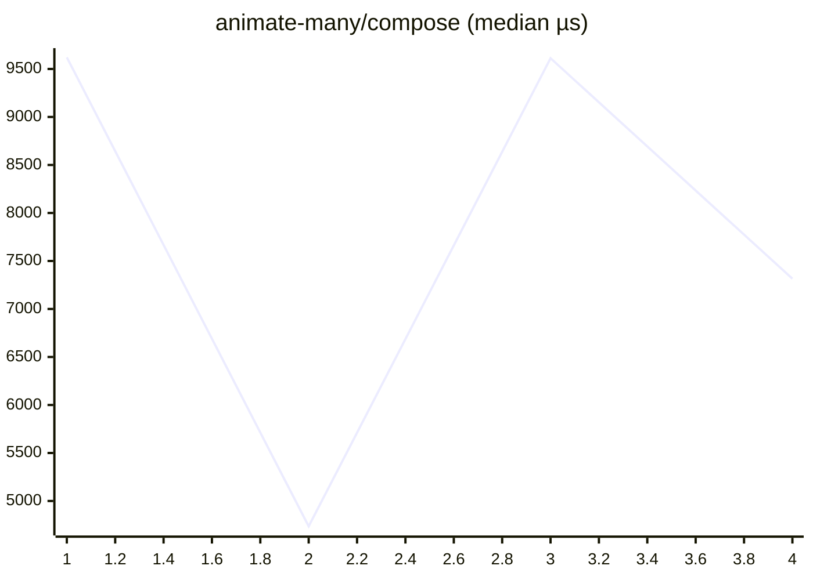

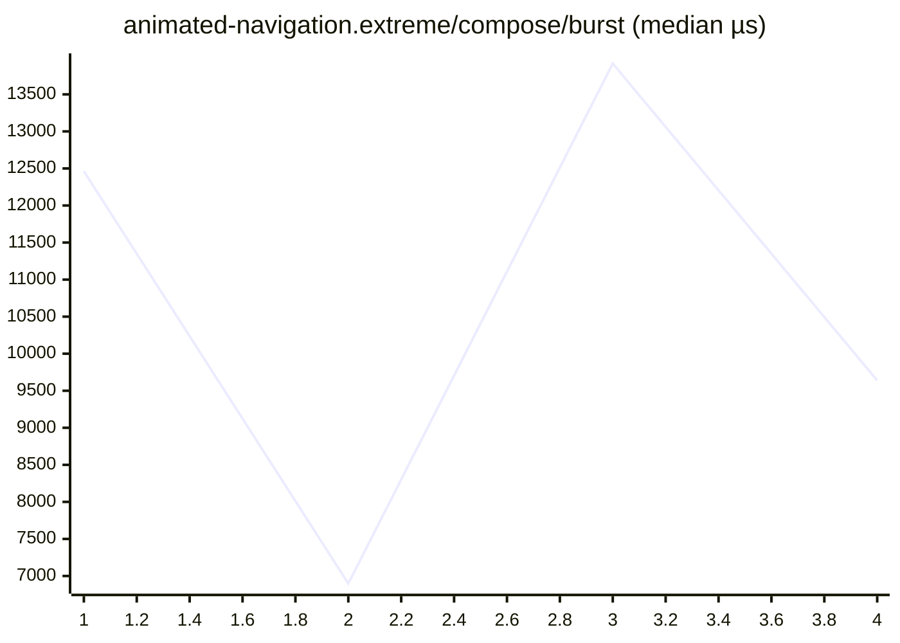

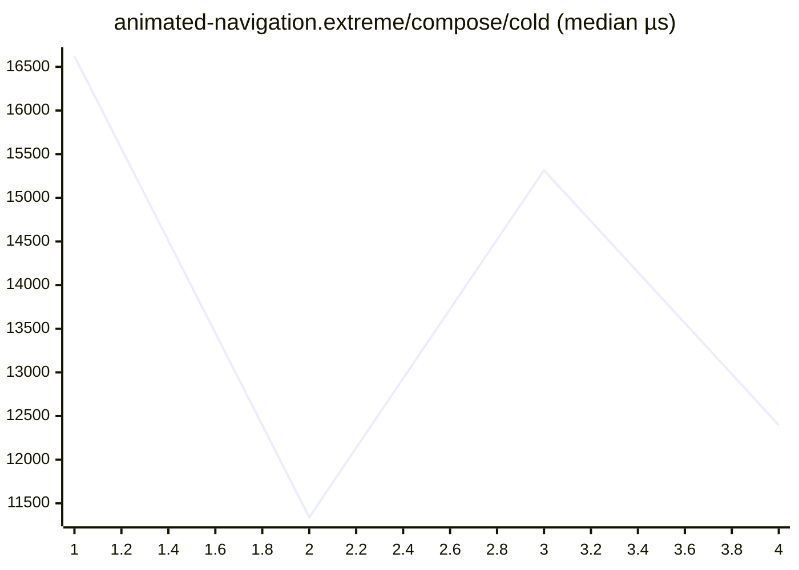

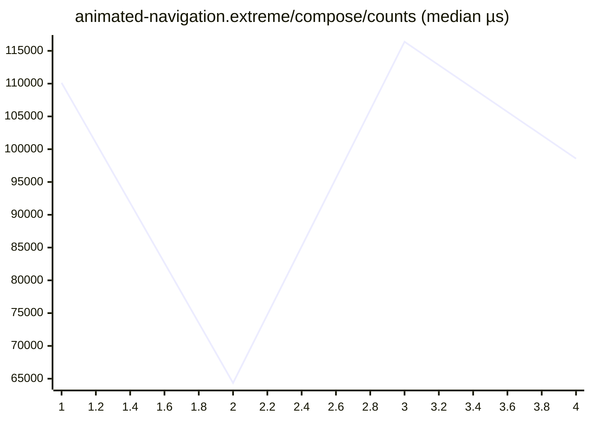


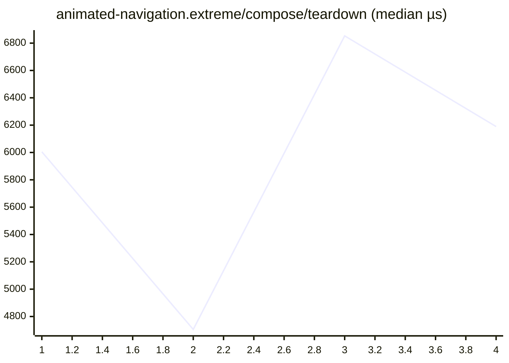

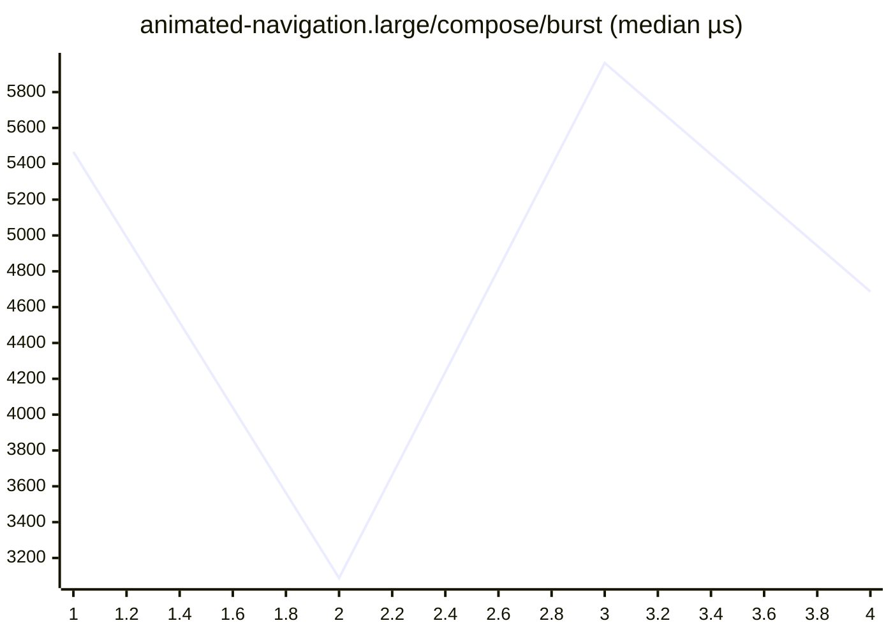

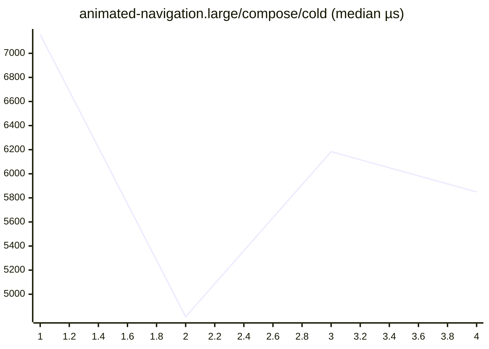


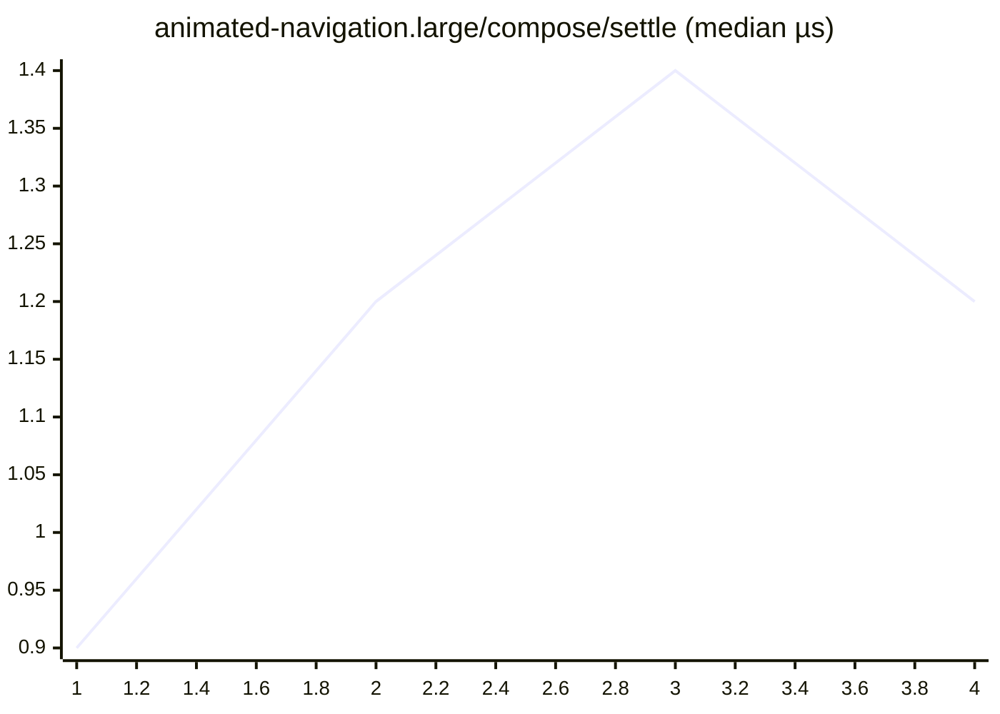

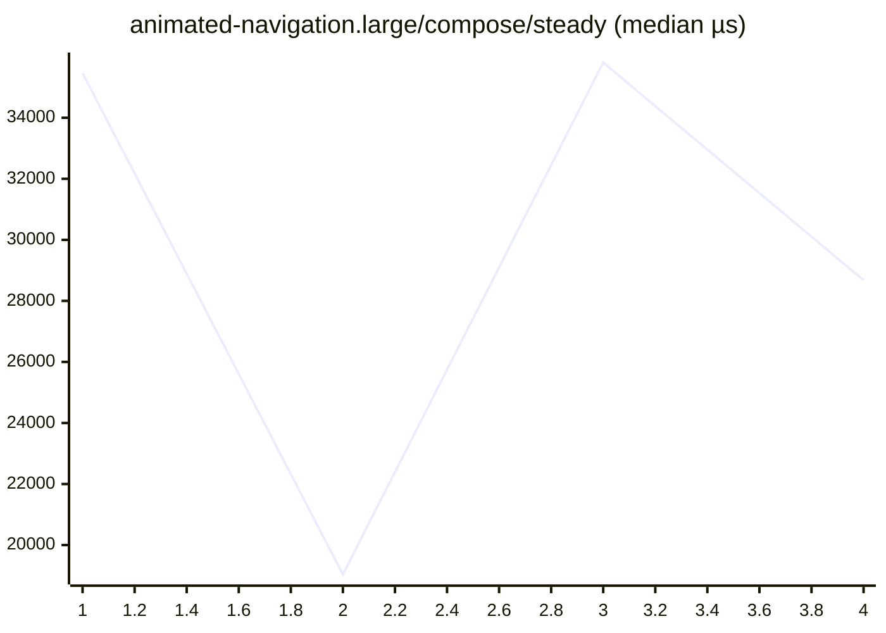


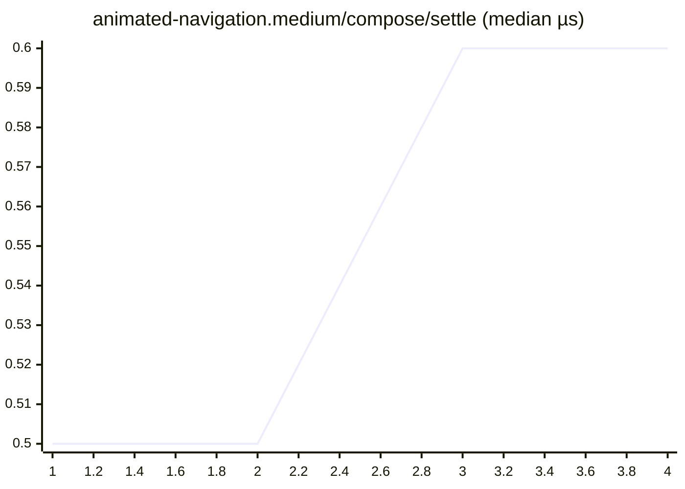

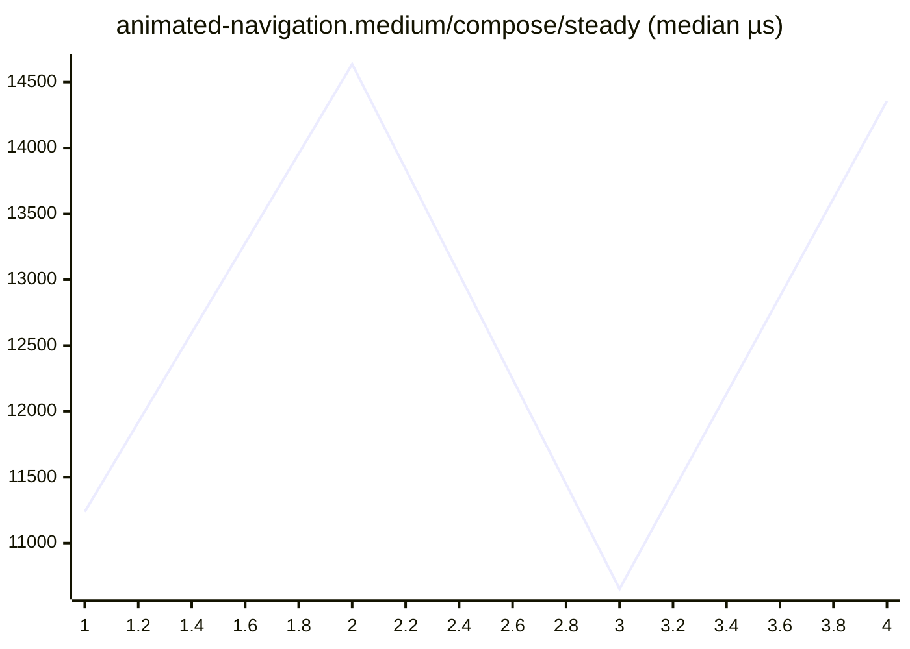

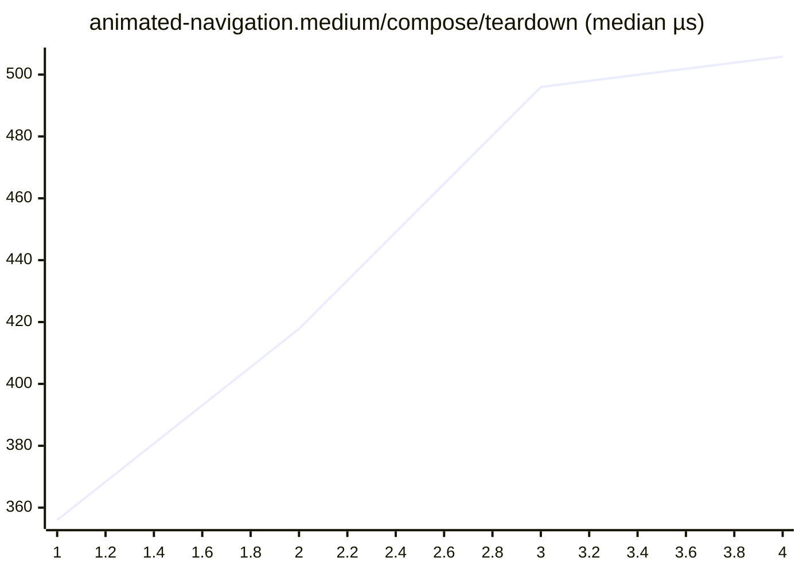

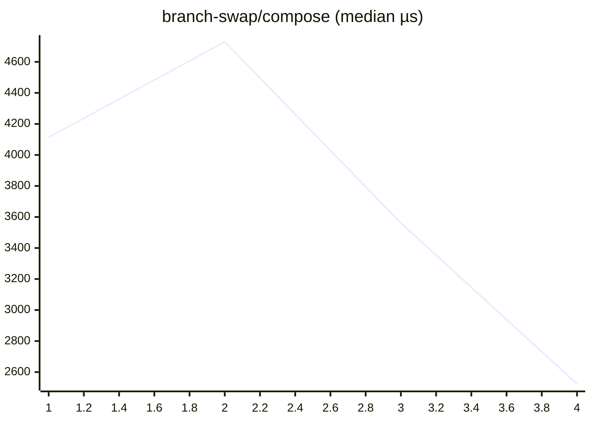

```mermaid
xychart-beta
    title "cold-mount-100/compose (median µs)"
    x-axis 1 --> 4
    line [686.8, 560.2, 838.1, 567.4]
```

```mermaid
xychart-beta
    title "cold-mount-1000/compose (median µs)"
    x-axis 1 --> 4
    line [8399.3, 4719.3, 3773.5, 7121.6]
```

```mermaid
xychart-beta
    title "cold-mount-10000/compose (median µs)"
    x-axis 1 --> 4
    line [74882.4, 77308.0, 75289.0, 90310.2]
```

```mermaid
xychart-beta
    title "data-grid.extreme/compose/burst (median µs)"
    x-axis 1 --> 4
    line [917195.8, 848359.9, 869706.9, 657651.2]
```

```mermaid
xychart-beta
    title "data-grid.extreme/compose/cold (median µs)"
    x-axis 1 --> 4
    line [564671.1, 532198.1, 527821.7, 398200.7]
```

```mermaid
xychart-beta
    title "data-grid.extreme/compose/counts (median µs)"
    x-axis 1 --> 4
    line [1731762.7, 1413521.5, 1498282.4, 1110786.6]
```

```mermaid
xychart-beta
    title "data-grid.extreme/compose/settle (median µs)"
    x-axis 1 --> 4
    line [2.1, 2.1, 1.9, 2.3]
```

```mermaid
xychart-beta
    title "data-grid.extreme/compose/steady (median µs)"
    x-axis 1 --> 4
    line [27880.3, 26608.5, 24816.6, 19150.7]
```

```mermaid
xychart-beta
    title "data-grid.extreme/compose/teardown (median µs)"
    x-axis 1 --> 4
    line [1360.6, 1265.7, 1291.4, 1110.8]
```

```mermaid
xychart-beta
    title "data-grid.large/compose/burst (median µs)"
    x-axis 1 --> 4
    line [108370.1, 137573.0, 114009.5, 133242.0]
```

```mermaid
xychart-beta
    title "data-grid.large/compose/cold (median µs)"
    x-axis 1 --> 4
    line [60694.5, 76941.3, 63120.6, 77459.9]
```

```mermaid
xychart-beta
    title "data-grid.large/compose/counts (median µs)"
    x-axis 1 --> 4
    line [187980.4, 244856.9, 207644.2, 241741.6]
```

```mermaid
xychart-beta
    title "data-grid.large/compose/settle (median µs)"
    x-axis 1 --> 4
    line [1.5, 1.6, 2.4, 1.8]
```

```mermaid
xychart-beta
    title "data-grid.large/compose/steady (median µs)"
    x-axis 1 --> 4
    line [14957.3, 18099.0, 16104.9, 16959.8]
```

```mermaid
xychart-beta
    title "data-grid.large/compose/teardown (median µs)"
    x-axis 1 --> 4
    line [469.9, 567.8, 474.6, 573.2]
```

```mermaid
xychart-beta
    title "data-grid.medium/compose/burst (median µs)"
    x-axis 1 --> 4
    line [69739.0, 35886.9, 46673.5, 57857.6]
```

```mermaid
xychart-beta
    title "data-grid.medium/compose/cold (median µs)"
    x-axis 1 --> 4
    line [39856.7, 21102.5, 25793.1, 34471.6]
```

```mermaid
xychart-beta
    title "data-grid.medium/compose/counts (median µs)"
    x-axis 1 --> 4
    line [141793.3, 71603.8, 99581.8, 122381.7]
```

```mermaid
xychart-beta
    title "data-grid.medium/compose/settle (median µs)"
    x-axis 1 --> 4
    line [2.3, 1.0, 1.8, 1.5]
```

```mermaid
xychart-beta
    title "data-grid.medium/compose/steady (median µs)"
    x-axis 1 --> 4
    line [20754.9, 8162.0, 12334.8, 12381.3]
```

```mermaid
xychart-beta
    title "data-grid.medium/compose/teardown (median µs)"
    x-axis 1 --> 4
    line [356.8, 187.9, 248.2, 292.5]
```

```mermaid
xychart-beta
    title "dense-dashboard.extreme/compose/burst (median µs)"
    x-axis 1 --> 4
    line [20153.1, 12231.0, 11532.2, 14838.7]
```

```mermaid
xychart-beta
    title "dense-dashboard.extreme/compose/cold (median µs)"
    x-axis 1 --> 4
    line [606.7, 398.8, 383.4, 479.8]
```

```mermaid
xychart-beta
    title "dense-dashboard.extreme/compose/counts (median µs)"
    x-axis 1 --> 4
    line [23438.8, 13693.1, 17691.5, 22404.5]
```

```mermaid
xychart-beta
    title "dense-dashboard.extreme/compose/settle (median µs)"
    x-axis 1 --> 4
    line [1.3, 0.9, 1.2, 1.1]
```

```mermaid
xychart-beta
    title "dense-dashboard.extreme/compose/steady (median µs)"
    x-axis 1 --> 4
    line [863.1, 432.7, 533.0, 686.6]
```

```mermaid
xychart-beta
    title "dense-dashboard.extreme/compose/teardown (median µs)"
    x-axis 1 --> 4
    line [599.1, 388.0, 393.2, 539.8]
```

```mermaid
xychart-beta
    title "dense-dashboard.large/compose/burst (median µs)"
    x-axis 1 --> 4
    line [9706.7, 4188.0, 5056.8, 5928.3]
```

```mermaid
xychart-beta
    title "dense-dashboard.large/compose/cold (median µs)"
    x-axis 1 --> 4
    line [371.6, 211.1, 249.9, 272.8]
```

```mermaid
xychart-beta
    title "dense-dashboard.large/compose/counts (median µs)"
    x-axis 1 --> 4
    line [16409.6, 9670.9, 14102.2, 13629.3]
```

```mermaid
xychart-beta
    title "dense-dashboard.large/compose/settle (median µs)"
    x-axis 1 --> 4
    line [1.0, 0.6, 1.2, 0.9]
```

```mermaid
xychart-beta
    title "dense-dashboard.large/compose/steady (median µs)"
    x-axis 1 --> 4
    line [865.5, 435.0, 514.3, 679.4]
```

```mermaid
xychart-beta
    title "dense-dashboard.large/compose/teardown (median µs)"
    x-axis 1 --> 4
    line [297.0, 159.4, 204.5, 229.9]
```

```mermaid
xychart-beta
    title "dense-dashboard.medium/compose/burst (median µs)"
    x-axis 1 --> 4
    line [3256.9, 3747.3, 2886.3, 1441.8]
```

```mermaid
xychart-beta
    title "dense-dashboard.medium/compose/cold (median µs)"
    x-axis 1 --> 4
    line [214.4, 274.0, 218.8, 100.9]
```

```mermaid
xychart-beta
    title "dense-dashboard.medium/compose/counts (median µs)"
    x-axis 1 --> 4
    line [6736.4, 8374.2, 5949.6, 3187.1]
```

```mermaid
xychart-beta
    title "dense-dashboard.medium/compose/settle (median µs)"
    x-axis 1 --> 4
    line [0.8, 1.3, 0.7, 0.4]
```

```mermaid
xychart-beta
    title "dense-dashboard.medium/compose/steady (median µs)"
    x-axis 1 --> 4
    line [823.5, 817.9, 816.4, 407.5]
```

```mermaid
xychart-beta
    title "dense-dashboard.medium/compose/teardown (median µs)"
    x-axis 1 --> 4
    line [120.9, 153.9, 121.5, 62.5]
```

```mermaid
xychart-beta
    title "entities-identity-churn-10.extreme/compose/burst (median µs)"
    x-axis 1 --> 4
    line [57275.1, 58550.6, 48500.0, 29373.5]
```

```mermaid
xychart-beta
    title "entities-identity-churn-10.extreme/compose/cold (median µs)"
    x-axis 1 --> 4
    line [35128.8, 48787.2, 29239.1, 17390.4]
```

```mermaid
xychart-beta
    title "entities-identity-churn-10.extreme/compose/counts (median µs)"
    x-axis 1 --> 4
    line [203645.1, 278041.5, 232881.6, 153922.4]
```

```mermaid
xychart-beta
    title "entities-identity-churn-10.extreme/compose/settle (median µs)"
    x-axis 1 --> 4
    line [1.7, 2.7, 2.1, 1.3]
```

```mermaid
xychart-beta
    title "entities-identity-churn-10.extreme/compose/steady (median µs)"
    x-axis 1 --> 4
    line [67605.4, 110490.0, 62006.6, 30428.1]
```

```mermaid
xychart-beta
    title "entities-identity-churn-10.extreme/compose/teardown (median µs)"
    x-axis 1 --> 4
    line [1382.9, 1964.2, 1144.8, 694.6]
```

```mermaid
xychart-beta
    title "entities-identity-churn-10.large/compose/burst (median µs)"
    x-axis 1 --> 4
    line [22661.4, 12171.9, 13759.9, 13609.3]
```

```mermaid
xychart-beta
    title "entities-identity-churn-10.large/compose/cold (median µs)"
    x-axis 1 --> 4
    line [16026.8, 10773.1, 8930.7, 10020.5]
```

```mermaid
xychart-beta
    title "entities-identity-churn-10.large/compose/counts (median µs)"
    x-axis 1 --> 4
    line [80942.4, 39356.0, 64825.7, 63038.7]
```

```mermaid
xychart-beta
    title "entities-identity-churn-10.large/compose/settle (median µs)"
    x-axis 1 --> 4
    line [1.9, 1.8, 1.6, 1.3]
```

```mermaid
xychart-beta
    title "entities-identity-churn-10.large/compose/steady (median µs)"
    x-axis 1 --> 4
    line [29699.1, 13169.4, 18127.8, 19237.6]
```

```mermaid
xychart-beta
    title "entities-identity-churn-10.large/compose/teardown (median µs)"
    x-axis 1 --> 4
    line [555.6, 288.1, 337.4, 360.3]
```

```mermaid
xychart-beta
    title "entities-identity-churn-10.medium/compose/burst (median µs)"
    x-axis 1 --> 4
    line [8775.5, 6489.2, 8202.0, 6319.3]
```

```mermaid
xychart-beta
    title "entities-identity-churn-10.medium/compose/cold (median µs)"
    x-axis 1 --> 4
    line [6847.6, 4064.4, 5318.6, 5299.9]
```

```mermaid
xychart-beta
    title "entities-identity-churn-10.medium/compose/counts (median µs)"
    x-axis 1 --> 4
    line [33013.6, 23547.5, 40497.8, 27670.3]
```

```mermaid
xychart-beta
    title "entities-identity-churn-10.medium/compose/settle (median µs)"
    x-axis 1 --> 4
    line [1.1, 1.6, 2.1, 1.6]
```

```mermaid
xychart-beta
    title "entities-identity-churn-10.medium/compose/steady (median µs)"
    x-axis 1 --> 4
    line [10632.2, 6021.8, 10678.6, 8206.7]
```

```mermaid
xychart-beta
    title "entities-identity-churn-10.medium/compose/teardown (median µs)"
    x-axis 1 --> 4
    line [231.8, 181.7, 264.1, 212.7]
```

```mermaid
xychart-beta
    title "entities-identity-churn-50.extreme/compose/burst (median µs)"
    x-axis 1 --> 4
    line [38163.8, 45513.9, 41164.8, 46703.8]
```

```mermaid
xychart-beta
    title "entities-identity-churn-50.extreme/compose/cold (median µs)"
    x-axis 1 --> 4
    line [30010.2, 36978.8, 29991.4, 41393.0]
```

```mermaid
xychart-beta
    title "entities-identity-churn-50.extreme/compose/counts (median µs)"
    x-axis 1 --> 4
    line [308853.3, 356183.6, 347691.5, 358267.1]
```

```mermaid
xychart-beta
    title "entities-identity-churn-50.extreme/compose/settle (median µs)"
    x-axis 1 --> 4
    line [1.9, 1.8, 2.1, 2.0]
```

```mermaid
xychart-beta
    title "entities-identity-churn-50.extreme/compose/steady (median µs)"
    x-axis 1 --> 4
    line [170674.3, 195161.2, 168550.7, 182630.3]
```

```mermaid
xychart-beta
    title "entities-identity-churn-50.extreme/compose/teardown (median µs)"
    x-axis 1 --> 4
    line [1011.2, 1123.7, 1080.1, 1376.9]
```

```mermaid
xychart-beta
    title "entities-identity-churn-50.large/compose/burst (median µs)"
    x-axis 1 --> 4
    line [20445.0, 22651.5, 14964.2, 12211.5]
```

```mermaid
xychart-beta
    title "entities-identity-churn-50.large/compose/cold (median µs)"
    x-axis 1 --> 4
    line [12195.2, 16233.7, 12335.9, 7185.3]
```

```mermaid
xychart-beta
    title "entities-identity-churn-50.large/compose/counts (median µs)"
    x-axis 1 --> 4
    line [116758.9, 159716.3, 121699.6, 72346.5]
```

```mermaid
xychart-beta
    title "entities-identity-churn-50.large/compose/settle (median µs)"
    x-axis 1 --> 4
    line [1.7, 2.6, 1.9, 1.3]
```

```mermaid
xychart-beta
    title "entities-identity-churn-50.large/compose/steady (median µs)"
    x-axis 1 --> 4
    line [65487.9, 100478.1, 59706.0, 34308.7]
```

```mermaid
xychart-beta
    title "entities-identity-churn-50.large/compose/teardown (median µs)"
    x-axis 1 --> 4
    line [465.8, 729.5, 440.9, 295.7]
```

```mermaid
xychart-beta
    title "entities-identity-churn-50.medium/compose/burst (median µs)"
    x-axis 1 --> 4
    line [7359.9, 9363.4, 7988.6, 9747.3]
```

```mermaid
xychart-beta
    title "entities-identity-churn-50.medium/compose/cold (median µs)"
    x-axis 1 --> 4
    line [5217.5, 8076.9, 4571.3, 5260.1]
```

```mermaid
xychart-beta
    title "entities-identity-churn-50.medium/compose/counts (median µs)"
    x-axis 1 --> 4
    line [53771.4, 72919.2, 57149.8, 65876.4]
```

```mermaid
xychart-beta
    title "entities-identity-churn-50.medium/compose/settle (median µs)"
    x-axis 1 --> 4
    line [1.0, 1.3, 1.6, 1.3]
```

```mermaid
xychart-beta
    title "entities-identity-churn-50.medium/compose/steady (median µs)"
    x-axis 1 --> 4
    line [24173.9, 29083.3, 23959.0, 26680.3]
```

```mermaid
xychart-beta
    title "entities-identity-churn-50.medium/compose/teardown (median µs)"
    x-axis 1 --> 4
    line [206.6, 265.4, 235.4, 253.6]
```

```mermaid
xychart-beta
    title "entities-identity-churn.extreme/compose/burst (median µs)"
    x-axis 1 --> 4
    line [67899.9, 40475.8, 49011.8, 47993.9]
```

```mermaid
xychart-beta
    title "entities-identity-churn.extreme/compose/cold (median µs)"
    x-axis 1 --> 4
    line [43440.3, 23189.6, 21354.5, 24947.4]
```

```mermaid
xychart-beta
    title "entities-identity-churn.extreme/compose/counts (median µs)"
    x-axis 1 --> 4
    line [322090.0, 155075.8, 263232.8, 241537.1]
```

```mermaid
xychart-beta
    title "entities-identity-churn.extreme/compose/settle (median µs)"
    x-axis 1 --> 4
    line [2.2, 2.0, 2.2, 1.5]
```

```mermaid
xychart-beta
    title "entities-identity-churn.extreme/compose/steady (median µs)"
    x-axis 1 --> 4
    line [168290.2, 78037.0, 94632.2, 97962.6]
```

```mermaid
xychart-beta
    title "entities-identity-churn.extreme/compose/teardown (median µs)"
    x-axis 1 --> 4
    line [1918.2, 1082.7, 1099.8, 1219.6]
```

```mermaid
xychart-beta
    title "entities-identity-churn.large/compose/burst (median µs)"
    x-axis 1 --> 4
    line [15198.1, 12817.1, 17384.4, 12828.2]
```

```mermaid
xychart-beta
    title "entities-identity-churn.large/compose/cold (median µs)"
    x-axis 1 --> 4
    line [14413.0, 10025.1, 12412.5, 10919.1]
```

```mermaid
xychart-beta
    title "entities-identity-churn.large/compose/counts (median µs)"
    x-axis 1 --> 4
    line [94808.6, 66047.0, 131198.0, 102800.1]
```

```mermaid
xychart-beta
    title "entities-identity-churn.large/compose/settle (median µs)"
    x-axis 1 --> 4
    line [1.7, 2.1, 2.3, 1.7]
```

```mermaid
xychart-beta
    title "entities-identity-churn.large/compose/steady (median µs)"
    x-axis 1 --> 4
    line [42870.9, 30465.6, 44952.7, 30109.8]
```

```mermaid
xychart-beta
    title "entities-identity-churn.large/compose/teardown (median µs)"
    x-axis 1 --> 4
    line [421.7, 347.3, 504.6, 355.7]
```

```mermaid
xychart-beta
    title "entities-identity-churn.medium/compose/burst (median µs)"
    x-axis 1 --> 4
    line [9268.9, 6214.3, 6318.0, 7594.1]
```

```mermaid
xychart-beta
    title "entities-identity-churn.medium/compose/cold (median µs)"
    x-axis 1 --> 4
    line [6175.2, 5202.2, 4209.2, 4766.1]
```

```mermaid
xychart-beta
    title "entities-identity-churn.medium/compose/counts (median µs)"
    x-axis 1 --> 4
    line [48430.6, 24546.5, 34883.2, 42248.6]
```

```mermaid
xychart-beta
    title "entities-identity-churn.medium/compose/settle (median µs)"
    x-axis 1 --> 4
    line [1.8, 1.7, 1.3, 1.0]
```

```mermaid
xychart-beta
    title "entities-identity-churn.medium/compose/steady (median µs)"
    x-axis 1 --> 4
    line [18970.0, 11144.9, 13984.1, 14562.6]
```

```mermaid
xychart-beta
    title "entities-identity-churn.medium/compose/teardown (median µs)"
    x-axis 1 --> 4
    line [266.7, 172.8, 182.1, 197.6]
```

```mermaid
xychart-beta
    title "entities-integrated.extreme/compose/burst (median µs)"
    x-axis 1 --> 4
    line [21280.1, 17085.4, 25262.9, 28283.5]
```

```mermaid
xychart-beta
    title "entities-integrated.extreme/compose/cold (median µs)"
    x-axis 1 --> 4
    line [107928.0, 93149.3, 109143.0, 107346.8]
```

```mermaid
xychart-beta
    title "entities-integrated.extreme/compose/counts (median µs)"
    x-axis 1 --> 4
    line [345877.0, 271171.1, 372031.9, 371349.9]
```

```mermaid
xychart-beta
    title "entities-integrated.extreme/compose/settle (median µs)"
    x-axis 1 --> 4
    line [1.8, 2.2, 2.2, 2.2]
```

```mermaid
xychart-beta
    title "entities-integrated.extreme/compose/steady (median µs)"
    x-axis 1 --> 4
    line [112062.9, 90774.1, 117256.3, 106657.1]
```

```mermaid
xychart-beta
    title "entities-integrated.extreme/compose/teardown (median µs)"
    x-axis 1 --> 4
    line [33241.4, 38551.9, 37604.0, 45565.4]
```

```mermaid
xychart-beta
    title "entities-integrated.large/compose/burst (median µs)"
    x-axis 1 --> 4
    line [8720.8, 10514.8, 8702.4, 10287.4]
```

```mermaid
xychart-beta
    title "entities-integrated.large/compose/cold (median µs)"
    x-axis 1 --> 4
    line [35331.9, 46561.1, 36425.1, 45716.0]
```

```mermaid
xychart-beta
    title "entities-integrated.large/compose/counts (median µs)"
    x-axis 1 --> 4
    line [127887.2, 165417.5, 156094.5, 170891.3]
```

```mermaid
xychart-beta
    title "entities-integrated.large/compose/settle (median µs)"
    x-axis 1 --> 4
    line [1.4, 1.6, 2.0, 1.5]
```

```mermaid
xychart-beta
    title "entities-integrated.large/compose/steady (median µs)"
    x-axis 1 --> 4
    line [42270.1, 58987.0, 46845.8, 49441.4]
```

```mermaid
xychart-beta
    title "entities-integrated.large/compose/teardown (median µs)"
    x-axis 1 --> 4
    line [9384.4, 11676.7, 12636.7, 11453.4]
```

```mermaid
xychart-beta
    title "entities-integrated.medium/compose/burst (median µs)"
    x-axis 1 --> 4
    line [8064.7, 5412.3, 8325.1, 7310.8]
```

```mermaid
xychart-beta
    title "entities-integrated.medium/compose/cold (median µs)"
    x-axis 1 --> 4
    line [23640.0, 18354.3, 20523.4, 16963.3]
```

```mermaid
xychart-beta
    title "entities-integrated.medium/compose/counts (median µs)"
    x-axis 1 --> 4
    line [92316.8, 67519.0, 107959.8, 94567.5]
```

```mermaid
xychart-beta
    title "entities-integrated.medium/compose/settle (median µs)"
    x-axis 1 --> 4
    line [1.6, 2.1, 2.2, 1.7]
```

```mermaid
xychart-beta
    title "entities-integrated.medium/compose/steady (median µs)"
    x-axis 1 --> 4
    line [39845.5, 29943.1, 47449.4, 35007.7]
```

```mermaid
xychart-beta
    title "entities-integrated.medium/compose/teardown (median µs)"
    x-axis 1 --> 4
    line [6105.6, 6486.4, 6913.2, 7758.7]
```

```mermaid
xychart-beta
    title "entities-relevance-saturated.extreme/compose/burst (median µs)"
    x-axis 1 --> 4
    line [95057.1, 94073.3, 97254.7, 96247.4]
```

```mermaid
xychart-beta
    title "entities-relevance-saturated.extreme/compose/cold (median µs)"
    x-axis 1 --> 4
    line [30591.9, 22227.2, 28424.7, 29174.1]
```

```mermaid
xychart-beta
    title "entities-relevance-saturated.extreme/compose/counts (median µs)"
    x-axis 1 --> 4
    line [228810.1, 211002.3, 277035.4, 262243.7]
```

```mermaid
xychart-beta
    title "entities-relevance-saturated.extreme/compose/settle (median µs)"
    x-axis 1 --> 4
    line [2.0, 2.8, 2.9, 2.6]
```

```mermaid
xychart-beta
    title "entities-relevance-saturated.extreme/compose/steady (median µs)"
    x-axis 1 --> 4
    line [56507.4, 52162.7, 59312.8, 52039.1]
```

```mermaid
xychart-beta
    title "entities-relevance-saturated.extreme/compose/teardown (median µs)"
    x-axis 1 --> 4
    line [13113.8, 13417.0, 14500.7, 15465.3]
```

```mermaid
xychart-beta
    title "entities-relevance-saturated.large/compose/burst (median µs)"
    x-axis 1 --> 4
    line [27403.3, 40547.2, 27643.0, 16736.6]
```

```mermaid
xychart-beta
    title "entities-relevance-saturated.large/compose/cold (median µs)"
    x-axis 1 --> 4
    line [11952.4, 12445.2, 13843.1, 7413.0]
```

```mermaid
xychart-beta
    title "entities-relevance-saturated.large/compose/counts (median µs)"
    x-axis 1 --> 4
    line [100423.7, 101703.7, 92984.2, 61791.0]
```

```mermaid
xychart-beta
    title "entities-relevance-saturated.large/compose/settle (median µs)"
    x-axis 1 --> 4
    line [1.5, 2.3, 2.0, 1.3]
```

```mermaid
xychart-beta
    title "entities-relevance-saturated.large/compose/steady (median µs)"
    x-axis 1 --> 4
    line [19345.5, 23966.2, 20176.3, 10165.4]
```

```mermaid
xychart-beta
    title "entities-relevance-saturated.large/compose/teardown (median µs)"
    x-axis 1 --> 4
    line [2906.6, 4134.8, 3277.4, 2382.9]
```

```mermaid
xychart-beta
    title "entities-relevance-saturated.medium/compose/burst (median µs)"
    x-axis 1 --> 4
    line [13879.1, 10176.6, 13944.0, 11937.1]
```

```mermaid
xychart-beta
    title "entities-relevance-saturated.medium/compose/cold (median µs)"
    x-axis 1 --> 4
    line [6104.0, 4520.5, 5933.8, 6295.2]
```

```mermaid
xychart-beta
    title "entities-relevance-saturated.medium/compose/counts (median µs)"
    x-axis 1 --> 4
    line [39918.2, 26024.7, 45495.9, 38988.2]
```

```mermaid
xychart-beta
    title "entities-relevance-saturated.medium/compose/settle (median µs)"
    x-axis 1 --> 4
    line [1.3, 1.8, 2.2, 1.9]
```

```mermaid
xychart-beta
    title "entities-relevance-saturated.medium/compose/steady (median µs)"
    x-axis 1 --> 4
    line [8588.8, 6714.5, 10581.6, 7636.9]
```

```mermaid
xychart-beta
    title "entities-relevance-saturated.medium/compose/teardown (median µs)"
    x-axis 1 --> 4
    line [1136.6, 1234.8, 1482.3, 1376.9]
```

```mermaid
xychart-beta
    title "entities-relevance-sweep.extreme/compose/burst (median µs)"
    x-axis 1 --> 4
    line [139551.2, 143863.6, 147758.9, 149769.7]
```

```mermaid
xychart-beta
    title "entities-relevance-sweep.extreme/compose/cold (median µs)"
    x-axis 1 --> 4
    line [37476.4, 26814.0, 37931.2, 27280.6]
```

```mermaid
xychart-beta
    title "entities-relevance-sweep.extreme/compose/counts (median µs)"
    x-axis 1 --> 4
    line [453942.0, 363604.4, 495520.1, 408039.1]
```

```mermaid
xychart-beta
    title "entities-relevance-sweep.extreme/compose/settle (median µs)"
    x-axis 1 --> 4
    line [2.0, 2.9, 2.8, 2.4]
```

```mermaid
xychart-beta
    title "entities-relevance-sweep.extreme/compose/steady (median µs)"
    x-axis 1 --> 4
    line [149428.6, 140862.0, 167028.5, 121048.4]
```

```mermaid
xychart-beta
    title "entities-relevance-sweep.extreme/compose/teardown (median µs)"
    x-axis 1 --> 4
    line [13492.1, 13806.8, 15285.8, 15385.2]
```

```mermaid
xychart-beta
    title "entities-relevance-sweep.large/compose/burst (median µs)"
    x-axis 1 --> 4
    line [64372.4, 33315.0, 43296.5, 43553.3]
```

```mermaid
xychart-beta
    title "entities-relevance-sweep.large/compose/cold (median µs)"
    x-axis 1 --> 4
    line [12505.9, 8058.4, 8874.3, 10385.9]
```

```mermaid
xychart-beta
    title "entities-relevance-sweep.large/compose/counts (median µs)"
    x-axis 1 --> 4
    line [187160.4, 84451.7, 121670.1, 137514.1]
```

```mermaid
xychart-beta
    title "entities-relevance-sweep.large/compose/settle (median µs)"
    x-axis 1 --> 4
    line [2.3, 1.9, 2.4, 1.6]
```

```mermaid
xychart-beta
    title "entities-relevance-sweep.large/compose/steady (median µs)"
    x-axis 1 --> 4
    line [56628.5, 29545.4, 39104.4, 46006.1]
```

```mermaid
xychart-beta
    title "entities-relevance-sweep.large/compose/teardown (median µs)"
    x-axis 1 --> 4
    line [3915.7, 2636.1, 3097.4, 3094.1]
```

```mermaid
xychart-beta
    title "entities-relevance-sweep.medium/compose/burst (median µs)"
    x-axis 1 --> 4
    line [20435.0, 27247.9, 20502.7, 11766.6]
```

```mermaid
xychart-beta
    title "entities-relevance-sweep.medium/compose/cold (median µs)"
    x-axis 1 --> 4
    line [6221.8, 7648.4, 5806.6, 3251.3]
```

```mermaid
xychart-beta
    title "entities-relevance-sweep.medium/compose/counts (median µs)"
    x-axis 1 --> 4
    line [79311.3, 99350.5, 73925.1, 39521.4]
```

```mermaid
xychart-beta
    title "entities-relevance-sweep.medium/compose/settle (median µs)"
    x-axis 1 --> 4
    line [1.2, 2.3, 1.9, 0.9]
```

```mermaid
xychart-beta
    title "entities-relevance-sweep.medium/compose/steady (median µs)"
    x-axis 1 --> 4
    line [21056.0, 29692.1, 21901.2, 11598.6]
```

```mermaid
xychart-beta
    title "entities-relevance-sweep.medium/compose/teardown (median µs)"
    x-axis 1 --> 4
    line [1121.8, 1664.5, 1361.2, 805.1]
```

```mermaid
xychart-beta
    title "entity-labels-sparse.extreme/compose/burst (median µs)"
    x-axis 1 --> 4
    line [55182.4, 21144.1, 30740.0, 30157.3]
```

```mermaid
xychart-beta
    title "entity-labels-sparse.extreme/compose/cold (median µs)"
    x-axis 1 --> 4
    line [32818.0, 17437.9, 19443.1, 21501.3]
```

```mermaid
xychart-beta
    title "entity-labels-sparse.extreme/compose/counts (median µs)"
    x-axis 1 --> 4
    line [135325.6, 59311.0, 95734.4, 87969.1]
```

```mermaid
xychart-beta
    title "entity-labels-sparse.extreme/compose/settle (median µs)"
    x-axis 1 --> 4
    line [2.6, 1.7, 2.1, 1.5]
```

```mermaid
xychart-beta
    title "entity-labels-sparse.extreme/compose/steady (median µs)"
    x-axis 1 --> 4
    line [5921.1, 2635.6, 4056.5, 3954.9]
```

```mermaid
xychart-beta
    title "entity-labels-sparse.extreme/compose/teardown (median µs)"
    x-axis 1 --> 4
    line [15688.5, 7760.4, 10927.2, 10437.8]
```

```mermaid
xychart-beta
    title "entity-labels-sparse.large/compose/burst (median µs)"
    x-axis 1 --> 4
    line [17004.7, 10266.2, 12968.2, 14944.3]
```

```mermaid
xychart-beta
    title "entity-labels-sparse.large/compose/cold (median µs)"
    x-axis 1 --> 4
    line [14612.0, 9463.4, 9673.3, 10162.5]
```

```mermaid
xychart-beta
    title "entity-labels-sparse.large/compose/counts (median µs)"
    x-axis 1 --> 4
    line [56031.2, 30721.5, 40692.9, 42414.6]
```

```mermaid
xychart-beta
    title "entity-labels-sparse.large/compose/settle (median µs)"
    x-axis 1 --> 4
    line [2.0, 1.2, 1.6, 1.4]
```

```mermaid
xychart-beta
    title "entity-labels-sparse.large/compose/steady (median µs)"
    x-axis 1 --> 4
    line [2403.1, 1405.3, 2440.9, 2190.5]
```

```mermaid
xychart-beta
    title "entity-labels-sparse.large/compose/teardown (median µs)"
    x-axis 1 --> 4
    line [4514.6, 2934.8, 3895.1, 3908.4]
```

```mermaid
xychart-beta
    title "entity-labels-sparse.medium/compose/burst (median µs)"
    x-axis 1 --> 4
    line [6844.5, 9109.6, 5969.2, 3082.2]
```

```mermaid
xychart-beta
    title "entity-labels-sparse.medium/compose/cold (median µs)"
    x-axis 1 --> 4
    line [6071.8, 5752.8, 4648.3, 2237.8]
```

```mermaid
xychart-beta
    title "entity-labels-sparse.medium/compose/counts (median µs)"
    x-axis 1 --> 4
    line [24575.3, 28494.2, 23587.6, 12562.2]
```

```mermaid
xychart-beta
    title "entity-labels-sparse.medium/compose/settle (median µs)"
    x-axis 1 --> 4
    line [0.9, 2.3, 0.9, 0.5]
```

```mermaid
xychart-beta
    title "entity-labels-sparse.medium/compose/steady (median µs)"
    x-axis 1 --> 4
    line [968.2, 1678.2, 1013.9, 512.7]
```

```mermaid
xychart-beta
    title "entity-labels-sparse.medium/compose/teardown (median µs)"
    x-axis 1 --> 4
    line [1286.2, 1937.9, 1228.0, 691.1]
```

```mermaid
xychart-beta
    title "entity-labels.extreme/compose/burst (median µs)"
    x-axis 1 --> 4
    line [53690.8, 21373.5, 33150.6, 31009.3]
```

```mermaid
xychart-beta
    title "entity-labels.extreme/compose/cold (median µs)"
    x-axis 1 --> 4
    line [42536.2, 18791.7, 19043.0, 26424.6]
```

```mermaid
xychart-beta
    title "entity-labels.extreme/compose/counts (median µs)"
    x-axis 1 --> 4
    line [210738.5, 102006.1, 145730.7, 183814.2]
```

```mermaid
xychart-beta
    title "entity-labels.extreme/compose/settle (median µs)"
    x-axis 1 --> 4
    line [2.5, 1.5, 1.8, 1.5]
```

```mermaid
xychart-beta
    title "entity-labels.extreme/compose/steady (median µs)"
    x-axis 1 --> 4
    line [52614.8, 24846.6, 30404.9, 43592.1]
```

```mermaid
xychart-beta
    title "entity-labels.extreme/compose/teardown (median µs)"
    x-axis 1 --> 4
    line [16453.7, 7976.6, 10670.0, 11402.2]
```

```mermaid
xychart-beta
    title "entity-labels.large/compose/burst (median µs)"
    x-axis 1 --> 4
    line [19159.2, 27915.4, 15705.5, 8668.6]
```

```mermaid
xychart-beta
    title "entity-labels.large/compose/cold (median µs)"
    x-axis 1 --> 4
    line [18682.7, 20066.2, 13238.4, 7382.9]
```

```mermaid
xychart-beta
    title "entity-labels.large/compose/counts (median µs)"
    x-axis 1 --> 4
    line [91912.5, 114130.0, 97208.5, 44084.1]
```

```mermaid
xychart-beta
    title "entity-labels.large/compose/settle (median µs)"
    x-axis 1 --> 4
    line [1.2, 2.6, 1.6, 0.7]
```

```mermaid
xychart-beta
    title "entity-labels.large/compose/steady (median µs)"
    x-axis 1 --> 4
    line [22658.3, 28149.5, 23067.9, 10007.7]
```

```mermaid
xychart-beta
    title "entity-labels.large/compose/teardown (median µs)"
    x-axis 1 --> 4
    line [4112.4, 6443.5, 4511.9, 2413.7]
```

```mermaid
xychart-beta
    title "entity-labels.medium/compose/burst (median µs)"
    x-axis 1 --> 4
    line [6413.9, 7923.0, 6655.7, 2987.1]
```

```mermaid
xychart-beta
    title "entity-labels.medium/compose/cold (median µs)"
    x-axis 1 --> 4
    line [7035.0, 7218.0, 4634.0, 2388.0]
```

```mermaid
xychart-beta
    title "entity-labels.medium/compose/counts (median µs)"
    x-axis 1 --> 4
    line [34527.2, 41760.6, 39554.7, 17018.3]
```

```mermaid
xychart-beta
    title "entity-labels.medium/compose/settle (median µs)"
    x-axis 1 --> 4
    line [0.9, 2.2, 1.4, 0.5]
```

```mermaid
xychart-beta
    title "entity-labels.medium/compose/steady (median µs)"
    x-axis 1 --> 4
    line [9633.0, 11476.3, 10002.5, 4084.2]
```

```mermaid
xychart-beta
    title "entity-labels.medium/compose/teardown (median µs)"
    x-axis 1 --> 4
    line [1339.3, 2013.9, 1522.0, 723.0]
```

```mermaid
xychart-beta
    title "events/compose (median µs)"
    x-axis 1 --> 4
    line [12824.2, 16203.6, 12880.5, 7949.6]
```

```mermaid
xychart-beta
    title "inspector.extreme/compose/burst (median µs)"
    x-axis 1 --> 4
    line [10283.2, 16184.3, 10218.7, 5604.9]
```

```mermaid
xychart-beta
    title "inspector.extreme/compose/cold (median µs)"
    x-axis 1 --> 4
    line [26249.5, 32777.8, 23939.4, 18653.8]
```

```mermaid
xychart-beta
    title "inspector.extreme/compose/counts (median µs)"
    x-axis 1 --> 4
    line [42785.5, 50581.3, 44294.9, 28478.2]
```

```mermaid
xychart-beta
    title "inspector.extreme/compose/settle (median µs)"
    x-axis 1 --> 4
    line [1.2, 2.7, 1.8, 1.4]
```

```mermaid
xychart-beta
    title "inspector.extreme/compose/steady (median µs)"
    x-axis 1 --> 4
    line [264.2, 375.4, 304.4, 195.7]
```

```mermaid
xychart-beta
    title "inspector.extreme/compose/teardown (median µs)"
    x-axis 1 --> 4
    line [2274.0, 4160.9, 2610.4, 1830.1]
```

```mermaid
xychart-beta
    title "inspector.large/compose/burst (median µs)"
    x-axis 1 --> 4
    line [5172.9, 5523.4, 4834.6, 2399.5]
```

```mermaid
xychart-beta
    title "inspector.large/compose/cold (median µs)"
    x-axis 1 --> 4
    line [10732.1, 10546.3, 9019.8, 4807.1]
```

```mermaid
xychart-beta
    title "inspector.large/compose/counts (median µs)"
    x-axis 1 --> 4
    line [22551.8, 25059.8, 22413.4, 13855.0]
```

```mermaid
xychart-beta
    title "inspector.large/compose/settle (median µs)"
    x-axis 1 --> 4
    line [0.8, 2.1, 1.0, 0.4]
```

```mermaid
xychart-beta
    title "inspector.large/compose/steady (median µs)"
    x-axis 1 --> 4
    line [256.4, 347.2, 245.5, 127.5]
```

```mermaid
xychart-beta
    title "inspector.large/compose/teardown (median µs)"
    x-axis 1 --> 4
    line [1173.0, 1562.2, 1034.1, 633.8]
```

```mermaid
xychart-beta
    title "inspector.medium/compose/burst (median µs)"
    x-axis 1 --> 4
    line [1730.1, 812.1, 949.5, 1228.1]
```

```mermaid
xychart-beta
    title "inspector.medium/compose/cold (median µs)"
    x-axis 1 --> 4
    line [2916.5, 2007.5, 1674.3, 1787.9]
```

```mermaid
xychart-beta
    title "inspector.medium/compose/counts (median µs)"
    x-axis 1 --> 4
    line [6271.7, 3825.7, 3465.4, 5629.4]
```

```mermaid
xychart-beta
    title "inspector.medium/compose/settle (median µs)"
    x-axis 1 --> 4
    line [0.6, 0.4, 0.6, 0.6]
```

```mermaid
xychart-beta
    title "inspector.medium/compose/steady (median µs)"
    x-axis 1 --> 4
    line [220.2, 113.5, 160.3, 190.7]
```

```mermaid
xychart-beta
    title "inspector.medium/compose/teardown (median µs)"
    x-axis 1 --> 4
    line [363.0, 214.0, 235.1, 343.4]
```

```mermaid
xychart-beta
    title "keyed-append/compose (median µs)"
    x-axis 1 --> 4
    line [2241.5, 1230.1, 2017.3, 1849.1]
```

```mermaid
xychart-beta
    title "keyed-insert/compose (median µs)"
    x-axis 1 --> 4
    line [3904.0, 2135.2, 3946.0, 3101.5]
```

```mermaid
xychart-beta
    title "keyed-prepend/compose (median µs)"
    x-axis 1 --> 4
    line [4631.9, 5670.2, 4810.1, 5713.6]
```

```mermaid
xychart-beta
    title "keyed-remove/compose (median µs)"
    x-axis 1 --> 4
    line [3754.0, 2340.4, 3841.8, 2875.3]
```

```mermaid
xychart-beta
    title "keyed-replace/compose (median µs)"
    x-axis 1 --> 4
    line [52486.3, 65204.8, 53183.6, 71503.5]
```

```mermaid
xychart-beta
    title "keyed-reverse/compose (median µs)"
    x-axis 1 --> 4
    line [3454.2, 4152.3, 3170.7, 4076.7]
```

```mermaid
xychart-beta
    title "keyed-rotate/compose (median µs)"
    x-axis 1 --> 4
    line [3675.5, 4205.0, 3245.0, 4008.5]
```

```mermaid
xychart-beta
    title "keyed-shuffle/compose (median µs)"
    x-axis 1 --> 4
    line [3509.2, 4344.0, 3309.9, 4133.7]
```

```mermaid
xychart-beta
    title "mount-cycles/compose (median µs)"
    x-axis 1 --> 4
    line [22487.2, 16290.9, 25389.8, 24470.6]
```

```mermaid
xychart-beta
    title "mount-dispose/compose (median µs)"
    x-axis 1 --> 4
    line [8156.2, 11089.1, 7309.6, 5895.6]
```

```mermaid
xychart-beta
    title "ordered-window-scroll/compose (median µs)"
    x-axis 1 --> 4
    line [476.6, 541.8, 471.3, 556.9]
```

```mermaid
xychart-beta
    title "scene-2d.extreme/compose/burst (median µs)"
    x-axis 1 --> 4
    line [30003.3, 30104.3, 33381.7, 27820.2]
```

```mermaid
xychart-beta
    title "scene-2d.extreme/compose/cold (median µs)"
    x-axis 1 --> 4
    line [21590.6, 18636.7, 17711.5, 14764.4]
```

```mermaid
xychart-beta
    title "scene-2d.extreme/compose/counts (median µs)"
    x-axis 1 --> 4
    line [222074.4, 182929.5, 238390.1, 207079.0]
```

```mermaid
xychart-beta
    title "scene-2d.extreme/compose/settle (median µs)"
    x-axis 1 --> 4
    line [2.0, 3.0, 2.5, 2.4]
```

```mermaid
xychart-beta
    title "scene-2d.extreme/compose/steady (median µs)"
    x-axis 1 --> 4
    line [101466.1, 63734.7, 97238.3, 78657.6]
```

```mermaid
xychart-beta
    title "scene-2d.extreme/compose/teardown (median µs)"
    x-axis 1 --> 4
    line [1168.5, 1282.5, 1345.4, 1276.1]
```

```mermaid
xychart-beta
    title "scene-2d.large/compose/burst (median µs)"
    x-axis 1 --> 4
    line [30042.0, 37026.2, 26826.4, 14648.1]
```

```mermaid
xychart-beta
    title "scene-2d.large/compose/cold (median µs)"
    x-axis 1 --> 4
    line [9782.2, 11285.3, 8011.4, 5744.9]
```

```mermaid
xychart-beta
    title "scene-2d.large/compose/counts (median µs)"
    x-axis 1 --> 4
    line [203516.4, 232335.1, 211377.1, 117511.9]
```

```mermaid
xychart-beta
    title "scene-2d.large/compose/settle (median µs)"
    x-axis 1 --> 4
    line [1.6, 2.4, 1.7, 1.3]
```

```mermaid
xychart-beta
    title "scene-2d.large/compose/steady (median µs)"
    x-axis 1 --> 4
    line [102067.8, 113887.3, 93404.2, 50940.6]
```

```mermaid
xychart-beta
    title "scene-2d.large/compose/teardown (median µs)"
    x-axis 1 --> 4
    line [1105.1, 1578.5, 1068.9, 745.5]
```

```mermaid
xychart-beta
    title "scene-2d.medium/compose/burst (median µs)"
    x-axis 1 --> 4
    line [18821.8, 22931.8, 19566.8, 24613.0]
```

```mermaid
xychart-beta
    title "scene-2d.medium/compose/cold (median µs)"
    x-axis 1 --> 4
    line [5108.5, 6142.9, 3823.9, 5466.1]
```

```mermaid
xychart-beta
    title "scene-2d.medium/compose/counts (median µs)"
    x-axis 1 --> 4
    line [126713.0, 160716.4, 148021.9, 170011.4]
```

```mermaid
xychart-beta
    title "scene-2d.medium/compose/settle (median µs)"
    x-axis 1 --> 4
    line [1.2, 1.5, 2.2, 1.3]
```

```mermaid
xychart-beta
    title "scene-2d.medium/compose/steady (median µs)"
    x-axis 1 --> 4
    line [59494.9, 76366.9, 54077.8, 70846.0]
```

```mermaid
xychart-beta
    title "scene-2d.medium/compose/teardown (median µs)"
    x-axis 1 --> 4
    line [772.6, 884.1, 896.1, 1066.5]
```

```mermaid
xychart-beta
    title "scene-3d/compose (median µs)"
    x-axis 1 --> 4
    line [10372.3, 5793.5, 5440.4, 7389.5]
```

```mermaid
xychart-beta
    title "session-cycle.extreme/compose/burst (median µs)"
    x-axis 1 --> 4
    line [127130.6, 167018.1, 115393.0, 103046.5]
```

```mermaid
xychart-beta
    title "session-cycle.extreme/compose/cold (median µs)"
    x-axis 1 --> 4
    line [4.2, 4.6, 4.2, 4.3]
```

```mermaid
xychart-beta
    title "session-cycle.extreme/compose/counts (median µs)"
    x-axis 1 --> 4
    line [296908.1, 344119.5, 308098.2, 247736.6]
```

```mermaid
xychart-beta
    title "session-cycle.extreme/compose/settle (median µs)"
    x-axis 1 --> 4
    line [2.2, 2.3, 1.9, 2.0]
```

```mermaid
xychart-beta
    title "session-cycle.extreme/compose/steady (median µs)"
    x-axis 1 --> 4
    line [160845.4, 196666.1, 197076.8, 157127.6]
```

```mermaid
xychart-beta
    title "session-cycle.extreme/compose/teardown (median µs)"
    x-axis 1 --> 4
    line [2.2, 2.6, 2.2, 2.4]
```

```mermaid
xychart-beta
    title "session-cycle.large/compose/burst (median µs)"
    x-axis 1 --> 4
    line [57003.0, 42123.0, 46878.9, 50522.5]
```

```mermaid
xychart-beta
    title "session-cycle.large/compose/cold (median µs)"
    x-axis 1 --> 4
    line [4.4, 3.1, 3.5, 3.2]
```

```mermaid
xychart-beta
    title "session-cycle.large/compose/counts (median µs)"
    x-axis 1 --> 4
    line [128750.1, 75810.9, 99563.4, 125498.0]
```

```mermaid
xychart-beta
    title "session-cycle.large/compose/settle (median µs)"
    x-axis 1 --> 4
    line [2.2, 1.6, 1.6, 1.4]
```

```mermaid
xychart-beta
    title "session-cycle.large/compose/steady (median µs)"
    x-axis 1 --> 4
    line [69667.1, 42712.5, 61818.0, 57307.8]
```

```mermaid
xychart-beta
    title "session-cycle.large/compose/teardown (median µs)"
    x-axis 1 --> 4
    line [2.2, 1.7, 2.0, 1.8]
```

```mermaid
xychart-beta
    title "session-cycle.medium/compose/burst (median µs)"
    x-axis 1 --> 4
    line [14058.5, 13643.4, 14167.1, 12992.3]
```

```mermaid
xychart-beta
    title "session-cycle.medium/compose/cold (median µs)"
    x-axis 1 --> 4
    line [3.3, 3.2, 3.5, 3.8]
```

```mermaid
xychart-beta
    title "session-cycle.medium/compose/counts (median µs)"
    x-axis 1 --> 4
    line [28155.4, 34778.7, 33666.4, 44220.3]
```

```mermaid
xychart-beta
    title "session-cycle.medium/compose/settle (median µs)"
    x-axis 1 --> 4
    line [1.1, 1.2, 1.8, 1.4]
```

```mermaid
xychart-beta
    title "session-cycle.medium/compose/steady (median µs)"
    x-axis 1 --> 4
    line [16033.0, 21649.1, 18367.5, 26384.9]
```

```mermaid
xychart-beta
    title "session-cycle.medium/compose/teardown (median µs)"
    x-axis 1 --> 4
    line [1.4, 1.7, 1.8, 1.5]
```

```mermaid
xychart-beta
    title "spatial-scene.extreme/compose/burst (median µs)"
    x-axis 1 --> 4
    line [122493.7, 149820.6, 129214.0, 136849.7]
```

```mermaid
xychart-beta
    title "spatial-scene.extreme/compose/cold (median µs)"
    x-axis 1 --> 4
    line [9688.2, 11822.6, 13879.1, 19936.9]
```

```mermaid
xychart-beta
    title "spatial-scene.extreme/compose/counts (median µs)"
    x-axis 1 --> 4
    line [218379.0, 269117.3, 254745.5, 304720.4]
```

```mermaid
xychart-beta
    title "spatial-scene.extreme/compose/settle (median µs)"
    x-axis 1 --> 4
    line [1.8, 2.0, 2.4, 2.0]
```

```mermaid
xychart-beta
    title "spatial-scene.extreme/compose/steady (median µs)"
    x-axis 1 --> 4
    line [53873.0, 66474.9, 52024.6, 70068.5]
```

```mermaid
xychart-beta
    title "spatial-scene.extreme/compose/teardown (median µs)"
    x-axis 1 --> 4
    line [3328.9, 4158.0, 4512.2, 4315.9]
```

```mermaid
xychart-beta
    title "spatial-scene.large/compose/burst (median µs)"
    x-axis 1 --> 4
    line [30042.5, 39771.4, 33445.5, 38984.4]
```

```mermaid
xychart-beta
    title "spatial-scene.large/compose/cold (median µs)"
    x-axis 1 --> 4
    line [2800.4, 3543.0, 3829.8, 3724.9]
```

```mermaid
xychart-beta
    title "spatial-scene.large/compose/counts (median µs)"
    x-axis 1 --> 4
    line [58121.2, 76076.5, 68807.2, 84007.9]
```

```mermaid
xychart-beta
    title "spatial-scene.large/compose/settle (median µs)"
    x-axis 1 --> 4
    line [1.0, 1.2, 2.3, 1.3]
```

```mermaid
xychart-beta
    title "spatial-scene.large/compose/steady (median µs)"
    x-axis 1 --> 4
    line [15596.8, 21949.3, 16415.8, 21967.6]
```

```mermaid
xychart-beta
    title "spatial-scene.large/compose/teardown (median µs)"
    x-axis 1 --> 4
    line [739.4, 972.7, 805.0, 855.2]
```

```mermaid
xychart-beta
    title "spatial-scene.medium/compose/burst (median µs)"
    x-axis 1 --> 4
    line [10440.0, 15557.2, 11457.1, 13518.7]
```

```mermaid
xychart-beta
    title "spatial-scene.medium/compose/cold (median µs)"
    x-axis 1 --> 4
    line [925.2, 1427.4, 1127.5, 1311.3]
```

```mermaid
xychart-beta
    title "spatial-scene.medium/compose/counts (median µs)"
    x-axis 1 --> 4
    line [27492.1, 38434.8, 28600.2, 38760.3]
```

```mermaid
xychart-beta
    title "spatial-scene.medium/compose/settle (median µs)"
    x-axis 1 --> 4
    line [0.8, 1.2, 1.4, 0.9]
```

```mermaid
xychart-beta
    title "spatial-scene.medium/compose/steady (median µs)"
    x-axis 1 --> 4
    line [7535.1, 11593.9, 7440.0, 10757.9]
```

```mermaid
xychart-beta
    title "spatial-scene.medium/compose/teardown (median µs)"
    x-axis 1 --> 4
    line [209.5, 316.8, 257.4, 307.7]
```

```mermaid
xychart-beta
    title "status-panel/compose (median µs)"
    x-axis 1 --> 4
    line [468.9, 653.2, 449.9, 652.9]
```

```mermaid
xychart-beta
    title "unwind/compose (median µs)"
    x-axis 1 --> 4
    line [4377.9, 5909.9, 4681.9, 2220.6]
```

```mermaid
xychart-beta
    title "update-batched/compose (median µs)"
    x-axis 1 --> 4
    line [3498.0, 1720.7, 3034.6, 2232.9]
```

```mermaid
xychart-beta
    title "update-fanout/compose (median µs)"
    x-axis 1 --> 4
    line [2181.8, 955.8, 1823.1, 1315.3]
```

```mermaid
xychart-beta
    title "update-leaf/compose (median µs)"
    x-axis 1 --> 4
    line [36.3, 43.0, 35.9, 40.1]
```

```mermaid
xychart-beta
    title "update-repeated/compose (median µs)"
    x-axis 1 --> 4
    line [393.2, 210.7, 261.5, 364.0]
```

```mermaid
xychart-beta
    title "virtual-filtered-list.extreme/compose/burst (median µs)"
    x-axis 1 --> 4
    line [874021.2, 673319.5, 659995.0, 698672.7]
```

```mermaid
xychart-beta
    title "virtual-filtered-list.extreme/compose/cold (median µs)"
    x-axis 1 --> 4
    line [548551.6, 399701.0, 402562.3, 443175.1]
```

```mermaid
xychart-beta
    title "virtual-filtered-list.extreme/compose/counts (median µs)"
    x-axis 1 --> 4
    line [1518062.6, 1045366.1, 1078431.5, 1190165.4]
```

```mermaid
xychart-beta
    title "virtual-filtered-list.extreme/compose/settle (median µs)"
    x-axis 1 --> 4
    line [2.2, 2.7, 2.7, 1.8]
```

```mermaid
xychart-beta
    title "virtual-filtered-list.extreme/compose/steady (median µs)"
    x-axis 1 --> 4
    line [21817.1, 12911.6, 13726.7, 13668.5]
```

```mermaid
xychart-beta
    title "virtual-filtered-list.extreme/compose/teardown (median µs)"
    x-axis 1 --> 4
    line [597.3, 596.2, 570.2, 533.8]
```

```mermaid
xychart-beta
    title "virtual-filtered-list.large/compose/burst (median µs)"
    x-axis 1 --> 4
    line [129597.0, 152881.9, 130628.4, 71007.0]
```

```mermaid
xychart-beta
    title "virtual-filtered-list.large/compose/cold (median µs)"
    x-axis 1 --> 4
    line [77495.7, 86845.4, 78386.1, 43806.1]
```

```mermaid
xychart-beta
    title "virtual-filtered-list.large/compose/counts (median µs)"
    x-axis 1 --> 4
    line [233844.8, 292742.7, 237449.0, 132886.2]
```

```mermaid
xychart-beta
    title "virtual-filtered-list.large/compose/settle (median µs)"
    x-axis 1 --> 4
    line [1.8, 2.5, 2.0, 1.0]
```

```mermaid
xychart-beta
    title "virtual-filtered-list.large/compose/steady (median µs)"
    x-axis 1 --> 4
    line [16797.9, 18068.3, 13820.3, 7769.8]
```

```mermaid
xychart-beta
    title "virtual-filtered-list.large/compose/teardown (median µs)"
    x-axis 1 --> 4
    line [394.3, 415.6, 316.6, 177.0]
```

```mermaid
xychart-beta
    title "virtual-filtered-list.medium/compose/burst (median µs)"
    x-axis 1 --> 4
    line [26466.6, 30431.0, 24749.7, 14336.6]
```

```mermaid
xychart-beta
    title "virtual-filtered-list.medium/compose/cold (median µs)"
    x-axis 1 --> 4
    line [13006.1, 14270.7, 12615.2, 6978.4]
```

```mermaid
xychart-beta
    title "virtual-filtered-list.medium/compose/counts (median µs)"
    x-axis 1 --> 4
    line [59589.6, 61649.5, 60488.9, 31514.3]
```

```mermaid
xychart-beta
    title "virtual-filtered-list.medium/compose/settle (median µs)"
    x-axis 1 --> 4
    line [1.3, 2.0, 1.7, 0.7]
```

```mermaid
xychart-beta
    title "virtual-filtered-list.medium/compose/steady (median µs)"
    x-axis 1 --> 4
    line [13755.1, 15839.6, 11775.6, 6339.4]
```

```mermaid
xychart-beta
    title "virtual-filtered-list.medium/compose/teardown (median µs)"
    x-axis 1 --> 4
    line [209.7, 348.6, 197.9, 112.1]
```
